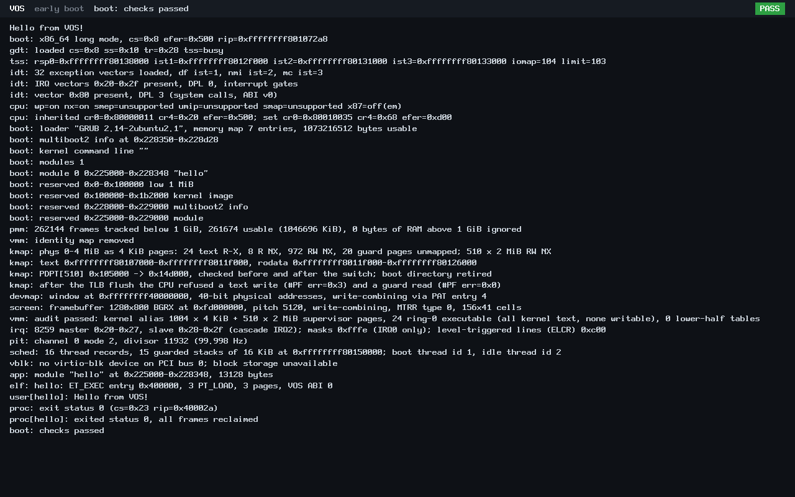

# VOS

**VOS (Veasna OS) is an open-source, AI-assisted, from-scratch operating-system project for x86 PCs.**

VOS is being developed with human architectural direction, review, and testing supported by AI coding assistance. The goal is to grow an independent kernel into a usable general-purpose operating system. It is currently **pre-alpha kernel research**, not a desktop OS or a production-ready release. See the [verified status](docs/STATUS.md) and [roadmap](docs/ROADMAP.md) before interpreting capability claims.

VOS is written primarily in freestanding C and x86 assembly. It is **not a Linux distribution**, and it does not rely on Linux, a host operating system, or a hosted C library at runtime. GRUB currently loads the kernel through Multiboot2 on x86-64. A small legacy i386 build remains available.

**Status: pre-alpha kernel research.** VOS is not an installable or everyday-use operating system. The documented checkpoint has been tested in **QEMU with SeaBIOS and OVMF**, not verified as a functioning physical-machine installation. N4 development now includes an opt-in PS/2 console and a native Rust `vsh` shell running in ring 3. A native graphical desktop, mouse input, writable storage and network stack remain future work.

### What works today

- A 64-bit higher-half kernel with memory isolation, W^X mappings, and protected stacks.
- Separately built ELF user programs running in ring 3, system calls, kernel threads, timer preemption, and IPC channels.
- Read-only virtio-blk access, block caching, an ext2 reader, and a completed
  [userspace file ABI v2](docs/abi/syscall-v2.md). File access uses bounded,
  process-owned handles and trusted non-root namespace grants; normal programs
  receive no filesystem access automatically.
- A basic framebuffer boot/status/panic console where supported, plus serial diagnostics.
- An opt-in keyboard console with US ASCII, Shift/Caps Lock, Backspace, completed
  line delivery on Enter and bounded command buffering
  ([buffered input result](docs/results/n4-buffered-input.md)).
- Native Rust `vsh`: `help`, `clear`, `echo`, `pwd`, `ls`, `cd`, `cat` and `exit`.
  Filesystem commands use real read-only ABI v2 handles under an explicit grant
  ([first shell results and screenshots](docs/results/n4-native-vsh.md)).
  Its [dynamic prompt](docs/results/n4-dynamic-prompt.md) reflects the normalized
  working directory, for example `VOS>docs>results>`.
- A minimal shared Rust SDK, reusable entry/runtime conventions and an independent
  native example ([application guide](docs/rust-apps.md)).
- [Rixie Core v0](docs/rixie-core.md): an independent Rust ring-3 text application
  with greetings, command explanations and predefined answers. It is a
  deterministic offline prototype, not a conversational AI model.
- An opt-in [modern virtio-net adapter](docs/networking.md): bounded raw Ethernet
  send/receive with private DMA buffers and no automatic application network access.
- BIOS and UEFI boot paths **in QEMU** via GRUB; extensive emulator-based regression tests.

**N0–N3 are complete.** N3 storage closure was accepted on 2026-10-24 and is
published at `897312f` and integrated into GitHub main by PR #2 (`d9a4ade`).
Local `main` and the `feat/n4-interactive-console` development branch have been
fast-forwarded to that merge, whose source tree is identical to the N3 baseline.
The [N3 closure record](docs/results/n3-closure.md) contains D1a–D1f,
5/5 mutation controls, 15/15 larger-RAM stress runs, evidence hashes and preserved
failure history. **N4 is complete and integrated into main** at `bbca69d`,
including the Rust SDK, dynamic shell prompt and offline Rixie Core v0.
Keyboard input (`3a2b642`), buffered input (`87b99df`), native Rust shell
(`1beb406`), reusable SDK (`f7ac434`) and normalized cwd prompt (`bdde1bc`) all
have focused verification and authentic screenshots. The subsequent
[Rixie prototype](docs/results/n4-rixie-core.md) also passes host and BIOS/UEFI
checks. The [N4 record](docs/results/n4-closure.md) preserves its pre-merge checkpoint.
**N5 is in progress** on `feat/n5-networking`: its [first adapter increment](docs/results/n5-first-network.md)
passes focused host and BIOS/UEFI frame checks. ARP, IPv4, ICMP and explicit
userspace network capabilities are subsequent work. Rixie Connected has not begun.

An authentic, unchanged QEMU capture from accepted D1 evidence: the kernel boots,
runs ring-3 hello, reclaims its frames and reports PASS. This console has no input
prompt yet. [UEFI and deliberate-panic screenshots](docs/results/n3-closure.md#authentic-screenshots)
include provenance and explain exactly what they demonstrate.

The separate [Veasna OS](https://github.com/veasnawt/veasna-os) React/Electron desktop prototype is **not** a graphical environment running on this kernel.

**Start here:** [Current status](docs/STATUS.md) · [Roadmap](docs/ROADMAP.md) · [Development handoff](docs/HANDOFF.md) · [Contribution guide](CONTRIBUTING.md) · [Security policy](SECURITY.md).

### Quick start (BIOS / QEMU)

On Ubuntu, Debian, or WSL2, install the toolchain and emulator prerequisites listed below and in [docs/HANDOFF.md](docs/HANDOFF.md), then run:

~~~sh
make iso
make run
~~~

For an automated check, run `make test-all`. A UEFI ISO and additional OVMF tests are available using `make uefi-iso` and `make test-uefi` after installing the additional UEFI build/test tools. VOS is intended for **emulation first**; do not flash experimental images onto a disk holding important data.

To try the first N4 keyboard console, run `make input-run` and type into the QEMU
display window. It builds into `build/n4-input/`, boots the usual ring-3 hello,
then starts a buffered `input> ` prompt. Enter submits a complete line to a demo
consumer, which displays `submitted: ...`; no command is executed yet.
`make input-uefi-iso` builds its OVMF
variant using the existing EFI tool prerequisites. Normal `make run` still uses
the original boot-and-halt configuration. See the [result and screenshots](docs/results/n4-buffered-input.md).

For the native shell, use `make vsh-run RUSTC=/path/to/rustc` with an installed
`x86_64-unknown-none` Rust target. `help`, `clear` and `echo` need no disk.
An optional `VSH_DISK=/path/to/trusted-ext2.img` attaches a read-only volume whose
`shell` directory becomes the explicitly granted namespace for file commands.
See [native shell setup and limitations](docs/results/n4-native-vsh.md).

For another native Rust application, create `user/<name>/main.rs` using
`vos::entry!(run)`, then build with
`make rust-app RUST_APP=<name> RUSTC=/path/to/rustc`. The independent example runs
with `make rust-demo-run RUSTC=/path/to/rustc`. See the
[SDK guide](docs/rust-apps.md) and [foundation results](docs/results/n4-rust-foundations.md).

For Rixie, use `make rixie-run RUSTC=/path/to/rustc`, then type `hello`, `help`,
`explain cd` or `are you AI?`. This is its own boot configuration; `vsh` does not
launch external applications. See the [Rixie guide](docs/rixie-core.md).

## What happens when x86_64 VOS boots

1. GRUB loads the kernel (`vos.bin`) and the program `hello.elf` as a boot module.
2. The kernel switches to 64-bit mode, sets up its own memory management and CPU protections,
   and checks the boot information. It then maps itself W^X: only its code is executable, its
   code and constants are read-only, and its stacks have unmapped guard pages below them.
   It sets up the interrupt controller and the timer (100 Hz); interrupts stay off inside the
   kernel and are on while the program runs.
3. It validates `hello.elf`, copies it into a fresh, isolated user address space and runs it in
   ring 3 (user mode).
4. `hello` prints through the kernel's `debug_write` system call and exits with status 0.
5. The kernel takes back every page the program used, reports the result, and halts.

## Requirements

gcc (with `gcc-multilib`), binutils, make, grub-mkrescue (+ grub-pc-bin), xorriso,
qemu-system-i386 and qemu-system-x86_64. The host gcc builds both kernels and the user
programs, with flags that keep them freestanding. Full tests also require Python 3
and e2fsprogs; see [HANDOFF](docs/HANDOFF.md) for the additional UEFI tools and
the current mutation runner's host restriction.

## Architectures

Select the target with `ARCH=<name>`; the default is `x86_64` (since N2). The 32-bit `i386`
kernel is kept, still built and tested with `ARCH=i386`.

| ARCH | Boot protocol | Status |
|---|---|---|
| `i386` | Multiboot 1 | 32-bit protected mode; prints a greeting and halts (legacy, `ARCH=i386`) |
| `x86_64` | Multiboot2 | 64-bit higher-half kernel with memory management, ring-3 programs and system calls (default) |

## Build

    make                          # x86_64 kernel: build/x86_64/vos.bin (same as ARCH=x86_64)
    make ARCH=i386                # legacy i386 kernel: build/i386/vos.bin
    make ARCH=x86_64 user         # the native program: build/x86_64/user/hello.elf
    make ARCH=x86_64 user-check   # validate hello.elf against the VOS executable profile
    make ARCH=x86_64 iso          # bootable image with kernel and hello: build/x86_64/vos.iso
    make clean                    # remove build/ (all architectures)

`hello.elf` is built from `user/hello/hello.c` with the VOS runtime in `user/lib/`, completely
separately from the kernel. `user-check` runs `scripts/check-user-elf.sh`, which reads the ELF
headers directly and prints, for example:

    check-user-elf: build/x86_64/user/hello.elf: OK (3 PT_LOAD, entry 0x400000, 3 pages, VOS ABI 0)

## Boot VOS in QEMU

All program output goes to the serial port. To see it in your terminal (the kernel halts at the
end, so `timeout` stops QEMU after a few seconds):

    make ARCH=x86_64 iso
    timeout 10 qemu-system-x86_64 -cdrom build/x86_64/vos.iso -display none -serial stdio -no-reboot

The last lines should be:

    app: module "hello" at 0x1c5000-0x1c8348, 13128 bytes
    elf: hello: ET_EXEC entry 0x400000, 3 PT_LOAD, 3 pages, VOS ABI 0
    user[hello]: Hello from VOS!
    proc: exit status 0 (cs=0x23 rip=0x40002a)
    proc[hello]: exited status 0, all frames reclaimed
    boot: checks passed

(Addresses can differ.) When `timeout` stops QEMU it prints
`qemu-system-x86_64: terminating on signal 15 ... (timeout)` and exits with status 124; that
is expected, because the kernel halts instead of powering off. How to read the lines:

- `user[hello]: Hello from VOS!` was written by the program itself. The kernel adds the
  `user[hello]:` prefix to every line a program prints, so programs cannot imitate kernel
  messages.
- `cs=0x23` shows the program ran in ring 3; `rip=0x40002a` is the instruction right after its
  `exit` system call.
- `proc[hello]: exited status 0, all frames reclaimed` is the kernel's own report: the program
  exited with status 0 and every page it used was returned.

`make ARCH=x86_64 run` boots the same image in a QEMU window, which can show the
framebuffer boot diagnostics and status display; the user program's detailed output is on the serial port.
`make ARCH=x86_64 debug` starts the same image halted, waiting for a debugger on TCP port 1234
(GDB is not part of the requirements; see `docs/plans/n2-foundation.md`, section 8).

## Tests

    make test                  # the default architecture (x86_64, a few minutes)
    make ARCH=i386 test        # the legacy i386 kernel
    make test-all              # every architecture
    make ARCH=x86_64 user-test # only the static ELF tests (no QEMU)

Every QEMU run is headless, sequential and has a timeout. The x86_64 tests include:

- smoke tests of the production images (`scripts/test.sh`), which must show the lines above;
- test images built with `VOS_TEST=1`, which report pass (exit status 33) or an expected
  failure (35) through QEMU's `isa-debug-exit` device (`scripts/exit-test.sh`); a test passes
  only with the right exit status **and** the expected kernel messages;
- kernel self-tests (boot information, memory managers, page tables, the W^X kernel map and its
  checker, user mode, ELF loading);
- deliberate kernel faults, which must panic with the expected diagnostics;
- stress tests (since N2.5): mixed concurrent workloads of the programs above with kills,
  faults, full tables and recovery, while the kernel audits its scheduler, process and channel
  state;
- IPC tests (since N2.4): separately built programs exchanging messages over channels in
  scenarios set up by the test configuration (ordering, full queues, closing, killed receivers,
  rights, ABI v0 compatibility);
- multi-process tests (since N2.3): separately built programs running at the same time —
  memory isolation, fair sharing, endless loops beside normal programs, faults, limits;
- kernel-thread tests (since N2.2): threads alternating, registers and stacks surviving switches,
  blocking and waking, thread exit and stack reclamation, the idle thread taking timer interrupts,
  and failure cases (thread stack overflow, deadlock);
- timer-interrupt tests (since N2.1): separately built programs that loop forever, check their
  registers or try to switch interrupts off, run while the timer interrupts them; a test-only
  tick budget in the kernel ends them;
- kernel memory-protection cases (since N2.0): the kernel writing its own code or constants,
  executing data or a free page (through a 2 MiB alias page and, since N3.0, through the 4 KiB
  pages above the image), reading a stack guard page, overflowing its stack, and NMI and
  machine-check entry (one NMI injected through the QEMU monitor); `scripts/check-fault.sh`
  compares the CPU-reported fault with what each case expected;
- N3.6 deterministic storage stress: accounting and ownership checks, concurrent
  readers and IPC, lifecycle/kill/publication schedules, work-budget exhaustion,
  and directory enumeration under the existing bounds; see the [closure record](docs/results/n3-closure.md);
- an isolation suite of 41 small programs that try forbidden things (write kernel memory,
  execute data, run privileged instructions, pass bad pointers, ...) and must each end exactly
  as their test configuration says, with `hello` run again after each one; it runs with 128 MiB,
  2 GiB and `-cpu max` (SMEP, SMAP, UMIP);
- static tests of the executable format, including about 60 deliberately corrupted files;
- virtio-blk tests (since N3.1): a generated read-only test disk (`build/vblk/disk.img`) is
  attached through QEMU's `virtio-blk-pci` and also delivered by GRUB as a module. Every
  sector read through the driver must equal that independent copy. The tests also cover
  range, buffer and queue limits, injected device errors (QEMU `blkdebug`), timeouts with
  reset and recovery, forged completions, modern and transitional devices, devices the driver
  must refuse, and reads beside running programs. The disk's SHA-256 is checked after every
  run;
- block-layer tests (since N3.2): a test-only RAM device in every image, and the virtio-blk
  disk in the disk images. They cover the device registry, request validation, the read-only
  cache (counted hits, misses and evictions, LRU, exhaustion, failed loads, invalidation after
  resets, corruption detection), concurrent readers, and shutdown and reinitialization with
  frame accounting;
- ext2 tests (since N3.3): six deterministic ext2 images built with `mke2fs -d`
  (`scripts/mkext2fixtures.sh`; 1, 2 and 4 KiB blocks, htree directories, no features, empty).
  Every file, directory and link is compared with a manifest written on the host from the
  source tree (SHA-256 per file). The tests also cover path errors, 46 corrupted or failing
  images refused for the intended reason, device reset and removal, concurrent readers, and
  the 1 KiB image read through virtio-blk beside running programs.

## Layout

- `Makefile` – shared build; includes `arch/<ARCH>/arch.mk` and, for x86_64, `user/user.mk`
- `arch/i386/` – the 32-bit kernel
- `arch/x86_64/` – the 64-bit kernel: boot (`boot.S`), CPU and interrupts (`cpu.c`, `gdt.c`,
  `idt.c`, `entry.S`, `exception.c`, `irq.c`, `pic.c`, `pit.c`), kernel threads (`thread.c`,
  `thread_switch.S`), memory (`pmm.c`, `vmm.c`, `kmap.c`, `resv.c`, `bootinfo.c`),
  processes and system calls (`process.c`, `usermode.S`, `syscall.c`, `usercopy.c`), executables
  (`elf.c`, `loader.c`, `app.c`), and `selftest*.c` for test builds
- `user/` – user space: `include/vos/syscall.h`, `lib/` (runtime, ABI note, linker script),
  `hello/`, `suite/` (isolation-test programs), `tests/` (fixtures)
- `tests/x86_64/` – GRUB configurations for special test images
- `scripts/` – test harnesses and ELF tools

The `m1-32bit` tag marks the original known-good 32-bit baseline.

## Documentation

- `docs/abi/syscall-v0.md` – the experimental application ABI: entry state, system calls,
  memory protection, executable format
- `docs/abi/syscall-v1.md` – ABI v1 (N2.4): yield and message channels between processes
- [ABI v2](docs/abi/syscall-v2.md) – N3.5: handle-relative open/read, metadata,
  directory enumeration, initial grant discovery and handle close
- `docs/plans/n1-user-space.md` – the completed N1 milestone: design, stages and verified results
- `docs/architecture/native-software-platform.md` – the long-term native software architecture
  (proposal), with the current state and security boundaries in its section 3
- `docs/plans/n2-foundation.md` – the N2 roadmap; N2.0 (kernel W^X, protected stacks), N2.1
  (interrupt controller, timer), N2.2 (kernel threads, scheduler), N2.3 (several processes,
  timer preemption), N2.4 (channels, ABI v1) and N2.5 (stress, audits, closure) are done: N2
  is complete; its closure (section 3.7) lists guarantees, limits and risks
- [N3 storage plan](docs/plans/n3-storage.md) – N3.0–N3.6 are complete; the
  [final closure record](docs/results/n3-closure.md) consolidates regression,
  integrated stress, mutation, footprint, reproducibility and archive evidence
- `docs/architecture/storage.md` – the storage architecture proposal: layers, virtio-blk, ext2
  (read-only first), layout, naming, permissions, crash behaviour, open decisions
- `docs/vision/product-direction.md` – provisional long-term product direction (not a specification)

## Community, license, and support

VOS is licensed under the [GNU General Public License version 3 only](LICENSE)
(§GPL-3.0-only§). You can study and contribute to the project under that license's terms.
See [CONTRIBUTING.md](CONTRIBUTING.md) for contribution expectations and attribution,
[CODE_OF_CONDUCT.md](CODE_OF_CONDUCT.md) for community guidelines, and
[SECURITY.md](SECURITY.md) for private security reporting.

This is an experimental research kernel. **No warranty or production security guarantees**
are provided. The [status report](docs/STATUS.md) is the source of truth for tested
capabilities and unsupported hardware. Please do not mistake a checkpoint tag for
an end-user operating-system release.

## History

VOS was developed under the working name MyOS until 2026-10-17. Commits up
to `5fd25cc` (including the `m1-32bit` tag) use the old name, for example in
boot messages, artifact names (`myos.bin`, `myos.iso`) and the `MYOS_TEST`
build variable, which is now `VOS_TEST`.
