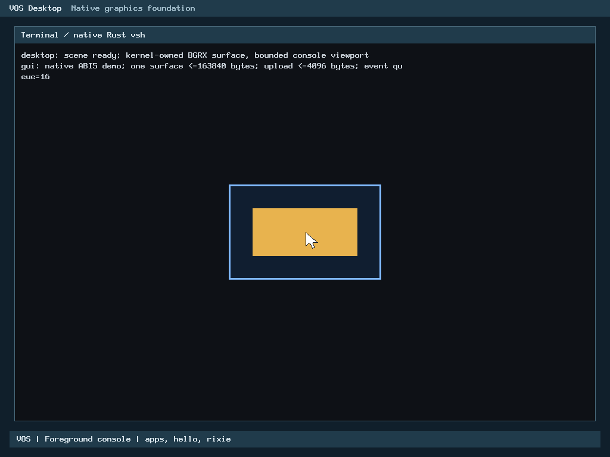

# VOS

**VOS (Veasna OS) is an independent, open-source operating system for x86_64 PCs.**
It is built from scratch with human architectural direction and review, supported
by AI coding assistance. The long-term target is native physical hardware.
QEMU is the current development and verification platform.

VOS is **pre-alpha**. N0-N5 are accepted within their documented scopes.
N6 remains in progress: framebuffer graphics, bounded native GUI surfaces/events
and PS/2 pointer input are accepted components, not a complete desktop.
No physical-machine installation or production-security claim is made.

[](LICENSE)

## Architecture and implemented capabilities

The kernel is primarily freestanding C and x86 assembly; the first
[Rust kernel integration](docs/results/r0b-rust-kernel-foundation.md) is merged
through PR #20. The first [real bounds-helper migration](docs/results/r1-performance.md)
is merged through PR #21. Rust is the first-class native
application language. VOS is not a Linux distribution and
does not use Linux or a hosted C library inside the guest. GRUB supplies a
Multiboot2 handoff through BIOS or UEFI; a legacy i386 baseline is also retained.

- Higher-half kernel, protected memory/stacks, timer-preempted isolated ring-3
  processes, kernel threads and bounded IPC.
- Read-only virtio-blk, block caching and ext2, with process-owned file handles
  and explicit namespace grants. [N3 closure](docs/results/n3-closure.md).
- Native Rust `vsh`: bounded editable input, normalized-directory prompt,
  `help`, `clear`, `echo`, `pwd`, `ls`, `cd`, `cat` and `exit`.
  A shared [Rust SDK](docs/rust-apps.md) supports separate native ELF programs.
- Common application payload, trusted catalog and ABI v4 execution broker:
  `apps`, `hello` and interactive `rixie` work from the shell with explicit
  authority, isolated child processes and exclusive console handoff/restoration.
  This is not arbitrary executable or package launching.
  [Application architecture](docs/applications.md) and
  [handoff verification](docs/results/app-handoff.md).
- [Rixie Core v0](docs/rixie-core.md) is an offline deterministic Rust prototype
  with predefined responses, not a conversational AI model.
- Bounded kernel-controlled virtio-net, Ethernet/ARP, IPv4/ICMP, UDP and passive
  TCP payload/retransmission/closure. No application network authority is granted
  automatically. [Accepted N5 scope and limits](docs/networking.md).
- Opt-in, read-only PCI bus-0 xHCI discovery and capability diagnostics are
  merged through PR #22. USB.2-A's portable Rust controller model is merged
  through PR #23; it enables no live controller operations. The
  [USB.1 Rust migration review](docs/results/usb1-rust-publication-review.md)
  covers production discovery decisions, shared validation, measured costs and
  firmware evidence; migration is accepted through PR #24.
  [USB.2-B resource ownership](docs/results/usb2b-resource-ownership.md) is
  merged through PR #25: real mapping/PMM rollback and worker fixtures, with no
  live xHCI backend or DMA qualification. There is no USB device
  enumeration or USB keyboard/mouse support.
  [Original integration evidence and preview](docs/results/usb1-rust-integration.md).

Existing ABI v0-v3 behavior is preserved by the additive ABI v4 launch and ABI v5
GUI interfaces. Capability boundaries, input validation, fixed resource limits
and cleanup are part of the design; they do not establish production security.

## Accepted graphical components

| Component | Implemented scope | Verification record |
| --- | --- | --- |
| N6.1 framebuffer graphics | Validated framebuffer, deterministic scene, one system bar and bounded console viewport | [First slice](docs/results/n6-desktop.md) |
| N6.2 native GUI surfaces/events | One process-owned surface, copied pixel uploads, bounded event queue, keyboard input and bootstrap cleanup | [GUI foundation and hardening](docs/results/n6-gui.md) |
| N6.3 pointer input | i8042 PS/2 relative motion, primary-button events, explicit pointer authority and clipped software cursor | [Pointer foundation](docs/results/n6-pointer.md) |
| N6.3 cursor refinement | 21x28 white arrow on a 32x32 canvas, exact tip hotspot, fixed 4 KiB underlay | [Refinement and owner preview](docs/results/n6-cursor-refinement.md) |

The accepted baseline includes the owner's merged
[PR #15](https://github.com/veasnawt/vos/pull/15) at
[`bf5eb43f2e07478e31be8b4123c5a297add67efe`](https://github.com/veasnawt/vos/commit/bf5eb43f2e07478e31be8b4123c5a297add67efe).
The owner completed the manual QEMU cursor checklist successfully.



This is actual QEMU output from the native Rust pointer demo. It demonstrates a
click-responsive application panel and the enlarged cursor. The
[UEFI capture](docs/images/n6/vos-cursor-refined-uefi.png) and
[verification index](docs/results/n6-cursor-refinement/evidence.json) provide
the corresponding firmware and provenance records.

There is no full window manager, movable/resizable application window system,
graphical **Terminal** application, dock or integrated VOS Display/VICons assets.
A console panel drawn by the kernel is not the planned graphical Terminal.

## Build and preview

Development hosts need GCC/binutils, make, GRUB BIOS/EFI image tools, xorriso and
QEMU; Python 3, e2fsprogs, mtools and OVMF support the relevant checks and images.
The x86_64 kernel and native Rust applications require rustc and the
`x86_64-unknown-none` target. R0-B verifies `nightly-2026-09-03`; select its compiler
with `RUSTC=/path/to/rustc`. See the [kernel reproduction instructions](docs/results/r0b-rust-kernel-foundation.md#reproduction-and-ordinary-preview)
and [SDK build guide](docs/rust-apps.md). The legacy i386 build remains C/assembly.

```sh
make ARCH=x86_64 verify
make ARCH=x86_64 iso
make ARCH=x86_64 run
# With the EFI build prerequisites and OVMF installed:
make ARCH=x86_64 uefi-iso
```

These default targets build the diagnostic hello boot configuration, not the
interactive pointer session. For the accepted graphical preview, use the
[verified BIOS/UEFI launch commands](docs/results/n6-cursor-refinement.md#normal-interactive-preview).
They reference retained local acceptance media and a read-only disk fixture;
those generated files are not included in a fresh source checkout. The same
report identifies the build inputs and guarded reproduction workflow.

In the graphical preview, move and click normally; press `a`/`b` to change
the demo palette and `q` to restore vsh. Then try `apps`, `hello` and
`rixie` (type `exit` to return). Manual use requires no timed stress inputs.
For standalone shell and Rust application builds, see
[the shell record](docs/results/n4-native-vsh.md) and [Rust applications](docs/rust-apps.md).

Use focused checks appropriate to a change. Build smoke and full-history secret
audit run in GitHub CI. Historical sanitizer, native runtime, PCAP, mutation and
storage results remain in their linked reports; they are not all rerun for a
documentation update. Existing storage admission and preservation rules still
apply to local builds. Do not run broad cleanup over protected evidence.

## Status, plans and limitations

[STATUS](docs/STATUS.md) records accepted capabilities, evidence and limitations.
[ROADMAP](docs/ROADMAP.md) preserves the accepted milestone sequence and separates
future design from approved execution.

Current limits include QEMU-only BIOS/OVMF validation, RAM tracked below 1 GiB,
read-only trusted media, bounded single-endpoint networking, polling limitations
and standard PS/2 keyboard/primary-button mouse input. USB input, production
networking, writable storage, installation and Secure Boot are not implemented.
The [R2-B Rust PS/2 pointer decoder](docs/results/r2b-ps2-pointer-rust.md) is
merged through PR #26; it does not add USB input or fix physical
USB-keyboard/mouse PCs.
[USB.2-C1 read-only xHCI qualification](docs/results/usb2c1-qualification.md) is
merged through PR #27 and the
[USB.2-C2 DMA ownership foundation](docs/results/usb2c2-dma.md) through PR #28,
and the [USB.2-C3a firmware residue guard](docs/results/usb2c3a-residue.md) through
PR #29, and the
[USB.2-C3a.2 early UEFI firmware memory exclusion](docs/results/usb2c3a2-efi-exclusion.md)
through PR #30: on UEFI, EFI boot-services and other non-RAM memory never becomes
allocatable, from before the first PMM allocation. The
[USB.2-C3a.3 protected firmware DMA inspection](docs/results/usb2c3a3-protected-inspection.md)
is merged through PR #31: the guard reads that excluded firmware memory in
place, read-only and bounded, again without device writes. The
[USB.2-C3b.1 containment dry-run](docs/results/usb2c3b1-containment-dry-run.md)
is merged through PR #32: opt-in `vos.usb2-contain=1` rehearses the
bus-master-off and controller-reset sequence for the strict idle UEFI QEMU
profile and lists the proposed writes as data, with no write path. The
[USB.2-C3b.2 controlled containment](docs/results/usb2c3b2-controlled-containment.md)
is merged through PR #33 at `03e7532aba739c636438c887e8aa9d6169f4cfcb`: only a separately built, explicitly
QEMU-only test image (production and physical-PC images contain none of it)
can, behind a one-shot `vos.usb2-contain-execute=1`, make exactly two writes to
the one eligible idle UEFI QEMU xHCI (clear PCI Bus Master Enable, then request
HCRST), verify each, and never re-enable bus mastering. It establishes nothing
about physical xHCI hardware. This branch's
[USB.2-C4.1 hosted initialization protocol model](docs/results/usb2c41-hosted-init-model.md)
is a host-only Rust state machine for the future controller bring-up (typed
operations, register writes as model events, bus-master ordering, DMA ownership,
refusal and quarantine rules) with an independent oracle and mutation controls;
it is not linked into any kernel or ISO and touches no device. Further Rust
kernel migration and broader
hardware portability remain proposed tracks requiring separate authorization.

The separate [Veasna OS React/Electron prototype](https://github.com/veasnawt/veasna-os)
is not a graphical environment running on this kernel. Design mockups are not
implementation evidence.

## Community, license and history

VOS is licensed under [GPL-3.0-only](LICENSE). See
[CONTRIBUTING](CONTRIBUTING.md), [CODE_OF_CONDUCT](CODE_OF_CONDUCT.md) and
[SECURITY](SECURITY.md) for contribution expectations, community guidelines and
private security reporting. No warranty or production security guarantee is
provided. Checkpoint tags are not end-user releases.

VOS used the working name MyOS until 2026-10-17. The older
`m1-32bit` tag and pre-rename commits retain their original names and artifacts.
Detailed historical narratives remain in the existing
[N3](docs/results/n3-closure.md), [N4](docs/results/n4-closure.md),
[N5](docs/results/n5-tcp-close.md) and [application](docs/results/app-handoff.md)
records. Historical checkpoint wording is preserved there.

Every milestone publication reviews README, STATUS and ROADMAP together using
the [documentation publication checklist](docs/milestone-publication-checklist.md).
