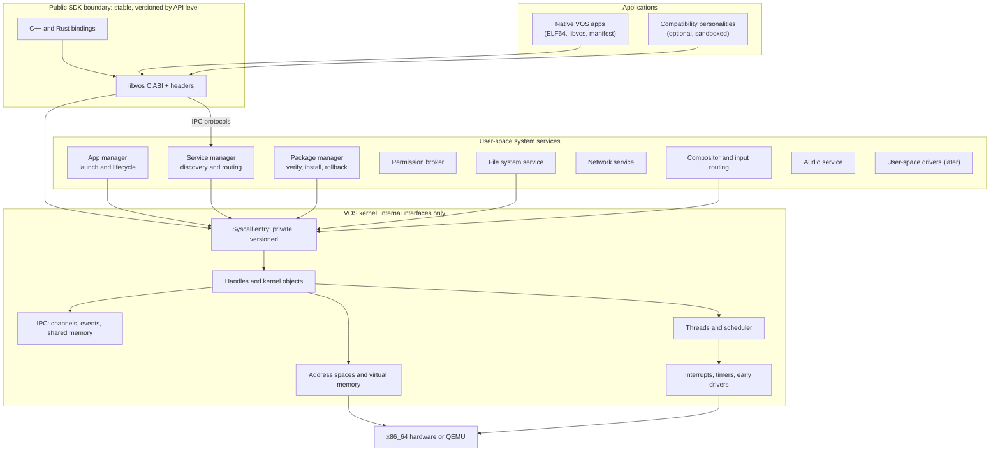
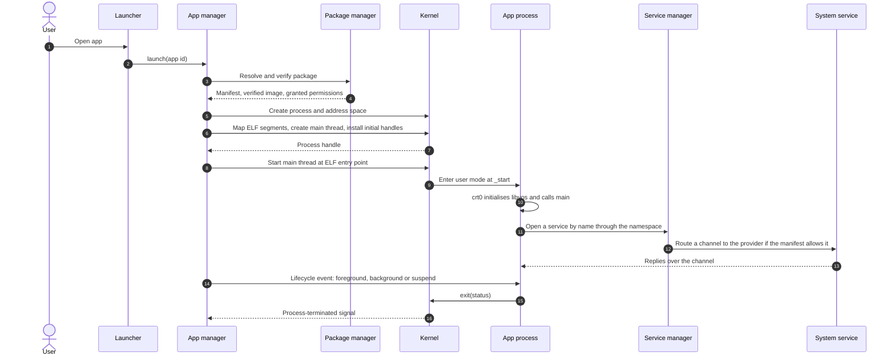
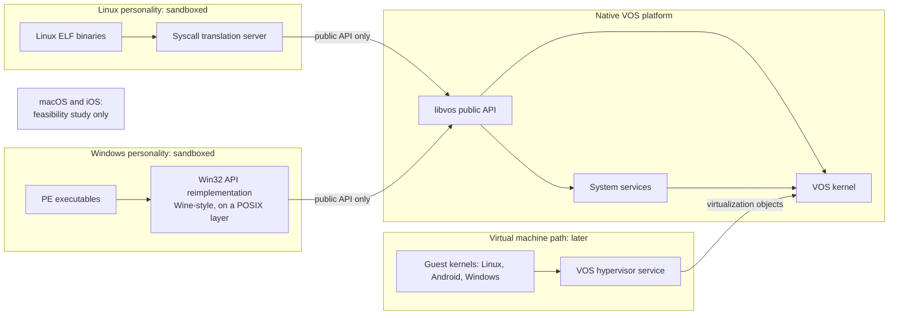

# VOS Native Software Platform — Architecture Proposal

| | |
|---|---|
| Status | **Proposal.** Section 3 describes what milestone N1 implemented (tagged *Current*); everything else remains a proposal unless marked *Current*. |
| Date | 2026-10-17 (written at `7c06bc6`; section 3 and the status notes updated after N1 at `74501a7`, after N2.0–N2.5, the end of N2, on 2026-10-18) |
| Code baseline | after N1: the x86_64 kernel runs a separately built native application in ring 3 |
| Scope | Native application model and public software interfaces of VOS, plus the separate compatibility architecture |
| Out of scope | Implementing any of it; kernel Stage 2/3 work; UEFI |

**How to read this document.** Statements are tagged:

- **[Fact]** — established, externally documented; carries a reference `[Rn]` (see [References](#20-references)).
- **[Current]** — observed in this repository or development environment on the date above.
- **[Proposal]** — a design recommendation for VOS; not yet approved.
- **[Open]** — an unresolved question; see also [Decisions requiring approval](#18-decisions-requiring-approval).

No performance numbers appear in this document because none have been measured.

---

## 1. Executive summary

VOS should be an independent operating system whose **public contract with applications is
its own SDK**, not Linux, Windows or POSIX. At the same time it should not reinvent
well-understood technology where reinvention adds cost without benefit. The main
recommendations:

1. **The stable public ABI is a VOS library (`libvos`), not the raw system-call table.**
   System-call numbers and kernel entry details stay private and versioned. This follows
   established practice: Fuchsia makes its vDSO the sole system-call interface and keeps the
   kernel/vDSO boundary private [R5]; Apple aims for binary compatibility at its dynamically
   linked system libraries and makes no guarantee at the kernel system-call interface [R10].
2. **Capabilities, not ambient authority.** Every resource is reached through a *handle* with
   explicit rights, obtained at launch or over IPC. Processes start with only what their
   manifest was granted. Precedents: Zircon handles [R6], Capsicum [R12], seL4 [R13], WASI [R14].
3. **ELF64 (x86-64 psABI) as the executable format**, identified as VOS by an ABI note,
   instead of a custom format. A custom format would cost toolchain, debugger and loader work
   and buy no independence that the SDK and package format do not already provide.
4. **Kernel provides mechanisms, user space provides policy.** The kernel offers threads,
   address spaces, handles, IPC channels, events and shared memory; file systems, networking,
   compositing, audio, packaging and application management are user-space services. Early
   drivers may live in the kernel but behind interfaces that allow moving them out later.
5. **C ABI first, then C++ and Rust.** The SDK's canonical interface is C headers plus
   `libvos`; C++ and Rust bindings sit on top. Start with the host gcc in freestanding mode
   (works today) and introduce a dedicated `x86_64-vos` toolchain only when the ABI settles.
6. **Signed packages with TUF-style repository metadata**, per-app read-only install trees,
   platform API levels instead of a shared-library dependency graph, and transactional
   install with rollback.
7. **Compatibility is a separate, sandboxed layer** built only on the public native API (or on
   a future hypervisor). Linux, Windows and Android each need a different mechanism; none may
   leak into the native ABI. macOS/iOS is a feasibility study only.
8. **x86_64 is the target for all user-space work.** i386 remains the default build and the
   boot baseline until you decide otherwise.
9. **Incremental path:** eight kernel milestones lead from today's boot-only kernel to the first
   separately built, ring-3 VOS application (`hello`) loaded from an initial ramdisk and tested
   by the existing QEMU harness (section 17).

---

## 2. Goals, non-goals and constraints

**Goals**

- A native application model and SDK that belong to VOS and can stay stable across kernel changes.
- Least privilege by default for applications and system services.
- A path from today's code to user space in small, testable steps.
- Compatibility with other platforms as an optional, isolated layer.

**Non-goals (for now)**

- POSIX as the native API (a POSIX layer may exist as a convenience library on top of `libvos`).
- Binary compatibility with Linux or Windows *at the native ABI*.
- A custom executable format, custom compiler or custom debug-info format.
- UEFI, SMP, GPU acceleration and real-hardware support in the first milestones.

**Constraints [Current]**

| Constraint | Observation (2026-10-17) | Consequence |
|---|---|---|
| Host | Windows 10, WSL2 Ubuntu (kernel 6.18.40.1-microsoft-standard-WSL2), 8 GB physical RAM | — |
| Memory visible to WSL2 | `free`: 3.8 GiB total, ~3.0 GiB available; 4 vCPUs | Building LLVM/Clang locally is impractical; LLVM's own docs budget roughly 10–15 GB RAM per parallel link job [R37]. A GCC cross toolchain is the lighter option when one is needed. |
| Virtualization | `/dev/kvm` exists, but QEMU reports `Permission denied` and `/proc/cpuinfo` shows no `vmx`/`svm` | QEMU runs in TCG (software emulation). VM-based compatibility (section 14) cannot be developed or tested in this environment. |
| Installed tools | gcc 15.2, binutils, GRUB 2.14 (`i386-pc` only), xorriso, QEMU 10.2.1, OVMF, python3; **no** clang, gdb, nasm, rustc | Anything beyond gcc needs installation approval. |
| Policy | No new packages or dependencies without approval; i386 stays the default | All milestones below work with the current tools unless a decision says otherwise. |

---

## 3. Current state after N1 and N2 [Current]

Milestone N1 (`docs/plans/n1-user-space.md`, stages N1.0–N1.10) took the x86_64 kernel from
"boots and prints" to "loads and runs a separately built native program in ring 3, isolated
from the kernel". The exact application interface is in `docs/abi/syscall-v0.md`. Everything
from section 4 onward is still a proposal or future work unless tagged *Current*.

| Area | State in the repository |
|---|---|
| Targets | `ARCH=x86_64` (default since N2.0, Multiboot2, where all N1 and N2 work lives) and `ARCH=i386` (Multiboot 1, 32-bit, unchanged since N0) |
| Boot and CPU | GRUB loads the ELF64 kernel and modules; `boot.S` enters long mode and the higher half (`0xFFFFFFFF80000000`). The kernel enables CR0.WP, EFER.NXE (required), SMEP/SMAP/UMIP when present, and CR0.EM (no x87). |
| Segments and interrupts | Own GDT (kernel and user segments, 64-bit TSS with a 16 KiB ring-0 entry stack and IST stacks for #DF, NMI and #MC, each above an unmapped guard page; no I/O bitmap); 256-entry IDT: exception vectors 0–31 and IRQ vectors 0x20–0x2F (DPL 0) and `int $0x80` (DPL 3). Since N2.1: 8259 PIC remapped to 0x20–0x2F with only IRQ0 unmasked, PIT at 99.998 Hz; the kernel always runs with IF = 0, ring 3 with IF = 1. |
| Exceptions | Every exception is classified by the CPU-pushed CS: ring 0 → diagnostic and panic; ring 3 → the process is killed with the vector, error code and fault address recorded. |
| Physical memory | Bitmap allocator over frames in [1 MiB, 1 GiB); the Multiboot2 map is validated and "unusable wins"; kernel, boot structures, modules and low memory are reserved; frames are zeroed on allocation. RAM above 1 GiB is unused. |
| Virtual memory | 4-level page tables, 4 KiB user mappings with validated permissions, an audit of whole hierarchies; the boot identity map is removed. Since N2.0 the supervisor-only alias of physical 0–1 GiB is W^X: the kernel image in 4 KiB pages (text R-X, read-only data R, everything else RW NX, stack guard pages unmapped), the rest in 2 MiB RW NX pages (`kmap.c`; `docs/plans/n2-foundation.md` section 3.1). |
| Processes | Up to 8 at once (N2.3), each with a fresh PML4 sharing only the kernel entry, code/data/stack from fresh frames, and one thread of its own on a guarded kernel stack (TSS.RSP0 and CR3 switched per thread); entry via `iretq` with all registers zeroed; preempted by the timer only on the return to ring 3 (2-tick round robin); exit, fault or kill end only that process; full teardown after its thread is gone. Created by the kernel from GRUB modules only. |
| Kernel threads (N2.2) | 16 static thread records, 15 guarded 16 KiB stacks; round robin with yield, FIFO wait queues, tick sleeps and exit with deferred reaping; an idle thread that waits with `sti; hlt` (the only kernel code with IF = 1). Kernel code is never preempted. |
| System calls | ABI v0 over `int $0x80`: `exit`, `debug_write`; ABI v1 (N2.4, `docs/abi/syscall-v1.md`) adds `yield`, `channel_send`, `channel_recv`, `handle_close` for executables marked v1 (v0 executables get `-VOS_ENOSYS`); unknown numbers return `-VOS_ENOSYS`; all registers but `rax` preserved. |
| IPC (N2.4) | Channels between two processes, created only by trusted kernel code: 16 static channels, 16 × 256-byte message queues per direction in allocated frames, 8 handles per process with rights and generations; non-blocking send, blocking receive, drain then `EPIPE` after the peer closes; handles closed at process end. |
| User memory | `copy_from_user` validates every page (user bit at all levels) and copies through the kernel alias, never through the user address. |
| Executables | Static ELF64 `ET_EXEC` with a mandatory VOS ABI note; validated in the kernel before any allocation (and at build time by `scripts/check-user-elf.sh`). |
| User space | `user/`: a minimal runtime (`crt0.S`, system-call stubs, ABI note, linker script) and `hello`, built separately from the kernel; 41 isolation-test programs in `user/suite`. |
| Applications | GRUB delivers `hello.elf` as a module; the kernel validates, loads and runs it in ring 3 at boot: `user[hello]: Hello from VOS!`, then `proc[hello]: exited status 0, all frames reclaimed`. |
| Tests | `make test-all` (sequential QEMU runs with timeouts): smoke tests, strict `VOS_TEST=1` images reporting through `isa-debug-exit` (33 = pass, 35 = expected failure), kernel self-tests, deliberate kernel faults, the 41-case isolation suite under qemu64, 2 GiB and `-cpu max`, SMEP/SMAP cases with controls, and static ELF tests. |
| Not present | Preemption of kernel code, more than one thread per process, channel creation or handle transfer by programs, process spawning by programs, kernel heap, APIC/IOAPIC/ACPI, device interrupts other than the timer, file systems, drivers beyond COM1/VGA, input, graphics, networking, packages, a shell. |

### 3.1 Security boundaries after N1 and N2 [Current]

N2's closure (`docs/plans/n2-foundation.md`, section 3.7) lists what was demonstrated, the
limits, the known failure modes and the remaining risks; the summary below is consistent with it.
Since N2.5 every test image also runs scheduler, process and channel consistency audits, and a
stress image runs mixed concurrent workloads with kills, faults, exhaustion and recovery.

**Implemented and tested (in QEMU):**
- Ring-3 privilege separation: CS 0x23/SS 0x1B in every user frame; privileged instructions,
  port I/O and exception gates other than `0x80` raise `#GP` from ring 3.
- Supervisor-only kernel mappings: user reads and writes of kernel pages raise `#PF` with the
  U bit set; the kernel bytes stay unchanged.
- Page-level protections: code not writable; data, read-only data and stack not executable;
  never writable and executable; null and stack guard pages unmapped.
- Kernel W^X (N2.0): only kernel text is executable in ring 0 and it is not writable through any
  mapping; kernel writes to text and read-only data, and execution of data or of free frames
  through the alias, fault; the audit enforces this in every address space.
- Interrupts (N2.1): ring 3 cannot change IF or IOPL or raise IRQ vectors; every IRQ is checked
  against the controller's in-service register and acknowledged; the interrupted program resumes
  with every register intact; the kernel never runs with IF = 1.
- IPC (N2.4): a handle works only in the process that holds it and only with its rights; stale
  handles cannot reach a new channel; messages are copied through validated kernel aliases (no
  shared memory, no kernel pointers to user space, no partial writes on a bad buffer); a blocked
  receiver can be killed; a dead process's handles close and its peers see `EPIPE`.
- Concurrent processes (N2.3): separate address spaces with no shared user frame; a program that
  never yields is preempted; a fault or kill ends only its own process; every trap is validated
  on that process's own kernel stack and address space; all resources return at teardown.
- Kernel stacks (N2.0): guard pages below the boot, entry and IST stacks; a kernel stack
  overflow ends in #DF on IST1; NMI and #MC have their own IST stacks (NMI delivery tested
  with a QEMU-injected NMI).
- Fault handling: a ring-3 fault ends only that process; nothing after the faulting instruction
  runs; kernel faults panic.
- User-memory validation: invalid pointers, lengths and ranges are refused without the kernel
  touching user addresses.
- ELF rejection: malformed executables are rejected for a specific reason before any allocation.
- Resource cleanup: every frame and page table returns after exit, fault, rejection and
  allocation failure; no data survives into the next process; boot modules stay reserved.
- SMEP, SMAP and UMIP behave as expected under `-cpu max` (absent on the default `qemu64`).

**Not provided or not verified:**
- Real hardware (everything ran under QEMU TCG).
- Resource limits per process beyond the fixed tables (a program cannot exhaust kernel memory
  through the v0 system calls, but there are no quotas yet), and a kernel thread that never
  yields still keeps the CPU.
- FPU/SIMD context management (FP/SIMD is disabled instead).
- DMA/IOMMU protection.
- Side-channel mitigations (the kernel is mapped, supervisor-only, in every address space).
- Machine-check handling: CR4.MCE is off (a machine check shuts the machine down); only the
  `#MC` gate and stack are tested, with `int $18`. No nested-NMI handling.
- General-purpose drivers and system services.

None of this amounts to production-grade security; it is a tested foundation.

---

## 4. Architectural principles [Proposal]

| # | Principle | Rationale |
|---|---|---|
| P1 | **Public ABI = `libvos` + SDK headers; system calls are private.** | Lets the kernel evolve (renumber, merge, split calls) without breaking apps. Precedents: Fuchsia [R5]; Apple, which aims for compatibility at its libraries rather than at syscalls [R10]; contrast Linux, which treats the syscall interface as stable ABI [R11] and therefore must carry it forever. |
| P2 | **No ambient authority.** Access only through handles with rights. | Containment of compromised apps; explicit dependency graph. [R6][R12][R13][R14] |
| P3 | **Kernel mechanisms, user-space policy.** | Smaller kernel attack surface; services can crash and restart. |
| P4 | **Reuse established formats and tools** (ELF, DWARF, GCC/LLVM, GDB). | Independence comes from interfaces and policy, not file formats. |
| P5 | **Compatibility is layered on top, never underneath.** | Native ABI must not inherit Linux/Windows semantics or bugs. |
| P6 | **Everything testable in QEMU headless** with the existing `isa-debug-exit` harness. | Matches the working method of Stage 0/1. |
| P7 | **Incremental, never a rewrite.** Each milestone keeps `make test-all` green. | Lowers risk; keeps a known-good recovery point. |

### 4.1 Layered architecture

Diagrams in this document use Mermaid syntax [R48].



---

## 5. Architectural options comparison

Maintenance cost is a qualitative estimate for a very small team; risks are design risks, not measurements.

| Decision area | Option | Trade-offs | Main risks | Maintenance cost | Recommendation |
|---|---|---|---|---|---|
| Kernel structure | Monolithic (drivers, FS, network in kernel) | Simplest IPC; fastest to first features | Large attack surface; any driver bug crashes the system | Grows with every driver | — |
| | Microkernel from day one | Strong isolation; small trusted base | Much IPC and user-space infrastructure before anything works; DMA isolation needs an IOMMU | High up front | — |
| | **Hybrid, moving outward** | Early drivers in kernel behind a narrow driver interface; FS/network/compositor in user space from their first version | Discipline needed to keep interfaces narrow | Moderate | **[Proposal] chosen** |
| Public ABI boundary | Raw syscalls (Linux model) | No library needed | Every syscall becomes permanent ABI [R11] | Grows forever | — |
| | **`libvos` library (static first, shared later)** | Kernel free to change; one place for versioning | Static apps embed a libvos version, so syscalls must stay compatible within an API level | Moderate | **[Proposal] chosen** |
| | vDSO-only (Fuchsia model) [R5] | Strongest decoupling | Needs kernel-provided ELF image and loader support early | Moderate–high | Later evolution of `libvos` |
| Executable format | **ELF64 + VOS ABI note** | All toolchains, debuggers, binutils work [R1][R2] | Must define VOS-specific conventions clearly | Low | **[Proposal] chosen** |
| | PE/COFF [R3] | Well specified | Toolchain support on Linux hosts is weaker; implies Windows conventions | Moderate | No |
| | Custom format | Full control | Must write linker support, loader, objdump-like tools, debugger support | High | No |
| | WebAssembly as primary [R14] | Portable, sandboxed | Needs a runtime in the trusted base; not suited to system services yet | High | Optional runtime later |
| C library | Own minimal `libvos-c` | Exactly fits VOS | Large if it grows into full ISO C/POSIX | Grows | **Start here** (tiny) |
| | Port musl (MIT) [R31] | Mature, small | Built on the Linux system-call API [R31]; needs a syscall shim | Moderate | Evaluate for POSIX layer |
| | Port newlib [R32] | Designed for porting to new targets with a few low-level routines [R32] | Mixed licences; less POSIX coverage | Moderate | Evaluate |
| | relibc (Redox) [R33] | Rust, MIT-predominant | Ties C runtime to Rust toolchain | Moderate | Reference |
| Window protocol | **Own minimal protocol over VOS channels** | Fits handles and capabilities | Must design and maintain | Moderate | **[Proposal]** |
| | Wayland protocol as native | Mature model [R26] | Makes a Linux-ecosystem protocol an architectural dependency | Moderate | Bridge for compatibility only |
| Package dependencies | Shared-library dependency graph | Disk savings | "Dependency hell", hard rollback | High | No |
| | **API levels + bundled private libraries** | Predictable; easy rollback | Larger packages | Low–moderate | **[Proposal] chosen** |

---

## 6. Native application model

### 6.1 Concepts [Proposal]

| Concept | Definition |
|---|---|
| **Package** | Signed unit of installation (section 13). Contains one or more components, resources and a manifest. |
| **Component** | Something runnable: `app` (interactive, may own windows), `service` (long-running, no UI, started on demand), `tool` (command-line). |
| **Manifest** | Declarative metadata: identity, version, minimum API level, components, entry points, requested permissions, offered/used services. |
| **Instance** | A running component: one process (initially; multi-process apps later). |
| **Namespace** | The set of named handles a process receives at start (its data directory, granted services, a log sink). It replaces global paths and global service lookup. Precedent: Fuchsia builds each component's namespace from manifest declarations [R9]. |

### 6.2 Illustrative manifest [Proposal — format and field names are not decided]

```toml
# Hypothetical example; the manifest format (TOML, JSON or a binary form) is an open decision.
id          = "org.example.notes"
version     = "1.2.0"
api_level   = 1

[[component]]
name  = "main"
kind  = "app"
entry = "bin/notes"            # ELF64 executable inside the package

[permissions]
request = ["files.user_documents:read-write", "notifications.post"]

[services]
use   = ["vos.graphics.compositor", "vos.storage.files"]
offer = []
```

### 6.3 Lifecycle [Proposal]

States: `Installed → Starting → Running(Foreground | Background) → Suspended → Stopping → Terminated`.

- The **app manager** owns state transitions and sends lifecycle events over a channel the app receives at start.
- Apps acknowledge `suspend` within a deadline or are terminated; services declare a restart policy.
- Process creation is **spawn-style**: the app manager creates an empty process, maps the image, installs the initial handle table and starts the main thread. There is no `fork()` in the native API. A POSIX layer may emulate `fork` later if ever needed.

### 6.4 Native application execution flow



[Open] Whether the first versions run the ELF loader inside the app manager (user space) or
inside the kernel; section 7.4 recommends user space for everything except the first process.

---

## 7. Executable format and loader

### 7.1 Established options [Fact]

- **ELF.** The System V gABI defines the ELF header, including `e_ident[EI_OSABI]`, which
  "identifies the OS- or ABI-specific ELF extensions used by this file"; registered values
  include Linux and FreeBSD, and `ELFOSABI_NONE` (0) means "no extensions or unspecified" [R1].
  The x86-64 processor supplement (psABI) defines the calling convention and relocations; its
  LaTeX sources are hosted at the x86-psABIs GitLab project [R2].
- **OS identification by note section.** Linux binaries carry a `.note.ABI-tag` note (name
  `GNU`, type 1) whose descriptor identifies the OS and minimum kernel version [R4]. This is
  precedent for identifying an OS ABI without a registered `EI_OSABI` value.
- **PE/COFF** "describes the structure of executable (image) files and object files under
  the Windows family of operating systems" [R3].
- **DWARF** is a debugging information format "used by many compilers and debuggers"; version 5
  is the published standard [R40].
- [Current] The VOS kernel is already an ELF64 image built by GNU ld with explicit program headers.

### 7.2 Cost of a custom executable format [Proposal / analysis]

A custom format would require, at minimum: linker output support (or a post-link converter),
a loader, inspection tools (`readelf`/`objdump` equivalents), debugger support for symbols and
DWARF mapping, and documentation. None of it buys functionality ELF lacks. VOS-specific needs
(ABI version, required API level, permissions) belong in a **note section** and in the **package
manifest**, not in a new container. Recommendation: **no custom format**.

### 7.3 Proposed VOS ELF profile [Proposal]

| Item | Proposal |
|---|---|
| Class / machine | `ELFCLASS64`, `EM_X86_64`, little-endian, x86-64 psABI calling convention [R2] |
| OS identification | `EI_OSABI = ELFOSABI_NONE` [R1] plus a mandatory note `.note.vos.abi` (name `"VOS"`, type 1, descriptor: VOS ABI version, minimum API level). Loader rejects ELF files without it. |
| First milestone | Statically linked `ET_EXEC` at a fixed user address (simplest loader) |
| Later | `ET_DYN` position-independent executables with ASLR; shared `libvos.so` via a user-space dynamic loader |
| Segment rules | Reject writable+executable segments (W^X), overlapping or out-of-range segments, unaligned `p_offset`/`p_vaddr`, entry point outside an executable segment, sizes above limits |
| Debug info | DWARF [R40], stripped in packages, kept in separate debug files |

[Open] Whether to request an official `EI_OSABI` value later (requires the gABI maintainers'
process; not needed for the note-based approach).

[Current] N1 implemented the first-milestone row: static `ET_EXEC` at `0x400000`, segment rules
as above, plus the limits in `docs/abi/syscall-v0.md`. The note differs from this proposal: its
section is `.note.vos` and its descriptor holds only the ABI version (no minimum API level).

### 7.4 Loader placement [Proposal]

- **Kernel loader** only for the very first user process (`init`), from an initial ramdisk
  delivered as a Multiboot2 module. It parses a static `ET_EXEC` with the rules above.
- **All other processes** are loaded by the app manager in user space, using kernel primitives
  (create address space, map memory object with permissions, start thread). This keeps ELF
  parsing out of the kernel's steady-state attack surface.
- The loader is a prime fuzzing target (section 8.5; threat T1 in section 11.2).

[Current] In N1 the kernel loads only the boot application (`hello`), straight from a
Multiboot2 module; there is no initial ramdisk, `init` process or app manager yet. The loader
is covered by 69 corrupted-file tests and a host build compared with the build-time validator,
but it has not been fuzzed.

---

## 8. Language and toolchain strategy

### 8.1 Languages [Proposal]

| Layer | Language | Notes |
|---|---|---|
| Kernel | C (current) with small assembly | [Open] Whether to admit Rust into the kernel later. |
| `libvos`, crt0, SDK headers | C (C11) with a C ABI | The C ABI is the canonical public interface: every language can bind to it. |
| C++ apps | C++ on top of C headers | Needs a C++ runtime port later (libstdc++ or libc++); exceptions/RTTI policy is [Open]. |
| Rust apps | `no_std` + `alloc` first, `std` later | Rust custom target JSON is an unstable interface and needs a pinned compiler [R35]; new targets start at tier 3, where "Rust provides no guarantees" and `std` may be incomplete [R34]. Proposal: custom target first, upstream `x86_64-unknown-vos` tier-3 target once the ABI is stable. |
| System services | C first; Rust evaluated per service | Memory-safety benefits weighed against toolchain cost. |

### 8.2 Toolchain phases [Proposal]

| Phase | Toolchain | Status / requirement |
|---|---|---|
| T0 | Host gcc in freestanding mode, GNU ld, custom linker script and crt0 | **Works today** for the kernel [Current]; sufficient for the first user-space app (static, no libc). |
| T1 | `x86_64-elf` cross binutils + GCC | Needs approval. Avoids distribution-specific host-gcc defaults that the build currently overrides by hand (CET, stack-clash probes). Lighter to build than LLVM within 3.8 GiB. |
| T2 | OS-specific target `x86_64-vos` in GCC and/or LLVM, plus a sysroot | Only after the ABI stabilises. LLVM builds are memory-heavy [R37]; prefer prebuilt or CI-built toolchains. |

**Licensing note [Fact]:** GCC's runtime libraries carry the GCC Runtime Library Exception,
whose purpose "is to allow compilation of non-GPL (including proprietary) programs" to use
them [R38]. LLVM uses the "Apache 2.0 License with LLVM exceptions" [R36].

### 8.3 SDK layout [Proposal]

```
sdk/
  include/vos/        # public headers (generated from IDL later)
  lib/libvos.a        # static libvos (shared libvos.so later)
  lib/crt0.o          # process entry: sets up stack, calls vos_main / main
  lib/vos-app.ld      # default linker script for ET_EXEC user programs
  share/vos/api-level # API level this SDK targets
```

Versioning: **API levels** (integers). An app declares a minimum level; the system supports a
window of levels. Internal syscall numbers are never exposed in SDK headers.

### 8.4 Debugging [Fact + Proposal]

- [Fact] QEMU's gdbstub lets GDB pause the guest, inspect registers and memory and set
  breakpoints; `-s` listens on TCP port 1234 and `-S` holds the guest until GDB continues. The
  stub has no authentication [R39].
- [Current] GDB is not installed; installing it is a pending decision (it becomes valuable at
  exceptions and user-mode milestones).
- [Proposal] Serial logging stays the primary channel; a kernel panic path prints registers and
  a symbolised backtrace; user-space crash reports go to the app manager; later a debug
  service exposes process control through capabilities (no global `ptrace`).

### 8.5 Testing [Proposal]

- Extend the existing harness: user-space test programs run in QEMU and report through a test
  syscall that the kernel turns into an `isa-debug-exit` status (still only in `VOS_TEST=1` builds).
- Host-side unit tests (in WSL with host gcc) for pure, platform-independent code: manifest
  parsing, ELF validation, IPC message encoding.
- ABI conformance checks: compare SDK header layouts across commits.
- Fuzzing of the ELF loader and IPC decoders on the host once a fuzzer is approved (clang/libFuzzer is not installed).

---

## 9. Native system APIs

### 9.1 Stability tiers [Proposal]

| Tier | Contents | Promise |
|---|---|---|
| **Public-Stable** | `libvos` functions and types at a released API level | Backward compatible within the supported API-level window |
| **Public-Preview** | New APIs behind an explicit preview flag | May change between releases |
| **Internal** | Syscall numbers and calling details, kernel ↔ service protocols, service ↔ service protocols | No compatibility promise; versioned together |

### 9.2 Initial subsystem and API boundary table [Proposal]

Names are illustrative. "Kernel mechanism" is what the service uses internally; apps see only the public API column.

| Area | Public API (`libvos`) | Provided by | Kernel mechanism (internal) | First milestone |
|---|---|---|---|---|
| Process & lifecycle | `vos_process_*`, `vos_lifecycle_*` | App manager | process/thread objects, channels | N8 (exit only), N10 |
| Memory | `vos_mem_*` (allocate, map, protect) | libvos + kernel | memory objects, address-space mapping | N7 |
| Time | `vos_clock_*`, `vos_timer_*` | kernel | timer objects, events | N7 |
| Logging / debug | `vos_log_*` | kernel log (early), log service (later) | debug-write syscall (test builds), channel | N7 |
| IPC | `vos_channel_*`, `vos_event_*`, `vos_wait_*` | kernel | channels, events, ports | N9 |
| Services | `vos_service_open(name)` | Service manager | namespace handles, channels | N10 |
| Files | `vos_dir_open`, `vos_file_*` (handle-relative only) | File system service | channels, memory objects | after N10 |
| Storage | `vos_storage_*` (volumes, app data quota) | Storage service | block driver interface | after files |
| Networking | `vos_socket_*` style, handle-based | Network service | channels; NIC driver (virtio-net [R27]) | later |
| Graphics | `vos_surface_*`, `vos_window_*` | Compositor | shared memory, events; display driver | later |
| Input | events delivered to focused window | Compositor + input service | interrupts → events | later |
| Audio | `vos_audio_stream_*` | Audio service | shared memory rings; audio driver (e.g. virtio sound device [R27]) | later |
| Notifications | `vos_notify_post` | Notification service | channels | later |
| Permissions | `vos_permission_check/request` | Permission broker | channels | N11+ |
| Packages | `vos_pkg_*` (privileged) | Package manager | channels, storage | N11+ |

Design rules for every public API [Proposal]: handle-based; asynchronous-capable (wait on
handles/events); explicit error codes; no global paths or global names except through the
namespace; every call checks handle rights.

---

## 10. IPC, service discovery and failure isolation

### 10.1 Kernel IPC primitives [Fact precedent + Proposal]

[Fact] In Zircon, a handle references a kernel object together with rights and an owning
process; the same object can be held through different handles with different rights, and
handles move between processes by writing them into a channel [R6]. A channel is "a
bidirectional transport of messages consisting of some amount of byte data and some number of
handles" [R7]. A VMO "represents a contiguous region of virtual memory that may be mapped into
multiple address spaces" and is the standard way to share memory [R8].

[Proposal] VOS kernel objects, in order of introduction:

| Object | Purpose | Milestone |
|---|---|---|
| Process, thread | Execution, address space | N6–N8 |
| Memory object | Pages that can be mapped with rights (read/write/execute) | N7 |
| Channel | Message + handle transfer, peer-closed signal | N9 |
| Event / port | Signalling and waiting on multiple handles | N9 |
| Interrupt object | Delivers device interrupts to a (user-space) driver | after N10 |

### 10.2 Service discovery [Proposal]

- The app manager builds each process's **namespace** from its manifest (precedent: Fuchsia
  capability routing with `use`/`offer`/`expose` [R9]).
- `vos_service_open("vos.storage.files")` sends a request to the service manager over a
  pre-installed channel. The service manager checks the caller's granted capabilities and
  forwards one end of a new channel to the provider.
- No global service registry visible to apps; no listening on well-known names.

### 10.3 Failure isolation [Proposal]

- Every service runs in its own process. A crash closes its channels; clients observe
  *peer closed* and reconnect through the service manager.
- The service manager restarts services per policy (bounded retries, backoff) and records
  crash reports.
- Kernel-resident early drivers are the exception and are the motivation to move drivers out
  once interrupt objects and memory objects exist (DMA-capable drivers need an IOMMU for real
  isolation — [Open]).

### 10.4 Kernel / user-space boundary [Proposal]

| In the kernel | In user space |
|---|---|
| Scheduling, threads, address spaces, page tables | App manager, service manager, permission broker |
| Handles, rights checks, IPC objects | File systems, storage policy, package manager |
| Interrupt dispatch, timers | Network stack (candidates: lwIP [R45], smoltcp [R46]) |
| Early drivers: serial, timer, framebuffer pass-through | Compositor, input routing, audio mixer |
| Initial-ramdisk loader for `init` only | ELF loading for all other processes |

---

## 11. Security architecture

### 11.1 Model [Proposal, with precedents]

| Mechanism | Proposal | Precedent / basis |
|---|---|---|
| Process isolation | Separate address spaces; ring 3 for all apps and services; kernel validates every user pointer and length | x86-64 paging and privilege levels [R41] |
| Memory protections | NX/W^X for user and kernel mappings (the x86_64 kernel ELF already has no RWX segment [Current]); SMEP/SMAP when CPUID reports them; ASLR after PIE support | Intel SDM Vol. 3 [R41] (specific sections not quoted in this pass) |
| Capabilities | Handles with rights; rights can only be reduced when duplicating | Zircon [R6], Capsicum ("makes file descriptors into capabilities") [R12], seL4 ("any operation is authorised by a capability") [R13] |
| Sandboxing | Default deny: a process starts with its namespace only; no global file system root, no global process list | Capsicum capability mode restricts access to global namespaces [R12]; WASI modules start "with no ambient authority" [R14] |
| Privilege separation | Each service holds only the capabilities it needs; the package manager alone can write install trees; the permission broker alone records grants | — |
| Permissions | Declared in the manifest; low-risk granted at install; sensitive (microphone, camera, user documents outside app storage, location) granted at runtime by the user through the permission broker; revocable | — |
| Package signing | Every package signed; signature covers the manifest, which lists a hash of every file; repository metadata follows TUF roles | TUF resists compromised mirrors, key compromise below a threshold, rollback, freeze and mix-and-match attacks [R29] |
| Boot integrity | Deferred with UEFI (measured/secure boot later) | — |

[Open] Signature algorithm and key management (e.g. Ed25519), and whether developer-signed
packages may be side-loaded.

### 11.2 Security threat and risk register

Likelihood and impact are qualitative judgements for planning, not measurements.

| ID | Threat / risk | Impact | Likelihood | Mitigation (proposed) | Milestone |
|---|---|---|---|---|---|
| T1 | Malformed ELF exploits the loader | Kernel or app-manager compromise | High once apps are installable | Strict validation rules (7.3), kernel loads only `init`, fuzzing | N6, N10 |
| T2 | Bad syscall argument or user pointer | Kernel memory corruption | High | Central copy-in/copy-out helpers, rights checks, fuzzing of syscall decoder | N7 |
| T3 | Handle leaks or rights escalation | Privilege escalation | Medium | Rights only shrink on duplicate; per-process handle tables; tests for each object type | N7–N9 |
| T4 | Compromised app reads other apps' data | Data theft | Medium | No global FS root; per-app storage handles; permission broker | after N10 |
| T5 | Input snooping / injection | Credential theft | Medium | Compositor alone owns input devices; events only to the focused surface | graphics milestones |
| T6 | Tampered package or repository mirror | Malware install | Medium | Signatures + TUF metadata [R29]; verify before install and at load | N11+ |
| T7 | Rollback to vulnerable version | Re-exposure to fixed bugs | Medium | TUF version and expiry checks [R29]; monotonic version records | N11+ |
| T8 | Kernel-resident driver bug | System crash / compromise | Medium | Keep in-kernel drivers minimal; move out behind interrupt/memory objects; IOMMU later | after N10 |
| T9 | Compatibility layer escape (e.g. a translation bug) | Native platform compromise | Medium | Each personality in its own sandbox using only public APIs (section 14) | compatibility phase |
| T10 | Debug interfaces exposed (QEMU gdbstub has no authentication [R39]) | Code execution in guest | Low (dev only) | Bind gdbstub to unix sockets or localhost; never in releases | now |
| T11 | Supply-chain risk from imported components | Licence or security issue | Medium | Component review gate (section 15), pinned versions, SPDX tracking | each import |
| T12 | Test-only exit device compiled into production | Unexpected shutdown path | Low | `isa-debug-exit` code only under `VOS_TEST` [Current]; keep it that way | ongoing |
| R1 | Scope too large for a small team | Stalled project | High | Milestones with acceptance tests; compatibility deferred | ongoing |
| R2 | Toolchain lock-in to host gcc defaults | Subtle ABI bugs | Medium | Explicit flags [Current]; cross toolchain at T1 | T1 |
| R3 | Unclear project licence blocks component reuse | Legal risk, rework | Medium | Choose the licence before the first import (decision D1) | before imports |

---

## 12. Graphics, windowing, compositing, UI toolkit, accessibility, input and audio

### 12.1 Boundaries [Proposal]

| Layer | Responsibility | Notes |
|---|---|---|
| Display driver | Mode setting and scan-out | Today: VGA text [Current]. Next: linear framebuffer (Multiboot2 framebuffer tag), then virtio-gpu in QEMU [R27]. |
| Compositor (service) | Owns the display, composes client surfaces, owns input focus | [Fact] Wayland's model: "window management and composition are handled entirely in the server" and "rendering is left to clients" [R26]. VOS adopts the *model*, not the protocol. |
| Window protocol | Clients share buffers (memory objects) with the compositor over a channel; damage and frame events | [Proposal] own minimal protocol; a Wayland bridge is a compatibility concern. |
| UI toolkit (`vos-ui`) | Widgets, layout, text, theming; produces an accessibility tree | Text rendering candidates: FreeType [R43], HarfBuzz [R44]. |
| Accessibility | Toolkit exports a semantic tree to an accessibility service (screen reader, keyboard navigation) | AccessKit provides toolkit-side accessibility infrastructure with adapters for UI Automation, AppKit, AT-SPI and Android [R28]; candidate for evaluation (a VOS adapter would be new work). |
| Input | Kernel delivers device events to the input service; compositor routes to the focused surface | Apps never open input devices directly (T5). |
| Audio | Audio service mixes streams and owns the device; apps write to shared-memory rings | Microphone capture requires a runtime permission. |

[Open] Software rendering only for the first graphics milestones (likely, given TCG) versus
early GPU work (Mesa [R42] is a later evaluation).

---

## 13. Package format, repositories and updates

### 13.1 Package [Proposal]

- **Container:** an existing archive format (e.g. uncompressed tar) — [Open] — with the manifest
  first. No new container format.
- **Integrity:** the manifest lists a SHA-256 hash for every file; a detached signature covers
  the manifest.
- **Install:** each package version is unpacked into its own read-only tree
  (`/packages/<id>/<version>/`, path illustrative); app data lives separately per app.
- **Dependencies:** apps depend on a platform **API level**, not on other packages; non-platform
  libraries are bundled privately. Shared runtime packages (e.g. a C++ runtime) are allowed only
  as versioned platform components.

### 13.2 Repositories and signed updates [Proposal, based on TUF]

[Fact] TUF defines top-level roles: *root* (delegates trust, keys offline), *targets* (which
files are trusted), *snapshot* (consistent view of metadata) and *timestamp* (freshness) [R29].
VOS repositories should follow this role model; a VOS-specific client is needed (TUF reference
implementations are not ported).

### 13.3 Rollback [Proposal]

- Applications: keep the previous version's tree until the new version has started successfully;
  switch atomically by updating a per-app "current" record.
- System image: transactional deployments with a boot-time fallback. [Fact] OSTree, a precedent,
  provides "transactional upgrades and rollback for the system" and is LGPLv2+ [R30]; VOS would
  borrow the design idea (content-addressed trees), not necessarily the code.

---

## 14. Compatibility architecture

### 14.1 Principles [Proposal]

1. Compatibility layers ("personalities") are **optional, separately packaged and sandboxed**.
2. They are built **only on public native APIs** or on a future VOS hypervisor; the native ABI
   never depends on them, and no Linux/Windows type or constant appears in `libvos`.
3. Claims of compatibility are made only after tests; none are made in this document.

### 14.2 Mechanisms [Fact]

| Mechanism | What it is | Precedent |
|---|---|---|
| **API translation** | Reimplement a platform's user-space API on top of another OS | Wine: a loader runs Windows binaries and Winelib implements Windows API calls with Unix, X11 or Mac equivalents [R17]; LGPL-2.1-or-later [R18] |
| **System-call translation** | Kernel- or server-level layer that runs unmodified foreign binaries | WSL 1 used a translation layer [R15]; FreeBSD's Linuxulator runs unmodified Linux binaries, with stated gaps such as cgroups and namespaces [R16] |
| **Runtime** | A managed runtime executes portable code | WebAssembly + WASI [R14] |
| **Container** | Isolated user space sharing the *host's* kernel features | Waydroid boots Android in a container on GNU/Linux using Linux namespaces [R22] — it depends on a Linux kernel |
| **Virtual machine** | Run the foreign OS's own kernel | WSL 2 runs a real Linux kernel in a lightweight utility VM with "full system call compatibility" [R15]; Cuttlefish is a configurable virtual Android device [R21] |

Consequence: on VOS, "Linux containers" or Android containers are not possible without a Linux
kernel underneath, so they reduce to the VM path.

### 14.3 Per-platform assessment [Proposal unless tagged]

| Platform | Viable mechanisms | Key obstacles | Recommendation |
|---|---|---|---|
| Linux | (a) syscall-translation personality as a user-space server; (b) Linux VM on a VOS hypervisor | (a) Large, moving ABI surface — Linux treats syscalls as stable ABI [R11], so the target never shrinks; (b) needs a hypervisor (VMX/SVM) in VOS | Long term: VM for full compatibility, small translation layer for simple CLI tools. Not before the native platform is usable. |
| Windows | (a) Wine-style API translation over a VOS POSIX layer [R17]; (b) Windows VM | (a) Requires a substantial POSIX layer and porting Wine (LGPL [R18]); (b) Windows licensing and a hypervisor | Defer; (a) is the only path that does not require a hypervisor. |
| Android | VM running an Android image (Cuttlefish-like) | [Fact] Android kernels are based on Linux LTS kernels with Android-specific patches [R19], and framework/HAL processes communicate through the kernel binder driver [R20]. AOSP prefers Apache 2.0 for user space; kernel patches are GPLv2 [R23] | VM path only; Android-on-VOS-kernel translation is not recommended. |
| macOS / iOS | Feasibility study only | [Fact] Darling (macOS software on Linux) has only basic experimental support for simple GUI apps and no iOS support [R24]; Apple's macOS licence restricts use to Apple-branded computers, including virtualized copies [R25] | Separate investigation with legal review before any work. |

### 14.4 Compatibility-layer boundary



Arrows point only from compatibility layers to native interfaces; nothing in the native platform
depends on a personality.

---

## 15. Open-source components worth evaluating

**Reusable component**: code VOS could import or port behind a VOS-owned interface and replace
later. **Architectural dependency**: something whose semantics would shape VOS's public interfaces
or boot path, and is therefore hard to replace. **Reference**: design studied, code not imported.
**Host tool**: used on the development machine only. Licences were checked against the cited
pages on 2026-10-17 and must be re-checked (exact version, SPDX headers) at import time.

| Component | Purpose | Licence (verified source) | Classification |
|---|---|---|---|
| GRUB + Multiboot2 | Current bootloader and boot protocol | GRUB licence not re-verified in this pass | **Architectural dependency (boot path)** — Multiboot2 shapes `boot.S`; alternative later: UEFI loader |
| GCC + binutils | Compiler/linker | GPL with GCC Runtime Library Exception for runtime libs [R38] | Host tool |
| LLVM / Clang | Alternative compiler | Apache 2.0 with LLVM exceptions [R36] | Host tool (not installed) |
| QEMU | Emulator, gdbstub [R39] | not re-verified | Host tool |
| musl | C library | MIT; built on the Linux system-call API [R31] | Reusable component (needs syscall shim) |
| newlib | C library for embedded/new targets | Collection of free-software licences [R32] | Reusable component |
| relibc / Redox | Rust C library; microkernel OS in Rust | Redox: "predominately MIT" [R33] | Reference / possible component |
| lwIP | TCP/IP stack | BSD licence [R45] | Reusable component |
| smoltcp | TCP/IP stack (Rust, no heap required) | 0BSD [R46] | Reusable component |
| ACPICA | ACPI reference implementation | GPL or a separate licence offered by Intel [R47] | Reusable component (needed for real hardware) |
| Mesa | Graphics drivers / GL | Core library MIT; some parts other licences [R42] | Reusable component (late) |
| FreeType | Font rasterisation | FreeType License or GPLv2 [R43] | Reusable component |
| HarfBuzz | Text shaping | "Old MIT" [R44] | Reusable component |
| AccessKit | Toolkit accessibility infrastructure | Apache-2.0 or MIT [R28] | Reusable component (Rust) |
| Wine | Windows API reimplementation | LGPL-2.1-or-later [R18] | Compatibility component only |
| OSTree | Transactional OS trees | LGPLv2+ [R30] | Reference (design idea) |
| TUF | Update-security specification | Specification [R29]; implementation licences not checked | **Architectural dependency (update model)** if adopted |
| seL4, Fuchsia/Zircon | Capability kernels | seL4 kernel GPLv2 [R13]; Fuchsia licence not checked | Reference only |
| Wayland | Display protocol model | not verified in this pass | Reference / compatibility bridge |

[Open] The project licence is not chosen. It determines which of these can be imported
(e.g. GPL-only code inside a permissively licensed project). This is decision D1.

---

## 16. Development environment fit [Proposal]

- QEMU TCG with 128–512 MiB guests fits comfortably in the 3.8 GiB WSL2 VM.
- Keep using GNU tools already installed; postpone LLVM builds (memory) and VM-based compatibility (no usable KVM).
- If KVM is wanted later, it needs WSL2 nested-virtualization support and access to `/dev/kvm`;
  this was not available on 2026-10-17 and is not required by the roadmap below.

---

## 17. Incremental roadmap to the first native application

All milestones target `ARCH=x86_64` (the default build since N2.0); `ARCH=i386` keeps its tests.
Each milestone ends with `make test-all` green and its own strict `VOS_TEST` checks.

[Current] **Status after N1.** The N1 plan reached row N8 by a shorter path that skipped rows
N4 and N5: one synchronous process needs neither a timer nor a scheduler. Done: N1 (GDT/TSS,
256-entry IDT, exceptions), N2 (physical memory), N8 (separately built `hello`, CPL 3, a
faulting program killed while the kernel continues). Partly done: N3 (own page-table manager
and identity map removed; kernel W^X since N2.0; no direct map of RAM above 1 GiB, no heap), N6 (ring 3 and TSS RSP0, kernel ELF loader, Multiboot2
module, but `int $0x80` instead of `syscall` and no initrd or `init`), N7 (ABI v0 has `exit` and
`debug_write` only; the runtime is in-tree object files, not `libvos.a`). Not started: N4, N5,
N9 and later. The next phase is proposed in `docs/plans/n2-foundation.md`; that plan uses its
own numbering.

| # | Milestone | Deliverable | Acceptance test (QEMU, headless) |
|---|---|---|---|
| N0 | *Done* | x86_64 long mode, higher half, Multiboot2 parsing, reservations, strict tests | Current `make test-all` |
| N1 | Kernel GDT/TSS, IDT, exceptions (old Stage 3) | Own GDT with TSS and IST stack; 256-entry IDT; panic with register dump | Deliberate #DE, #UD, #GP, #PF, #DF each print the expected vector and exit 35 in a test build |
| N2 | Physical memory manager | Allocator over the Multiboot2 map honouring the reservation table | Alloc/free self-test; reserved ranges never returned; 128 MiB and 2 GiB runs |
| N3 | Kernel virtual memory | Own page tables, direct map of RAM, identity map removed, W^X kernel mappings, kernel heap | Writes to `.rodata` and null dereference fault with expected CR2 |
| N4 | Interrupts and timer | Interrupt controller + timer; interrupts enabled | Timer ticks counted over a fixed interval |
| N5 | Threads and scheduler | Kernel threads, preemption | Two kernel threads interleave output deterministically under test |
| N6 | User mode and initial ramdisk | Ring-3 segments, TSS RSP0, `syscall` entry; Multiboot2 module as initrd; kernel ELF loader for `init` (static `ET_EXEC`, rules of 7.3) | A malformed ELF in the initrd is rejected; a valid one starts in ring 3 |
| N7 | Syscall ABI v0 (internal) and SDK v0 | Minimal calls (exit, debug log, memory map, handle close); `libvos.a`, `crt0.o`, headers, linker script in-tree | SDK builds a program with host gcc only |
| **N8** | **First separate native application** | `hello`, built from its own directory against the SDK, placed in the initrd, launched as the first process, prints through `vos_log`, exits with status | Harness requires: user-space marker on serial, exit status reported by the kernel, CS shows CPL 3; a second test app that dereferences a kernel address is killed while the kernel keeps running |
| N9 | IPC | Channels, events, handle transfer between two user processes | Ping-pong test; peer-closed observed when one side exits |
| N10 | App manager + service manager | Spawn-style process creation from user space; namespaces | `init` launches two apps via the app manager; service lookup routed by manifest |
| N11 | Packages (unsigned dev format) | Manifest parser, package unpacking from initrd | Manifest validation tests; install tree read-only |
| N12+ | Signing, permissions, file system, framebuffer graphics, input, storage, network; compatibility investigations | — | Defined when reached |

---

## 18. Decisions requiring approval

| ID | Decision | Recommendation |
|---|---|---|
| D1 | Project licence (needed before importing any third-party code) | Choose before N7; permissive licences keep most components in section 15 usable. **Still open after N1** (no licence file). |
| D2 | x86_64 as the only target for user space; when (if ever) to switch the default from i386 | x86_64 only; keep i386 default until N8 passes, then revisit. **Decided in N2 preparation (2026-10-18): `x86_64` is the default; `ARCH=i386` stays buildable and tested.** |
| D3 | Kernel structure | Hybrid, moving drivers outward (section 5) |
| D4 | Public ABI boundary | `libvos` (static first); syscalls private |
| D5 | Executable format | ELF64 + `.note.vos.abi`, `ELFOSABI_NONE`; static `ET_EXEC` first. *Implemented provisionally in N1 (note section `.note.vos`, ABI version only).* |
| D6 | Loader placement | Kernel loads only `init`; user-space loader for everything else. *N1: the kernel loads the boot application; no user-space loader yet.* |
| D7 | Capability model | Handles with rights; no ambient authority; namespaces from manifests |
| D8 | Languages | C kernel; C ABI SDK; Rust apps via custom target later; Rust in kernel deferred |
| D9 | Toolchain installs | Install GDB at N1; `x86_64-elf` GCC cross toolchain at or after N7; no local LLVM build. *N1 was completed without GDB or a cross toolchain (host gcc with explicit flags).* |
| D10 | C library strategy | Own minimal runtime now; evaluate newlib vs musl for a later POSIX layer |
| D11 | Window protocol | Own minimal protocol; Wayland only as a compatibility bridge |
| D12 | Package model | Existing archive format, per-file hashes, signed manifest, TUF-style repository, API levels |
| D13 | Manifest format | TOML vs JSON vs binary (open) |
| D14 | Compatibility priorities | None before N12; then Linux CLI translation study first; Android/Windows via VM only when a hypervisor exists; macOS/iOS feasibility + legal review only |
| D15 | Naming | Reverse-DNS app IDs; `libvos` / `vos_` prefixes; `.note.vos.abi` name |

---

## 19. Unresolved questions

1. Exact handle-rights set and whether rights are bitmasks or typed per object.
2. Synchronous call vs. asynchronous message as the primary IPC style for services.
3. IDL: write a small VOS IDL with a C generator, or adopt an existing one (licence and fit to be checked).
4. Whether to adopt a vDSO for `libvos` early (section 5) or keep a static library until shared libraries exist.
5. Permission UX before any graphical shell exists (console prompt? deny by default?).
6. IOMMU requirements before moving DMA-capable drivers to user space.
7. How API levels map to SDK releases and how long old levels stay supported.
8. Whether an official `EI_OSABI` value is ever worth requesting.

---

## 20. References

All URLs were fetched and checked for the cited statement on **2026-10-17** unless noted.

| # | Source | Supports |
|---|---|---|
| R1 | System V gABI, ELF header — https://refspecs.linuxfoundation.org/elf/gabi4+/ch4.eheader.html | `EI_OSABI` meaning; `ELFOSABI_NONE` |
| R2 | x86-64 psABI sources — https://gitlab.com/x86-psABIs/x86-64-ABI | Maintained psABI repository ("ELF x86-64 psABI LaTeX sources") |
| R3 | Microsoft, PE Format — https://learn.microsoft.com/en-us/windows/win32/debug/pe-format | PE/COFF definition |
| R4 | LSB 1.2, ABI note tag — https://refspecs.linuxfoundation.org/LSB_1.2.0/gLSB/noteabitag.html | OS identification via ELF note |
| R5 | Fuchsia, Zircon vDSO — https://fuchsia.dev/fuchsia-src/concepts/kernel/vdso | vDSO is the sole system-call interface; kernel/vDSO interface private |
| R6 | Fuchsia, Handles — https://fuchsia.dev/fuchsia-src/concepts/kernel/handles | Handle, rights, transfer over channels |
| R7 | Fuchsia, Channel — https://fuchsia.dev/fuchsia-src/reference/kernel_objects/channel | Channel definition |
| R8 | Fuchsia, Virtual Memory Object — https://fuchsia.dev/fuchsia-src/reference/kernel_objects/vm_object | VMO definition, memory sharing |
| R9 | Fuchsia, Component capabilities — https://fuchsia.dev/fuchsia-src/concepts/components/v2/capabilities | Manifest-declared capabilities, routing, namespaces |
| R10 | Apple Technical Q&A QA1118 — https://developer.apple.com/library/archive/qa/qa1118/_index.html | No guarantee at kernel syscall interface; compatibility at dynamic libraries (archived 2011 document) |
| R11 | Linux kernel, ABI documentation — https://www.kernel.org/doc/html/latest/admin-guide/abi.html | ABI stability levels; syscalls expected never to change |
| R12 | FreeBSD capsicum(4) — https://man.freebsd.org/cgi/man.cgi?query=capsicum&sektion=4 | Capability mode, descriptors as capabilities |
| R13 | seL4 FAQ — https://sel4.systems/About/FAQ.html | Capability authorisation; functional-correctness proof; kernel GPLv2 |
| R14 | WASI — https://wasi.dev/ | Capability-based sandbox, no ambient authority |
| R15 | Microsoft, Comparing WSL versions — https://learn.microsoft.com/en-us/windows/wsl/compare-versions | WSL 1 translation layer vs WSL 2 real kernel in utility VM |
| R16 | FreeBSD Handbook, Linux binary compatibility — https://docs.freebsd.org/en/books/handbook/linuxemu/ | Linuxulator runs unmodified Linux binaries; limitations |
| R17 | Wine README (official GitHub mirror) — https://raw.githubusercontent.com/wine-mirror/wine/master/README.md | Wine loader + Winelib implementing Windows API on Unix/X11/Mac. winehq.org itself returned HTTP 403 to automated fetch. |
| R18 | Wine LICENSE (mirror) — https://raw.githubusercontent.com/wine-mirror/wine/master/LICENSE | LGPL 2.1 or later |
| R19 | Android, Kernel overview — https://source.android.com/docs/core/architecture/kernel | Android kernels based on Linux LTS + Android patches |
| R20 | Android, Binder IPC — https://source.android.com/docs/core/architecture/hidl/binder-ipc | Framework and HALs communicate using binder; kernel binder driver |
| R21 | Android, Cuttlefish — https://source.android.com/docs/devices/cuttlefish | Configurable virtual Android device |
| R22 | Waydroid documentation — https://docs.waydro.id/ | Container approach using Linux namespaces |
| R23 | Android, Licenses — https://source.android.com/docs/setup/about/licenses | Apache 2.0 preferred for AOSP user space (context for Android components) |
| R24 | Darling — https://www.darlinghq.org/ | macOS translation layer on Linux; limited GUI, no iOS |
| R25 | Apple macOS (Tahoe 26) Software License Agreement — https://www.apple.com/legal/sla/docs/macOSTahoe.pdf | Licence limited to Apple-branded computers; virtualization only on Apple-branded computers. **Verified from search-engine excerpts of the official PDF only** (PDF text could not be extracted locally); legal review required. |
| R26 | Wayland book, Introduction — https://wayland.freedesktop.org/docs/book/Introduction.html | Compositor handles window management/composition; clients render |
| R27 | OASIS VIRTIO 1.2 — https://docs.oasis-open.org/virtio/virtio/v1.2/virtio-v1.2.html | Network, block, GPU, input, sound device types |
| R28 | AccessKit repository — https://github.com/AccessKit/accesskit | Apache-2.0 or MIT; platform adapters |
| R29 | TUF specification — https://theupdateframework.github.io/specification/latest/ | Threats addressed; root/targets/snapshot/timestamp roles |
| R30 | OSTree repository — https://github.com/ostreedev/ostree | Transactional upgrades and rollback; LGPLv2+ |
| R31 | musl, About — https://musl.libc.org/about.html | MIT; runs on the Linux system-call API |
| R32 | newlib, Info — https://sourceware.org/newlib/info.html | C library for embedded systems; ports need a few low-level routines |
| R33 | Redox OS — https://www.redox-os.org/ | Rust microkernel OS; predominately MIT; relibc; Orbital |
| R34 | Rust target tier policy — https://doc.rust-lang.org/rustc/target-tier-policy.html | Tier definitions; tier 3 no guarantees |
| R35 | Rust custom targets — https://doc.rust-lang.org/rustc/targets/custom.html | Target JSON unstable; pin compiler |
| R36 | LLVM Developer Policy — https://llvm.org/docs/DeveloperPolicy.html | Apache 2.0 with LLVM exceptions |
| R37 | LLVM CMake documentation — https://llvm.org/docs/CMake.html | Link-job memory guidance (one link job per ~15 GB; ~10 GB per link job) |
| R38 | GCC Runtime Library Exception (libstdc++ manual) — https://gcc.gnu.org/onlinedocs/libstdc++/manual/license.html | Purpose of the exception. gnu.org copies could not be fetched. |
| R39 | QEMU gdbstub — https://www.qemu.org/docs/master/system/gdb.html | `-s`, `-S`, no authentication |
| R40 | DWARF standard — https://dwarfstd.org/ | DWARF purpose; version 5 published |
| R41 | Intel 64 and IA-32 SDM — https://www.intel.com/content/www/us/en/developer/articles/technical/intel-sdm.html | Location of Vol. 3 System Programming Guide (specific features not quoted in this pass) |
| R42 | Mesa licence — https://docs.mesa3d.org/license.html | Core MIT; other components differ |
| R43 | FreeType licence — https://freetype.org/license.html | FTL or GPLv2 |
| R44 | HarfBuzz COPYING — https://raw.githubusercontent.com/harfbuzz/harfbuzz/main/COPYING | "Old MIT" |
| R45 | lwIP (official mirror) — https://github.com/lwip-tcpip/lwip | Small TCP/IP stack; BSD licence |
| R46 | smoltcp — https://github.com/smoltcp-rs/smoltcp | Event-driven TCP/IP stack, no heap needed; 0BSD |
| R47 | Intel ACPICA overview — https://www.intel.com/content/www/us/en/developer/topic-technology/open/acpica/overview.html | ACPI reference implementation; GPL or separate licence |
| R48 | Mermaid syntax — https://mermaid.js.org/syntax/flowchart.html, https://mermaid.js.org/syntax/sequenceDiagram.html | Diagram syntax used here |
| — | Multiboot2 specification — https://www.gnu.org/software/grub/manual/multiboot2/multiboot.html | **Not fetched in this pass** (gnu.org requests failed). The boot behaviour VOS relies on was verified empirically in Stage 0/1 QEMU tests. |
