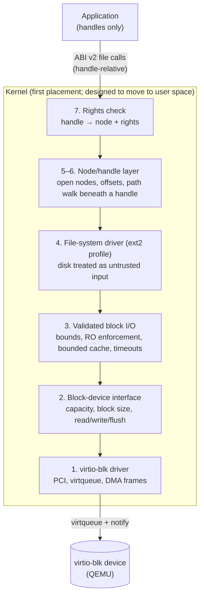

# VOS Storage Architecture — Design Proposal

| | |
|---|---|
| Status | **Proposal (N3.0).** Nothing in this document is implemented. VOS has no storage driver, no file system, no file system calls and no writable persistent state. |
| Date | 2026-10-18 (written at `8e30f9b`, the end of N2) |
| Scope | The layered storage stack from the device driver to the file API; the first device and file-system format; the file-system layout, naming, ownership and permission model; crash and power-loss behaviour |
| Out of scope | Implementation (N3.1 and later); networking and remote file systems; encryption; graphics; package installation (only its storage needs) |
| Related | `docs/architecture/native-software-platform.md` (capabilities, namespaces, packages: sections 6, 9.2, 11, 13), `docs/plans/n3-storage.md` (N3 roadmap and the N3.0 memory work), `docs/vision/product-direction.md` |

**How to read this document.** It uses the same tags as the platform proposal:

- **[Fact]**: established and externally documented, with a reference `[Sn]` (see [References](#14-references)).
- **[Current]**: observed in this repository or development environment on the date above.
- **[Proposal]**: a design recommendation that has not been approved.
- **[Open]**: an unresolved question, also listed in [Decisions](#12-decisions-requiring-approval).

No performance numbers appear here because none have been measured.

---

## 1. Summary

1. **Device: virtio-blk over PCI** (modern interface), driven by polling with a bounded wait
   first and by interrupts later. ATA PIO is simpler to bring up but is a dead end that
   shares nothing with later VOS drivers (section 4).
2. **Format: ext2, read-only first.** A restricted ext2 profile is the first on-disk format:
   - it is an established, documented format;
   - the host already has `mke2fs`, `e2fsck` and `debugfs` to create and check test images;
   - it is case-sensitive byte names with per-inode owner and mode;
   - its structure is small enough to parse defensively.

   Writing comes later and is a separate decision, because plain ext2 has no journal and its
   crash consistency depends on `e2fsck` (section 5). A custom VOS format is **not**
   recommended now. It would be justified only by a concrete technical need such as
   copy-on-write or checksums, never by branding.
3. **Authority comes from handles, not paths.** A process reaches files only through
   directory handles with rights that it received at start or over IPC. Path lookup is always
   relative to such a handle and can never climb above it. On-disk owners and modes are
   inputs to policy, not the enforcement mechanism (section 8).
4. **Layers:**
   - hardware driver;
   - block-device interface;
   - validated block I/O (bounds, read-only enforcement, bounded waits, bounded cache);
   - file-system driver that treats the disk as untrusted input;
   - a thin node/handle layer (a full VFS only when a second file-system type exists);
   - per-process rights;
   - file operations introduced as a new, negotiated ABI version.
5. **Early placement in the kernel, designed to move out.** The first driver and file system
   run in the kernel behind the interfaces above, consistent with the hybrid structure (D3)
   of the platform proposal. They can move to user-space services once IPC carries the data
   and DMA can be confined.
6. **Proposed layout:** `/system`, `/applications`, `/users`, `/configuration`, `/temporary`,
   with lowercase names and kebab-case for multiword names. It is a proposal, and its path
   syntax, case sensitivity and display names are three separate decisions (section 9).

---

## 2. Current state [Current]

- No block device, file system or file API. Programs and test data reach the kernel only as
  GRUB Multiboot2 modules, which are reserved in the physical allocator and copied from by the
  ELF loader.
- QEMU 10.2.1 (`qemu-system-x86_64`) runs every test. The image boots from an ISO through
  `-cdrom` on the default `pc` machine, so the CD-ROM sits on the PIIX3 IDE controller. The
  QEMU build offers `virtio-blk-pci`, `ide-hd`, `piix3-ide` and `ich9-ahci`.
- Host tools present: `mke2fs`/`mkfs.ext2` (e2fsprogs 1.47.2), `e2fsck`, `debugfs`, `tar`,
  `truncate`, `qemu-img`. Not present: `genext2fs`, `mkfs.vfat`, `mtools`, `cpio`.
  `mke2fs -d` can populate a new file system from a directory.
- Kernel facilities a storage stack would build on:
  - the PMM bitmap frame allocator;
  - the W^X kernel alias of physical 0–1 GiB, through which DMA frames are reachable at
    `KERNEL_VMA + pa`;
  - kernel threads with wait queues and tick sleeps;
  - the PIC and PIT with checked IRQ acknowledgement;
  - user-copy routines that validate every page before copying;
  - channels and handles with rights and generations (ABI v1).
- There is no general kernel heap, no PCI enumeration and no DMA mapping layer.
- The kernel is not preemptible and runs system calls with interrupts disabled.

---

## 3. Layered stack [Proposal]

| # | Layer | Responsibility | What it must never do |
|---|---|---|---|
| 1 | Hardware driver | Find the device and negotiate features. Own the virtqueue and the DMA frames. Submit requests and collect completions with a bounded wait. Report device errors verbatim. | Let the device DMA into a frame the kernel does not own for that request; wait without a bound; interpret file-system data. |
| 2 | Block-device interface | One small table per device: capacity in sectors, logical block size, read-only flag, `read`, `write`, `flush`. All callers above use only this. | Expose virtio details; accept requests that are not whole logical blocks. |
| 3 | Validated block I/O | Check every request: range inside the device without overflow, alignment, read-only devices and volumes refuse writes before any request reaches the driver. Keep a fixed-size block cache in PMM frames with explicit dirty and write-back state, and turn device errors and timeouts into error codes. | Grow without a bound (no general heap); return cached data that failed to read; reorder writes across a flush barrier. |
| 4 | File-system driver | Parse the superblock, group descriptors, inodes, block maps and directories. Validate every field before using it, bound every loop, detect cycles, and refuse unknown incompatible features. | Trust any on-disk value; panic on a corrupt image; follow a block number outside the volume. |
| 5 | Node/handle layer | Open-node table, per-handle offset and rights, and path resolution beneath a directory handle. A full VFS (mount table, multiple file-system types) only when a second type exists, such as a RAM file system for `/temporary`. | Resolve `..` above the handle's directory; give a process a node it did not reach through its own handles. |
| 6 | Per-process permissions | Rights on each handle (read, write, create, delete, enumerate, traverse). Rights can only be reduced when a handle is duplicated or passed. A process starts with its namespace only. | Provide a superuser bypass; grant authority because of a path or display name. |
| 7 | Versioned file operations | File system calls arrive as a new ABI version (ABI v2) negotiated through the existing ELF ABI note. ABI v0 and v1 programs get `-VOS_ENOSYS` for them, exactly as v0 programs do for v1 calls today. | Change the meaning of an existing call number or error code. |

**Why a thin node layer instead of a VFS now [Proposal].** A VFS earns its cost when several
file-system types must look alike. The first milestones have one (ext2, read-only), so the
node layer stays a single implementation behind a small interface. The interface keeps the
seam where a VFS switch can go later. The platform proposal also rejects a global file-system
root (`native-software-platform.md` section 11.1), which removes the main reason for a global
mount table.

**Concurrency [Proposal].** VOS runs on one CPU, and the kernel is not preemptible. A process
that needs a block waits on a wait queue until the request completes, and other threads keep
running.

- Requests are completed by a driver path that runs with interrupts handled correctly, never
  inside a system call that spins with `IF = 0`.
- Until interrupt completion exists, the first driver may poll inside the boot path and in
  tests only, with a bounded number of iterations.
- The node table serialises operations on a node. With read-only volumes, concurrent readers
  need no further coordination.

---

## 4. Storage device: virtio-blk vs ATA PIO

### 4.1 Facts

**virtio-blk** [S1]:

- Virtio device ID 2; on PCI, modern device ID `0x1040 + 2`, transitional ID `0x1001`.
- Requests travel through virtqueues. Each request is a header (type and sector), data
  buffers and a status byte.
- Types: `VIRTIO_BLK_T_IN` (0), `OUT` (1), `FLUSH` (4), `GET_ID` (8).
- Status: `VIRTIO_BLK_S_OK` (0), `IOERR` (1), `UNSUPP` (2).
- The sector unit is always 512 bytes.
- Feature `VIRTIO_BLK_F_RO` (5) marks a read-only device. The device then must fail writes
  with `IOERR` and must not write any data. `VIRTIO_BLK_F_FLUSH` (9) offers a cache flush.
  `VIRTIO_BLK_F_BLK_SIZE` (6) reports the logical block size.

**ATA PIO** [S2]:

- The CPU moves every 16-bit word through I/O ports. The primary channel uses ports
  `0x1F0`–`0x1F7` and control port `0x3F6`.
- Commands: `IDENTIFY DEVICE`, `READ SECTORS` and `WRITE SECTORS` with 28-bit LBA, and
  `FLUSH CACHE`.
- Completion is found by polling the BSY/DRQ/ERR status bits or by IRQ 14/15.

**On QEMU [Current]:**

- `-cdrom` already places the boot CD-ROM on the PIIX3 IDE controller. An ATA disk would
  share that controller.
- virtio-blk needs PCI configuration access (mechanism #1 through ports `0xCF8`/`0xCFC`) and
  bus mastering.

### 4.2 Comparison

| Criterion | virtio-blk (PCI, modern) | ATA PIO (legacy ports) |
|---|---|---|
| Bring-up code | PCI config-space scan; capability-list walk for the modern BARs; feature negotiation; one split virtqueue | Fixed ports, no PCI; IDENTIFY plus a 512-byte read loop |
| Data path | DMA by the device into frames the driver gives it; the CPU copies nothing | The CPU copies every word; slow but simple |
| Read-only device | `VIRTIO_BLK_F_RO`; QEMU can expose a read-only image | No device-level flag; must be enforced purely in software |
| Flush / write ordering | `FLUSH` request type, negotiated feature | `FLUSH CACHE` command |
| Error reporting | Per-request status byte | Status/error registers; timeouts are driver-defined |
| Reuse for later drivers | **High**: PCI enumeration and virtqueues are reused by virtio-net, virtio-gpu, virtio-input and virtio-sound, which the platform proposal already lists | **None**: the ATA PIO code is used by nothing else |
| Real-hardware relevance | Virtual machines and hypervisors | Old PCs; modern machines use AHCI or NVMe instead |
| Security exposure | DMA: a buggy driver or device can write any physical frame (no IOMMU in VOS) | No DMA; the CPU performs every transfer |
| Interaction with the boot CD | None (separate PCI function) | Shares the IDE controller with the boot CD-ROM |

### 4.3 Recommendation [Proposal]

**virtio-blk, modern PCI interface, read-only first.**

- **Reuse.** The extra bring-up (PCI scan, virtqueue) is infrastructure that every later
  virtio driver needs anyway. ATA PIO would be code written to be thrown away.
- **Read-only at the device.** `VIRTIO_BLK_F_RO` gives a read-only system disk that the
  hardware enforces, as a second barrier behind the software checks of layer 3.
- **Test control.** QEMU can attach the test image read-only, so N3.1 tests can verify that
  the driver honours a device that refuses writes.

DMA risk containment:

- DMA targets are frames the PMM allocated for that one purpose (queue frames, request headers
  and a bounded bounce or cache pool). They are never user frames and never frames shared with
  any other subsystem.
- Every descriptor the driver publishes is checked against that pool before the
  notification.
- After a timeout, a request's frames stay owned by the driver (quarantined) until the device
  is reset. The device could still write to them, so they are not freed early.

Interrupt-driven completion through the PIC (the INTx line from PCI configuration space)
follows once polling works. With no IOMMU, moving the driver to user space is not safe and
stays deferred (platform proposal, open question 6).

**Rejected for now:**
- AHCI: more complex than both options and not needed in QEMU;
- NVMe: queue pairs and admin commands, more than the first milestone needs;
- legacy (pre-1.0) virtio: the transitional interface, which would mean carrying two
  interfaces.

---

## 5. File-system format

### 5.1 Requirements

R1. Read-only system files that cannot be changed through the file API.

R2. Per-user files with an owner.

R3. Safe reading of a corrupt or hostile image (the disk is untrusted input, like an ELF
file).

R4. A crash-consistency story before any write lands on disk.

R5. Host tooling to create, inspect and check images for tests.

R6. Small enough for a careful, fully validated implementation.

R7. No licence or legal obstacle to an independent implementation.

### 5.2 Options

| Option | Fit | Problems | Verdict |
|---|---|---|---|
| **ext2 (revision 1, restricted features)** | R2: inodes carry owner, group and mode [S3]. R5: `mke2fs -d`, `e2fsck`, `debugfs` are on the host [Current]. R6: superblock, group descriptors, inodes, direct and indirect blocks, linear directories. Byte-string names (case-sensitive). | **No journal**: consistency after a crash depends on `e2fsck` [S3] (R4 is weak for writes). The POSIX owner/mode model is not VOS's capability model, though it can serve as policy input. The feature-flag set must be pinned to a strict subset. | **[Proposal] Recommended first format**, read-only first |
| ext4 (journal, extents) | Journal answers R4 | Extents, journal replay (JBD2), checksums and many features. Far more code than a first milestone can validate. | Later candidate for writable volumes |
| FAT32 | Universal host support | No owner or permission metadata (fails R2). No crash consistency. Long names are a separate structure from 8.3 names, and lookup is case-insensitive by convention. Host tools are not installed. | Not recommended (possibly for removable media much later) |
| USTAR (tar) image | Trivial parser; `tar` present; deterministic output possible | Not a file system: no random write, linear lookup, no free-space structure | Possible fallback for a read-only system image only |
| littlefs | Designed for power-loss resilience (copy-on-write metadata) | Designed for small flash devices; host tools not installed; licence and fit not checked in this pass | [Open] candidate for writable data volumes |
| Custom VOS format | Full control (capability metadata, copy-on-write, checksums) | Own mkfs, fsck and inspection tools; no external checker for tests; all format and recovery bugs are ours | **Not now.** Only with a concrete technical requirement that existing formats fail, never for branding |

### 5.3 Recommended ext2 profile [Proposal]

**Accept:**
- revision 1 (dynamic);
- block size 1024 or 4096 bytes;
- inode size 128 or 256 bytes;
- the `filetype` incompatible feature;
- the `sparse_super` read-only-compatible feature.

**Refuse to mount:**
- any other incompatible feature (`journal_dev`, `meta_bg`, `extents`, `64bit`, `flex_bg`,
  `casefold`, encryption, inline data);
- a file system whose state field does not say "cleanly unmounted".

**Mount read-only only:**
- any other read-only-compatible feature.

**Enforced by the reader:**
- every block number is non-zero and lies inside the volume and outside the metadata areas;
- every inode number lies in `[first inode, inode count]`;
- directory entries:
  - the record length is a multiple of 4 and stays inside the block;
  - the name length fits inside the record;
  - no name contains `/` or NUL;
  - `.` and `..` are where they belong;
- indirect-block depth is at most 3;
- file sizes stay consistent with the block count;
- symbolic links are not followed in the first version (refused or returned as a node type
  only);
- hard-link loops cannot form, because directory traversal is bounded by depth and by visit
  count.

**Writes are a separate milestone and a separate decision ([Open] D-S4):**
- (a) ext2 with ordered writes, flush barriers and `e2fsck` after an unclean shutdown
  (simple, weak);
- (b) the ext3/ext4 journal (stronger, much more code);
- (c) a copy-on-write data volume (littlefs, or a VOS design with a stated technical
  justification).

The system volume stays read-only in all three.

### 5.4 Reproducible test images [Proposal]

Images come from a checked-in directory tree through `mke2fs -d`, with these pinned:
- the UUID (`-U`);
- the hash seed;
- the root owner (`-E root_owner=0:0`);
- the inode size;
- the block size;
- the feature list (`-O none,filetype,sparse_super`).

Each image is then checked with `e2fsck -fn`. Whether the output is byte-for-byte reproducible
(timestamps) must be verified in N3.1. If it is not, the test compares `debugfs` listings
instead of hashes.

---

## 6. Read-only system files and protected metadata [Proposal]

**System volume:**
- separate from user data;
- attached read-only at the device (`VIRTIO_BLK_F_RO`, or QEMU `readonly=on`);
- mounted read-only by layer 3;
- every handle to it lacks the write, create and delete rights.

These are three independent barriers. A bug in one does not open the system files.

**Protected metadata:**
- Superblocks, group descriptors, bitmaps, inode tables and directory blocks are reachable
  only by the file-system driver.
- No file call addresses a block, inode number or raw device.
- A raw device handle exists only for a future privileged storage service and is never in an
  application namespace.

**Updates to system files** happen as whole-image or whole-tree replacement by a future system
updater (platform proposal, section 13.3), never by editing files in place.

## 7. Multiple processes [Proposal]

- Each open file is an entry in a fixed-size kernel node table. Each process handle points to
  one entry and carries its own rights and offset.
- No buffer is shared between processes. Data is copied with the existing validated user-copy
  routines, as for channels.
- Per-process limits:
  - open-handle limit (the handle table, 8 today);
  - outstanding-request limit;
  - for writable volumes later, a per-user and per-application quota.

  One process cannot exhaust the block cache or the node table for everybody.
- A process killed while waiting for I/O is taken off the wait queue as in IPC. The request
  completes into driver-owned frames and is then discarded.
- The kernel audits get storage counterparts, run after every test suite like the existing
  audits:
  - node table consistent with handles;
  - cache frames owned exactly once;
  - no request outstanding at teardown.

## 8. Ownership, permissions and capabilities [Proposal]

**Enforcement is by handle rights.**
- A process holds directory and file handles. Each has rights: `read`, `write`, `create`,
  `delete`, `enumerate`, `traverse`.
- Path resolution starts at a handle and walks only beneath it. `..` at the handle's own
  directory fails. Absolute paths are text that a trusted service resolves against handles it
  holds; the kernel never resolves them against a global root.
- Duplicating or passing a handle can only remove rights.

**Ownership is policy input.**
- The ext2 owner field records which VOS user (or the system) owns a file.
- The services that build namespaces use it to decide which directory handles a user's
  processes may receive.
- Mode bits are written conservatively (system files `0444`/`0555`, owner `0`) but grant
  nothing on their own.
- Owner `0` is not a superuser: no call bypasses handle rights.

**Applications and users.**
- An application gets:
  - its own read-only install tree;
  - its own data directory (`/users/<user-name>/application-data/<app-id>/`);
  - nothing else by default.
- Access to user documents outside that directory requires a grant from the permission broker
  (platform proposal, section 11.1). A file picker is the usual route: it hands back a handle
  to one file or directory, not a path.

**AI-generated applications** are applications. They get no extra privilege for being
generated and no different rules:
- a manifest;
- a read-only install tree;
- a private data directory;
- no access to `/system` writes, other applications' data or the user's documents without a
  broker grant;
- quotas once writes exist.

A generated app cannot widen its own manifest at runtime.

**VOS Studio** (product idea, not designed) would run as an application with restricted
capabilities:
- read and write on its own workspace directory (project sources, the source of truth);
- a staging directory for build outputs;
- the right to *request* installation from the package manager, which verifies and records
  the result;
- the generated program runs as a separate process with only its own manifest's grants.

Studio would **not** get:
- write access to `/system` or `/applications`;
- other applications' data;
- the right to grant permissions it does not hold;
- raw device access.

## 9. Paths, naming, case sensitivity and display names

These are separate decisions. Settling one does not settle another.

### 9.1 Path syntax [Proposal]

- Separator `/`.
- Components are non-empty UTF-8 byte strings of 1–255 bytes. They exclude NUL and `/` and
  are neither `.` nor `..` in stored names.
- The total length is bounded (proposed 1024 bytes, [Open]).
- Lookups compare bytes exactly. Unicode normalisation (for example NFC on creation) is
  [Open] D-S6.

### 9.2 Naming convention for system-defined names [Proposal]

System-defined names are lowercase ASCII words, joined with `-` when there are several
(kebab-case): `application-data`, `boot-modules`. User-created names follow no convention
beyond the path syntax.

### 9.3 Proposed layout [Proposal, not implemented]

| Path | Volume | Writable by | Contents |
|---|---|---|---|
| `/system` | system (read-only device) | nobody at runtime; replaced as a whole by the updater | kernel, boot modules, services, libraries, default configuration |
| `/applications/<app-id>/<version>/` | system or application volume | package manager only | read-only install trees (replaces the illustrative `/packages/...` path in the platform proposal, section 13.1) |
| `/users/<user-name>/` | data volume | that user's processes, through granted handles | `documents`, `downloads`, `pictures`, … |
| `/users/<user-name>/application-data/<app-id>/` | data volume | that application, for that user | per-application private data |
| `/configuration` | data volume | privileged services only | machine-wide settings that differ from the defaults in `/system` |
| `/temporary` | RAM (future second file-system type) | per-process subdirectories | erased at boot |

The layout describes where things live for services and tools. It is not a set of global paths
that applications open: applications see only the handles in their namespace.

### 9.4 Case sensitivity [Open, recommendation]

- **Recommendation:** case-sensitive, exact-byte lookup in the kernel and on disk.
  - ext2 already works this way.
  - Lookup needs no Unicode case-folding tables, whose behaviour changes between Unicode
    versions.
  - Two names never collide silently.
- **Alternative:** case-insensitive, case-preserving. It is friendlier but needs folding
  tables and a policy for existing collisions.
- **Middle way:** user-facing tools could refuse to create a name that differs from an
  existing sibling only by case. That is a policy in user space, not a kernel rule.

### 9.5 Display names [Proposal]

- What the user sees ("Documents", "Applications", a translated name) is a display name. It
  comes from localisation data or metadata, not from the path.
- Display names are never used for lookup, security decisions or manifests.
- Renaming a display name changes no path.

## 10. Crash and power-loss behaviour [Proposal]

| Situation | Behaviour |
|---|---|
| Read-only volumes | Nothing on disk changes, so a crash cannot corrupt them |
| Mount after an unclean shutdown (ext2 state not clean) | Read-only mount only, until a check has run (first host-side `e2fsck` in tests, later an on-device checker) |
| Device error or timeout on read | Error to the caller. The block is not cached. The volume is marked failing after a bounded number of errors. |
| Writes (later milestone) | Ordered: data before the metadata that points to it, with a `FLUSH` barrier between dependent groups. Atomic replace: write a new file, flush, rename over the old one, flush. A crash leaves either the old or the new content, never a mix, for files written this way. |
| Lost flush support (`VIRTIO_BLK_F_FLUSH` not offered) | The volume is mounted read-only. VOS does not write without a durability barrier. |

**Testing crash behaviour (with writes):** kill QEMU at chosen points, run `e2fsck -fn` on the
image on the host, and require either the old or the new state.

## 11. Memory and resource budget for N3 [Proposal]

There is no general heap. Every storage structure is fixed-size or drawn from the PMM in a
bounded pool:
- the virtqueue: a few frames for a small queue size;
- request headers and status bytes: one frame;
- the block cache: a fixed number of frames, with its size [Open];
- static tables in `.bss`: devices, volumes, open nodes.

The kernel image will grow with the PCI, virtio, block and ext2 code. Before N3.0 the test
images left about 56 KiB below the 2 MiB that the W^X kernel map could cover. N3.0 extends
that limit to 4 MiB (`docs/plans/n3-storage.md`).

## 12. Decisions requiring approval

| ID | Decision | Recommendation |
|---|---|---|
| D-S1 | First storage device | virtio-blk, modern PCI, polled first, interrupts next |
| D-S2 | First on-disk format | ext2 revision 1, restricted profile (section 5.3), read-only |
| D-S3 | Placement | In the kernel first, behind the layer interfaces; move to user space only after IOMMU or DMA confinement exists |
| D-S4 | Write strategy for data volumes | Decide before any write code: ext2 ordered writes + fsck, journal, or copy-on-write (section 5.3) |
| D-S5 | Case sensitivity | Case-sensitive exact bytes; collisions by case prevented by user-space policy if wanted |
| D-S6 | Unicode normalisation of names | Open: NFC on creation, or none |
| D-S7 | Layout | `/system`, `/applications`, `/users`, `/configuration`, `/temporary` (section 9.3) |
| D-S8 | File ABI | New ABI version (v2), handle-relative calls only, negotiated through the ELF ABI note |
| D-S9 | Cache size and per-process limits | Fixed numbers chosen in N3.1 from the measured kernel budget |

## 13. Risks

| Risk | Mitigation |
|---|---|
| A corrupt or hostile disk image crashes or confuses the kernel | Validate every field before use, bound every loop and recursion; host-generated corrupt images in tests (mutated superblock, directory records, block pointers) |
| A wrong DMA address lets the device overwrite kernel memory | DMA only into a dedicated, audited frame pool. Every descriptor is checked before notification, and timed-out frames are quarantined. |
| An unbounded wait for a device that never completes | Every wait has an iteration or tick bound. The test harness also has its own QEMU timeout, which is never counted as a pass. |
| ext2 without a journal loses metadata consistency on power loss | No writes until D-S4 is decided; read-only system volume in all cases |
| Kernel growth exhausts the W^X-mapped image area | N3.0 doubles the 4 KiB-mapped area to 4 MiB; the linker assertion and boot checks fail closed |
| The POSIX owner/mode model leaks in as ambient authority | Mode bits grant nothing; only handle rights do (section 8) |

## 14. References

Checked on 2026-10-18 for the statements cited, except where noted.

- [S1] OASIS, *Virtual I/O Device (VIRTIO) Version 1.2*: section 4.1.2 (PCI device IDs:
  "adding 0x1040 to the Virtio Device ID", transitional block ID `0x1001`) and section 5.2
  (block device: feature bits `VIRTIO_BLK_F_RO` 5, `BLK_SIZE` 6, `FLUSH` 9; request types;
  status values; 512-byte sectors; a read-only device "MUST NOT write any data").
  https://docs.oasis-open.org/virtio/virtio/v1.2/csd01/virtio-v1.2-csd01.html
- [S2] ATA/ATAPI command set (INCITS ATA8-ACS and predecessors). The register-level
  description used here (ports `0x1F0`–`0x1F7`, `0x3F6`; BSY/DRQ/ERR; READ/WRITE SECTORS;
  FLUSH CACHE) is the widely documented legacy interface. **Not re-fetched in this pass**;
  verify before any implementation.
- [S3] The Linux kernel documentation, *The Second Extended Filesystem*: inode metadata
  (permissions, owner, group); no journal in ext2; `e2fsck` after an unclean unmount.
  https://docs.kernel.org/filesystems/ext2.html. Ext2 field-level details in section 5.3
  (feature names, state field, 255-byte names) follow the published format description and
  e2fsprogs. They were **not re-fetched in this pass** (the reference page was unreachable)
  and must be checked against the format description before N3.1 code is written.
- [S4] e2fsprogs 1.47.2 manual pages on the host: `mke2fs(8)` (`-d root-directory`,
  `-E root_owner`) and `ext4(5)` (`casefold` is an ext4 feature, kernel 5.2).
