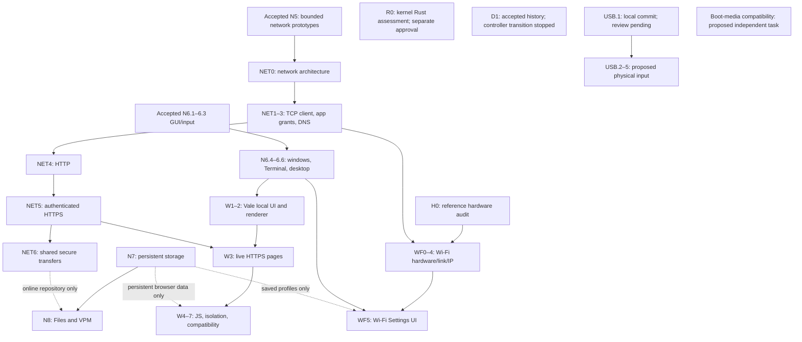

# VOS Master Development Plan

**Project:** VOS (Veasna OS)

**Document version:** 0.1 — proposed master planning baseline

**Prepared:** 2026-10-26

**Status:** **PROPOSED / OWNER REVIEW.** Integrated for version-controlled review; this is not an accepted engineering specification and authorizes no code, driver, hardware, controller, budget, or Git changes.

**Repository location:** `docs/plans/MASTER-PLAN.md`

**Repository:** <https://github.com/veasnawt/vos>

> **Read this first:** “Accepted” refers to verified and owner-accepted implementation scope, not full production capability. Everything described as proposed, candidate, target, future, research, or open is *not implemented or authorized by this document*. Do not infer hardware support from QEMU tests, security from a successful unit test, or a deadline from milestone numbering.

## Contents

1. [Purpose, authority and decision rules](#1-purpose-authority-and-decision-rules)
2. [Product vision and non-negotiable principles](#2-product-vision-and-non-negotiable-principles)
3. [Verified baseline and current limitations](#3-verified-baseline-and-current-limitations)
4. [Roadmap taxonomy and release gates](#4-roadmap-taxonomy-and-release-gates)
5. [N-series: OS and native desktop](#5-n-series-os-and-native-desktop)
6. [R-series: Rust-first kernel migration](#6-r-series-rust-first-kernel-migration)
7. [H-series: physical hardware and portability](#7-h-series-physical-hardware-and-portability)
8. [NET-series: network services, HTTP and HTTPS](#8-net-series-network-services-http-and-https)
9. [WF-series: Wi-Fi and connection management](#9-wf-series-wi-fi-and-connection-management)
10. [W-series: Vale native web browser](#10-w-series-vale-native-web-browser)
11. [Native SDK, packages, shells and applications](#11-native-sdk-packages-shells-and-applications)
12. [Rixie, original AI research and Khmer support](#12-rixie-original-ai-research-and-khmer-support)
13. [D-series: development infrastructure](#13-d-series-development-infrastructure)
14. [Security, reliability and testing contracts](#14-security-reliability-and-testing-contracts)
15. [Cross-track dependencies and execution waves](#15-cross-track-dependencies-and-execution-waves)
16. [Priority, complexity and acceptance matrix](#16-priority-complexity-and-acceptance-matrix)
17. [Documentation governance and publication](#17-documentation-governance-and-publication)
18. [Open decisions and owner approval register](#18-open-decisions-and-owner-approval-register)
19. [Reference documents and history](#19-reference-documents-and-history)

---

## 1. Purpose, authority and decision rules

This is the **integrated planning index** for VOS, an independent open-source operating system designed for actual physical computers. It consolidates the owner's 2026-10-26 standalone roadmap, the accepted GitHub milestone record, and subsequent planning discussions about desktop design, Rust, hardware, networking, Wi-Fi, Vale, applications, scripting, and development tooling.

**Authoritative hierarchy (highest first):**

1. Executed, independently verifiable tests, accepted evidence and actual committed implementation.
2. Explicit later owner decisions and published accepted architecture contracts.
3. `docs/STATUS.md` for accepted scope; versioned ABI/security and `docs/results/` for evidence.
4. Approved individual engineering plans and architectural decision records (ADRs).
5. This forward-looking master plan and `docs/ROADMAP.md` summaries.
6. Archived roadmaps and conversations, as historical context only.

If an older document contradicts new evidence, preserve the old document and record the superseding decision. **Do not retroactively rewrite accepted evidence or give future plans the status of implementation.** If this planning document and the accepted STATUS/evidence disagree about a completed feature, treat STATUS/evidence as controlling and propose a documentation correction separately.

**This file is a plan, not a work order.** Each engineering task still needs owner-scoped authorization, admission, isolation, and review before execution. This file does not authorize importing dependencies, flashing hardware, changing controllers, starting a new branch, pushing, or merging.

### 1.1 What each repository document should mean

| Document | Primary job | Maintenance policy |
|---|---|---|
| `README.md` | Accurate public introduction and current highlights | Update at relevant milestone publication |
| `docs/ROADMAP.md` | Short navigation map, current major milestones, links | Avoid duplicating this entire plan |
| `docs/STATUS.md` | Implemented/merged/accepted reality and limitations | Update only from grounded evidence |
| `docs/plans/MASTER-PLAN.md` | Cross-track strategy, dependencies, acceptance targets | Update on explicit planning decisions |
| `docs/plans/*.md` | Detailed engineering designs, tasks and risk gates | Create as a track is authorized for design |
| `docs/architecture/*.md` | Architectural contracts and rationale | Preserve historical sections, version decisions |
| `docs/decisions/*.md` | Future approved ADRs (directory proposed) | New records rather than silent changes |
| `docs/results/` | Immutable historical test evidence and closure | Never rewrite to match later plans |

### 1.2 Decision states

- **Proposed:** a candidate idea; no implementation permission.
- **Designed:** written engineering specification exists; options may remain open.
- **Approved:** owner approves a bounded scope and specific acceptance contract.
- **In progress:** authorized work has actually started.
- **Verified locally:** relevant checks passed, but publication/acceptance may remain.
- **Published:** branch/PR or release artifact published, with verified provenance.
- **Accepted:** required evidence reviewed and milestone accepted by owner.
- **Deferred/Blocked/Rejected:** explicit reason, prerequisites, and decision record.

Avoid conflating these states. A label such as `NET5` is an identifier, not a release date.

### 1.3 Integration provenance and corrections, 27 October 2026

Imported from the owner's `E:\VOS Assets\VOS_MASTER_PLAN.md` (WSL
`/mnt/e/VOS Assets/VOS_MASTER_PLAN.md`): UTF-8 without BOM, **63,333 bytes,
665 lines**, SHA-256
`ac1b80a14be0081aca5f9e6bf0235602a9444b099aca41591927b8c10e29fb3f`.
The original remains unchanged. The integrated copy has these explicit corrections:

1. Describe this copy as a version-controlled proposal; retain the dated PR #16
   snapshot below and distinguish it from the integration baseline, GitHub main
   `cbe9f9202ca9a45aaafa57ec45fc01baeb347bc1` after merged PRs #17 and #18.
2. Record completed D1-A, the actual accepted B1/B2 work and the owner's later
   termination of the controller-transition project. Keep the original D1 table
   as a superseded historical proposal, not a new work order or prerequisite.
   Ordinary development uses clean reviewed Git areas, scoped work, focused tests,
   CI, backups and disk checks; legacy PID/VSIX attestation is not reinstated.
3. Preserve storage decision D-S7's provisional longer-path layout. The shortened
   N7 names are a new preference awaiting approval, not a replacement ABI.
4. Distinguish this proposed H2 identifier from the older roadmap's physical-test
   label, and identify obsolete status/numbering in historical architecture texts.
5. Clarify the dependency graph: local N8 packages do not require online NET
   services; JavaScript and live Wi-Fi controls do not inherently require N7
   persistence. Remove the superseded D1 controller-transition prerequisite.
6. Update the corresponding execution-wave, priority and decision-register text;
   retain historical accounting as history and preserve every N/R/H/NET/WF/W
   proposal and accepted implementation boundary.
7. Replace five metadata-line trailing-space breaks with blank-line paragraphs
   for clean Git whitespace validation, without changing their meaning.

USB.1 is separately verified locally at `bd22803b8b5635b776c848d08d1494f65b49dd21`
on `feat/usb-xhci-discovery`, outside this accepted main baseline. It is not
published or accepted by this planning integration and provides no USB HID input.

## 2. Product vision and non-negotiable principles

**North star:** a usable, trustworthy, beautiful, general-purpose VOS installed on selected physical computers, with independently evolved kernel and native services, a compelling graphical desktop, Rust-first app tooling, secure internet access, Khmer-first quality, and a growing open ecosystem.

**Identity and implementation principles:**

- **Independent OS:** not a Linux distribution, macOS derivative or Windows clone. Reuse interoperability standards and well-reviewed libraries when justified, but own and document VOS's public contracts.
- **Real hardware:** QEMU BIOS/UEFI is a development environment. Physical x86-64 compatibility needs genuine devices, drivers and non-destructive tests. Broad compatibility is a progressive goal, not a guaranteed claim.
- **Rust-first, not Rust-only:** use Rust for native apps and appropriate new kernel work; preserve C until verified replacements; use assembly where processor and ABI needs justify it.
- **Capability security:** no ambient filesystem, device, network or privileged process authority; explicit grants and revocation; process-owned handles; defensive parsing and bounded work.
- **User-owned data:** strong isolation, transparent permissions, local-first where practical, safe persistent storage and authenticated update channels.
- **Accessible, coherent GUI:** keyboard/pointer first, clearly indicated focus, meaningful errors, reduced motion, scalable fonts, localized content, trustworthy permissions.
- **Standards where useful:** use established protocols for IP, HTTP, TLS, Unicode and HTML/CSS/JS compatibility. Independence does not require inventing a cryptographic algorithm or a new web standard.
- **Evidence before claims:** reproducible results, exact technical limitations, authentic QEMU screenshots and separate physical hardware results.
- **Maintainable development:** small reviewable increments, preserved history, proportionate verification and predictable resource budgets.

**Release strategy:** define a *minimum usable, safe VOS* independently from the complete aspirational application suite. A desktop alpha need not ship a modern browser, universal Wi-Fi or AI model. A broadly usable consumer release needs stronger gates, including qualified real hardware and secure updates.

## 3. Verified baseline and current limitations

### 3.1 Publication snapshot, 26 October 2026

This is the supplied historical snapshot. The later integration baseline and
owner workflow decision are recorded in section 1.3; neither changes accepted
N0–N6.3 implementation claims or rewrites these historical publications.

- GitHub `main` verified at **`ba8e762a358d36711a53dd70f50cd47ccf39e8a9`**, merged documentation [PR #16](https://github.com/veasnawt/vos/pull/16).
- Documentation branch source: `3ed379695e14c3955da6afb75c38bcee122bcb3f`; PR #16 build smoke and secret-history audit passed.
- Cursor refinement [PR #15](https://github.com/veasnawt/vos/pull/15) merged at `bf5eb43f2e07478e31be8b4123c5a297add67efe` (a prior implementation baseline, not today's main HEAD).
- **N0–N5** and the unified native-app execution foundation are accepted within their verified scopes. **N6.1–N6.3** are accepted/merged. **N6 as a whole is incomplete.**
- No proof of physical PC compatibility, complete writable filesystem, complete internet stack, full desktop, production browser or installable consumer release.

### 3.2 Completed milestone foundations

| Milestone | Accepted functionality | Boundary that remains |
|---|---|---|
| N0 | Original freestanding i386 boot/serial foundation | Historic precursor, not modern desktop |
| N1 | Higher-half x86-64, protected user ELF/ring-3 and syscall ABI | Not POSIX compatibility |
| N2 | Memory protection, kernel/user scheduling, bounded IPC | No complete modern multi-core kernel |
| N3.0–N3.6 | Read-only virtio-blk, block cache, ext2, capability-scoped file API and storage stress closure | No durable writable data; QEMU-oriented verification |
| N4 | Keyboard, buffered console, native Rust `vsh`/SDK, `hello`, deterministic offline Rixie Core v0 | No mature terminal scripting or arbitrary app installation |
| N5 | Bounded virtio-net, Ethernet/ARP, IPv4/ICMP, UDP, passive TCP payload/retry/close experiments | No general outbound TCP client, DNS, DHCP, TLS or userspace sockets |
| Pre-N6 apps | Unified catalog/payload, execution broker, process isolation and return to shell | Trusted fixed app catalog, not general loader/installer |
| N6.1 | Graphical framebuffer scene and bounded console viewport | Not a compositing window desktop |
| N6.2 | One explicitly granted Rust process-owned GUI surface and event foundation | Not a general window manager |
| N6.3 | PS/2 movement/primary clicking, secure routing, exact cursor clipping and refined arrow | No USB/wheel/extra buttons or physical-mouse qualification |

### 3.3 Current graphics and pointer evidence

Cursor accepted after PR #15: visible arrow approximately **21×28 pixels on a 32×32 canvas** with white/ice fill, dark outline and tip hotspot at `(0,0)`. Evidence includes BIOS/UEFI QEMU interaction, clipping and representative screenshots under `docs/images/n6/`. User-selectable pointer sizes (e.g., 16–48 px) remain a **future Settings/Accessibility proposal**, not an N6.3 implementation.

### 3.4 Important current platform limitations

Read-only trusted media; formal verification remains QEMU-based, with owner-reported partial physical boot distinguished in section 7.2; limited physical RAM range and framebuffer formats; bounded storage/device mappings; UEFI polling in relevant paths; incomplete full dynamic kernel-stack high-water proof; PS/2 input only; no window manager, multi-window compositor or native graphical Terminal; no persistent settings; no independent EFI loader/Secure Boot; no production networking/TLS; no validated real GPU, USB, NVMe, sound or Wi-Fi drivers. Consult [`docs/STATUS.md`](../STATUS.md) for the exact evidence-backed accepted scope; section 7.1 separately records local-only USB.1 work.

## 4. Roadmap taxonomy and release gates

| Track | Coverage | Relationship |
|---|---|---|
| **N** | Core OS capability, desktop, storage, packages, release-readiness | Primary product sequence |
| **R** | Incremental Rust-first kernel migration | Parallel only when approved/isolation-safe |
| **H** | Physical PC and device compatibility | Cross-cutting, especially installation and drivers |
| **NET** | General network services, HTTP/HTTPS and internet client APIs | Builds on N5; supports Vale, VPM and apps |
| **WF** | Wireless hardware, 802.11, authentication and Wi-Fi UX | Hardware-specific input into shared NET services |
| **W** | Vale browser UI, engine and modern-web compatibility | Depends on N6 and NET; N7 for persistence |
| **D** | Developer tooling, admission, storage controls, CI and evidence workflow | Accepted tooling/history; controller transition stopped; future changes require new authorization |

Identifiers and increments below are **proposed planning names** unless their accepted status is explicitly stated. Series can overlap in research but *not* in unauthorized concurrent Codex changes. Other exploratory tracks such as AI should not be promoted to blocking N6/N9 scope without owner decision.

### 4.1 Release gates (distinct from track identifiers)

1. **Kernel development checkpoint:** reproducible QEMU boot, isolation and required tests.
2. **Desktop alpha:** N6 acceptance of cohesive GUI in both QEMU firmware paths.
3. **Persistent-system alpha:** safe N7 write and recovery behavior with bounded user data.
4. **Application-platform alpha:** N8 file operations, package trust and documented SDK.
5. **Connected-device preview:** defined subset of NET/WF/H claims verified on selected devices.
6. **Distribution candidate:** N9 installer, recovery, updates, security and qualified supported hardware.

None is a calendar promise. A safe desktop alpha may precede Vale's modern-web compatibility. N9 must define a supported device matrix rather than implying 'all PCs'.

## 5. N-series: OS and native desktop

### 5.1 N6 definition of done

VOS boots into one coherent GUI, lets users interact with keyboard/mouse, safely manage several granted native application surfaces, launch graphical Terminal with existing Rust `vsh`, use an app launcher/dock, access basic Settings and Rixie and browse trusted read-only Files; applications exit/clean up without rebooting the system. BIOS and UEFI QEMU evidence, explicit limitations and documentation synchronization are required. **No full web browser, writable filesystem, package repository, real GPU stack or AI model required for N6 closure.**

#### N6.4 — Window manager and compositor foundations [PROPOSED]

**Dependencies:** accepted N6.1–N6.3, unified process launching, relevant memory/IPC and GUI ownership guarantees.

**Implementation slices:**

1. Define compositor ownership and window/surface lifecycle; evaluate kernel mechanism versus userspace compositor/service boundary. Keep application pixels and input authority isolated.
2. Support bounded multiple surfaces, compositing order, visibility, opaque/translucent semantics when feasible, clipping and invalidation/damage regions.
3. Define focus routing, activation, keyboard/pointer capture and ownership checks; prevent one app from impersonating another or drawing outside grants.
4. Implement window decorations, dragging, resizing, minimize/maximize/restore/close, z-order, task switching and keyboard alternatives.
5. Handle process exit, misbehaving apps, partially drawn frames, screen geometry changes and safe teardown without leaks or stale grants.
6. Add renderer/state model tests, negative adversarial cases and genuine QEMU interaction captures.

**Acceptance:** at least two independent native surfaces coexist; correct focus, clipping and interaction at edges; crash/exit of one app does not hand it another's pixels/events; BIOS+UEFI demonstrate non-mocked interaction, bounded resource behavior and cleanup. **Non-goals:** GPU acceleration, browser engine, general permissions UI.

#### N6.5 — Native Rust Terminal and UI foundation [PROPOSED]

**Dependencies:** focused windows/input from N6.4, existing Rust `vsh`, text services and lifecycle bridge.

**Implementation slices:** proper **Terminal** GUI app (not “VTerminal”), clear text layout/wrapping/scrollback, keyboard/text editing, resizing, focus/cursor, reusable widgets and font pipeline. Design future PTY/terminal service as an explicit interface; do not claim it already exists. Define `.vsh` file conventions and `sh` compatibility policy without making script execution a closure requirement.

**Acceptance:** open Terminal from desktop launch path, run supported `vsh` commands (`apps`, `hello`, `rixie`, etc.), preserve app return and shell state, test resize/focus/scrolling, and verify no shell authority escalation.

#### N6.6 — VOS graphical desktop shell [PROPOSED]

**Dependencies:** N6.4/6.5 window, launcher and surface framework.

**Product contract:** working name **VOS Flow**; dark midnight-navy/graphite, restrained electric blue, system bar and **bottom-centered floating pill dock**, launcher, window indicators, focus and switching, crisp typography, accessibility states and reduced-motion options.

**Assets:** canonical originals in `E:\VOS Assets` (WSL `/mnt/e/VOS Assets`). Planned built-in wallpaper **VOS Horizon** (default) and **VOS Flow** (alternative), with optimized copies `vos-horizon.png` and `vos-flow.png`. Never modify originals. Incorporate approved VOS mark; verify redistributable rights for the VOS Display font before adding any binaries to an open-source repo. VICons remains a candidate, not mandatory or already integrated. Windows controls: compact roughly 14px yellow/minimize, green/maximize, red/close circles at top-right, with larger click areas and keyboard alternatives. Cursor size choices are a future Settings extension.

**Acceptance:** normal boot reaches a repeatable native desktop; dock/launcher opens and switches real apps; wallpapers/background remain clipped and responsive; screenshot evidence is of VOS running inside QEMU, never illustrative mockups labeled as implementation.

#### N6.7 — Essential native application integration [PROPOSED]

**Dependencies:** N6.4–N6.6 app framework, existing read-only file API, trusted launch rules.

**Minimum deliverables:** desktop-launchable Terminal, deterministic/offline Rixie Core, basic Settings UI and bounded read-only Files browser. Optional Photos/image-viewer proof only if separately justified. Settings may expose live but not persistent values. No write APIs, installer, network grants or unrestricted Files traversal introduced by implication.

**Acceptance:** launch, switch, use and close native apps repeatedly in same session; input isolation and resource accounting remain correct; trusted file traversal follows existing handle rights.

#### N6.8 — Integrated N6 acceptance [PROPOSED]

**Required evidence:** fresh bounded end-to-end BIOS and UEFI QEMU desktop sessions, multi-app input/focus/interleaving, process crash/exit containment, renderer clipping, memory and GUI resource reclamation, screenshots and recorded performance baselines where feasible. Review H0 hardware assumptions but label any real-device support separately. Synchronize README/STATUS/ROADMAP and conclude only the actually accepted scope.

### 5.2 N7 — Writable persistent filesystem and settings [PROPOSED]

**Dependencies:** N3 trusted read-only storage and capability APIs, block I/O semantics, memory/risk review; Rust pieces depend on suitable R-series integration if selected.

**Sequence:**

1. Specify durability: partitions/volumes, crash-consistent metadata, journaling or copy-on-write decision, ordering/flush barriers and recovery strategy.
2. Select a defensible on-disk format or constrained evolution path; document threats and tooling. Do not invent a new format merely for branding.
3. Introduce bounded block writes, error/cancellation paths, cache coherency and safe shutdown/reboot durability contracts.
4. Define namespace/ownership, mount policy, quotas and app-private storage; maintain least-privilege, path validation and nonreused handle semantics.
5. Add persistent user directories, machine settings and crash-safe settings updates.
6. Verify reboot persistence, full-volume behavior, simulated power cuts, corruption, metadata atomicity, permissions and recovery. Never test destructive writes on important physical disks.

**Preferred logical namespace (NOT YET APPROVED AS AN ABI):**

```text
/
├── system/               # protected OS files
├── apps/                 # installed app trees
├── home/
│   └── <username>/
│       ├── Desktop/
│       ├── Documents/
│       ├── Downloads/
│       ├── Pictures/
│       ├── Music/
│       ├── Videos/
│       └── .config/       # example user-private application settings
├── config/               # privileged system settings
└── tmp/                  # bounded temporary namespace
```

These shortened names are a **new planning preference only**. Storage architecture decision D-S7 provisionally approved `/system`, `/applications`, `/users`, `/configuration`, `/temporary` on 2026-10-18; it was not implemented as a global application namespace. This proposal does not revoke that decision or approve replacement paths. DEC-04 must resolve the difference before any new public contract. Final semantics, case policy, private app-data naming, root/mount layout, namespace virtualization, localization and compatibility aliases remain open. Applications must use **handle-relative grants**, not ambient absolute-path privilege. Shell `~` home expansion is future functionality.

**N7 acceptance:** persistent round-trip and recoverable crash tests, least-privilege write denial, bounded space/quotas, repeatable BIOS/UEFI image tests and a clearly documented durability model. A working save button alone is insufficient.

### 5.3 N8 — Full Files and application platform [PROPOSED]

1. **Files:** navigate, create/copy/move/rename/delete, show errors/conflicts, safe drag/drop when framework permits, view permissions and locations.
2. **Text Editor:** reliable read/write, encoding-aware edits, dirty-state prompting, atomic save semantics.
3. **App-private data:** per-app storage scope, lifecycle, declared capabilities and user-mediated grants.
4. **`.vapp` packages:** manifest/schema/version, dependencies, app IDs, content integrity, signatures/trust and rollback-safe installation design. Avoid arbitrary installer scripts running with elevated authority.
5. **VPM:** local package inspection/install/remove/update primitives; later signed repository metadata and secure HTTPS downloads once NET5/NET6 are accepted.
6. **SDK:** stable Rust-first facade on language-neutral ABI, docs, sample apps and versioned compatibility tests.
7. **Settings/Photos:** persistent config and well-scoped media support; full editor/browser not mandatory for N8.

**Acceptance:** installing/removing signed test packages preserves unrelated users, apps and system state; Files operations persist and reject invalid rights; corrupt/unsigned packages fail safely; app lifecycle and API compatibility documented.

### 5.4 N9 — Installation and release-readiness [PROPOSED]

Scope: supported physical x86-64 devices, installation media with explicit disk selection, no destructive defaults, boot and recovery path, measured performance and resilience, package/update signing, automatic or operator-triggered rollback, clear recovery guidance, security process, diagnostics, accessibility, Khmer/English localization, privacy and transparent release notes. Define stable supported APIs, release channel and vulnerability patch policy.

**Acceptance:** isolated install/recovery rehearsals on *selected test hardware*, verified update rollback, failure simulation, signed distribution artifacts, documented hardware matrix and owner-reviewed supported-use claims. Neither N9 nor an alpha badge promises compatibility with every PC or every website.

## 6. R-series: Rust-first kernel migration

**Intent:** Rust is the intended primary language for future VOS kernel development, through interoperable increments. Preserve the currently working C/assembly kernel, stable userspace ABIs and cross-language interoperability; use `no_std` Rust appropriately; keep necessary assembly; audit FFI, `unsafe`, panic behavior, allocation constraints, linking, interrupts, DMA ownership and memory lifetimes. Do not rewrite core memory management simply to change GitHub language percentages.

| Stage | Engineering contract | Required gate |
|---|---|---|
| **R0-A** | Read-only module/dependency inventory: linker, toolchain, ABI/FFI, panic, allocator, interrupt and memory model, build reproducibility, risk and budgets | Audit report, zero source changes |
| **R0-B** | Minimal bounded freestanding Rust kernel module/call path | Isolated implementation approval; sanitizer/host checks where feasible; BIOS/UEFI evidence; frozen ABI preservation |
| **R1** | Pure low-risk helpers: parsing, bounds, utilities with Rust test equivalents | Behavioral equivalence and resource proof |
| **R2** | Selected input/drivers with understood device ownership | Hardware-facing error, IRQ and DMA contract verification |
| **R3** | Graphics, storage and networking subsystem migrations | Independent subsystem gates; safe FFI; no simultaneous blind rewrites |
| **R4** | Memory, scheduler, process and security-critical core | Highest scrutiny, concurrency/isolation and regression matrix |
| **R5** | Consolidation into predominantly Rust-owned kernel code | Retire C only after all affected tests and ABIs remain valid |

**Scheduling:** the original proposal placed R0-A after the D1 documentation/infrastructure checkpoint. The owner has since stopped the D1 controller transition; completing that transition is not a prerequisite. R0-A's read-only assessment is now authorized; R0-B still requires separate review and implementation authorization. R1–R5 can span multiple N milestones; N6.4 must not be blocked on finishing the entire R-series. Preserve portable C ABIs so non-Rust language bindings remain viable.

**Owner priority decision:** R0-A is the next Rust-kernel engineering milestone,
limited to the authorized read-only assessment in a separate checkout. Establish
the separately reviewed R0-B Rust integration before substantial additional C
kernel subsystems where practical; this is not permission to implement R0-B.
USB.1 remains preserved and locally implemented. USB.2 should evaluate Rust after
R0-B is demonstrated. Do not block unrelated bug fixes, boot-media work or ongoing
desktop planning on completion of the entire R1–R5 migration. Hardware development
and Rust migration remain independent tracks; coordinate shared source files.

## 7. H-series: physical hardware and portability

**Target:** improve real-PC compatibility progressively through selected reproducible hardware, not claim universal PC support.

The H-series identifiers below are proposed. The existing roadmap's **H2** label
means controlled physical testing in the older UEFI sequence; it is not approval
of the new H2 USB/input scope. Resolve the identifier collision in a separately
approved H0 design rather than silently renumbering historical records.

| Stage | Engineering scope | Acceptance boundary |
|---|---|---|
| **H0** | Inventory CPU/firmware/PCI/ACPI/interrupt/APIC/IOMMU/DMA/USB/framebuffer assumptions; select reference spare PC | Read-only audit, risk and compatibility matrix |
| **H1** | Non-destructive removable-media boot on a spare UEFI x86-64 computer | Explicit owner approval, no writes to valuable disks, serial/screen diagnostics |
| **H2** | USB keyboard/mouse/HID, display handoff, input and real framebuffer qualification | Real-device test reports, no emulator inference |
| **H3** | Selected NVMe/AHCI/USB storage detection/read-only support, then separately controlled writes | Device-specific storage safety and data protection |
| **H4** | Real NIC, selected Wi-Fi, audio and peripheral paths | Driver-specific acceptance; link into WF and NET |
| **H5** | GPU modesetting/acceleration, ACPI power, sleep/wake, multicore/performance | Per-device documented evidence; no blanket support claims |
| **Future** | ARM64, RISC-V and other families | Separate ABI, toolchain, boot, MMU and hardware plans |

**Hardware safety:** never issue disk writes, partition operations, firmware flashing, Wi-Fi regulatory transmissions or power-management experiments on an unapproved host. Prefer replaceable hardware and dedicated test media. GPU, USB, ACPI and chipset diversity will be major effort centers.

### 7.1 USB discovery and proposed input sequence

**USB.1 — implemented and committed locally, not merged or physically verified.**
Branch `feat/usb-xhci-discovery`, commit
`bd22803b8b5635b776c848d08d1494f65b49dd21`, is retained in the separate
`/home/veasnawt/src/vos-usb` checkout. Its local report is
`docs/results/usb1-xhci.md`; that file and implementation are not in this
planning branch or accepted GitHub main. No unpublished GitHub link is implied.

The implementation supplies opt-in PCI xHCI discovery, BAR validation, bounded
capability inspection and startup diagnostics. Recorded evidence includes
**45,713 xHCI sanitizer assertions**, **49,499 console assertions**, keyboard
regressions, **523 bootstrap assertions** with modeled service/scheduler
boundaries, and **ten BIOS/UEFI cases**, including expected PS/2-disabled failure
controls. Independent QMP snapshots confirm controller IDs and BAR addresses.
This is bus-0 discovery and QEMU verification only: no USB transfers, no
VOS-initialized xHCI data path, and no operational USB keyboard or mouse support.

The following increments sit within the existing H-series hardware/input scope.
USB identifiers do not replace H numbers or resolve the historical H2 collision.

| Increment | Scope | State and boundary |
|---|---|---|
| USB.1 | Native xHCI discovery and diagnostics described above | Locally implemented/committed; publication review pending, not accepted main or physical input |
| USB.2 | Controller ownership and initialization; owned DMA allocation; command/event rings; interrupt or bounded polling behavior; errors and teardown | PROPOSED; evaluate Rust after R0-B is demonstrated; define bounded ownership and cleanup before enabling a VOS data path |
| USB.3 | Port/device initialization, descriptor validation, endpoint configuration, HID boot-keyboard input and supported recovery | PROPOSED; builds on controller operation; reject malformed input and bound enumeration/resources |
| USB.4 | Unified keyboard events through existing PS/2 input architecture, `vsh`, native GUI and process-owned input delivery | PROPOSED; preserve existing keyboard behavior, authority and input ownership rather than duplicate infrastructure |
| USB.5 | USB mouse HID motion/buttons through the existing pointer/input architecture | PROPOSED; reuse enumeration and shared routing, preserving pointer bounds, button semantics and cleanup |

USB.1 completion does not authorize USB.2–USB.5. Hardware qualification remains
a separate evidence requirement; neither the proposed sequence nor complete
hardware support is a prerequisite for all further desktop development.

### 7.2 Owner-reported physical boot and Rufus compatibility

The owner reports that Rufus **DD Image mode** media reached the VOS graphical
display on a physical x86_64 computer. Boot failures were reported with these
labels: `native GUI surface/event application`, `native vsh`, and
`common payload native vsh`. These are owner observations, not a new independently
reproduced hardware acceptance record or proof of functional application input.

**Partial physical boot demonstrated (owner-reported); functional GUI, shell and
USB input not yet demonstrated.** Missing or failed PS/2 initialization is a
plausible explanation, not an established root cause on that machine. USB.1's
opt-in diagnostics can help distinguish input initialization from ELF loading,
grants and other startup failures. Its QEMU controls do not prove the physical
machine has the same fault. No H-series physical acceptance is marked complete.

Rufus **ISO Image mode** previously encountered GRUB errors. The root cause is
unknown. A **proposed, separate H-series/boot-media compatibility task** should:

- Preserve the owner-reported working DD-mode path and retained boot artifacts.
- Investigate the exact GRUB bootloader/module versions and configuration using
  captured errors; do not assume the failure mechanism.
- Validate extracted ISO layouts, BIOS/UEFI boot paths, the Multiboot2 loader and
  all required kernel/application modules against their intended payloads.
- Evaluate FAT32 and applicable NTFS boot configurations independently, with
  explicit firmware/layout limitations rather than assumed universal support.
- Support standard Rufus ISO Image mode where technically feasible and check
  both BIOS and UEFI paths, retaining DD mode as a compatibility control.
- Require owner-authorized, non-destructive physical validation of each claimed
  configuration before declaring compatibility complete.

This boot-media task neither replaces USB development nor proves USB HID support.
Firmware/device identification, raw error capture and qualified test media remain
necessary inputs to its separately authorized engineering specification.

## 8. NET-series: network services, HTTP and HTTPS

**Boundary:** N5 supplied a constrained kernel-owned protocol prototype, not a functioning VOS internet client. NET must create a secure, reusable networking service for `vget`, Vale, VPM, updates and native apps. Reassess whether higher layers should remain in kernel or move to isolated userspace services, preserving proven driver work.

| Stage | Scope | Minimum acceptance demonstration |
|---|---|---|
| **NET0** | Architecture: driver/service boundary, network capabilities, queues, memory, routes, network policy and protocol-stack choice | Reviewed interfaces, threat model, library/license decision record |
| **NET1** | General outbound TCP client: active connect, sequencing, flow/congestion control, loss/retransmission, close, timeouts and concurrent bounded sessions | Real QEMU guest-to-peer outbound byte exchange under loss/error tests |
| **NET2** | Process-owned userspace socket/connection API in Rust SDK | Authorized Rust application connects; ungranted application is denied |
| **NET3** | DHCPv4, usable routing, DNS resolution and error handling; plan IPv6 explicitly | Resolve named controlled host and connect with verified addressing |
| **NET4** | HTTP/1.1 client, URLs, redirects, verbs, status, headers, framing, streaming and limits | `vget http://...` retrieves controlled document correctly |
| **NET5** | Authenticated TLS 1.3 and HTTPS: cert trust, hostname, secure randomness, time, SNI/ALPN | `vget https://...` succeeds; invalid cert/time/name fail closed |
| **NET6** | Shared HTTP/HTTPS client services: async/cancel, policy, downloads, TLS observability and APIs for Vale/VPM | Multiple authorized apps use bounded audited secure transfers |
| **NET7** | Reliability, observability, IPv6/dual-stack qualification, HTTP/2; later QUIC/HTTP/3 only if justified | Published compatibility/performance matrix and threat tests |

### 8.1 Architecture decisions and non-goals

- **Service placement:** verify which NIC and protocol operations belong in kernel versus isolated network service, and the migration cost from N5. Process-owned network capabilities cannot be replaced by an unrestricted “socket” syscall.
- **Protocol strategy:** evaluate continuation of in-house code versus reviewed libraries such as `smoltcp` or `lwIP`; no dependency is approved merely by appearing here.
- **TCP validation:** handshake, sequence/window, reordering, retransmission, flow control, congestion behavior, RST/FIN, teardown, corrupted checksums, resource exhaustion, deterministic tests.
- **DNS/DHCP:** bound parsing, spoof/malformed-message handling, timeouts, policy for resolver configuration, route changes and interface lifecycle. DNSSEC/DoH are distinct future decisions, not implied by DNS.
- **HTTP:** parse exact byte framing, redirects, size/transfer limits, streaming/body handling, chunked framing, character encoding, proxy considerations and errors. An HTTP response is not rendered HTML.
- **TLS:** prefer externally reviewed crypto implementations. Requires dependable entropy, certificate trust store and verified time policy, hostname checking, certificate-chain validation, protocol downgrade resistance, revocation strategy and safe user warnings. **Never use “accept all certificates” to claim HTTPS completion.**
- **HTTP/2 vs HTTP/3:** HTTP/2 is an additional protocol; HTTP/3 requires QUIC over UDP. Neither blocks the first secure download.
- **Security:** deny raw NIC/network authority to apps by default; explicit origin/destination policies and quotas; revocation/cancellation; safe certificate updates and logging without leaking secrets.

### 8.2 First internet acceptance ladder

1. Controlled outbound TCP peer communication (**NET1**).
2. Authorized native app performing an outbound network request (**NET2/3**).
3. `vget` retrieves HTTP from a controlled host (**NET4**).
4. `vget` verifies and downloads HTTPS with negative certificate tests (**NET5**).
5. Vale renders live HTTPS static content (**NET5 + W3**).
6. Secure software metadata/package fetch integrated with policy (**NET6 + N8**).

These are **future targets**, not currently runnable VOS commands.

## 9. WF-series: Wi-Fi and connection management

**Goal:** implement working wireless networking on specifically qualified hardware, sharing the same IP/TCP/HTTPS services as Ethernet. Wi-Fi is not a property of the current QEMU virtio-net driver.

| Stage | Work | Required evidence |
|---|---|---|
| **WF0** | Architectural and threat audit: 802.11, adapter/firmware choices, regulatory constraints, managed interface, WPA strategy | Chipset selection rationale and owner-approved hardware test plan |
| **WF1** | PCIe and eventual USB wireless-device discovery, resource ownership, firmware-loading contract | Identify exactly supported adapters without writes/unsafe radio behavior |
| **WF2** | First selected adapter driver, firmware, scan and access-point discovery | Real device scan with controlled logs and stable resource cleanup |
| **WF3** | Secure association and WPA2-Personal/AES authentication; protected key material and disconnection | Join designated WPA2 network with credential failure tests |
| **WF4** | Bridge link state to NET DHCP, routes, DNS and TCP/IP | Same secure outbound client works through qualified Wi-Fi as through Ethernet |
| **WF5** | Native Wi-Fi Settings/connection manager: SSIDs, signal, security, connect/disconnect, reconnection | Actual scan/connect UI backed by real service state |
| **WF6** | WPA3 where hardware/firmware permit, roaming, reconnect and resilience | Defined secured network matrix, no weaker silent downgrade |
| **WF7** | Expanded adapters, region-aware operation and physical reliability testing | Published device/firmware/regulatory test matrix |

**Design requirements:** firmware licensing and authenticity review; support for chipset-specific MAC/PHY management; radio and transmission region limits; authenticate APs with trustworthy protocols; avoid logging passwords or key material; N7-backed secure profile storage once persistent settings are available; no claim that generic USB/PCI discovery equals a working driver. Hardware vendors and chipsets must be chosen by evidence, not guessed in advance.

**Interfaces:** common VOS network service accepts per-interface link events, address configuration and routing. Vale and `vget` must not care whether approved traffic travels over Ethernet or Wi-Fi. On laptops, physical USB keyboard/input, PCIe interrupts/DMA and power management may be prerequisites to usable Wi-Fi. H4 and WF stages are linked, but not interchangeable.

## 10. W-series: Vale native web browser

**Mission:** a native VOS browser with attractive UI, capability-controlled network/filesystem use and a standards-oriented web engine. **Rendering one static HTML page is not equivalent to a secure modern browser.** A browser process must not execute untrusted web scripts with direct kernel/device privileges.

**Separate components:**

- **Vale UI:** window/tabs, address bar, history, bookmarks, permission surfaces, download UI, accessibility.
- **Web content engine:** HTML parser/DOM, CSS, layout, font rendering, images, scripting, fetch, event loop and graphics.
- **Network service:** HTTP/HTTPS and TLS from NET, subject to browser and application permissions.
- **Security boundary:** navigation and origin policy, isolation, storage controls and crash containment.

| Stage | Scope | Measurable acceptance |
|---|---|---|
| **W0** | Browser architecture and engine build-vs-port decision; standards/test/ABI/licensing assessment | Approved design with dependency and risk estimates |
| **W1** | Native Rust Vale GUI, tabs/navigation controls and built-in offline pages | Launch independent Vale windows; navigate local internal pages |
| **W2** | HTML/CSS parsing and basic layout/rendering, images, links, forms and scrolling against local fixtures | Conformance-oriented static page golden tests, no network requirement |
| **W3** | Connect Vale to NET5 HTTPS; URLs, redirects and resource loading | Render controlled live HTTPS static page; reject TLS failures |
| **W4** | JavaScript engine and DOM/event/fetch integration | Dynamic pages and JS compatibility test subset with bounded process authority |
| **W5** | Site isolation, same-origin/CORS/CSP policy, cookies, permissions, downloads, persistence and privacy controls | Malicious-page negative tests, no unauthorized host/app capability access |
| **W6** | Wider modern-web support: CSS layout, JS APIs, workers, WebSockets, SVG/media, font shaping, WebAssembly if justified, performance | Published defined site/test compatibility matrix |
| **W7** | Browser alpha qualification, update/security response, accessibility, resilience and realistic supported-web claims | Repeatable end-to-end web/security tests and explicit known limitations |

### 10.1 High-risk decisions

- **Engine choice:** original VOS/Rust engine versus ported established engine versus incremental hybrid. Evaluate complexity, trusted computing base, sandboxing, license, compiler/runtime needs, memory, update cadence, Web Platform Tests and standards coverage. **Do not implicitly commit to writing a complete JavaScript engine.**
- **HTML/CSS:** parsing and rendering should consume untrusted input in constrained processes with checked buffers, resource caps, font/image isolation and error handling.
- **JavaScript:** existing well-reviewed engine may be safer than building an entire language runtime; exact selection requires architecture approval.
- **Security:** enforce same-origin, cross-origin policy, HTTPS security, certificate warnings, downloads, sandboxed file pickers, permissions for camera/microphone/location only if corresponding drivers and broker exist. Browser sandbox design must precede exposing arbitrary hostile content.
- **Persistence:** tabs may work in N6; history/cookies/downloads need suitable N7 data services and data-deletion semantics; package/browser updates need N8/NET security.
- **Accessibility/Khmer:** Unicode text, proper Khmer shaping and input, keyboard navigation, assistive hooks and localized browser UI are first-class standards goals, not last-minute decoration.
- **Media/GPU:** high-performance video decode, WebGL, audio and modern GPUs are separate H-/app-platform milestones, not baseline W3 requirements.

**Vale's first three useful demonstrations:** W1 local browser shell; W3 real static HTTPS web page; W4–W7 interactive websites with tested security and compatibility. Vale can begin as local UI before NET5, but **W3 depends on authenticated HTTPS**.

## 11. Native SDK, packages, shells and applications

### 11.1 Platform layers

1. **Kernel mechanism:** versioned low-level handles, memory/process/thread, IPC, exception and device contracts.
2. **User services:** compositor, Files, network, permissions, settings, application manager, later audio/media and other brokers.
3. **SDK:** Rust-first APIs, stable language-neutral ABI, error semantics, async/event facilities, samples and API versioning.
4. **Applications:** signed or explicitly trusted native executables with scoped capabilities, packaged as future `.vapp`.
5. **Compatibility:** optional POSIX/Unix-style and other-platform API layers; should not undermine VOS's native security model.

### 11.2 Shell strategy and `.vsh` / `.sh`

**Already implemented:** interactive native Rust `vsh` with a limited built-in command set and trusted app catalog. **Not implemented:** general script-file interpretation, quoting/pipes/redirection/history, robust POSIX semantics and arbitrary executable launching.

**Proposed scripts:**

- `.vsh`: future native VOS shell-script format interpreted by `vsh`. Define grammar, variables, functions, conditions/loops, quoting, comments, argument/environment model, error codes, asynchronous commands and capability inheritance through a versioned specification; do not assume invented examples are current syntax.
- `.sh`: portable POSIX-shell-style scripts via a **separate future `sh` compatibility interpreter** (preferred design), with pipes, redirection, process creation, environment, standard utilities and stream abstractions as prerequisites. A `.sh` extension alone does not provide compatibility with Bash or Zsh extensions.
- File extension and interpreter selection are distinct concepts. Scripts may need explicit interpreter metadata; an extension never grants authority. Resolve path and execution rights through VOS handles.
- Host Ubuntu `.sh` development scripts remain host tools; they are not native VOS scripts.

**Sequencing:** N6.5 can specify syntax/Terminal integration; N7 enables reading persistent scripts; later app/process/streams services permit execution, and POSIX compatibility can proceed as a separate track.

### 11.3 Native app priority

| Application | Planned phase | Dependency and scope |
|---|---|---|
| Terminal | N6.5 | Windowed `vsh`, reliable input, focus and text |
| Settings | N6.7 first; N7 persistence | Appearance, accessibility, network and device panels after real backing services |
| Files | N6.7 read-only; N8 full | Capability-backed navigation, then safe writes |
| Rixie Core | N4 limited; N6.7 UI | Offline deterministic program; AI research separate |
| Text Editor | After N7 | Persistent file writes, encoding and save/recovery |
| Photos | N6 experimental; later mature | Image decode/format security, renderer and Files |
| System Monitor | Later | Safe telemetry and process/service API |
| VOS Studio | Long-term | Rust SDK, compiler/build runtime, debugging, GUI, files |
| Vale | W-series | N6 UI + NET HTTPS + web engine/security |
| `vget` | NET4/5 | Safe HTTP client, then authenticated HTTPS |
| VPM | N8 + NET6 for online repo | Package verification and trusted update service |
| Music/Videos | Later | Audio/video decode, stream and device support |
| Notifications, camera, printing, gaming APIs | Exploratory | Dedicated architecture/hardware/security tracks |

**App compatibility:** native Rust SDK is first-class; C/C++ and other languages can use a stable ABI. Binary/API emulation of Linux/Windows/macOS is research, not guaranteed by adopting Rust, ELF or a POSIX shell. No browser or AI service is entitled to bypass capability checks.

## 12. Rixie, original AI research and Khmer support

### 12.1 Rixie roadmap

- **Rixie Core v0 [ACCEPTED, limited]:** independent deterministic offline Rust userspace program for bounded interactions. This is **not a trained AI model**.
- **GUI integration [N6.7 proposed]:** launch and interact from VOS desktop under ordinary app permissions.
- **Assisted workflows [later]:** transparent user-approved actions with revocable grants, logs and human review of impactful actions; preserve an entirely functional OS with the assistant turned off.
- **Original AI research [separate program]:** explore original architecture, tokenizer/data strategy, reproducible training/inference, open-source licensing and weight/data documentation where legally viable, privacy, CPU/offline targets, Khmer-first performance and rigorous evaluation. Do not mislabel model research as a VOS kernel feature.

### 12.2 Language, text and accessibility

Targets: trustworthy Unicode input/output, Khmer shaping and fonts, font fallback, bidirectional script support when needed, locale/data formatting, keyboard layouts, IMEs, native localized interface strings, screen readers/assistive interfaces, scalable pointer/text, reduced motion and high contrast. The ability to paint Khmer glyphs is not proof of correct shaping or text editing. Test Khmer input, cursor movement, selection and rendering explicitly. Verify redistributable font licenses before bundling assets.

## 13. D-series: development infrastructure

**Why:** recent N6/documentation publication work experienced repeated stops for narrow record/admission allowances and a Python import-path error. Those stops preserved history but imposed disproportionate overhead for low-risk Markdown edits.

### 13.1 Current recorded publication history

- PR #16 documentation merge: `ba8e762a358d36711a53dd70f50cd47ccf39e8a9`; local source `3ed3796` with four changed documents, 104 links and 39 commit references validated before publication.
- Owner/Codex report: additional **88 KiB** of aggregate publication funding, one time; publication accounts **72/72 KiB records**, **8/16 KiB Git metadata**, **80/88 KiB total**, aggregate **2,991.90625 MiB charged against 3,371 MiB + 88 KiB**, full-reservation margin **36 KiB** at publication. These are *historical logical accounting snapshots*, not the actual host disk free space or reusable authorization.
- 49 protected records, 13 worktrees and two stashes were verified preserved in that task; future counts can differ and require fresh measurements.

### 13.2 Original proposed D1 stages (historical, superseded)

This is the supplied proposal's numbering and scope, not the actual accepted
D1-B1/B2 implementation or permission to resume D1-B3. See current status below.

| Stage | Scope | Gate |
|---|---|---|
| **D1-A** | Read-only inventory of controllers, storage/reservation model, historical failures, isolation, receipts and physical free-space distinction | Findings and evidence without modifying source/controllers |
| **D1-B1** | Owner review and written policy: soft budgets vs hard disk reserves, task risk tiers, reservations, retention and exceptions | Explicit approved spec; no silent loosening of guards |
| **D1-B2** | Implementation in isolated/controller-test environment: admission budgets and buffer, verified finalization provisions, packaging/import reliability, risk-aware receipts | Negative controls, preservation and resource tests; no real-record rewrites |
| **D1-B3** | Publish and transition new policy, with old-controller compatibility and rollback procedures | Reviewable PR, CI, change audit and owner merge |

### 13.3 Proposed policy principles

- Tier 1 docs/minor presentation: syntax/link/referential validation, minimal records, fixed bounded Git finalization provision; avoid QEMU unless behavior changes.
- Tier 2 normal app/GUI/network feature: relevant host/unit plus integration/firmware checks, genuine evidence, room for retries.
- Tier 3 memory, security-critical kernel, storage write, drivers, hardware: stronger isolation, guarded admission, negative tests, qualified device/firmware regressions.
- Preserve nonnegotiables: exact source scope, branch/ref safety, immutable accepted evidence, authentic screenshots, privileged-op limits and independent stop/audit paths.
- Compute budgets from measured historical jobs and available physical reserves. Reserve enough for commit, receipts and publication **before** the task; do not leave zero operational margin.
- Separate temporary/scratch build artifacts from immutable evidence. Any phase-retirement or deletion requires explicit audited policy and authority; never silently reclaim historical commitments.
- Avoid duplicate accounting of nested accounts; keep a dashboard explaining actual disk usage, logical charge, full-reservation obligation and eligible headroom.
- **Codex** owns VOS code, design and technical verification. **Antigravity** owns host WSL/disk/backup operations only. Neither agent edits the other's protected domain without a new owner decision.

**Current status at integration:** the owner accepted the completed D1-A audit as
the planning basis. Actual D1-B1 made root `make clean` fail closed and added its
regression test ([PR #17](https://github.com/veasnawt/vos/pull/17), merge
`37f51365b14a55585580e3822728d9a403d5d189`). Actual D1-B2 added the optional
versioned controller foundation and AGENTS.md
([PR #18](https://github.com/veasnawt/vos/pull/18), merge
`cbe9f9202ca9a45aaafa57ec45fc01baeb347bc1`). The D1-B3 draft and failed attempts
remain interrupted and preserved, not accepted implementation.

The owner subsequently **stopped the D1 controller-transition project and withdrew
the legacy maintainer-controller requirement for future development**. This is a
policy change, not successful legacy admission. Preserve existing controllers,
evidence, unfinished work, reservations and protected files unchanged. Do not
resume executor attestation, VSIX verification, bootstrap design or replacement
controller development. Use clean independently reviewed Git working areas,
explicit scope, focused tests/CI, protected backups, conflict checks and actual
disk-space checks. The optional published foundation is not activated by this
plan. No proposed funding is applied and no reservation is retired here.

## 14. Security, reliability and testing contracts

### 14.1 Foundational invariants

- Least-privilege capabilities and per-resource rights, process ownership and safe handle retirement.
- Validated userspace pointers, buffer bounds and overflow checks; kernel/user address and event isolation; never trust a displayed path/name as authority.
- Signed/authenticated update/package metadata before privileged installation; verify dependencies, rollback and revocation policy.
- Secure network credential handling, certificate validation and sandboxed untrusted web content; no disabling TLS verification for demos.
- Crash and fault containment, deterministic timeout/cancellation, resource cleanup and bounded queues/memory, explicitly disclose fairness limits.
- Independent immutable evidence, traceable provenance, reproducible toolchain, appropriate license inventory and vulnerability response.

### 14.2 Verification by risk

| Change type | Minimum planning expectation | Not automatically required |
|---|---|---|
| Documentation-only | Diff/encoding/links/identities, scope and provenance | Kernel rebuild/QEMU campaign |
| UI application | Unit/renderer tests, native interaction, relevant BIOS/UEFI evidence | Unrelated historical storage stress suites |
| ABI/kernel isolated feature | Contract/negative tests, integration and relevant firmware matrices | Unrelated exhaustive suites without risk rationale |
| Persistent storage, DMA or networking security | Strong fault injection, lifecycle, recovery, adversarial inputs, relevant physical/firmware tests | Waiving unverified hardware scenarios |
| Browser/TLS | Standards and adversarial tests, origin and cert policy, process isolation | Claiming internet safety after one HTTPS request |
| Actual physical hardware | Owner-approved non-destructive test plan and device inventory | Assuming QEMU equivalence |

**Mandatory publication discipline:** working-tree and Git ref verification, scope diff, verified baseline, honest tests and exceptions, authentic representative screenshots for visually testable milestones, updated READMEs/status/roadmaps, new failure evidence retained, manual owner merge. No tests should be quietly skipped or represented as passed when not run.

### 14.3 Explicit resource and safety boundary

Logical aggregate charge, nested task budgets, full-reservation accounting and physical disk usage are different quantities. No future plan text authorizes changing enforced ceilings. Existing applicable guards cannot be bypassed to make a task appear complete; this does not reactivate the withdrawn legacy maintainer-controller requirement (section 13.3). A read-only audit must not accidentally create Python bytecode, Git objects, or receipts unless authorized. Use isolated fresh verification/evidence paths, and preserve protected worktrees, stashes, reservations and failed receipts.

## 15. Cross-track dependencies and execution waves

### 15.1 Critical dependency map



This graph describes *planning dependencies*. Dotted edges apply only to the named optional persistence or online feature, not the whole destination milestone. D1 is historical here and is not a prerequisite for R0 or N6.4. Some designs and non-invasive research can proceed in parallel when explicitly approved. NET/WF/H can be split into independent worktrees only with adequate isolation, resources and owner authorization.

USB, boot-media compatibility, R0-A and N6.4 work require coordination where
sources overlap; there is no mandatory serial dependency between all tracks or
requirement to complete physical hardware support before progressing the desktop.

### 15.2 Practical execution waves (no dates promised)

**Wave A — protect and plan (integration status):** PR #16 is merged; D1-A completed, and actual D1-B1/B2 merged through PRs #17/#18. The later controller-transition project is stopped by owner decision. The owner has authorized this Master Plan's publication workflow and the separate R0-A assessment; USB.1 publication still needs its own authorization. No merge, new kernel feature or D1 work is authorized by the plan.

**Near-term owner priorities (not mandatory serial gates):**

1. Complete Master Plan and local USB.1 publication review.
2. Begin the authorized independent R0-A Rust-kernel assessment; R0-B needs separate review and authorization.
3. Establish R0-B before substantial new C kernel subsystems where practical; USB.2 should evaluate Rust afterward, with USB.2–USB.5 still requiring their own authorization.
4. Continue independent Rufus ISO-mode investigation, bug fixes and desktop planning without waiting for the full Rust migration.
5. Continue N6.4–N6.8 desktop work in coordination with hardware progress.

**Wave B — foundation work:** R0-A audit; possible separately approved R0-B; N6.4 compositor/window framework; NET0 and W0 design-only investigations; H0 physical-platform audit; WF0 architecture/chipset candidates. Avoid concurrent modifications to common graphics, process or device core.

**Wave C — coherent desktop:** N6.5 native Terminal, N6.6 shell/wallpapers/dock, N6.7 apps, N6.8 integrated acceptance. NET1/2 and early Vale local-renderer work may proceed if isolation, budget and security are approved.

**Wave D — persistent/connected OS:** N7 reliable writes, N8 Files/packages; NET3–6 DNS/HTTP/HTTPS; WF reference adapter through shared network service; W3 first HTTPS websites; stable time/entropy/credential services.

**Wave E — real hardware and maturity:** H-stage driver coverage, W4–W7 broader modern web, NET7 and WF6/7 reliability, N9 installer/security/update readiness, AI/native-app expansion. Production readiness is gated by tested features, not wave completion alone.

### 15.3 First user-visible demonstrations

1. **Desktop:** two independently isolated native windows coexist and respond to focus/drag/resize (N6.4).
2. **Integrated native desktop:** Terminal + Settings + read-only Files + Rixie from launcher/dock (N6.8).
3. **Persistent file:** user saves a document, reboots, retrieves identical bytes and survives simulated interrupted write (N7).
4. **First secure internet download:** `vget https://...` with authenticated cert and negative verification tests (NET5).
5. **First Wi-Fi connection:** VOS connects on qualified real Wi-Fi hardware and routes an authenticated download through NET (WF4/NET5/H4).
6. **First Vale website:** native Vale renders a controlled HTTPS page with images/styles and navigation (W3).
7. **Interactive Vale:** isolated JavaScript and defined standards/site test subset (W4–W7).
8. **Installable VOS:** safe installer/rollback on clearly listed reference PC (N9/H).

## 16. Priority, complexity and acceptance matrix

These priority classes are planning guidance, not scheduling authorization. Complexity is relative and must be refined into measured work forecasts after audits.

| Work | Strategic priority | Complexity/risk | Why it matters | Cannot honestly claim complete without |
|---|---|---|---|---|
| D1-A/B | Historical; controller transition stopped | Medium workflow risk | Preserve accepted B1/B2 protection and interrupted B3 work | Retain accepted evidence; any future tooling change needs new owner authorization |
| USB.1 publication review | Immediate review | Bounded review/publication risk | Preserve and publish the locally verified discovery increment | Source/evidence review and separate publication approval; no physical-input claim |
| Rufus boot-media compatibility | Near-term, separate from USB | Firmware/media compatibility risk | Preserve DD boot and investigate ISO mode | Captured cause, qualified BIOS/UEFI layouts and physical validation of claimed configurations |
| USB.2–USB.5 | Near-term hardware input | High device/DMA/lifecycle risk | Functional USB keyboard/mouse input | Separately approved increments, bounded lifecycle tests and physical qualification before hardware claims |
| R0-A | Authorized next read-only Rust assessment; independent of D1 and the plan PR merge | Low execution/high analysis | Safe Rust integration architecture before substantial new C subsystems where practical | Assessment report; separate owner review and authorization before R0-B implementation |
| N6.4–6.8 | Near-term core | High | First coherent VOS GUI | Real multi-app BIOS/UEFI acceptance |
| H0 | Early parallel | Medium | Identify real hardware assumptions | Exact device/firmware gaps |
| NET0/1/2 | Early parallel | High | App-level outbound networking | Genuine client behavior and denied ungranted access |
| WF0/1/2 | Hardware research | High | Real laptop Wi-Fi foundation | Selected driver + real hardware evidence |
| N7 | Core after N6 | Very high data risk | Safe persistent personal data | Recovery/corruption/power-cut tests |
| NET3–5 | High connected-use | Very high security | Real DNS, HTTP and HTTPS | Verified TLS/PKI plus failures closed |
| W0–3 | Medium early, high later | Very high overall | Native web navigation | Tested engine and controlled HTTPS page |
| N8 | High | High security/data | Files and app ecosystem | Safe persistent ops and package trust |
| W4–7 | Long-term | Extremely high | Real interactive modern web | Defined web-platform + origin security tests |
| H1–5 and N9 | Long-term required for consumer claims | Very high hardware risk | Installation and reliability | Qualified supported hardware/install/update matrix |
| R1–5 | Long-term architectural | Very high correctness risk | Predominantly Rust kernel | Migration-by-migration behavior and ABI evidence |
| Original AI model | Independent research | High research uncertainty | Khmer-first assistance | Reproducible, transparent model/data evaluations |

### 16.1 Work-size and resource planning

Per task: estimate source growth, intermediate builds, QEMU images, temporary/scratch, immutable records, Git objects, evidence screenshots and PR publication before starting. Define physical reserve thresholds and any applicable full-reservation commitments separately; account for finalization and bounded recovery where authorized. Refuse unmeasured unlimited allocations. Do not infer actual free disk from an aggregate accounting ceiling. Preserve historical accounting unchanged; this guidance does not restart the stopped D1 controller project or impose its retired executor-attestation workflow.

## 17. Documentation governance and publication

### 17.1 Create one navigable system

Proposed layout, complementing existing historical paths without rearrangement:

```text
docs/
├── ROADMAP.md                  # short public index; exists
├── STATUS.md                   # accepted reality; exists
├── milestone-publication-checklist.md
├── plans/
│   ├── MASTER-PLAN.md          # this document, once merged
│   ├── n6-desktop.md           # future detailed engineering plan
│   ├── n7-persistent-storage.md
│   ├── n8-application-platform.md
│   ├── n9-release-readiness.md
│   ├── rust-kernel-migration.md
│   ├── hardware-compatibility.md
│   ├── networking-http-https.md
│   ├── wireless.md
│   ├── vale-browser.md
│   ├── shell-scripting.md
│   ├── native-applications.md
│   ├── development-infrastructure.md
│   └── [preserved existing N1/N2/N3/UEFI plans]
├── architecture/               # existing designs
├── decisions/                  # proposed future ADRs
└── results/                    # preserved accepted evidence
```

**Rule:** *do not create empty placeholder technical plan files*. Split portions of the master into detailed files only when there is enough supported material and an owner-approved, admitted documentation task. Keep each file linked from `ROADMAP.md` and the master. Individual plans should not restate accepted status in ways that become stale.

### 17.2 Detailed-plan template (required sections)

For each proposed plan: identifier/title; status and decision authority; goal/user outcome; accepted starting evidence; prerequisites and dependency graph; component boundaries/API; implementation slices; performance/resource budgets; security and threat model; test fixtures and negative cases; required firmware/hardware matrix; screenshots and audit evidence; definition of done; non-goals; alternatives/tradeoffs; risks and rollback; open owner decisions; version and supersession history.

### 17.3 Change policy

- Docs-only planning PR: exact changed-file inventory, commit parent/HEAD verification, Markdown/UTF-8/link check, accurate referenced statuses, no kernel builds unless changes truly require them.
- Source implementation PR: link to an approved plan section and define scope/acceptance/gates; preserve tests and original failures; sync README/STATUS/ROADMAP on acceptance.
- Decision records: version changes rather than erasing prior accepted design. Open proposals must not be silently described as already ratified.
- Maintain a **coverage index** for N/R/H/NET/WF/W/D and app/security/i18n plans.
- Avoid modifying historical results and original reference artwork. Do not commit third-party font binaries without license review.
- The saved original consolidated roadmap (2026-10-26, pre-PR15/16) is a historical source; archive it only as a separately authorized, byte-preserving document copy when available.

## 18. Open decisions and owner approval register

| ID | Decision needed | Current provisional preference | Required before |
|---|---|---|---|
| DEC-01 | Future development-accounting/retention changes | Legacy controller requirement withdrawn; ordinary scoped Git/test/backup workflow applies; D1 transition stopped | Any separately proposed tooling, accounting or cleanup change needs new approval |
| DEC-02 | Compositor service/kernel ownership split | Keep GUI policy outside kernel where safe | N6.4 implementation |
| DEC-03 | GUI typography/icons redistribution | Use authorized VOS assets; check VOS Display license and icon dependency | N6.6 asset commit |
| DEC-04 | Persistent root namespace and case rules | Short names are proposed; reconcile provisionally approved D-S7 longer names first | N7 public path contracts |
| DEC-05 | Writable filesystem and recovery strategy | Select based on crash semantics and tests | N7 writes |
| DEC-06 | R0-B toolchain, panic, runtime, FFI | Small `no_std` Rust proof | R0-B implementation |
| DEC-07 | Networking service placement and library selection | Capability-scoped service; assess Rust stack options | NET1/2 |
| DEC-08 | Trusted time, entropy and root certificate updates | Fail closed, verifiable provenance | NET5/HTTPS |
| DEC-09 | First Wi-Fi chipset, driver/firmware licensing, regulatory/test location | One well-supported reference chipset | WF2/3 physical work |
| DEC-10 | Vale engine architecture and code reuse | Replaceable, sandboxed engine boundary; independent evaluation | W1/W2/W4 |
| DEC-11 | `.vsh` grammar and POSIX `sh` strategy | Native `.vsh`; separate future POSIX `sh` interpreter | Script API guarantees |
| DEC-12 | `.vapp` format, trust roots and update policy | Versioned signed manifests with rollback | N8/VPM network distribution |
| DEC-13 | Supported reference PCs and non-destructive tests | Start with one spare x86-64 UEFI machine | H1–H5 execution |
| DEC-14 | Release qualification minimums | Defined supported matrix and honest claims | N9 release approval |
| DEC-15 | Rixie original AI scope and external-data/privacy boundaries | Separate research program, permissions controlled | Assistant/model integration |
| DEC-16 | Rufus ISO-mode GRUB/module/layout test matrix | Preserve DD compatibility; diagnose captured errors; evaluate FAT32/applicable NTFS on BIOS/UEFI | Boot-media implementation and owner-authorized physical compatibility claims |
| DEC-17 | USB controller ownership, DMA/ring limits and HID/input contracts | Extend USB.1 through separately scoped USB.2–USB.5; reuse existing input and process-owned authority | Controller activation, transfers and claimed physical USB input |

Review decisions explicitly; do not present provisional preferences as approved specifications. An ADR should include alternatives, tradeoffs, compatibility, reversibility and its accepted owner/date.

## 19. Reference documents and history

**Repository reference set:** supplied snapshot verified on 2026-10-26; existence
and applicable accepted claims rechecked at the integration baseline in section
1.3. Historical architecture texts use older status, license-decision and milestone
numbering; they do not override STATUS or renumber today's N-series. The product
vision's "What exists today" describes 2026-10-17, not current implementation.

- [`docs/ROADMAP.md`](../ROADMAP.md) — milestone summary and accepted public status.
- [`docs/STATUS.md`](../STATUS.md) — evidence-backed accepted behavior and limitations.
- [`docs/networking.md`](../networking.md) — actual bounded N5 wire/protocol experiments.
- [`docs/architecture/native-software-platform.md`](../architecture/native-software-platform.md) — native software/ABI and services design proposals (some historical status and milestone numbering predates N6 acceptance).
- [`docs/architecture/storage.md`](../architecture/storage.md) — historic layered storage design and closure notes.
- [`docs/vision/product-direction.md`](../vision/product-direction.md) — provisional user-facing goals and safety principles.
- [`docs/plans/n3-storage.md`](n3-storage.md) — accepted N3 history/closure context.
- [`docs/plans/uefi.md`](uefi.md) — firmware and boot history.
- [`docs/milestone-publication-checklist.md`](../milestone-publication-checklist.md) — preservation and documentation publication policy.
- [`docs/results/n6-cursor-refinement.md`](../results/n6-cursor-refinement.md) — merged accepted N6.3 cursor refinement.
- [PR #15](https://github.com/veasnawt/vos/pull/15) and [PR #16](https://github.com/veasnawt/vos/pull/16) — accepted cursor refinement and synchronized documentation publication.

**Primary supplied historical source:** `VOS_Consolidated_Master_Roadmap_2026-10-26(1).md` (178 lines; owner-supplied copy, predating PR #15 and PR #16). Preserved historical elements: N6.4–N6.8 definitions, R-series, H-series, product visuals, N7–N9 scope and cross-cutting guards. Superseded snapshot statements: N6.3 small-cursor status and then-current GitHub HEAD. Previous accounting remains historical, not reusable funding. Longer directory names retain D-S7's provisional approval pending a separate namespace decision. Detailed NET/WF/W tracks, `.vsh`/`.sh` and cross-track gates remain proposals; the D-series transition proposal is superseded as recorded in section 13.3.

**External specifications to consult during separately authorized design:** processor and PCI/UEFI documentation; IEEE 802.11 and Wi-Fi security standards; current applicable country regulatory rules; RFCs for IP/TCP/DHCP/DNS/HTTP/TLS/QUIC; WHATWG HTML/DOM, CSS specifications and Web Platform Tests; Unicode and Khmer shaping; reviewed cryptographic implementation guidance. Listing standards here is not an assertion of current VOS conformance or a dependency selection.

---

**End of planning baseline.** This document becomes an official project master plan **only after** a verified, owner-reviewed documentation PR merges it into `main`. Updating this file alone implements no new VOS behavior.
