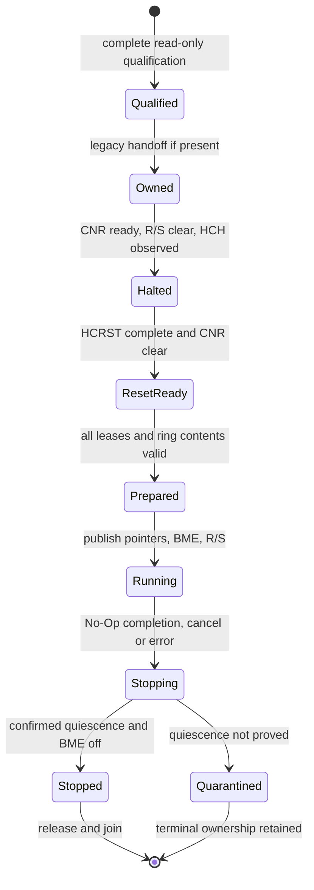

# USB.2: Rust-owned xHCI controller foundation

**Design for review; no controller-operation implementation or hardware test is
authorized by this document.** Base: accepted main
`95eb0e0c944277a4ed9f3ad0e8671e25d2d9f6cd`, the owner's merged
[USB.1 PR #22](https://github.com/veasnawt/vos/pull/22), including R0/R1.
The [Master Plan](MASTER-PLAN.md#71-usb-discovery-and-proposed-input-sequence)
sets the USB sequence. Its older local-only USB.1 wording and the
[integration report](../results/usb1-rust-integration.md) retain their historical
checkpoint meaning; USB.1 is now merged. This plan changes no milestone records.

## 1. Smallest useful result and current prerequisites

Recommend an explicit, default-off `vos.usb2=1` diagnostic: qualify **one** xHC,
obtain ownership, halt/reset it, install owned command/event rings, complete a
No-Op command, then stop and reclaim resources. A bounded verification profile
issues 260 No-Ops, one outstanding at a time, to exercise both ring wraps. This
is real VOS controller operation, not USB device enumeration. Do not issue
Enable Slot, Address Device, endpoint/transfer commands, port resets or power
changes. Starting an xHC can itself cause bus/link activity; “no transfers” here
means no VOS device-transfer requests, not an electrically inactive USB bus.

| Existing interface, inspected at the base | Consequence for USB.2 |
| --- | --- |
| [USB.1](../../arch/x86_64/xhci.c), [header](../../arch/x86_64/xhci.h), [boot adapter](../../arch/x86_64/xhci_boot.c) | Reuse bounded PCI discovery, BAR checks and existing negative vectors. Its 28-byte capability inspection is not permission to access operational registers. |
| [Rust crate](../../arch/x86_64/rust/kernel_probe.rs), [private C ABI](../../arch/x86_64/rust_kernel.h) | Extend the existing `vos_kernel` static library, single panic handler and bare-metal build; retain R0/R1 exports. No allocator or second runtime. |
| [PCI](../../arch/x86_64/pci.h) | Bus 0 and configuration offsets below 256 only; no bridge/resource allocator, ACPI resource provider or general device-claim service. |
| [PMM](../../arch/x86_64/pmm.h) | Individually allocated, zeroed 4 KiB frames below 1 GiB. No contiguous-run allocator, generic DMA service or IOMMU API. |
| [Device mappings](../../arch/x86_64/devmap.h) | Supervisor-only UC mappings, RAM/alias rejection, eight entries and 64 MiB total. Production mappings are permanent; test rollback is not a production release API. |
| [IRQ](../../arch/x86_64/irq.h), [PIT](../../arch/x86_64/pit.h), [threads](../../arch/x86_64/thread.h) | Kernel executes with IF=0, except idle halt. Approximately 100 Hz ticks advance in IRQ paths, not in a busy kernel loop. PIC/INTx exists; APIC/MSI/MSI-X routing does not. |
| [virtio-blk](../../arch/x86_64/virtio_blk.c), [virtio-net](../../arch/x86_64/virtio_net.c) | Useful ownership/barrier/quarantine precedents, not reusable xHCI transports or proof of universal DMA coherency. |
| [Keyboard](../../arch/x86_64/keyboard.h), [pointer](../../arch/x86_64/pointer.h) | Existing PS/2 input remains the sole input path. USB.2 creates no application input events or new authority. |

Two prerequisites require narrowly scoped new implementation: releasable MMIO
leases and an x86 DMA/platform adapter. Do not label these as already available.
Do not call `devmap_test_rollback`, borrow another driver's DMA pool, add a heap,
or redesign the scheduler/PCI framework to avoid these prerequisites.

## 2. Module and interoperability boundaries

Proposed source organization (future implementation, not files created here):

| Boundary | Proposed files and responsibility |
| --- | --- |
| Portable Rust protocol | `kernel/rust/usb/xhci/{mod,capabilities,ring,controller}.rs`: checked values, register layout, TRB encoding/validation, state transitions, deadlines and errors. No x86 addresses, port I/O or kernel C types. |
| Rust x86 backend | `arch/x86_64/rust/xhci_platform.rs`: narrowly audited MMIO/DMA access, barriers, checked platform leases and existing scheduler calls. |
| C kernel adapter | `arch/x86_64/xhci_platform.{c,h}`: existing PCI/PMM/devmap glue and fixed-size ABI records only. No command, ring, reset or enumeration implementation in C. |
| Integration | Existing Rust crate includes these modules; private header and `arch.mk` add dependencies/symbols. `kernel.c` starts the opt-in worker **after** `irq_init`/`sched_init`; USB.1's early read-only call stays separate. |
| Focused tests | Rust host tests for protocol/fake platform; C tests for lease/FFI glue; one bounded BIOS/UEFI runner. No migration of unrelated drivers. |

`Controller<P: Platform>` owns all state. The portable platform contract supplies
typed MMIO/DMA leases, a clock, cooperative wait and cancellation. Statically
dispatch the production Rust backend: register access, ring processing and
barriers do not cross into C per TRB. C calls occur on resource acquisition,
PCI setup, scheduling, diagnostics and final release. Future Rust PMM/PCI
implementations replace this backend, not the controller protocol.

Proposed private `*_v1` FFI contract:

- `vos_xhci_mmio_acquire_v1(bdf, offset, length, out)` / `mmio_release_v1(token)`;
  only a qualified, claimed BAR interval is accepted.
- `vos_xhci_page_alloc_v1(out)` / `page_free_v1(token)`; return one owned frame
  and its kernel CPU view. DMA eligibility is a separate backend check; a CPU
  physical address is not universally a device bus address.
- A checked PCI configuration adapter exposes reads and **whitelisted masked
  writes** for the claimed function only. Expected identity/old writable bits
  must match; never write a combined command/status DWORD to change BME.
- Reuse existing `irq_ticks`, `thread_sleep`, `thread_interrupt`, serial helpers
  and `thread_create`/`thread_state` behind the backend. Export one Rust worker
  callback with the existing `void (*)(void *)` C ABI. Its argument storage lives
  until the thread is reaped; the existing trampoline calls `thread_exit` on return.

Use `uint32_t`/`uint64_t` and `int32_t` status, never Rust enums, `bool`, `usize`,
slices or `Result` across FFI. A proposed lease record is 32 bytes:
`{ u64 token, cpu_va, device_address; u32 length, flags; }`, offsets
`0/8/16/24/28`. Check C/Rust size/alignment/offsets, zero outputs on error and
validate flags/ranges before constructing Rust wrappers. Tokens include a
generation; addresses in the FFI record are **unsafe boundary data**, not safe
public pointer APIs. All functions are kernel-private; userspace ABI v0-v5,
process grants and application loading remain unchanged.
Encode `bdf` as `u32`: bus in bits 15:8, device in 7:3, function in 2:0;
upper bits must be zero and the initial bus must be zero. Resource calls require
the owning kernel thread, IF=0 and no IRQ-handler context. Return zero on success
and defined negative statuses for invalid input, unsupported profile, busy,
allocation failure, timeout, protocol failure and quarantine; translate existing
C errors explicitly rather than exposing Rust discriminants.

## 3. Qualification and ownership

First operational profile: one explicitly qualified QEMU `qemu-xhci`
(`1b36:000d`, xHCI 1.0) on bus 0,
with the known 16 KiB BAR resource checked independently by QMP in tests. QMP
is a test oracle, never a guest runtime API. Use a private platform resource
descriptor bound to the supported device/profile and observed BAR; class/vendor
IDs alone do not establish aperture size. A future physical platform must supply
a reviewed firmware/PCI resource interval. Without one, return unsupported;
USB.1's bounds heuristic is insufficient. No BAR sizing/assignment writes.

Require assigned page-aligned MMIO, memory decoding already enabled, the qualified
QEMU xHCI 1.0 layout, accessible D0 state, at least one slot/interrupter, 4 KiB page
support, and **zero required scratchpads** initially. Reject other page sizes,
nonzero scratchpad demand, unknown power/IOMMU/coherency state, unsupported
quirks and ranges outside the qualified BAR. Address capability (AC64) and BAR
encoding are distinct. All initial DMA frames fit below 1 GiB in either address
mode, but still check every device-address range.
Require natural alignment of each selected register, not just USB.1's DWORD-
aligned CAPLENGTH. USB.1's accepted 1.1/1.2 capability decoding does not qualify
those versions for operation automatically.

Limit operational port metadata to 16 ports. Walk at most 64 extended-capability
headers using checked DWORD-relative links within the BAR; reject malformed
links, duplicate legacy ownership capabilities, truncated bodies and traversal
exhaustion. Preserve USB.1's broader read-only qualification independently.
Select the sole candidate from a complete bounded bus-0 scan; reject ambiguity
or an incomplete scan rather than silently choosing a controller. Explicit
selection can be reviewed later. Reject simultaneous `vos.usb_probe=1` and
`vos.usb2=1` before either maps the BAR: no overlapping aliases or dual owners.

Only the Rust controller and its kernel worker hold execution authority.
The backend must explicitly establish its **platform properties**:
identity DMA addressing, trusted coherent DMA for the selected memory, and no
unhandled translation requirement. There is no IOMMU implementation in VOS.
On arbitrary physical hardware those properties are unestablished. BME permits
hardware DMA beyond software buffer bounds; Rust checks cannot contain a faulty
or hostile controller without hardware isolation. No ring-3 mapping, syscall,
device handle, raw address or unrestricted hardware grant is introduced.

## 4. Memory and unsafe invariants

**Scoped MMIO prerequisite.** Extend the existing device registry with one
exclusive, generation-tagged tail lease, not a parallel mapper. While leased,
refuse subsequent mapping installation; existing framebuffer/permanent mappings
remain valid. Bound the lease by the BAR interval and existing eight-entry/64 MiB
limits. No count, byte or guard-page allowance increases. Acquisition must undo
newly allocated page tables on partial failure: today's `devmap_map` may leave
empty tables after allocation failure. Release only its owned tail entry under
kernel CR3, after CPU/IRQ users and device activity are quiescent; clear leaves,
invalidate translations, restore registry/VA capacity and free only newly created,
empty, unreferenced tables. Never relocate previous mappings or treat a stale
token as authority. The exclusive tail restriction is sufficient for this one
controller and avoids a general free-range allocator. Test normal map behavior,
mapping refusal during a lease, audits and stale-TLB rejection.

**Rust ownership.** `MmioLease`, `DmaPage` and `Controller` are non-`Copy`, private
constructors and not `Send`/`Sync`. Do not create ordinary shared Rust references
to device-mutated bytes. Use reviewed volatile access through `UnsafeCell`/raw
pointers inside the backend; safe protocol methods return values or decoded TRBs,
never raw addresses/slices with unconstrained lifetimes. CPU access to a DMA
region is phase-specific. Zeroing/publishing and reclamation are explicit;
`Drop` must never blindly free a device-visible page. Only the controller can
produce the stopped/unpublished proof accepted by normal release. An unfinished
device lease transfers to the bounded quarantine owner, not the free pool.

**MMIO.** Validate offset addition, alignment, access width and register-specific
write masks. Use aligned DWORD operations; for 64-bit address registers use the
specification's AC64-dependent access convention (native Qword when supported,
appropriate low DWORD in 32-bit mode). The legacy semaphore byte is a separately
permitted access. Never use Rust atomics or a generic read/modify/write helper on
MMIO. Encode RW1C/RW1S, reserved-preserve and reserved-zero fields explicitly.
Read-as-zero/write-only fields cannot be verified by raw readback equality.
One owner; no post-release, post-terminal-state or interrupt-context accesses.

**DMA.** Allocate separate PMM pages, not a permanently reserved static pool.
Verify alignment, non-overlap, ownership, bus-address width, checked end and
single-page/64 KiB ring-boundary requirements before publishing any address.
Use the existing supervisor kernel RAM alias with the platform-approved RAM
cache type; never map ordinary RAM through `devmap` or create UC/WB aliases.
Retain pages for the entire possible device-access lifetime. The initial zero-
scratchpad restriction avoids pretending that opaque/no-snoop scratchpad access
is covered by ordinary coherent ring memory. Noncoherent DMA/cache maintenance
and translated DMA need an explicit backend before qualification can expand.

**Rings and ordering.** One 256-TRB command page (255 command positions and one
Link TRB with Toggle Cycle), one 256-TRB event page with **no Link TRB**, and one
ERST segment. Initial software cycle states are 1; initially zeroed rings are
unavailable. Publish command payload first, the cycle field last, then the DMA
write barrier before doorbell 0. Read event cycle first, then the DMA read barrier
before decoding other fields. The x86 backend initially uses conservative
compiler ordering plus hardware fences, following the existing driver precedent;
volatile alone or an ordinary Rust atomic fence is not a portable DMA contract.
Use a reviewed same-device read to flush posted control writes where required.

Retire only the exact outstanding command after validating event type, completion
code, slot, alignment and command-page pointer. Keep producer position separate
from completion ownership; do not reuse an outstanding TRB. Validate any port-
change event's port range, count it and dequeue it without enumerating/resetting
the port. Other unsupported/malformed events terminate the diagnostic safely.
Bound a service step to 32 events and 64 status reads; ring overflow, event floods
or missing completion cause bounded failure, never unbounded draining. Update
ERDP and its EHB semantics explicitly, including when interrupts are disabled.
Reject stale software callbacks by generation. These checks do not authenticate
arbitrary DMA writes by hostile hardware.

## 5. Initialization and permitted writes

The authoritative hardware contract is Intel's
[xHCI 1.2b specification](https://cdrdv2-public.intel.com/625472/625472_xHCI_Rev1_2b.pdf):
sections 4.2 (initialization/polling), 4.6.2 (No Op), 4.9.3-4.9.4 (rings),
4.18/4.20 (coherency/scratchpads), 4.21.2 (BME), 4.22.1 and 7.1 (handoff),
5.1 and 5.4-5.6 (registers), 6.4-6.5 (TRBs/ERST). Register masks and transition
tests must cite these sections; QEMU behavior is not a substitute for them.

| Transition | Required action and limits |
| --- | --- |
| Admission | Default-off flag; reserve one manager slot and kernel worker. Start only with PMM/devmap, timer and scheduler ready. Snapshot selected PCI identity/command/BAR; no ordinary application changes. |
| Ownership | If USB Legacy Support exists, request OS ownership without changing the BIOS semaphore; wait for firmware release, then mask defined legacy SMI enables/status correctly. No forced firmware-bit clear or ownership bypass. |
| Halt/reset | Respect CNR before operational/runtime/doorbell writes. Mask xHC interrupt production, clear R/S and observe HCH; then disable BME and assert HCRST. Wait for HCRST completion and CNR clear before installing VOS memory. Never copy virtio's device-specific reset sequence. |
| Prepare | Allocate/zero four DMA pages; validate every address. Set zeroed DCBAA (no scratchpads), MaxSlotsEn=1 without enabling a device slot, CRCR and interrupter-0 ERSTSZ=1, ERDP and ERSTBA in their specified initialization order. No endpoint contexts. |
| Run | After the publication barrier, set/check PCI BME, preserving unrelated command bits and avoiding PCI status writes. Keep PCI INTx disabled, USBCMD.INTE=0 and IMAN.IE=0. Disable previously enabled MSI/MSI-X through validated capability control fields; program no interrupt destinations. Set R/S, verify running state, publish No-Op and ring doorbell 0. |
| Stop | Refuse new commands; finish or abort the outstanding command through the specified command-ring protocol. Bounded halt/reset, CNR-ready confirmation, BME-off readback and ordering proof precede release. Do not infer quiescence from a missing event or BME-off alone. |

PCI changes are confined to the selected command register's BME/INTx policy and,
when necessary, MSI/MSI-X enable controls. Memory decoding being enabled is an
initial prerequisite, not permission to reassign BARs. FLADJ/platform defaults
are preserved for the qualified diagnostic profile; unknown physical tuning is
unsupported. No port-power, PORTSC reset, PCI power-state, firmware-update or
unrelated device writes. Once taken over, do not restore firmware DMA/interrupt
enables or blindly return ownership to a firmware configuration VOS has reset.
Before ownership is obtained, withdraw only our pending request where the
handoff protocol permits; otherwise leave a precise terminal diagnostic.

## 6. Resource proposals and cleanup

These are **recommended implementation bounds, not measurements or approved
storage allocations**. Enforce them with layout assertions and native counters.

| Resource, one controller | Proposed initial cost/bound |
| --- | --- |
| Command ring | 4,096 bytes; 256 TRBs, one outstanding command |
| Event ring | 4,096 bytes; 256 TRBs, one interrupter |
| DCBAA | One 4,096-byte page; full 2,048-byte array zeroed, entry 0 zero |
| ERST | One 4,096-byte page; one 16-byte descriptor; isolation/simplicity over packing |
| DMA total | **16,384 bytes / four independently allocated pages** |
| Rust control state | At most 2,048 bytes in one dynamically acquired 4 KiB CPU-only page; no heap allocator |
| MMIO | One lease covering at most the initial 16 KiB BAR; one 4 KiB VA guard, no RAM backing for MMIO |
| Additional page tables | At most two 4 KiB PT pages for the lease's virtual-boundary case; shared existing device PD is baseline memory |
| Incremental physical high-water | **28 KiB**: 16 KiB DMA + 4 KiB control + up to 8 KiB PTs; plus proposed permanent bookkeeping <=512 bytes |
| Worker | One existing thread slot / 16 KiB guarded stack from the preallocated pool; count this residency/opportunity cost, not another 16 KiB of newly allocated RAM |
| Healthy stopped/never activated | No DMA/control/leased PT pages or worker retained; only bounded permanent bookkeeping |
| Quarantine | At most 16 KiB DMA + 8 KiB leased PTs retained; control page released only after worker termination and summary transfer; no further activation this boot |

The control page costs more than a 2 KiB static object while active but costs no
such page while disabled/stopped. Rings already require page-aligned backing;
packing ERST/DCBAA saves a page only by mixing more lifetimes. Defer that
optimization until profiling justifies it. Proposed loaded text/rodata growth
review budget: 32 KiB; permanent BSS growth <=512 bytes. Measure actual linkage
and bring an exceeded proposal back for review, not an automatic limit increase.

Scratchpad support is not silently approximated: reject any nonzero requirement.
A later four-scratchpad variant with a separate array page would require up to
nine DMA pages (36 KiB), plus the same CPU/PT overhead, and verified cache/no-snoop
handling. It is outside the first operational profile, not funded by this plan.

Before publication of DMA pointers, failure releases acquired resources in
reverse order. After publication, normal release requires the full stopped proof.
On uncertain halt/reset or device disappearance: stop issuing commands, mask
available interrupt paths, attempt BME containment where accessible, transfer
the live leases to one terminal quarantine record and keep DMA pages unavailable
to the PMM. Retain required MMIO mapping if device access safety is uncertain.
No automatic reset/reinitialization loop, freeing unknown firmware buffers or
reallocating quarantined pages. Cancellation takes the same stop path.

The worker returns only after ordinary ownership has been released or transferred
to quarantine. The supervisor must observe `thread_state(id)==THREAD_FREE`
before releasing argument/control storage; a completion flag is not reclamation.
All reclamation runs under kernel CR3. Repeated clean starts must restore PMM,
devmap count/bytes/PTs, thread count and lease slots to baseline. A quarantine
occupies the single controller slot; it cannot accumulate on repeated requests.

## 7. Timing, polling and performance evidence

Use cooperative polling first: the existing kernel cannot safely sit in an
IF=0 loop waiting for `irq_ticks()` to advance. A bounded `step(now)` returns
Ready/Wait/Terminal; the worker sleeps one tick between incomplete polls and
checks cancellation at each step. Under present PIT settings this introduces
roughly 10 ms polling quantization, not a low-latency or real-time guarantee.
The diagnostic stops when finished, so it needs no perpetual idle poller.

Proposed safety deadlines: handoff at most one second per specification; CNR,
reset, run and command waits one second each; halt 100 ms; stop/abort one second,
then at most one terminal reset attempt. These are conservative policy proposals,
not observed performance or replacements for register completion conditions.
Use checked tick conversion and wrap-safe elapsed arithmetic with intervals
below half the counter range. No arbitrary sleep is evidence of completion.
PIT tick quantization/TCG do not prove precise specification wall-clock timing;
physical qualification needs a validated clock and sampling bound, especially
for the handoff deadline, before claiming that timing requirement is met.
No extension of a failed deadline without diagnosis. Timer failure while asleep
and a physical MMIO access that never returns cannot be solved by this driver;
the QEMU runner needs an external bounded watchdog and preserves such failures.

PIC INTx is the smallest later interrupt option only if firmware routing, level
trigger, a free handler and device acknowledgement are verified. A short top half
must not allocate/block/wake; deferred work runs in thread context, bounded and
serialized with the worker. MSI/MSI-X requires new platform routing support.
Neither is required for the first polling implementation. Compare modes only
after both exist; never report an unimplemented interrupt-mode benchmark.

Record optimized-build raw samples and configuration for initialization stages,
doorbell-to-observed-completion latency, events/step, empty polls, sleep ticks,
worker CPU time, idle QEMU CPU utilization, allocation/PT/stack high-water and
loaded ELF segment growth. Guest tick measurements are coarse; external marker
latency includes serial/host scheduling. Record those limits, host load, toolchain
and QEMU version. Use the same machine/CPU/RAM/firmware for before/after USB.1
discovery and no-USB.2 boot controls; do not compare a new No-Op service with
read-only discovery as though they do equal work. Sanitizer/fake-platform timing
is separate from release timing. No results or performance targets exist yet.
Do not add buffer copies to hide ownership problems: descriptors/events are
encoded/consumed in owned DMA pages; application zero-copy transfers are not in scope.

## 8. Verification and physical-hardware boundary

| Focused future check | Required evidence |
| --- | --- |
| Rust protocol tests | Fake MMIO/DMA/clock operation traces assert every transition, write mask and publication order; actual kernel modules compiled on host without hardware instructions. |
| Qualification negatives | Bad versions/offset arithmetic, truncated/cyclic capabilities, BAR overflow/aperture, 32-bit DMA overflow, missing 4 KiB support, nonzero scratchpads, ambiguous selection and unsupported platform properties rejected before unsafe writes. |
| Rings | Cycle/Link toggle and event wrap, single outstanding credit, full/flood behavior, malformed completion/port ID/pointer, duplicate completion, stale generation and no access after stop. |
| Lease/FFI | Layout assertions; failure at every allocation/PT step; existing mappings unchanged; partial acquisition rollback, alias rejection, stale/double release, TLB invalidation and kernel-CR3 checks. |
| Lifecycle | Handoff refusal, stuck CNR/reset/halt, lost completion, cancellation in every state, disappearance and unconfirmed-reset quarantine. Prove free versus retained pages, no retry after quarantine, and actual worker reaping. |
| BIOS and UEFI QEMU | Same qualified xHCI profile, no host disks/network: real reset, owned address programming, No-Op completions/wrap, bounded stop and resource-baseline restoration. Independently compare QMP PCI/BAR metadata and serial counters. Host faults are models, not native fault-path claims. |
| Compatibility | Existing USB.1 flag-off/read-only cases, Rust probe and real R1 ELF path, strict kernel layout/static instruction checks, normal PS/2 GUI/pointer, vsh, hello, Rixie and console restoration. No full N3/N4 campaign. |

Include hosted Rust tests plus ASan/UBSan for C adapters and reference models;
do not claim Rust machine code is instrumented by a C sanitizer. Future native
fault injection must exercise the real stop path without disabling guards.
Archive compact commands, source/tool/image hashes, raw serial, allocation/state
counters and genuine QEMU screenshots when a visible diagnostic is useful.
Keep manual normal application use separate from automated wrap/exhaustion tests.
This architecture-only task runs none of those hardware/implementation tests.

Physical activation needs **separate owner approval** on a spare x86_64 machine
with valuable disks disconnected and a recovery/power-off procedure. First do a
read-only inventory of firmware/PCI resources, ownership, D0, DMA/coherency/IOMMU
and interrupt assumptions; select a known compatible controller. Verify removable
boot media/serial capture and an independent input/recovery route. Establish that
firmware DMA is quiesced before unsafe memory reuse; semaphore handoff alone does
not prove it. Then, only after explicit write authorization, test one selected
controller's handoff/reset/No-Op/stop and counters before any USB device transfer.
Stop on unexpected DMA, timeout, firmware contention or resource discrepancy;
retain quarantine rather than retrying. QEMU acceptance is not this qualification.

## 9. Focused implementation sequence and acceptance

1. Add portable Rust capability/ring/state logic to the existing crate and fake-
   platform tests; retain R0/R1 exports, panic forwarding and build flags. No
   hardware activation in this first implementation slice.
2. Add/test the narrow scoped-devmap lease and PMM/FFI backend, including partial
   rollback and exact memory/counter assertions. Preserve old permanent-map APIs.
3. Add the explicit qualified QEMU resource profile, cooperative worker, ownership,
   reset and address-publication path. Only a separately authorized operational
   flag allows writes; verify stop/quarantine before relying on success cases.
4. Demonstrate No-Op and ring wrap on BIOS/UEFI, run affected compatibility checks,
   measure release resources/timing, preserve evidence and review the exact diff.

USB.2's initial acceptance means: Rust owns controller policy and rings; every
write has qualified ownership; real No-Op round trips and wrapping work on both
firmware paths; failures are bounded and resources are reclaimed or explicitly
quarantined; default boot and ABIs remain unchanged; measured memory/image costs
fit reviewed limits. No USB.3/USB.4/USB.5, HID, application sockets/ABI, mouse,
general hotplug, power management or physical-hardware claim is included.

Before implementation approval, the owner should confirm the one-controller,
polling-only, zero-scratchpad QEMU profile and proposed memory/deadline bounds;
authorize the scoped mapping prerequisite as part of USB.2; and approve the
concrete source/test scope and ordinary build/evidence provision. Physical BAR
resource discovery, translated/noncoherent DMA and interrupt-mode expansion stay
explicit later decisions. No prior D1 reservation, controller or executor-
attestation workflow is required or reactivated. The next requested implementation
should be **step 1 only**, with the remaining steps visible as dependencies.
