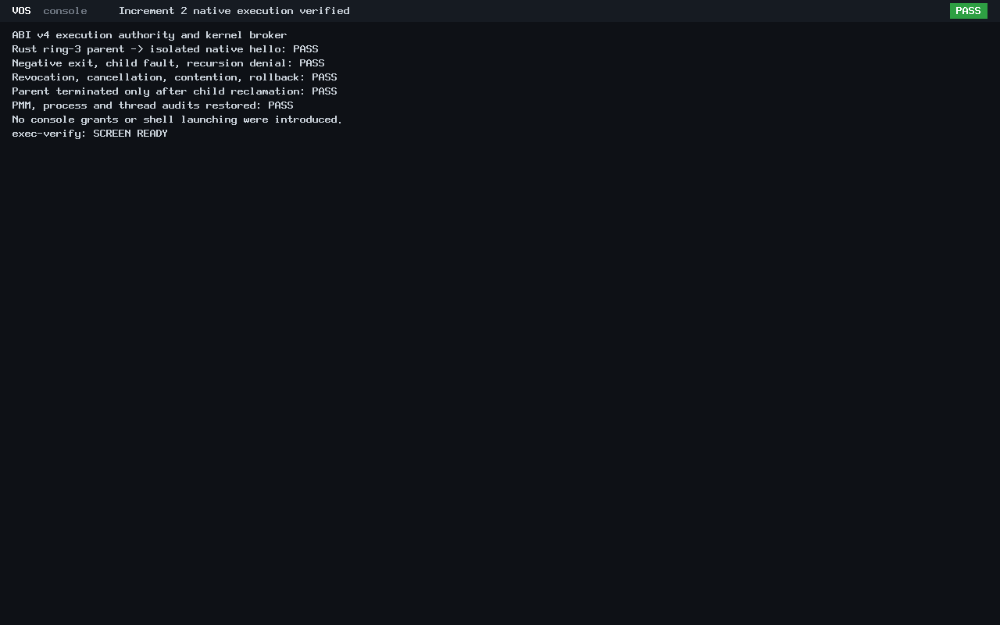

# Unified native application launching — Increment 2

Increment 2 implements ABI v4 execution authority and a bounded kernel broker.
BIOS and UEFI verification passed on 2026-10-25. This is independent native
VOS execution under QEMU TCG, not physical-computer validation. No Increment 3
console handoff or N6 implementation is included.

Baseline: main 57e230843f23ab6eb8e79d979fcf1d7d2f0a27c3, accepted Increment 1 PR #9.
Development branch: feat/app-execution-broker. Publication is not authorized;
the final verified implementation is committed locally only.

## Implemented contract

The [ABI v4 specification](../abi/syscall-v4.md) defines the exact 48-byte
enumeration record and packed signed-exit/fault/cancellation completion.
The public SDK extension reuses the existing Rust runtime. Syscalls 14/15 are
version gated; ABI v0–v3 retain ENOSYS. Logical IDs and authority-filtered,
generation-bound cookies keep the trusted catalog private.

Explicit READY-process grants separate enumeration and execution rights.
A single kernel broker owns a single scalar request and isolated child.
It joins the child thread before process destruction under kernel CR3 and
publishes completion only after reclamation. Grant revocation, parent kill,
queued/loading/running/reap/publication cancellation, rollback and immutable
DONE are implemented. No user buffer is retained across a blocking execution
call. Children receive no implicit privileged grants.

The normal build links the dormant broker foundation without installing shell
execution authority. The bounded native verification profile provisions only
the non-interactive Rust probe. It has safe, prefixed debug_write diagnostics
and no console grant. The accepted vsh, hello and Rixie ELFs retain their exact
historical identities; Rixie is cataloged but never launched by this fixture.

## Executed verification

| Check | Result | Scope |
|---|---|---|
| Strict C syntax | PASS | Kernel and hosted harness |
| ASan/UBSan | 11,232 assertions PASS | Actual exec.c; modeled scheduler/loader, reused by hash |
| Rust SDK | 4 tests PASS | Layout, decode, wrappers, zero/malformed records; reused by hash |
| Controller admission | 33 cases PASS | Identity reuse, authorization/source/manifest mismatches, quota/reserve/isolation rejection |
| Make expansion | 27 recipes inspected | Nine fixtures each with one/two/four dollar variants |
| Native ELF validation | 13 applications PASS | ELF64 x86_64, ABI profiles, entry/segment restrictions |
| Negative ELF controls | PASS | Actual build and kernel validators reject future ABI 5 and W+X |
| BIOS q35/TCG, 128 MiB | PASS | Ring-3 probe, scheduler, reclamation, normal shell |
| UEFI OVMF q35/TCG, 128 MiB | PASS | Same extracted kernel/application payload, native probe and shell |

Each firmware boot recorded:

- Four actual ABI v0–v3 probes rejected the new syscalls with ENOSYS.
- Authority-filtered enumeration, invalid pointers/capacities/cookies,
  hidden/unknown identities, absent rights and stale/revoked grants.
- Authorized hello exit 0, signed exit -7, an isolated kernel-address write
  fault (vector 14), and denied recursive launch.
- Process-table and thread exhaustion, first/partial allocation failures,
  invalid ELF and complete rollback.
- Cancellation while queued, loaded, before start, running, reaping and before
  publication; post-DONE revocation preserves immutable completion.
- Actual one-slot contention from another ring-3 process, an uncooperative
  spinning child, and parent termination after cancellation-safe child cleanup.
- 33 trusted controls, 23 submitted/completed requests, 15 starts,
  18 loaded-process reclamations, 6 cancellations and 8 pre-start failures.
- PMM/process/thread counts restored, handle/process/scheduler invariants and
  guarded-stack canaries intact, kernel CR3 destruction and broker-thread join.
- Existing shell help, echo, pwd, ls, cd, cat, prompt editing and exit; apps and
  rixie remain unknown commands. Shell process reclamation and final HLT checked.

There was no kernel hang or invariant failure in the executed native runs.
Native cancellation and fault evidence is present in both raw serial logs.
The host model results alone are not used to establish kernel cleanup.

## Authentic screenshots

The guest itself renders this summary after native lifecycle checks and before
starting unchanged vsh. Both independent boots render identical pixels and
therefore have identical PNG hashes; raw serial logs and firmware commands
distinguish the runs.




## Preserved failures and controlled continuation

The original two attempts remain immutable:

1. attempt-1: sanitizer/model and optimized host results passed; SDK compilation
   rejected two integer negations. Only the intended zero checks were corrected.
2. attempt-2: four Rust tests and native SDK/probe compiled; the fixture macro
   expanded $@ before target execution. ld then used generated crt0.o as its
   output and did not produce the expected fixture ELFs. Protected binaries
   were unaffected. No QEMU ran in either failed attempt.

The existing ledger allowed only two fresh attempt identities. Owner request
7aca8ca6-d6e2-40b9-ab75-26fa4a57905d explicitly authorized one additive identity,
continuation-1, with an 80 MiB individual work bound inside the unchanged
192 MiB phase and 3,360 MiB aggregate ceilings. Its separately pinned
authorization references the original ledger, baseline, both manifests and
exact pre-repair/runtime source identities. Original attempt admission and
historical records remain unchanged. Further identities are rejected.

Two stopped preflight controllers are also retained. The first candidate
staging collapsed $$ to a single dollar; the second corrected the candidate
but its inspection needle had the same transport error. Neither changed
repository source or created the continuation work directory. The validated
controller corrected literal transport, reran all 33 admission cases, proved
the Make expansion, and ran the sole continuation once. No failed controller
is relabeled as passing.

GNU Make call/eval expands the macro before the generated recipe runs.
The sole recipe correction is -o $@ to -o $$@ in EXEC_FIXTURE. Dry-run output
shows the exact nonempty ELF target for all nine fixtures; one dollar loses
the target, while four leave a shell variable. Linker flags and other rules
are unchanged.

All old records, seven protected binaries, 22 historical archives, thirteen
worktrees, two stashes, unrelated tracked bytes and refs are checked before
final staging. The unfinished historical D1r3 root remains unfinished; this
work does not seal or archive it.

## Storage and evidence

Accounting uses cumulative allocated-byte high-water growth with no shrink
credits. Original failures, controller preflights, source growth, evidence
copies and a fixed Git provision remain charged. Increment 1's unused
allocation is not reassigned. C:, E: and Linux reserve gates are unchanged.

The [evidence index](app-exec/evidence.json) records the measured pre-finalization
checkpoint, manifests and artifact hashes. The guard's final receipt and final
accounting remain in the preserved local phase root; the final user report
gives the post-commit charge. This avoids claiming a pre-commit measurement is
the final value.

Compact committed records:

- [Exact file inventory](app-exec/changed-files.txt)
- [Full workload result](app-exec/result.json)
- [Hosted and Rust results](app-exec/host-test.txt)
- [BIOS serial](app-exec/bios.serial.txt)
- [UEFI serial](app-exec/uefi.serial.txt)
- [Optimized host baseline](app-exec/performance.json)

The optimized baseline uses -O2 without sanitizers, seven samples of actual
broker code with a modeled scheduler/loader and 1,000 repeated requests plus
negative cases per sample. This is not native process-launch latency or a
comparison with an earlier implementation. Firmware startup/elapsed timings
are diagnostic measurements, not responsiveness guarantees.

## Reproduction and manual inspection

Run automated verification only through a newly admitted controller. The
historical identities are consumed and must never be recycled. The driver
rejects reused identities and requires the pinned additive authorization for
continuation-1. Reusing valid hosted/Rust evidence requires matching source,
binary, log and manifest hashes.

For a fresh owner-authorized fixture build, set a nonempty admitted output
directory and the accepted compiler, then use:

```sh
: "${admitted_output:?Set a fresh admitted output directory first}"
make exec-probe-uefi-iso \
  EXEC_BUILD="$admitted_output/image" \
  RUSTC="$HOME/.rustup/toolchains/nightly-2026-09-03-x86_64-unknown-linux-gnu/bin/rustc"
```

The completed local images, RO ext2 disk, per-firmware QEMU command JSON,
fresh OVMF variable store, registers, PPM/PNG screenshots and manifests remain
under build/app-exec-20261025T033737Z/continuation-1. BIOS manual display can use
the existing admitted products without rebuilding:

```sh
run="$HOME/src/myos/build/app-exec-20261025T033737Z/continuation-1"
qemu-system-x86_64 -machine q35 -accel tcg -m 128M \
  -cdrom "$run/image/kernel/vos.iso" -boot d -nic none \
  -serial stdio -no-reboot -no-shutdown \
  -drive "file=$run/disk.img,if=none,id=vs0,format=raw,readonly=on" \
  -device virtio-blk-pci,drive=vs0,disable-legacy=on
```

The diagnostic probe runs automatically, displays its checked summary briefly,
then starts vsh. Try help, echo, pwd, ls, cd docs, cat welcome.txt, cd / and
exit. apps and rixie still cannot launch programs. Automated runs use the exact
saved command JSON with display=none and QMP input. UEFI adds read-only
OVMF_CODE_4M.fd and a fresh writable copy of OVMF_VARS_4M.fd; do not overwrite
the preserved variable store. Any new manual artifact must fit its admitted
storage allowance. Do not run another VOS-accessing process while the
development controller is active.

## Limits and next scope

QEMU BIOS/OVMF success does not establish physical x86_64 hardware readiness,
authenticated boot or production security. The scheduler remains the existing
single-CPU design. This is a bounded diagnostic execution foundation with no
background jobs, recursive launching, filesystem executables, package install,
application networking or privilege inheritance.

Increment 2 is ready for owner review after its local commit. Increment 3
requires separate authorization for execution grants to vsh, interactive shell
commands, explicit foreground console ownership transfer/restoration and the
corresponding focused cancellation/input checks. That work has not started.
