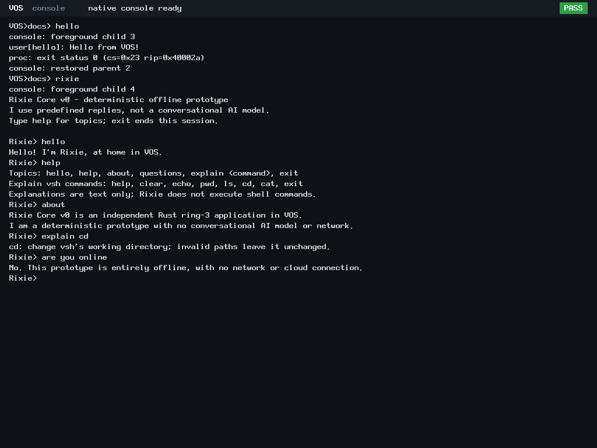
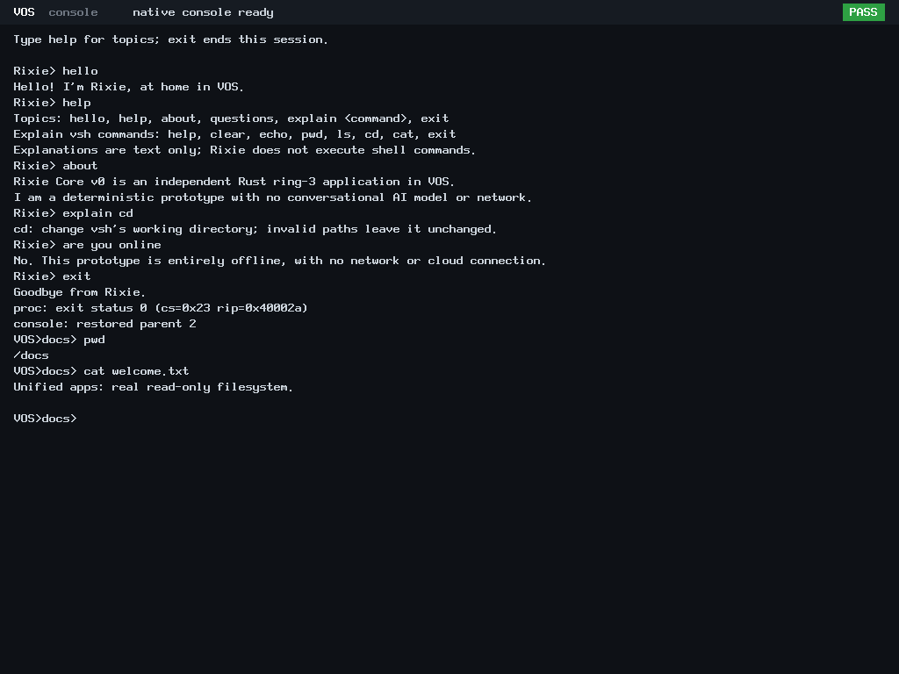

# Unified application launching: Increment 3

Status: focused host and native BIOS/UEFI verification PASS; local publication
candidate only. This does not establish physical-hardware readiness.

## Implementation

The common system payload now boots ABI v4 Rust vsh with explicit catalog
enumeration, run and foreground authority for hello and rixie only. The new
commands are `apps`, `hello` and `rixie`. Names resolve through the trusted
catalog; arbitrary paths and application arguments are rejected. Rixie is
the existing independent offline deterministic Rust ABI v3 application.
Hello remains the accepted ABI v0 ELF. Neither application inherits shell
execution, file, channel or networking grants.

The existing kernel broker owns the single request and isolated child.
Console transfer suspends keyboard delivery, drains bounded typeahead,
clears old pending line/editor/modifier state, and installs an exclusive child
lease. Non-owner console I/O is denied; non-owner debug writes cannot reach
the foreground display. Output still has application-prefixed serial records.
After thread termination and reaping, child destruction runs under kernel CR3.
Restoration validates the live parent PID/TID, authority and console generation.
Revoked or dead parents cannot regain ownership. Blocked child readers unwind
before reclamation. There are no production session deadlines.

See the [ABI contract](../abi/syscall-v4.md), [machine-readable results](app-handoff/result.json),
[evidence index](app-handoff/evidence.json), [host results](app-handoff/host-test.txt),
[BIOS serial records](app-handoff/bios.serial.txt),
[UEFI serial records](app-handoff/uefi.serial.txt),
[performance observations](app-handoff/performance.json) and
[changed-file inventory](app-handoff/changed-files.txt).

## Verification actually executed

| Check | Result |
|---|---|
| Broker ASan/UBSan, actual exec.c with modeled scheduler/loader | 11,232 assertions PASS, reused unchanged from attempt 1 |
| Console ASan/UBSan, actual console/keyboard/editor with modeled hardware | 49,499 assertions PASS, reused unchanged |
| Rust SDK structure/wrapper tests | 4 PASS, reused unchanged |
| Catalog ASan/UBSan, new ABI v4 shell and legacy ABI v3 payloads | 97,339 assertions per input set PASS |
| Application ELF validation | All 14 fixture/application ELFs revalidated read-only |
| Production BIOS and UEFI | PASS: real shell and Rixie sessions, repeated launches, cwd/prompt, cleanup and halted kernel |
| Instrumented BIOS and UEFI | PASS: 21 native handoff cases per firmware, plus existing broker regression |

Each instrumented run recorded 20 completed requests, 16 loaded/reclaimed
children, 14 child starts, 6 cancelled requests and 6 failures. Those categories
are not interchangeable: pre-start failures never start a child, and loaded
children can require reclamation without starting. Console statistics recorded
16 transfers, 11 restorations and 5 abandoned leases. Every case restored its
PMM/process/thread baseline and audited process/scheduler invariants.

The 21 cases cover interactive Rixie and cross-boundary typeahead; hello;
negative child exit; actual page fault; cancellation with a competing ungranted
reader/writer; cancellation at reap; queued execution revocation; running parent
console revocation; parent termination; actual blocked Rixie reader revocation;
frame/process/thread exhaustion and rollback; invalid ELF; revocation after
handoff and before completion; running execution revocation; filtered enumeration;
unknown IDs/flags; ENUM-only denial; RUN|FOREGROUND without ENUM; and recursive
launch denial. Host models are identified as models and do not replace these
ring-3 checks.

The unaffected ABI v0-v3 contract is preserved. Real ABI v0 hello, ABI v3 Rixie
and ABI v4 vsh execute in the native profiles. The existing instrumented broker
regression also executes its legacy ABI v0-v3 fixtures and records:
`legacy=4 controls=33 submitted=23 started=15 reclaimed=18 cancelled=6 failed=8`.
No historical N3/N4 campaign was repeated.

## Authentic screenshots



Real independent Rixie in the BIOS common image, answering help/about and
offline questions while vsh is suspended.


BIOS return to the existing `VOS>docs>` shell, with `pwd` and filesystem
reading still available after child exit.


The same real interaction under OVMF UEFI.



UEFI restoration to the unchanged working directory and prompt. All four PNGs
are direct QMP screen captures (1024x768), with no image editing.

## Failure history and authorized recovery

Phase: `build/app-console-20261025T051241Z`.
Accepted baseline: `3ad4dd1acb45b65852769ab52f8eba9941e6361d`.
Branch: `feat/app-console-handoff`.

The original stopped syntax-controller record is retained: its command included
an unchanged source file outside the admitted syntax argument list. A queued
write after that failure was never executed. An additive controller recovery
preserved that failure and corrected the command within the same source scope.

Attempt 1 remains FAILED_STORAGE: **120.73828125 MiB against 112 MiB**,
an **8.73828125 MiB overage**. Its guard stop is `STOP individual attempt limit`.
The guard terminated QEMU after the existing broker regression passed and before
the new handoff cases. No completed result.json or manifest.json was written by
that interrupted driver; none was fabricated afterward. A separate additive
forensic manifest records the immutable failed attempt and its entire charge.
Valid host/build evidence remains usable, but it did not establish native
handoff correctness.

The owner explicitly authorized only attempt 2 to proceed. Its pinned receipt
binds the exact phase, accepted baseline, failed manifest, stop record and owner
authorization. Seventeen focused rejection checks pass, including missing,
forged, stale and mismatched authorization, growing failed-attempt consumption,
an over-limit second attempt and an unexpected third attempt. Attempt 2's
original 112 MiB limit and the 256 MiB phase/3,360 MiB aggregate ceilings remain
unchanged. No old failure was relabeled or limit retroactively raised.

Attempt 2 reused existing artifacts read-only after manifest/hash and ELF/payload
checks; it did not rebuild or recopy accepted build trees. It ran the pending
native verification and captured new evidence in a distinct directory.
The recovery controller continuously checked isolation, immutable failed-attempt
identity, accounting and physical reserves. Historical controller intervals and
the stopped attempt remain distinct from this continuation.

At the post-runtime accounting checkpoint, attempt 2 charged
**1.371094 MiB**, the phase charged
**127.203125/256 MiB**, and aggregate charged
**2700.585938/3,360 MiB**.
Documentation, metadata and local-commit overhead remain charged by the same
controller; the final receipt supersedes this checkpoint without removing any
historical charge. Seven protected binaries, 22 historical archives, 13 worktrees,
two stashes and prior application evidence are preservation requirements.

## Reproduction and manual interaction

The existing production images from this verification can be used directly,
without rebuilding or writing into either historical attempt. Run a manual
session only after exclusive execution and the existing storage/reserve gates
are admitted. Use a fresh approved output directory for any UEFI variable store.

From the repository in WSL, BIOS display-only launch:

```sh
phase="$PWD/build/app-console-20261025T051241Z"
qemu-system-x86_64 -machine q35 -accel tcg -m 128M \
  -cdrom "$phase/attempt-1/image/kernel/vos.iso" -boot d \
  -nic none -vga none -device VGA,edid=on,xres=1024,yres=768 \
  -serial stdio -no-reboot -no-shutdown \
  -drive "file=$phase/attempt-1/disk.img,if=none,id=vs0,format=raw,readonly=on" \
  -device virtio-blk-pci,drive=vs0,disable-legacy=on
```

For UEFI, substitute `vos-uefi.iso` and add these arguments, using a fresh
writable copy of the OVMF variable template in an admitted output directory:

```sh
-drive if=pflash,format=raw,unit=0,readonly=on,file=/usr/share/OVMF/OVMF_CODE_4M.fd \
-drive "if=pflash,format=raw,unit=1,file=$manual_output/OVMF_VARS_4M.fd"
```

Do not reuse either attempt's writable OVMF variable file for manual sessions.
The recorded per-profile `command.json` contains the exact headless/QMP test
configuration. The keyboard must target QEMU's display window for manual use.

Try `apps`, `hello`, `cd docs`, `rixie`, then inside Rixie `hello`,
`help`, `about`, `explain cd`, `are you online`, and `exit`.
The shell returns to `VOS>docs>`; `pwd` returns `/docs` and
`cat welcome.txt` reads the real read-only fixture. Repeat launches, use
Backspace, and try an unknown name or `hello extra`. Finally shell `exit`
returns to the halted kernel after cleanup.

The original full-build test driver is preserved as attempt 1's recipe; that
recipe exceeded its 112 MiB attempt provision and must not be rerun under the
same provision. The additive recovery controller's `reuse-native.py` invokes
the same checked-in native boot/interaction functions using immutable existing
artifacts. Receipt, driver and image hashes are in the evidence index.

## Limits and measurements

No background/recursive jobs, arbitrary executable paths, arguments, filesystem
ELF loading, packages, application network authority or N6 desktop components.
Rixie remains an offline deterministic prototype. QEMU success does not establish
physical PS/2, firmware or native hardware compatibility; the target remains
independent physical x86_64 computers.

Production QEMU TCG startup-to-prompt observations were
0.669 s (BIOS) and
4.071 s (UEFI).
These include emulator/firmware startup and are not native hardware latency.
Per-command polling timings start after the QMP key helper returns; they exclude
key-delivery dwell and are not end-to-end input latency. No matching prior
performance baseline supports a regression or optimization claim. Seven optimized
host runs passed, but their timing samples were in memory when attempt 1 stopped;
they are explicitly unavailable and were not invented or conflated with sanitizer
measurements.
