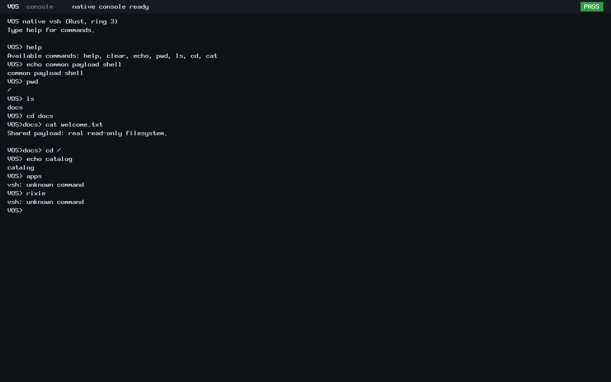

# Unified native application payload: Increment 1

The common payload and trusted catalog pass their focused checks on
`feat/unified-app-payload` from accepted main
`5b23fcbc09e81ee182ed3bece11d26b3f560edae`. Changes remain uncommitted for owner review.

## Delivered scope

New `apps-iso` / `apps-uefi-iso` packaging includes separate native vsh, hello and
Rixie ELFs. Both firmware variants carry identical kernel/application bytes and
bootstrap the same unchanged Rust shell. The legacy default and demonstration
targets remain preserved. See the [application guide](../applications.md).

The kernel-private catalog has eight-entry/15-character bounds, unique logical
IDs/names, command-name conflict checks, version/policy validation and the existing
ELF validator. It validates all sources before any payload application runs.
Source pages remain boot-reserved; no application is linked into the kernel.

There is no runtime execution API, child-process broker, console handoff, new
shell command or application networking. ABI v0-v3, SDK, existing process and
capability implementations remain unchanged.

## Focused results

| Check | Result |
| --- | --- |
| Catalog ASan/UBSan | 97,339 assertions PASS, including 392-byte erasure assertions on rejection |
| Capacity/enumeration | Eight valid entries; ninth rejected; bounds/null/corrupt-count lookups rejected |
| Metadata/identity | Duplicate IDs/names, reserved command names, invalid names/version/policy and unsupported console ABI rejected |
| Executables | All short-header lengths, empty/oversized/overflowing sources, invalid magic/type, W+X and future ABI rejected |
| Publication safety | Rejected catalogs empty; output canaries preserved; no allocation, execution or grants |
| Native application compatibility | Independently rebuilt hello, vsh and Rixie match accepted ELF hashes |
| ISO verification | Extracted kernel and all three ELFs match between BIOS/UEFI and build products; identical application/bootstrap GRUB directives |
| BIOS / UEFI | PASS / PASS: three catalog entries validated before hello, ten shell interactions, shell exit/reclamation and final halt |
| Existing shell behavior | Help/echo, Backspace, read-only files and normalized cwd prompt work |
| Scope boundary | `apps` and `rixie` return unknown command; cataloging does not launch Rixie |
| Read-only disk | Fixture SHA-256 unchanged after both boots |

Application identities:

| Executable | SHA-256 |
| --- | --- |
| vsh | `4a837277422f97c86f3c3a5ba0fef15de22c002addf9243a4b5d78bd73b5ad5f` |
| hello | `c6c6416195a0f18d680d7f8f19be52ce02ff02912ef3bac45324fbe88006cd06` |
| rixie | `77104da3b33caf809daf5e6674ac4e2fa9edf6a9e2e5dd59828514df76490d32` |

The shared kernel SHA-256 is
`4a8413af7c0149c1bdd101ee38adac944a02a4fb91257dd0c7f2524e382f59b0`.
This is a fresh increment build; none of the seven historical protected binaries
was rebuilt or overwritten.

## Measurements

The catalog is 392 bytes with 48-byte entries and no dynamic allocation.
A separate optimized `-O2` hosted model measured a median 964.36 ns per three-entry
catalog build (seven samples, 10,000 builds each). This is a first baseline, not a
speedup, kernel latency or throughput claim. Sanitizer results are separate.

Observed QEMU launch-to-shell times were 0.955 seconds BIOS and 3.686 seconds UEFI;
whole scripted boot/interaction/exit times were 3.690 and 6.605 seconds. They include
TCG/firmware/peer pacing, not guaranteed physical-machine response times. Raw
compiler, Rust/QEMU versions, load averages and samples are in the result record.

## Authentic captures

These are lossless PNG conversions of independent QMP framebuffer captures.
Identical pixels reflect identical scripted interaction, not invented behavior.
The unknown-command replies explicitly show that external launching is deferred.

## Evidence, storage and preservation

[Evidence index](app-payload/evidence.json), [raw result](app-payload/result.json),
[host assertions](app-payload/host-test.txt) and [exact inventory](app-payload/changed-files.txt)
identify the tested source, images, captures and raw records. The full successful
attempt is `build/app-launch-20261025T015543Z/attempt-1`; its 202-entry manifest
SHA-256 is `a481b78c6a724819f1249d3bc399e7d4ba9041bed5b163713928d58a52e7fa1c`.

The independent immutable `APP-BUDGET.json` commissions 160 MiB:
two 64 MiB attempts, 16 MiB finalization and 16 MiB metadata/retry provision.
Only attempt 1 was used. Cumulative per-path positive-growth accounting gives no
shrink/deletion credit. The 3,360 MiB aggregate ceiling, original host reserves,
90-second isolation queries and stop conditions remain enforced.
The phase's `APP-ACCOUNTING.json` and final guard receipt record final consumption.

Antigravity's retired N4/N5 roots remain in the independently verified archive;
the sealed historical N5 ledger is unchanged. The retirement manifest/receipt,
accepted N3 evidence, seven protected binaries, all thirteen worktrees and two
stashes are preservation anchors. D1r3 remains unfinished, unsealed and unarchived.
No historical runtime campaign was repeated, and no storage management was done.

## Finalization recovery

The original controller completed tests and preservation checks and wrote its
manifest/receipt, then failed while serializing the final response: the passed
field was supplied twice. Its failed guard result, violation record and response
remain unchanged. A fresh admitted evidence-only continuation corrects that
serialization with focused positive/negative regression checks, without changing
runtime code, validators, isolation rules or storage limits. No completed tests
were rerun. Monitoring applies to each bounded execution window; no uninterrupted
monitoring is claimed between the stopped controller and fresh admission.

## Limitations and next action

QEMU-only verification does not establish native physical x86_64 compatibility.
Trusted provisioning is not authenticated boot; fixed image contents require a
build to change. Catalog source buffers are kernel-owned readable memory, not a
userspace pointer API. Retained modules intentionally keep their reserved pages.
The current normal payload is provided by the new apps targets; old default ISO
and per-application test configurations remain unchanged.

Increment 1 is ready for owner review. Increment 2 needs separate approval for
execution authority, bounded foreground execution, cleanup and console restoration.
No later increment, syscall, VGet/VPM/.vapp work, filesystem executable loading or
N6 desktop component was started.
