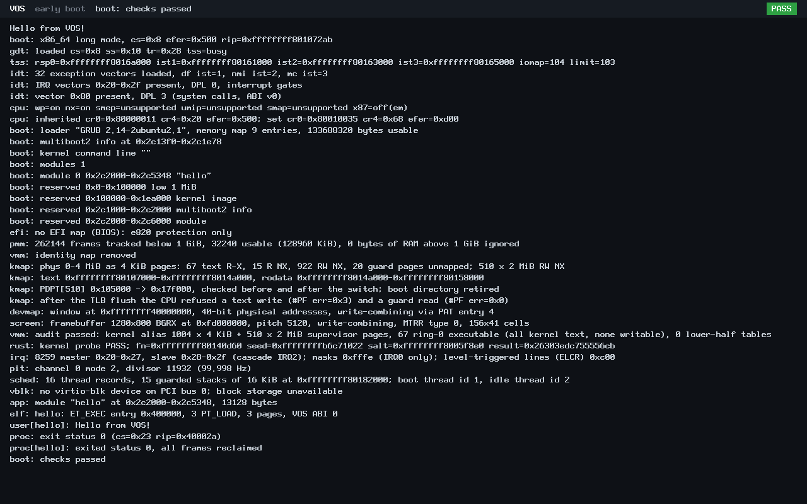
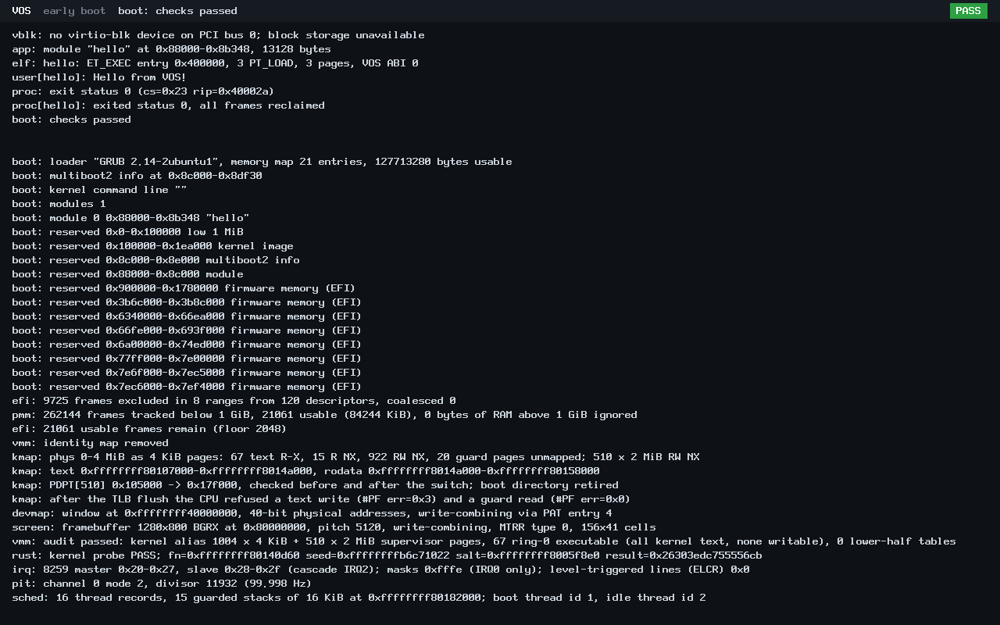

# B1: Rust boot reservations and EFI boundary

**Locally verified candidate, 2026-11-01; not merged.** Base: `1b1cb5d788c0ea1093d0c6258e9b036d81367421` (accepted A3 plus documentation).
QEMU and hosted verification only. Physical hardware is **NOT TESTED**.

## Scope and contracts

Nine production symbols now come directly from the existing freestanding Rust archive: `resv_init`, `resv_add`, `resv_overlaps`,
`boot_mmap_entry`, `boot_reserve`, `efi_memory_exclude`, `efi_memory_firmware_frame`, `efi_memory_strerror` and `efi_memory_what`.
`arch/x86_64/{bootinfo,resv,efi_memory}.c` are retired; their accepted code remains only in frozen, hash-checked test references.
This completes the remaining bootinfo boundary after [A2](a2-mb2-parse-rust.md) and [A3](a3-fb-validate-rust.md), not a wholesale kernel migration.

`kernel/rust/boot/reserve.rs` contains safe, allocation-free decisions. `arch/x86_64/rust/boot_resv.rs` confines unsafe pointer access
to the unchanged C ABI. The 80-entry table, structure layouts, message bytes, first-error ordering, partial reservations on failure,
page-zero/legacy-hole exclusions and 1 GiB tracked window are preserved. EFI provenance still uses the identity of one exported object;
no firmware-memory release, controller activation or new capability is introduced. The EFI classifier was already Rust before B1:
its frozen C glue reference calls that **same unchanged classifier**, so the differential isolates the boundary actually migrated.

Compatibility applies to the existing valid-call contracts. Rust additionally refuses null/misaligned structures, overlapping table/input storage
and short tags, and clamps invalid table counts where C could fault or access invalid storage. These Rust-only defensive cases are checked separately
from the C reference. Readable mapped inputs and exclusive writable table/report storage remain caller obligations.

## Verification

| Gate | Result and evidence |
|---|---|
| Production ownership, ABI, stack and panic-free link | **PASS.** All nine definitions resolve to `libvos_kernel.a`; three retired C objects are absent. ABI sizes/offsets are pinned on both sides. No linked Rust panic/format machinery. [gate](b1-rust-boot-foundations/evidence/gate-results.json) |
| Frozen-reference differential | **PASS.** 548,051 reservation inputs (293,943 deterministic, 254,108 seeded random), 344,694 table operations and 20,260 EFI glue inputs. Return values/messages, entire tables, untouched slots, EFI reports and provenance match; both tag boundaries are guard-paged. Same tests pass against an overflow-checked hosted Rust build. All 20 broken-reference controls are detected. [archive](b1-rust-boot-foundations/evidence/differential.txt), [hosted](b1-rust-boot-foundations/evidence/differential-host.txt) |
| USB resources / C1 / C2 | **PASS.** Resource harness: 1,016 assertions, Rust layout and non-Copy/Send/Sync checks. Existing C1 evidence reused only after archive/source identity checks. C2: 9 Rust tests plus ownership, mutation and real-adapter sanitizer checks. [resources](b1-rust-boot-foundations/evidence/usb-resources.json), [C1](b1-rust-boot-foundations/evidence/usb2c1.json), [C2](b1-rust-boot-foundations/evidence/usb2c2.json) |
| C3a / C3b1 | **PASS.** 17 Rust tests, mutation controls and real PMM/devmap/residue/dry-run adapter scenarios; no PCI writes. C3b1's production audit now checks the Rust-owned EFI glue rather than a retired C object. [C3a](b1-rust-boot-foundations/evidence/usb2c3a.json), [no-write audit](b1-rust-boot-foundations/evidence/usb2c3b1-no-write.json) |
| EFI compatibility (C3a.2) | **PASS after correction.** 11 Rust tests, 3 compile-rejection controls, 7 mutations and 262,450 hosted checks. Completed Rust subchecks were reused with matching source/fixture/archive and sealed artifact hashes; the corrected hosted portion was rerun. The old failed attempt remains FAIL. The public driver always runs the full suite. [completed substages](b1-rust-boot-foundations/evidence/efi-completed-substages.json), [final hosted run](b1-rust-boot-foundations/evidence/efi-hosted-final.json) |
| C3b2 compatibility / production isolation | **PASS.** Separate marked test kernel; 51 sanitizer scenarios, 9,573 checks, 47 mutation controls and negative build/packaging gates. A smuggled executor is rejected; production kernels/ISOs remain free of it. [result](b1-rust-boot-foundations/evidence/usb2c3b2.json) |
| A2 / A3 regressions | **PASS.** Archive and overflow-checked differentials, ownership, stack and 20 negative controls each. [A2](b1-rust-boot-foundations/evidence/a2-regression.json), [A3](b1-rust-boot-foundations/evidence/a3-regression.json) |
| Production BIOS/UEFI, 128 MiB/2 GiB | **PASS, four cases.** GDB traps land at the real Rust entry addresses; captured inputs replay through frozen C reservation/glue code to identical tables/reports. Every normal boot completes. [native proof](b1-rust-boot-foundations/evidence/native-proof.json) |
| Kernel selftests | **PASS, all four firmware/memory combinations, guest exit 33.** Each includes 183 bootinfo, 41 synthetic PMM, 48 kernel PMM and 13 screen cases; screen has one expected not-applicable case. VMM, user, kmap and remaining main-image selftests also pass. [BIOS 128 MiB](b1-rust-boot-foundations/evidence/selftest-bios-128M.txt), [BIOS 2 GiB](b1-rust-boot-foundations/evidence/selftest-bios-2G.txt), [UEFI 128 MiB](b1-rust-boot-foundations/evidence/selftest-uefi-128M.txt), [UEFI 2 GiB](b1-rust-boot-foundations/evidence/selftest-uefi-2G.txt) |
| Review hardening | **PASS.** Replay files/tags are bounded; four preserved snapshots still replay identically, four malformed-file controls and six observer length controls pass. Missing/capped convergence is now rejected; retained positive logs meet the criterion. [replay review](b1-rust-boot-foundations/evidence/replay-input-review.json), [convergence/resources](b1-rust-boot-foundations/evidence/resources-and-convergence.json) |

The bare-metal Rust machine code is **not ASan-instrumented**. C/harness sanitizers, guard pages and a separate overflow/debug-checked
Rust build provide complementary coverage. Full N3 fault campaigns, complete dynamic stack high-water proof and physical-machine safety are not claimed.

## Resources and authentic screenshots

Net input-section growth against accepted A3 is **937 bytes** (text +894, rodata +43, data 0). Loaded image growth is **0 bytes**:
all five PT_LOAD ranges and text/data/BSS sizes are identical. Maximum measured B1 Rust chain is **168 bytes** (`boot_reserve`, C 152;
+16); EFI exclusion is 72 bytes (C 88). These satisfy the existing 512-byte chain and +256-byte increase limits. No heap or writable
static is added. [measurements](b1-rust-boot-foundations/evidence/resources-and-convergence.json)

These unmodified 1280x800 PNGs were captured directly from running production QEMU guests using QMP `screendump`, not generated mockups.
Screens demonstrate healthy boot; the native trace above establishes Rust execution. [BIOS metadata](b1-rust-boot-foundations/evidence/screenshot-bios.json),
[UEFI metadata](b1-rust-boot-foundations/evidence/screenshot-uefi.json).





## Failures, preservation and readmission

The earlier USB/C1 projection incident and its authorized cleanup/readmission were preserved and not repeated. A new EFI attempt
retained 60,843,999 bytes against a 23,000,000-byte projection (1.25x allowance 28,750,000); the forecast omitted seven approximately
7.43 MB mutation executables and the main test executable. The guard correctly stopped execution. The complete tree remained below
160/175 MB and both physical drives had ample capacity. The owner explicitly approved archiving the STOP unchanged, a bounded
hosted-only rerun using verified passing Rust evidence, and hashed reproducible-binary cleanup only after complete new passing evidence.
Neither failed receipts nor the 1.25x rule were relabeled or weakened. Campaign peak was **139,389,017 bytes**, below the recorded
145 MB expected peak. Physical C:/E:, shared Git/controller growth and owned temporary outputs were accounted for separately.
[storage summary](b1-rust-boot-foundations/evidence/storage-summary.json), [original STOP](b1-rust-boot-foundations/evidence/STOP-B1-incident-1.txt),
[new STOP](b1-rust-boot-foundations/evidence/STOP-B1-incident-2.txt).

The EFI harness needed explicit `efi_memory.h` declarations and a test-only sink forwarding to Rust after its C implementation
includes were removed. A source scan was corrected to ignore full-line Rust documentation comments without ignoring code lines.
The original [FAIL result](b1-rust-boot-foundations/evidence/efi-attempt-failed.json) and [compile log](b1-rust-boot-foundations/evidence/efi-build-failure.txt)
remain intact. A local EFI-tool path and a QMP schema-name assumption were also corrected; their failed preparation records remain local.

## Reproduction and CI

Use [HANDOFF](../HANDOFF.md) prerequisites and the existing bare-metal nightly toolchain. In a fresh disposable output directory:

```sh
RUSTC="$(rustup which --toolchain nightly-2026-09-03 rustc)"
make ARCH=x86_64 BUILD=build/b1/kernel USER_BUILD=build/b1/user RUSTC="$RUSTC" uefi-iso
python3 -I -B scripts/test-boot-resv.py --archive build/b1/kernel/rust/libvos_kernel.a --kernel-dir build/b1/kernel --rustc "$RUSTC" --out build/b1-reproduce
python3 -I -B scripts/test-boot-resv-native.py --kernel-dir build/b1/kernel --archive build/b1/kernel/rust/libvos_kernel.a --out build/b1-native-reproduce
```

The existing Build smoke jobs now run the B1 hosted and four-case native checks and retain their failure text logs. No new runner,
permission or ruleset is introduced. Required CI and human review are checked on the pull request; this local report does not assert a merge.
See [CONTRIBUTING](../../CONTRIBUTING.md), [SECURITY](../../SECURITY.md) and the [publication checklist](../milestone-publication-checklist.md).
