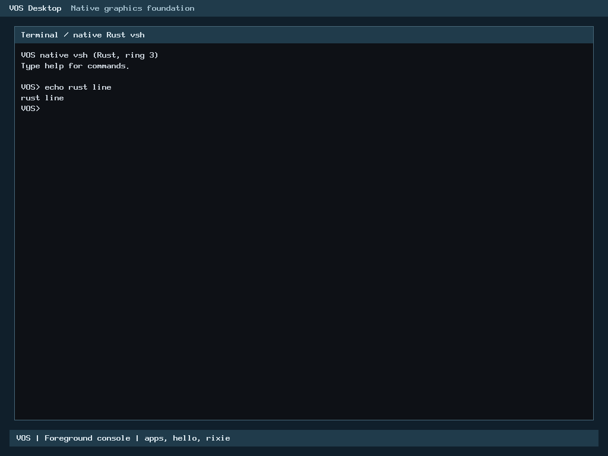

# H1-B reconciliation with accepted Rust input migrations

Local component verification PASS; pending published-head CI and separate human merge authorization. Existing PR51 is updated by a normal fast-forward feature-head push, not a rebase/force-push or protected-branch merge. Baseline: authoritative main `fbf11d98d66c6bca4cb457c12b7f952879ad7858` (PR53), including PR52 at `9ab5e9f58e85dfe57f039a6a7072496f21cc9779`. Original H1-B head: `b9e3cf6d5278a4ff2d507480fed0ec5cc37e5a76`.

## Exact correction and preserved boundaries

The old hosted fixture imported only Rust `pointer_decode`/`pointer_idle`. After the accepted migrations, `keyboard_decode` and `input_console_take_line` are also Rust-owned, so old adapters no longer link. The unmodified old-driver failure is reproduced and retained in `h1b-link-before`.

`scripts/test-boot-hid.py` now imports the actual accepted keyboard and console Rust ABI modules into the same existing hosted fixture, tracks their transitive source hashes, requires one Rust owner for each of the four input symbols, and verifies each symbol in the binary that exercises it. It does not restore C copies, substitute fake decoders, suppress linker errors or relax behavioral tests. A single fixture avoids duplicate strong Rust panic handlers from combining two complete Rust staticlibs. Separate full keyboard/console/GUI gates link the actual accepted bare-metal archive.

The HID descriptor/report core, public API, fixtures, protocol-confirmation gate, owner epochs, queue/reset/overflow recovery and resource budgets are byte-identical to accepted H1-B. Production arch/kernel/build inputs are unchanged except the pre-existing standalone HID files, which remain unreferenced by the production crate root. No native USB input, request, polling, controller write, DMA publication or physical activation is introduced. The original [H1-B results](h1b-rust-boot-hid.md) and all15 original sealed entries remain unchanged, with their original dated provenance.

## Safe history integration

The original H1 checkout/ref and R2 checkpoint refs remain intact. Local `codex/h1b-main-reconcile` starts at accepted main and merges existing published H1 history; the reviewed commit has both histories as parents. All original H1 commits remain ancestors of the updated PR head. Only the feature ref `feat/h1b-rust-boot-hid` is pushed, ordinarily and without force. Current README/STATUS/ROADMAP conflicts retain accepted main status and the unmerged H1 candidate; all existing CI gates are preserved. No PR is merged by this operation.

## Verification

| Component | Local result |
| --- | --- |
| H1 core | 15 tests; 50,000 hostile descriptor mutations; 10,000 independent keyboard transitions; 65,536 mouse X/Y pairs PASS |
| H1 negative controls | Eight compiled assertion-detected mutants PASS |
| HID console | Actual foreground transfer/epochs/stale-owner rejection/line delivery/disconnect PASS;49,500 console assertions |
| HID GUI | Actual grants, screen-oriented motion/buttons, overflow recovery and disconnect PASS;978,127 GUI assertions |
| PS/2 | Actual decoder/demultiplexer/GUI regression PASS;987,802 pointer-service assertions |
| Keyboard | Complete current gate:11 core tests, nine semantic mutants,3,703,936 comparisons per variant (three variants), ABI/guards/overflow checks PASS |
| Console extraction | Complete current gate:10 tests,10 mutants,222,017 cases per variant (three variants), overlap/guards/overflow checks PASS |
| GUI/input/renderer | Complete current pointer/input regression gate PASS against actual main archive |
| H1 resources | Maximum static frame344B, Session264B, two sessions+4096B descriptor buffer4624B, heap0/DMA0; unchanged bounds |
| Accepted input resources | Keyboard frame10B, console frame0B, no image-growth change from H1 reconciliation |

C sanitizers do not instrument Rust; separate Rust overflow/debug/resource checks supplement them. All raw test/result/command records are in [hashed evidence](h1b-main-reconciliation/SHA256SUMS).

The initial corrected-driver attempt passed the15 core tests and all three adapter executions but failed a newly added ownership assertion: the PS2 GUI binary legitimately garbage-collects an unused console extractor. That FAIL remains preserved. The proof now requires the extractor in the HID console binary and decoders in the PS2 binary, while the fixture archive must define all four exactly once. Fresh adapter executions/proof and the remaining mutation/resource stages pass. This reuses unchanged component source/compiled identity rather than rebuilding unaffected successful fixtures; the final default all-stage command still must pass in CI. No failed whole-run receipt is relabeled.

## Performance and evidence

This is a test-linkage correction, not a new C-to-Rust implementation. Both the HID core and accepted input Rust source/archive match their accepted identities. The standing performance policy remains unchanged: investigate regressions, preserve checks and require explicit approval for any new remaining implementation regression. PR52's keyboard optimization candidate and PR53's source-bound fallback exception remain recorded; neither is silently generalized or edited.

Fresh hosted samples are retained, not substituted for historical evidence. Keyboard median C4.1779ns versus Rust6.0828ns (about1.456x); console PENDING1.9373/2.2313ns and capacity refusal2.1108/3.5191ns retain the known guarded fallback cost. Successful console/overflow paths again measure at parity or faster. These repeat measurements of identical accepted code are diagnostic, not a claim that this reconciliation changes kernel performance. Raw samples, compiler/flags/CPU-affinity method and source hashes are preserved in the current keyboard/console reports. Guest timing and physical hardware performance are NOT TESTED.

Production sources and the accepted archive `d5645ff8e105eb1ad8a71704e6b27884dc84075e20dbc148ec67271dc5c9dd3f` are unchanged. Existing PR53 genuine BIOS/UEFI128MiB/2GiB functional execution evidence is reused by identity; no extra local kernel/media campaign is needed. Required published-head CI independently rebuilds and boots production. These images are from accepted PR53, **not native HID or a new hardware run**:




## Reproduction and admission

Follow [CONTRIBUTING](../../CONTRIBUTING.md), [SECURITY](../../SECURITY.md) and the [publication checklist](../milestone-publication-checklist.md). With normal prerequisites and the pinned Rust toolchain:

```sh
python3 -I -B scripts/test-boot-hid.py --rustc "$RUSTC" --out build/h1b-reconcile-check
```

The default command runs all H1 stages. Current production keyboard, console and pointer regression scripts take an explicitly built kernel archive; captured local commands used the exact accepted main archive. Output paths must be fresh and admitted under the applicable local policy. Maintainer private paths/receipts are not contributor prerequisites.

The owner approved reuse of the existing guarded root, with unchanged240MB STOP/260MB cap, C floor22,548,578,304B, E reserve1,610,612,736B plus projections,1.25x rule and exclusive fail-closed monitoring. The separately versioned reconciliation monitor has a6MB cumulative shared Git/controller ceiling from the same original origins, preserving all prior charges; old3MB guards are unchanged. Failed outputs are retained. No cleanup, clone, new worktree or H2 accounting/admission occurred.

Publication is to existing PR51 only after local review and ancestry checks. Final new-head Build smoke/Secret history audit conclusions must be inspected; pending is not PASS. Merge requires separate human authorization. R2's PR53 merge is recorded in the existing master ledger; subsequent R2 editor work remains a scoped proposal while this owner-prioritized reconciliation completes. H2-A stays inactive.
