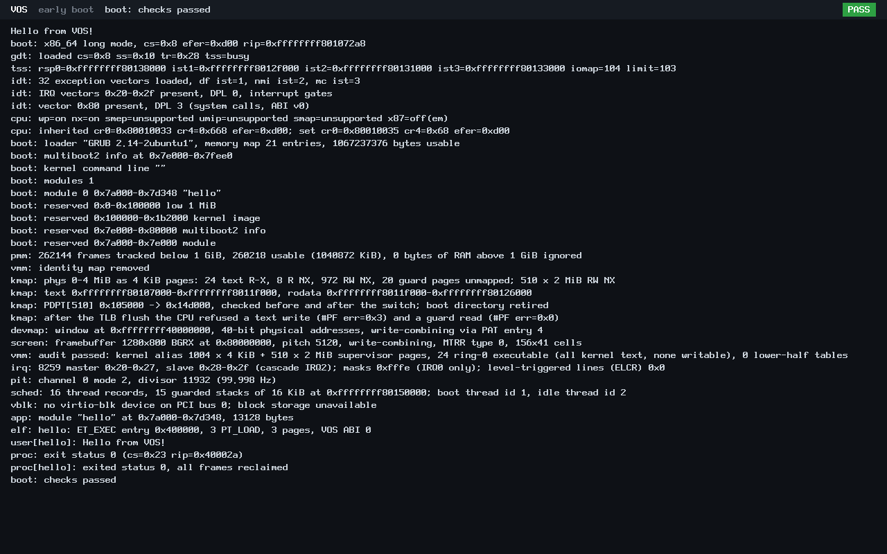
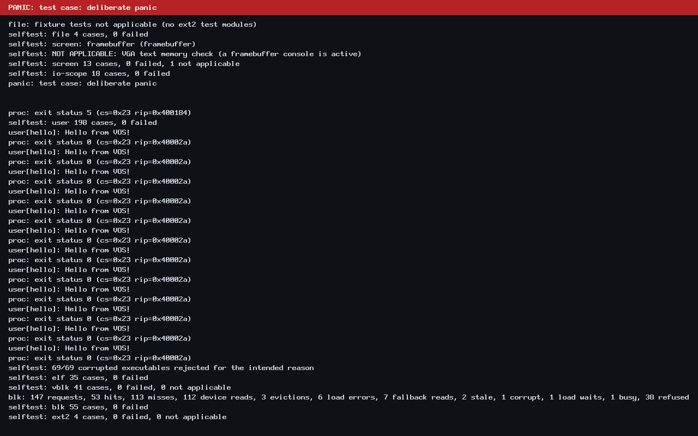

# N3 storage milestone closure

Status: **N3 COMPLETE; N3.6 COMPLETE**, accepted on 2026-10-24.
Publication branch: `feat/n3.6-storage-closure`; `main` remains the N3.5
checkpoint `c0ccdd7`. This is an emulator-verified development milestone, not
an installable operating-system release. N4 is next and has not started.

This is the planned R4 documentation closure. It records the accepted evidence;
it does not rerun D1, D2 or C20, introduce a new gate, or change their criteria.
The milestone commit publishes the final verified source tree, host harness
corrections, documentation and original screenshots together.

## Delivered milestones

| Milestone | Delivered capability |
| --- | --- |
| N0 | Original i386 protected-mode boot and serial greeting; the legacy build remains available. |
| N1 | Isolated ring-3 ELF programs, entry validation, ABI v0 system calls and resource reclamation. |
| N2 | W^X mappings and guarded stacks, PIC/PIT timing, kernel threads, preempted user programs, multiple processes and ABI v1 channels. |
| N3.0–N3.4 | Storage-safe kernel map, read-only virtio-blk, block registry/cache, ext2 reader and bounded interrupt-driven I/O with polling fallback. |
| N3.5 | Capability-scoped, read-only ABI v2 files and directories; bounded handles, grants, atomic result publication and cleanup. |
| N3.6 | Ownership/accounting observations, deterministic integrated storage stress, kernel layout enforcement, final regression, mutation controls and larger-RAM coverage. |

Production remains freestanding C and x86 assembly. The native software platform
is independent of the separate React/Electron desktop prototype. Keyboard input,
an interactive console, `vsh` and Rust-first native application foundations are
the next authorized design scope for N4, not capabilities claimed by this commit.

## Accepted verification

The user accepted D1a–D1f and subsequently D2/C20 before authorizing publication.
Earlier reports remain historical records; this section is the final verdict.

| Check | Final result |
| --- | --- |
| D1a | 74/74 full BIOS/i386/x86_64 verdicts match the accepted Stage 5 table. |
| D1b | 19/19 primary UEFI verdicts pass. |
| D1c | 19/19 additional UEFI configurations pass, with fresh variable stores. |
| D1d | 302/0 static user-ELF checks; 20 ABI constant comparisons; validator agreement and file-ELF checks pass. |
| D1e | 139 frozen hashes; 131/131 accepted c5 ELF comparisons; 55/55 ISO payload audits; real content-mismatch negative control passes. |
| D1f | 43/43 kernel layouts; all accepted static/reservation/code/test-only budgets pass. |
| D2 | Five deliberate mutations detected by the intended completed file assertions and guest exit 35; no timeout, build failure or missing PASS marker credited. |
| C20 | 15/15 accepted stress profiles, exit 33, exact gate serial contracts, configured RAM and unchanged inputs. |

D2 verdicts are PASS for **rights-width, symlink, error-copy, incarnation and
reserved-inode**. Its artifact allowlist now includes the accepted
`storage_observe.o` and `storage_observe.d`. Both were matched to the sealed D1
inventory and their source dependencies. The dependency validator still requires
exactly one compilation. Four focused checks prove it accepts the expected plan
and rejects the original extra compile, another extra compile and a wrong
single compile. The 3,360 MiB capacity boundary check also passes.

The separate [Gate B](n3.6-stage3-gateb.md), [Gate C](n3.6-stage3-gatec.md) and
[Gate D](n3.6-stage3-gated.md) records describe the accepted 128 MiB runs. C20 used
their exact six BIOS/UEFI ISOs and shared inputs, without rebuilding them:

| C20 profile | Gate B: SC01/SC02 | Gate C: SC03/SC04/SC05 | Gate D: SC10/SC11 |
| --- | --- | --- | --- |
| BIOS/pc, default CPU, 2 GiB | PASS | PASS | PASS |
| UEFI/q35, default CPU, 1 GiB | PASS | PASS | PASS |
| UEFI/q35, max CPU, 1 GiB | PASS | PASS | PASS |
| UEFI/q35, default CPU, 8 GiB | PASS | PASS | PASS |
| UEFI/q35, max CPU, 8 GiB | PASS | PASS | PASS |

Every stress group retains its 240-second watchdog and 60-second boot allowance.
Sparse 8 GiB RAM backing retains the separate 384 MiB allocated-block bound.
UEFI uses polling; BIOS exercises IRQ transport. Transport-specific exclusions,
including SC04 orphan combinations under polling, remain NOT APPLICABLE.

## Sealed evidence and independent archive verification

[Machine-readable evidence index](n3-evidence.json) records complete hashes,
root names, scope and protected identities. Evidence roots remain local under
`~/vos-evidence/`; independent archives remain on E: in
`VOS-Verification-Evidence/`. Raw build trees and large archives are deliberately
outside Git. The source tree and this compact index do not substitute for them.

| Accepted evidence root | Manifest entries | Verified archive members |
| --- | ---: | ---: |
| `n36-final-d1seal-codex-20261024T034457Z` | 565 | 566/566 |
| `n36-final-d2-deps-codex-20261024T044859Z` | 3031 | 64/64 tier-1 |
| `n36-final-c20-codex-20261024T045803Z` | 203 | 204/204 |

D2's manifest hashes the retained regenerable workspaces as well as tier-1
evidence. Its independent archive excludes those regenerable trees and retains
raw serial/QEMU logs, expected-failure evidence, input/copy plans, source archive,
driver records and summaries. D1 finalization similarly preserves tier-1 copies
and references the untouched regenerable originals. All three accepted archives
have no missing, mismatched or unexpected members within their declared scope.

SHA-256 identities:

| Evidence | Manifest SHA-256 | Independent archive SHA-256 |
| --- | --- | --- |
| D1 | `b56296a6c7bf1af2a256d720b2cf9aee94097ed6795af27568ff22673aa47839` | `5dcc1b19d09a7a006b5cf2e216c7c43af68f75f40091c4ba225893499284d7f6` |
| D2 | `5eb097d5d11654476e8d7cf51f510e0c4cf181b131521d348baca566a667461d` | `d19c507c8bd30667dcae328168a24ac928047cec0e65e5d61ac7ec37b6747de0` |
| C20 | `3b37ed3ebb1227c7082759be07e2be2bea3fd5e42d2fb225edf05b9c85dc4179` | `36719f159b8f9430fe74326aa8eb8f5ff8c759710cec3082243c22e3e8a0b03e` |

## C2-T test-design correction

[Held-publication rationale](n3.6-held-publication.md) records the original
`vblk-writable` failure and QEMU 10.2.1 investigation. Suppressing a virtqueue
notification does not prevent device consumption of an already published request.
The test-only correction holds the available-ring publication itself until the
test explicitly publishes or resets. It does not change production behavior or
the protected Gate B/C/D images.

Targeted validation passed 166/166 virtio-blk and 73/73 block cases with nine
expected timeouts and an unchanged writable-device image. The full repaired D1
campaign then passed. The original failed D1 evidence is retained.

## Reproducibility, footprint and protected identities

D1 verifies same-path production rebuild equality, loaded-image equality,
139 frozen hashes and 131 old ELF comparisons against a freshly reconstructed
accepted c5 baseline (`c5f5acb62b70f2dbbc75a7bece35ab4548e872f3`).
Debug ELF bytes can depend on the checkout path. Reproduction requires the
recorded paths, tools, flags and `build-env.json`; universal cross-path,
cross-host or cross-toolchain bit identity is not claimed. ISO payload audits
allow only the accepted metadata and GRUB-generated differences. A real changed
payload is rejected; the host verdict's `CONTENT` versus `content` correction
does not change that comparator.

The evidence records GCC 15.2.0, GNU ld 2.46, GNU Make 4.4.1, QEMU 10.2.1 and
OVMF 2025.11; GRUB build/package versions differ between retained host-tool
bundles and are pinned per run. See [handoff](../HANDOFF.md) for setup and bounds.

| Cumulative growth versus c5 | Measured bytes | Accepted ceiling |
| --- | ---: | ---: |
| Static | 45864 | 65536 |
| Reserved image | 57344 | 131072 |
| Code | 17238 | 65536 |
| Test-only | 19095 | 131072 |

All 43 checked layouts pass; the largest measured physical end is
`0x263000`, below the 4 MiB mapping limit. The layout-1 correction makes
page-rounded kernel reservations fully covered by PT_LOAD segments, preventing
a loader from placing data in an unrepresented kernel-page tail.

Seven protected references remain unchanged: production, Gate B, Gate C, Gate D,
`gatec.elf`, `gated.elf` and `hello.elf`. Their full hashes are in
[n3-evidence.json](n3-evidence.json). These reference identities and loaded-byte
comparisons are distinguished from path-dependent fresh debug binaries.

## Preserved failures and interruptions

No failed attempt is relabelled a pass, and no earlier evidence is rewritten.

| Root or record | Preserved status |
| --- | --- |
| `n36-final-d1-20261022T222934Z` | Original D1 stopped at the invalid skip-notify assumption; sealed as a failed/incomplete run and archived. |
| `n36-final-repair1-20261023T031646Z` | Expired/interrupted repair attempt; unsealed and unarchived. |
| `n36-final-d1r2-20261023T094001Z` | Incomplete pre-window attempt; sealed and archived; no QEMU campaign completed there. |
| `n36-final-d1r3-20261023T131536Z` | D1a–D1d completed; D1e stopped at missing baseline inputs and a verdict-case mismatch. **Unfinished, unsealed and unarchived**, unchanged. Its completed records were copied into accepted finalization evidence. |
| `n36-final-d1ef-codex-20261024T024127Z` | D1e/D1f passed; finalization interrupted by a 30-second monitoring-query timeout. Original violation retained; root unsealed and unarchived. |
| `n36-final-d1seal-codex-20261024T034457Z` | Accepted finalization-only recovery, with the accepted 90-second timeout and a fresh admitted window; no tests rerun. |
| `n36-final-d2-codex-20261024T041559Z` | Added reserve fixture omitted admission's 4 KiB; failure cleanup killed a monitoring query. Failed, unsealed and unarchived; original violation retained. |
| `n36-final-d2-recovery-codex-20261024T043252Z` | Four focused controller checks passed; D2 stopped before compilation/QEMU because two accepted build artifacts were missing from its allowlist. Unsealed and unarchived. |
| Gate C exec1/exec2 | SC05 cold-cache and attempt/sentinel synchronization failures retained; corrected exec3 passed. |
| Gate C exec3 archive | All 500 manifest members match; original strict completeness flag remains false because of one declared, byte-identical extra `ARCHIVE-ADMISSION.json`. The accepted addendum records this exception; the archive is unchanged. |

Uninterrupted isolation is **not** claimed across the D1 timeout, the original
D2 query termination or gaps between controllers. Accepted recovery windows were
freshly admitted. The completed D2 and C20 windows contain 41 and 61 clean samples.
Cleanup now protects active monitor queries, their descendants and required
ancestors; unreadable/reused identities fail closed. Detection and stop rules
were not relaxed. Earlier accidental Python bytecode files were removed only
under the user's explicit two-file authorization; their failure/cleanup records
remain preserved. Every later Python invocation disables bytecode generation.

## Storage and preservation

At accepted D2/C20 completion, cumulative final-campaign charge was
**2363.8203125 MiB of 3360 MiB**, leaving **996.1796875 MiB**. This includes
2324.3671875 MiB of final evidence roots, 37.0546875 MiB of independent archives,
0.3984375 MiB of source delta and 2 MiB headroom. Observed peak was
2416.96875 MiB. These figures are the frozen verification checkpoint, before R4
documentation, screenshots, Git objects and publication evidence.

User-authorized allowance versions are 2560, 3339 and 3360 MiB. Earlier versions
remain supported; no reserve was lowered. Admission requires C: to retain 10 GiB
plus remaining allowance plus 256 MiB, E: the admitted operation plus 256 MiB,
and Linux 1 GiB plus remaining allowance. Gate A/B/C/D families are independent.
R4 records its own incremental charge, including Git database growth, under the
same 3360 MiB ceiling; its final receipt gives post-publication totals.

All 13 worktrees, two stashes, old history, evidence roots and archives are
preserved. Only the intended final N3 files are staged; the exact publication
list is [n3-publication-files.txt](n3-publication-files.txt). No force-push or
automatic merge into main is part of closure.

## Authentic screenshots

These are unchanged PNG bytes from the accepted D1 archive, inherited from
the completed D1r3 display runs. [Origins and SHA-256](../images/n3/README.md)
identify the exact preserved files. No new QEMU run or image editing was used.

BIOS boot: kernel memory/protection setup, ring-3 hello, reclaimed frames and
the final PASS status. This production boot has no attached block device.

UEFI boot: real GOP framebuffer diagnostics and the completed production boot.
This is the existing display console, not an interactive command prompt.

Expected panic self-test: the red banner explicitly says `test case: deliberate
panic`. This demonstrates diagnostic rendering, not a normal boot failure.

## Accepted limits and N4 handoff

- QEMU/SeaBIOS/OVMF only; no physical-hardware boot or installation claim.
- Read-only, trusted immutable media; no authenticated-media or writable-filesystem claim.
- The kernel tracks RAM below 1 GiB even when the VM has more.
- OVMF storage polls; IOAPIC/MSI/MSI-X and interruptible polling waits are absent.
- Finite work/request/wait/poll bounds do not prove real-time latency or fairness.
- Unconfirmed reset can retain bounded DMA quarantine; physical reset-refusal,
  hot-unplug and complete live quarantine-lifecycle reclamation remain unproved.
- Full dynamic kernel-stack high-water proof is not established by static frame
  checks, canaries and guard-page tests.
- A 512-unit operation budget can prevent traversal of long single-block
  directory chains (depth 56 succeeds in this fixture; 57/64 exhaust), and
  `/scope/huge` cannot enumerate from its beginning without a resumable-progress
  design. The exact boundary probes are retained in Gate D.
- No keyboard input, interactive shell, writable storage, network stack or native
  desktop is present. The production demonstration exits and halts.

These are documented scope limits, not new N3 gates. N4 may begin after explicit
authorization for keyboard input, interactive console, `vsh` and Rust-first
native application foundations. This publication does not start N4.
