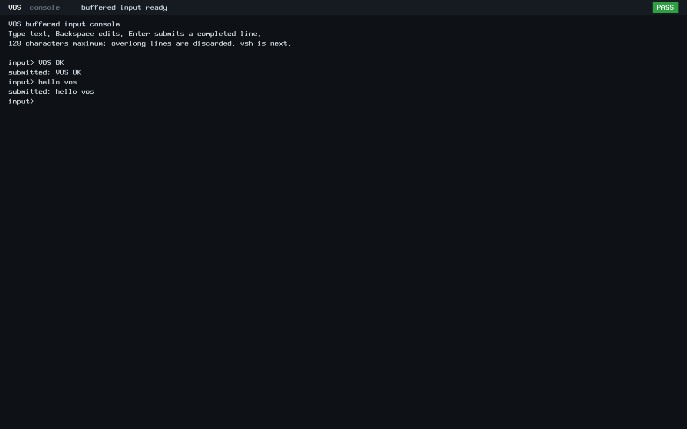
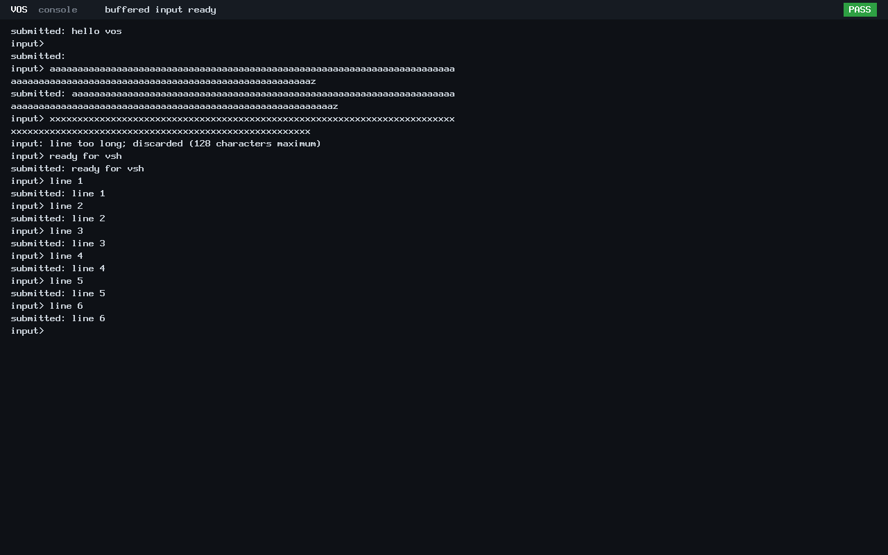

# N4 buffered command input

Buffered input passes focused host, BIOS and UEFI checks on 2026-10-24. The
console retains editable text, submits it only on Enter and copies each complete
line into caller-owned storage. This increment provides a kernel reader for a
future shell/input bridge; it does not execute commands.

## Published baseline

The exact 33-file keyboard/echo implementation was reviewed and published as
[`3a2b642cd3f2e7b719135c86e77cc787a865b327`](https://github.com/veasnawt/vos/commit/3a2b642cd3f2e7b719135c86e77cc787a865b327)
on `feat/n4-interactive-console`. It includes both authentic BIOS/UEFI screenshots
and the original technical results. The remote hash was independently checked.
Main remains at N3 merge `d9a4ade`; no N4 merge, history rewrite or force-push occurred.

The first publication attempt stopped before commit because whitespace lint
flagged the raw serial records' CRLF and trailing prompt spaces. Those records
remain byte-identical to their accepted hashes. The successful publication checked
source/documentation whitespace separately from those three raw serial files.
Both publication attempts and their guard records remain under `build/n4-publish-*`.

## Behavior and interface

- Printable US ASCII appends to a 128-byte line with a separate NUL terminator.
  Backspace deletes the final character and cannot erase the prompt.
- Enter seals the line. Subsequent input cannot change it until the consumer
  takes it. An empty line is a valid submission.
- A consumer receives a copy with a length of 0–128. The copy survives editor
  reuse. If its destination is too small, neither state nor destination changes,
  allowing a retry.
- Any overflow invalidates the entire submission, including after subsequent
  Backspace edits. Enter reports the discard and starts a fresh prompt. A
  truncated command prefix is never delivered.
- The opt-in display starts with a clear text area and scrolls in reading order.
  Its at-most-80×25 character shadow uses 2000 bytes; redraws never read VRAM.
  The serial stream retains the full boot diagnostics. Normal boot's circular
  log/status/panic display remains available when input mode is not selected.

The internal C API is in `arch/x86_64/input_console.h`:

```c
int input_console_take_line(struct input_console_line *line,
                            char *out, unsigned capacity);
int input_console_read_line(struct keyboard *keyboard,
                            char *out, unsigned capacity);
```

`take_line` returns length on success, PENDING or NOSPACE without consuming the
line, or TOOLONG while discarding an invalid line. The thread-context reader
requires a ready keyboard and a destination of at least 129 bytes. It prints the
prompt, sleeps through the existing scheduler/PIT path, retries rejected lines
and returns one valid submission. It does not enable kernel interrupts or alter
the PIC, scheduler or keyboard driver.

The current demo consumer displays `submitted: <line>` before requesting the next
line. That demonstrates the consumer boundary and keeps the prompt after output.
No command parser, executable launch or shell behavior is implied.

## Verification

| Focused check | Result |
| --- | --- |
| Existing production keyboard decoder/controller checks | PASS; original modifier, scan-code, ACK/error and bounded-wait checks retained |
| Production editor and reader host checks | PASS: ownership, Enter sealing, empty lines, prompt boundary, printable filtering, atomic capacity retry, NUL/canary limits, overflow discard, sequential recovery and scheduler sleep |
| Production renderer on RAM/VGA surfaces | PASS: erasure, wrapping, chronological scrolling, character-shadow/pixel agreement and panic/no-screen guards |
| BIOS q35/TCG, 128 MiB | PASS: no delivery before Enter; edited/sequential/empty lines; exact-limit editing; overlong submission rejected; next line succeeds; output scrolls |
| UEFI q35/TCG, 128 MiB, fresh OVMF VARS | PASS: same input/consumer/limit/recovery checks |
| Normal boot with the new kernel | PASS: ABI v0 hello exits 0, frames reclaimed, boot checks pass and CPU halts |
| Build/link checks | PASS: kernel layout validator; host `-Wall -Wextra -Werror`; no compiler warnings in successful build |

QMP sent actual PS/2 key events. Each firmware run submitted `VOS OK`, `hello vos`,
an empty line, a 128-character line edited at its limit, an invalid 129-character
line and recovery/scrolling lines. The validator explicitly rejects delivery of
the overlong line's prefix. No host serial input substitutes for keyboard input.

Reproduce with the documented EFI GRUB/mtools/OVMF environment:

```sh
python3 -B scripts/test-keyboard-console.py --buffered --output build/n4-buffered-check-NEW
make input-run
```

The output directory must be fresh. QEMU 10.2.1 used one VM at a time, TCG,
128 MiB RAM, no host disks, networking disabled and a 45-second boot deadline.
The original N3 extracted EFI tools were read only. No N3 campaign was rerun.

Raw host results, serial output, QEMU commands and the result JSON are in
[n4-buffered/](n4-buffered/). The [evidence summary](n4-buffered/evidence.json)
records tested source hashes, artifact hashes, the full local manifest, clean
isolation samples and storage admission. Original PPM/PNG captures and build
outputs remain in `build/n4-buffered-20261024T085345Z/`.

The first buffered host build at `build/n4-buffered-20261024T085310Z/` stopped on
a signedness warning in a new test assertion before any QEMU boot. The assertion
was corrected without disabling `-Werror`; that failed attempt remains unchanged.

## Authentic screenshots




These independent 1280×800 firmware captures show edited text and the complete
line delivered to the demo consumer, followed by the next prompt. Their identical
pixel hashes are expected: the focused text view contains no firmware-specific
boot addresses or timestamps.



The limit capture shows a full line, a discarded overlong submission, successful
recovery and chronological output. A matching [BIOS limit capture](../images/n4/vos-n4-bios-buffered-limits.png)
is also retained. Each PNG is a lossless conversion of its unmodified QEMU PPM,
with no cropping, retouching or invented UI.

## Preservation and remaining connection to vsh

All prior evidence, failures, protected binary references, 13 worktrees and two
stashes remain preserved. D1r3 remains unfinished, unsealed and unarchived.
The existing 3360 MiB ceiling and disk reserves were not increased or reduced.
Fresh admission carried all prior N4 outputs and used the same isolation rules
and 90-second query timeout, with a 128 MiB local output bound. This is focused
N4 verification, not another N3 campaign.

The keyboard driver, IRQ/scheduler code, storage implementation, existing ABI
definitions, user runtime and i386 sources are unchanged by this increment.
Physical hardware, USB keyboard support, input history, cursor navigation and
Unicode remain outside its verified scope.

Minimum remaining work for native `vsh`:

1. Bridge bounded console input/output to an explicitly authorized ring-3 process
   through a language-neutral interface, preserving ABI v0/v1/v2 and debug-log isolation.
2. Build and launch the native `vsh` ELF with the Rust-first application runtime
   bindings; its read/dispatch/write loop can consume complete lines from that bridge.
3. Connect the authorized commands, using existing ABI v2 handles and explicit
   filesystem grants for directory/file commands.

The kernel reader is complete and verified. Native `vsh` is not implemented yet.
The buffered changes remain uncommitted for review; only the first input
implementation was committed and pushed during this task.

The [29-file buffered change inventory](n4-buffered/changed-files.txt) includes
the reader/editor, opt-in scrolling, focused checks, four screenshots and result
artifacts. Final preservation checks reverified all seven protected binaries,
38,130 prior evidence entries, the N3 publication manifest/archive and the first
N4 artifacts. All N4 attempts together occupy about 84.17 MiB. Conservative
combined accounting leaves about 895.14 MiB below the unchanged 3360 MiB ceiling;
C:, E: and Linux reserves pass. No evidence was deleted.
