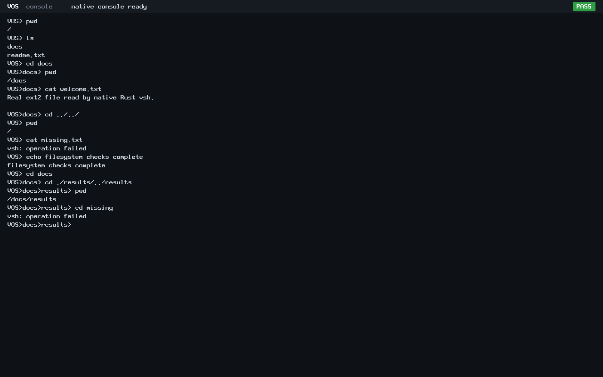

# N4 normalized working-directory prompt

The native ring-3 Rust shell now renders its actual normalized working directory:
root is `VOS>`, `/docs` is `VOS>docs>`, and `/docs/results` is
`VOS>docs>results>`. A trailing display space separates the editable input.

The existing bounded path resolver is shared with the formatter's host tests.
It still resolves absolute paths, repeated slashes, `.` and `..` inside the
granted namespace. Only a successful directory open updates the cwd, so failed
`cd` leaves both cwd and prompt unchanged. No kernel, SDK, syscall number,
capability grant, input capacity or command semantics changed.

## Focused checks

Three Rust host tests cover the requested prompt strings, normalized navigation,
root clamping, path overflow rejection and the maximum 262-byte display buffer
with sentinels. The strict native ELF profile and actual kernel loader validator
accept the rebuilt shell.

The BIOS and UEFI interactions exercise all seven existing commands plus exit,
real ext2 reads, nested/absolute/parent navigation, failed directory opens,
empty input, and Backspace before the first input character and within a command.
Each checks exact prompt text and per-command error results. Both boots retain
the ABI v0 hello check and finish with shell status 0, frame reclamation and HLT.
The read-only fixture hash is unchanged.

The focused `--prompt` option reuses the native-shell driver. Its default mode
retains the earlier five C console probes and invalid-ELF rejection checks;
these unchanged checks were not rerun for this display-only change.

## Reproduction and evidence

With the documented build tools and installed bare-metal Rust target:

```sh
PYTHONDONTWRITEBYTECODE=1 RUSTC=/path/to/rustc \
  python3 -B scripts/test-native-vsh.py --prompt \
  --output "$PWD/build/n4-prompt-$(date -u +%Y%m%dT%H%M%SZ)"
```

Use a fresh output directory and the existing EFI build environment. The test
creates an isolated trusted ext2 fixture, boots bounded QEMU guests and attaches
the disk read-only. This is focused N4 verification; no N3 campaign was repeated.

[Evidence index](n4-prompt/evidence.json) records source/artifact identities,
the complete local manifest, raw records, guard outcome and preserved attempts.
[Exact change inventory](n4-prompt/changed-files.txt) lists the publication files.

## Authentic captures




These are lossless conversions of unmodified QEMU screendumps. They show real
`/docs/results` navigation and a rejected missing directory with the same prompt.
Navigation back to parents/root and input-boundary editing are in the raw serial
transcripts and structured results, with additional local screendumps retained.
