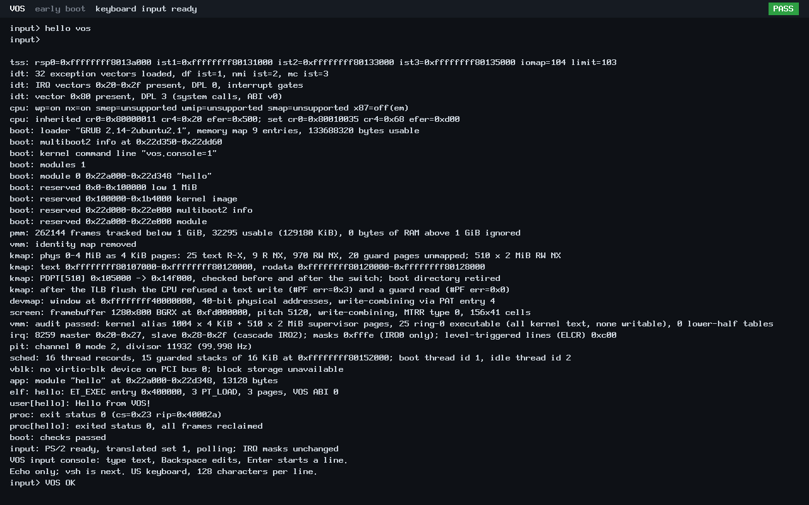

# N4 first keyboard-to-console result

The first N4 input increment passes focused verification on 2026-10-24. QEMU
PS/2 key events reach VOS, decode to US ASCII and appear on the existing
framebuffer and serial console. This is an echo console; no shell is claimed.

## Baseline and scope

Local `main` was safely fast-forwarded from `c0ccdd7` to the published N3 commit
`897312fb991b2f55799b37fbd4459fb552acfe82`, after clean-index/worktree, ancestry
and remote identity checks. Development uses `feat/n4-interactive-console` from
that baseline. All 13 worktrees and two stashes remain.

During this work, GitHub main advanced through [PR #2's N3 merge](https://github.com/veasnawt/vos/commit/d9a4ade0db1df8ab7c8c7fe3c4553cd3f36c3622).
The final remote check detected the change and stopped mutations for read-only
inspection. GitHub comparison and local Git tree identities proved that
`d9a4ade` is one commit ahead of N3 with no file differences or divergence.
Local main and the N4 branch were then fast-forwarded to that merge, preserving
all 33 uncommitted files byte-for-byte. No push was performed by this executor.
The tested N4 source hashes remain unchanged, so no test rerun was needed.

The implementation adds bounded i8042 setup and translated set-1 decoding,
Shift/Caps Lock, printable text, Backspace and Enter. Polling runs in thread
context and sleeps one PIT tick between polls. The existing idle thread handles
interrupts; the kernel's IF=0 rule, PIC masks, IRQ validators and scheduler are
unchanged. Controller replies must be acknowledged; timeouts, bad replies and a
stuck output stream leave input unavailable. Auxiliary bytes are ignored and
receive errors reset decoder modifiers.

Protocol constants and translated-mode behavior were cross-checked against the
installed emulator version's [i8042 controller source](https://github.com/qemu/qemu/blob/v10.2.1/hw/input/pckbd.c)
and [PS/2 keyboard source](https://github.com/qemu/qemu/blob/v10.2.1/hw/input/ps2.c).

`vos.console=1` is an exact, opt-in boot token, accepted only after successful
boot checks and outside self-test builds. `make input-run` uses a separate build
tree and starts `input> ` after the ordinary ring-3 hello exits. At most 128
characters can be echoed per line; Backspace cannot erase the prompt. Enter
starts the next line. The console retains only its current length, not a command
buffer. Serial control output for erasure is separate from screen cell erasure.

No ABI number, system call, user runtime, storage driver or i386 source changed.
USB keyboards, mouse support, alternate layouts, LEDs, input IPC/syscalls and
hotplug are not implemented. Physical hardware remains untested. The existing
screen renderer still uses a circular log area; later lines can appear above
older boot output. The header still labels that renderer as early boot.

## Focused verification

| Check | Result |
| --- | --- |
| Production decoder on host | PASS: make/break, both Shift keys, Caps repeat/XOR, Ctrl/Alt suppression, Pause and extended keys |
| Production controller code on host | PASS: exact command/ACK sequence, explicit set selection, bounded waits/drain, missing controller, bad ACK, auxiliary/error bytes |
| Production echo/editor on host | PASS: exact boot token, prompt protection, 128-cell bound, erase and Enter |
| Production renderer on RAM/VGA surfaces | PASS: exact erased cell, wrap and circular boundary, adjacent cell bounds, panic/no-screen guards |
| SeaBIOS, q35, TCG, 128 MiB | PASS: real QMP key events produce `input> VOS OK` and `input> hello vos` |
| OVMF, q35, TCG, 128 MiB, fresh VARS | PASS: same input/edit path and visible framebuffer output |
| Original GRUB configuration, same new kernel | PASS: ABI v0 hello exits 0, frames reclaimed, boot checks pass and CPU halts; input remains disabled |
| Kernel layout/link validation | PASS for new input and normal boot images; build logs have no compiler warnings |

Host tests compile production functions with `-Wall -Wextra -Werror` and fake
port I/O/UI sinks. Renderer tests execute the actual write-only renderer on RAM
surfaces. QMP injects keyboard events through the emulated input device; no host
serial input or synthetic guest output substitutes for key decoding.

Raw serial logs, host results, commands and result JSON are in
[n4-input/](n4-input/); hashes and source identities are in
[the evidence summary](n4-input/evidence.json). The complete fresh build tree,
logs, original PPM screendumps and per-file manifest remain locally at
`build/n4-input-20261024T071418Z/`. No N3 campaign was repeated.

Reproduce on the documented Linux/WSL toolchain:

```sh
python3 -B scripts/test-keyboard-console.py --output build/n4-input-check-NEW
make input-run
```

The output directory must be fresh. The automated check also needs the existing
OVMF and EFI GRUB/mtools prerequisites. In this workspace, the accepted
`build-env.json` supplies the preserved extracted EFI tool path read-only; no
system package or firmware changes were made. QEMU was 10.2.1, with one VM at a
time, no host disks, networking disabled and a 45-second boot deadline.

## Authentic screenshots




Both 1280×800 screenshots show VOS responding to injected PS/2 keyboard events.
`VOS OK` includes Shift/Caps Lock and deletion of an initial `x`; `hello vos`
is a second entered line. The next prompt is at the top because the existing
log area wrapped. Each PNG is a lossless conversion of its unmodified QEMU PPM
screendump, with no retouching, cropping or invented UI.

## Preservation and next work

The first build attempt at `build/n4-input-20261024T071316Z/` passed host checks
but stopped before QEMU because the system EFI tool directory was absent.
Its logs and manifest remain unchanged. The successful attempt used the accepted
extracted tool environment. Isolation checks and storage admission passed;
the local N4 output bound was 128 MiB, with the failed attempt also carried in
conservative admission. The N3 allowance remains 3360 MiB and disk reserves
were not reduced. Full N3 evidence, failed attempts and the unfinished, unsealed,
unarchived D1r3 root remain untouched.

Next development task: retain an editable command line and define the minimal
language-neutral terminal input boundary needed by native `vsh`, preserving
ABI v0/v1/v2. Then implement the authorized shell and commands incrementally.
Rust-first application support must preserve interoperability with other languages;
Rixie Core is optional and must not delay the shell. N4 is not complete.

The complete [changed-file inventory](n4-input/changed-files.txt) includes the
driver, opt-in integration, focused tests, current documentation, raw result
summaries and two screenshots. This first implementation was subsequently
approved for publication on `feat/n4-interactive-console`; the original
verification records describe the checkpoint before that commit and push.
