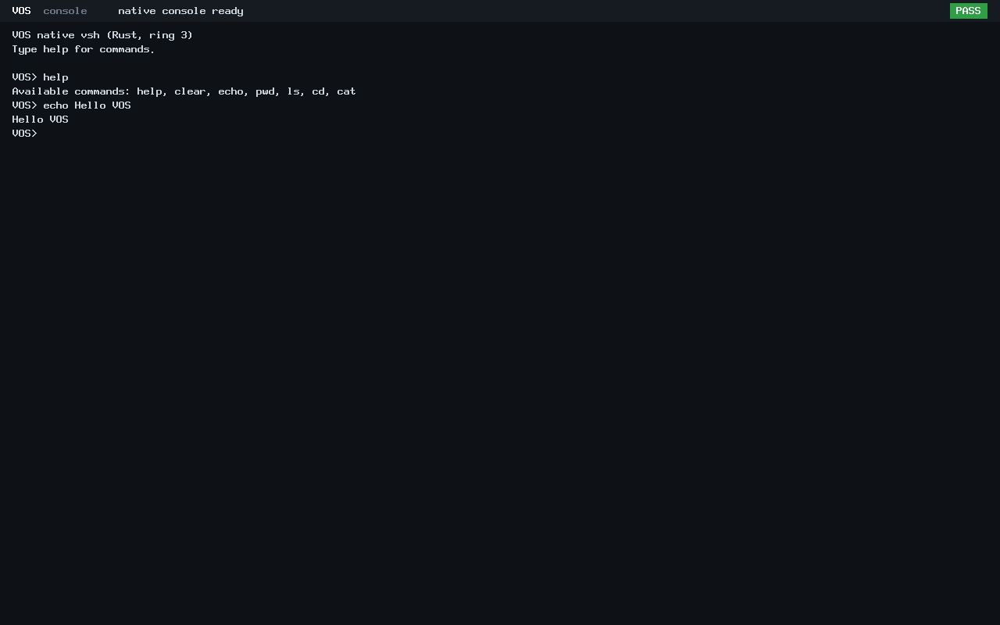
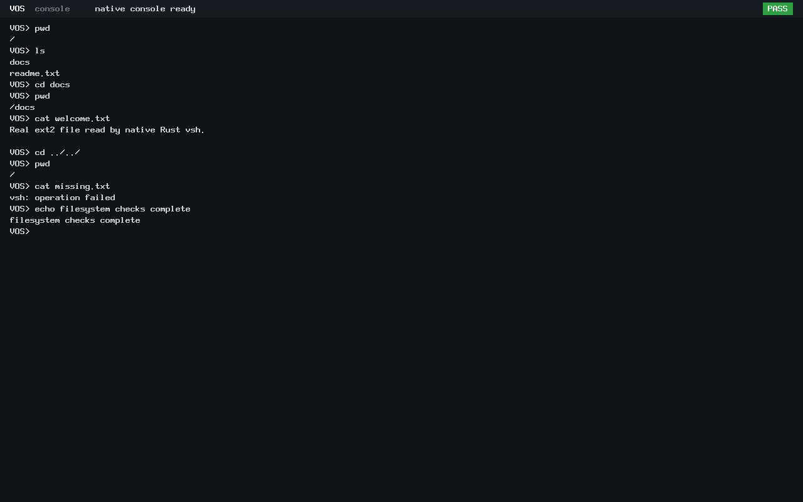

# First native Rust vsh

The first native `vsh` passes focused BIOS and UEFI verification on 2026-10-24.
It runs in ring 3, parses commands in Rust userspace and consumes the existing
kernel completed-line reader through an explicitly granted ABI v3 console.
Filesystem commands use the existing read-only ABI v2 file API and real ext2
data. No shell command is implemented inside the kernel.

## Publication and implementation

The reviewed 29-file buffered-input implementation was committed and pushed as
[`87b99dfc867c45bd01f512cf9ecac0117d1a6eac`](https://github.com/veasnawt/vos/commit/87b99dfc867c45bd01f512cf9ecac0117d1a6eac)
to `feat/n4-interactive-console`. Main remains at N3 merge `d9a4ade`; no N4 merge,
force-push or history rewrite occurred. Original buffered-input evidence describes
its pre-publication verification checkpoint and remains unchanged.

The new [ABI v3 contract](../abi/syscall-v3.md) defines bounded line reads,
sanitized text writes and clear, gated by an explicit process/PID console grant.
ABI v0–v2 keep their syscall behavior. The existing ELF profile now also accepts
note 3; its unsupported-version sentinel moves to 4. No sealed N3 results or
protected images were rebuilt or changed.

The Rust foundation reuses the existing assembly startup, C syscall stubs and ELF
linker profile. A Rust static library supplies required core functions, with
unused sections removed at link time. Small C memory routines complete the
freestanding runtime. The installed nightly compiler and bare-metal target were
used read-only; no Rust download, package installation or toolchain modification
was needed. C console probes and Rust vsh use the same ABI.

## Working commands

| Command | Behavior |
| --- | --- |
| `help` | Lists the seven requested commands |
| `clear` | Clears the granted display text area; serial history remains |
| `echo text` | Prints the remaining trimmed text |
| `pwd` | Prints the logical path inside the explicitly granted filesystem namespace |
| `ls [path]` | Enumerates real directory entries through ABI v2, up to 512 entries |
| `cd [path]` | Opens a real directory before updating the logical working path |
| `cat path` | Reads a real file in bounded chunks through ABI v2; the text console sanitizes control bytes |
| `exit` | Returns status 0 and allows trusted teardown/audit checks |

Paths are resolved inside the granted root. Absolute paths refer to that logical
root; `..` clamps there and is never sent to the kernel file API. For verification,
the trusted launcher granted the real ext2 directory `shell`, not the disk root.
The disk also contained an `outside.txt` file outside that grant. With no attached
volume/grant, filesystem commands report unavailability; no filesystem results
are fabricated. The normal hello launch has no automatic grants.

## Focused results

| Check | Result |
| --- | --- |
| Production console host tests | PASS: explicit/live owner, PID identity, bounded validation, atomic capacity retry, post-wait frame validation, sanitized output, diagnostic framing, clear, cancellation and revocation |
| Existing completed-line host tests | PASS; new cancellation-after-sleep check leaves destination unchanged |
| Native ELF checks | PASS for Rust vsh and five C probes using the unchanged W^X/range/TLS/FPU rules; future note 4 and writable code are rejected by both validators |
| BIOS q35/TCG, 128 MiB | PASS: five real ring-3 probes, all eight supported commands, real file content, missing-file rejection, root-clamped paths, status-0 shell exit and process audit |
| UEFI q35/TCG, 128 MiB, fresh OVMF VARS | PASS: same probes, commands, filesystem checks and clean exit |
| Normal boot using the same new kernel | PASS: original GRUB config, ABI v0 hello exits 0, frames reclaimed, no input activation, kernel halts |
| Integrity | Read-only disk hash unchanged; original N3/N4 evidence and protected references preserved |

For each firmware, ABI v0, v1 and v2 C programs receive ENOSYS for console calls.
An ungranted ABI v3 program receives EACCES. An explicitly granted ring-3 C probe
checks invalid pointers, read-only destinations, empty input, capacity limits,
retained-line retry, atomic output and zero-length write behavior. Rust vsh then
prints `VOS>`, receives real PS/2 keyboard input and executes its userspace loop.

Host tests additionally simulate a changed trap-frame destination after waiting
and exercise cancellation/revocation. Real asynchronous process killing during
input was not separately injected in QEMU. No broad N3 campaign was repeated.

The real fixture's `shell/docs/welcome.txt` contained:

```text
Real ext2 file read by native Rust vsh.
```

`cd docs`, `pwd` and `cat welcome.txt` obtain that content through ext2. The host
validator checks command output, trusted kernel probe/process results, unchanged
disk hashes and a halted kernel after `exit`. QMP injects actual keyboard events;
serial input or invented guest output is not used.

The successful local run is `build/n4-session-20261024T130158Z/`; the independent
reader-cancellation/normal-boot check is `build/n4-session-20261024T130542Z/`.
[Raw results and hashes](n4-vsh/evidence.json) record the source identities,
firmware commands, original manifests and screenshots. Earlier fresh attempts
remain intact: one stopped on an initialization warning under `-Werror`, and one
exposed unresolved Rust core references in the initial object-only link. Both
were corrected before any QEMU run in those attempts; no validator was disabled.

## Authentic captures






The independent BIOS/UEFI captures are unmodified QEMU screendumps converted
losslessly from PPM to PNG. Their identical rendered text produces identical
pixel hashes. A [BIOS filesystem capture](../images/n4/vos-n4-bios-vsh-files.png)
is also retained. These are real native ring-3 interactions, not mock UI.

## Running and limits

```sh
# RUSTC must name a compiler with the x86_64-unknown-none target installed.
make vsh-run RUSTC=/path/to/rustc
make vsh-uefi-iso RUSTC=/path/to/rustc
# Optional trusted ext2 fixture; QEMU attaches it read-only:
make vsh-run RUSTC=/path/to/rustc VSH_DISK=/path/to/trusted-ext2.img

# Full focused check; requires existing EFI GRUB/mtools/OVMF tooling:
RUSTC=/path/to/rustc python3 -B scripts/test-native-vsh.py --output build/n4-vsh-check-NEW
```

The optional volume must contain a `shell` directory suitable for the explicit
grant. These targets use a separate `build/n4-vsh/` tree and preserve normal boot
configuration. The output directory for checks must be fresh.

This is a minimal shell: one console owner, US ASCII, a 128-byte input limit,
256-byte path storage, end-of-line editing and a read-only trusted namespace.
There is no quoting/escaping, piping, redirection, history, external program
launch, writable storage, networking or GUI. Physical hardware remains untested.
Errors currently use a generic message; directory enumeration is capped at 512
entries. These are limits of this first shell, not additional N3 milestones.

All requested basic commands now work. Remaining work for this bounded shell is
review/publication and the N4 closure decision; broader shell features are not
claimed. The native console/vsh changes are currently uncommitted. Worktrees,
stashes, previous attempts and the unfinished, unsealed D1r3 root remain preserved.

The [52-file native change inventory](n4-vsh/changed-files.txt) includes the
console bridge, Rust/C runtime, shell, ABI specification, focused checks, four
authentic captures and verification records. Final checks reverified seven
protected binary identities, 38,130 prior evidence entries, the N3 publication
manifest/archive and earlier N4 artifacts. All N4 attempts occupy about
138.87 MiB; conservative combined accounting is 2519.85 MiB of the unchanged
3360 MiB ceiling, leaving about 840.15 MiB. C:, E: and Linux reserves pass.
