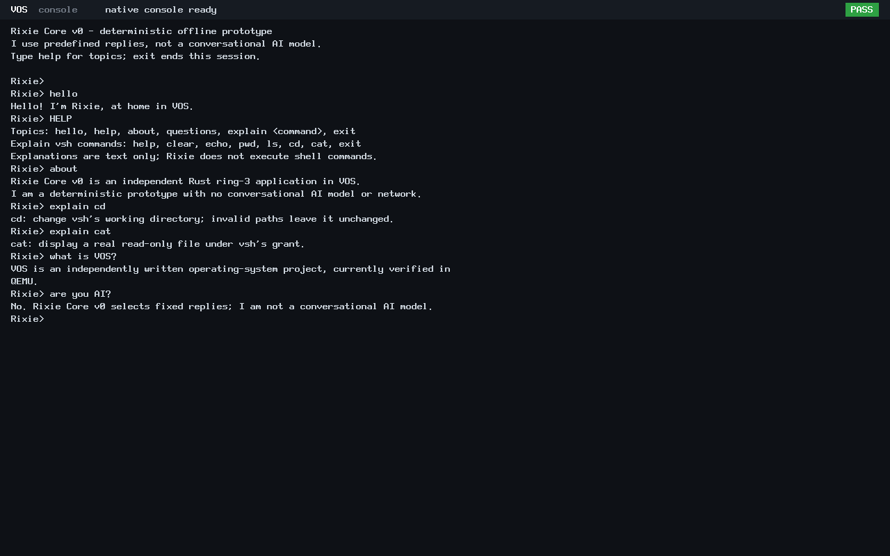

# N4: Rixie Core v0

After the SDK and dynamic prompt were published, the owner extended N4 to include
this minimal offline prototype before final closure. That explicit scope update
supersedes the earlier shell/SDK-only readiness statement. The earlier commits,
verification records and failure history remain unchanged.

Rixie Core v0 is an independent native Rust ring-3 application, built with the
existing VOS SDK. It has a real `Rixie>` console, greeting, help/about, explanations
of all requested vsh commands, five predefined questions, fallback replies and
exit. The interface clearly identifies a deterministic prototype, not a
conversational AI model. It executes no commands and has no network or model.

The [usage guide](../rixie-core.md) documents its inputs, build commands,
independent launch and capability limits. The existing trusted module launcher
receives a small opt-in `vos.rixie=1` selector. Its existing console grant is reused;
no filesystem/channel grants, process-launch framework, new ABI or kernel subsystem
were added. `vsh` source and its accepted ELF remain unchanged.

## Focused verification

| Check | Result |
| --- | --- |
| Rust dialog host tests | 6/6 PASS: identity, greeting/empty input, help, all explanations/questions, unknown/non-ASCII/bounded input, exact exit semantics |
| Build admission | Empty `RIXIE_BUILD` is rejected before recipes execute |
| ELF and loader validation | Rixie and unchanged vsh satisfy the existing ABI v3 native profile |
| Standalone Rixie, BIOS/UEFI | 17/17 interactions per firmware, plus goodbye/status-0 exit and process reclamation |
| Console bounds/editing | Empty input, 128-byte input, initial Backspace and correction inside the line pass on both firmware paths |
| Shell compatibility, BIOS/UEFI | Unchanged vsh starts independently, handles help/echo and exits/reclaims normally with the updated kernel |
| ABI compatibility | Original ABI v0 hello succeeds and is reclaimed on all four boots; shared SDK and accepted vsh ELF identities match |
| Isolation/resources | Existing controller rules, 90-second queries, continuous monitoring, reserves and 3360 MiB ceiling remain unchanged |

Both Rixie boots load no shell module, data disk or network device. The shell smoke
boots load no Rixie module. All four reach trusted status-0 teardown and HLT.
Capability restrictions are supplied by the unchanged grant/validation machinery;
the launcher explicitly passes console=1, filesystem=0 for Rixie. No broader
capability or isolation campaign was introduced, and no N3 campaign was rerun.

The successful root is `build/n4-session-20261024T144105Z/`. The
[evidence index](n4-rixie/evidence.json) preserves source/product hashes, the complete
local manifest reference, raw transcripts, commands, ELF results and guard outcome.
The [exact publication inventory](n4-rixie/changed-files.txt) and
[final preservation/accounting review](n4-rixie/final-review.json) cover the final
candidate. Prior evidence, including the unfinished/unsealed/unarchived D1r3 root,
is retained. No failed test or monitoring violation occurred in this prototype run.

To reproduce with the documented tools and installed bare-metal Rust compiler:

```sh
PYTHONDONTWRITEBYTECODE=1 RUSTC=/path/to/rustc \
  python3 -B scripts/test-rixie.py \
  --output "$PWD/build/n4-rixie-$(date -u +%Y%m%dT%H%M%SZ)"
```

Use a fresh output directory and the established EFI build environment. The driver
uses bounded q35/TCG guests with 128 MiB RAM, actual QMP keyboard input, no data
disk and no NIC. It terminates only its own QEMU processes.

## Authentic screenshots




These unretouched 1280×800 QEMU framebuffer captures show the prototype's identity,
real keyboard input, greeting, help/about, command explanations and fixed answers.
They are lossless conversions of original PPM screendumps. Identical rendered
content produces identical PNG hashes. Originals and vsh smoke captures remain
local; raw serial records are included in the publication.

With Rixie Core v0 verified, the extended N4 implementation is ready for closure.
Main remains at N3; the owner handles the GitHub pull request and merge.
