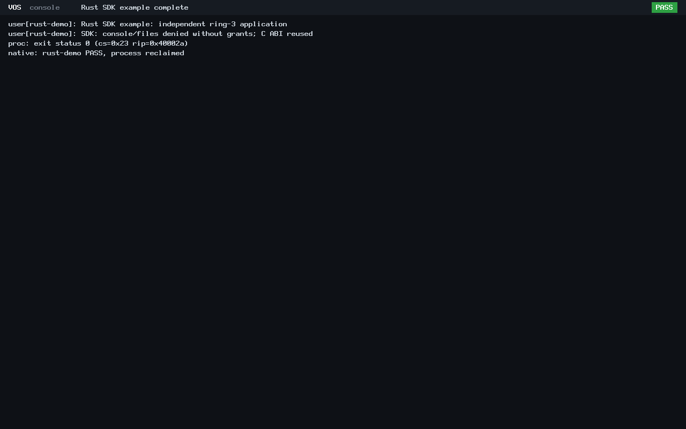

# N4 Rust application foundations

The original N4 development objectives are implemented and verified. N4 is
**ready for closure**, pending acceptance/publication of these final SDK changes
and separately authorized integration. No additional feature or campaign is
required for the agreed scope. Main has not been changed.

## Published native shell

The reviewed 52-file native implementation, including authentic BIOS/UEFI
screenshots and its host/runtime evidence, is published as
[`1beb40677bfeb605da5b2920b70af0fc24138493`](https://github.com/veasnawt/vos/commit/1beb40677bfeb605da5b2920b70af0fc24138493)
on `feat/n4-interactive-console`. Main remains at N3 merge `d9a4ade`. No force-push,
history rewrite, branch/worktree removal or evidence cleanup occurred.

## Final foundation changes

- `user/rust/vos.rs` is a small `no_std` SDK: one reusable C-ABI entry macro,
  one panic convention, typed VOS errors, bounded slice wrappers and raw C
  declarations covering existing ABI v0–v3 operations. It supplies no grants.
- Common C memory routines now live in `user/rust/runtime.c`; the old vsh path
  remains a compatibility forwarder. `vsh` imports the shared bindings/runtime.
- `make rust-app RUST_APP=<name>` builds `user/<name>/main.rs` into a VOS ELF
  through the existing entry point, v3 note, syscall stubs and linker profile.
  Rust dependency files support incremental builds. Empty output-path variables
  are rejected before a recipe can attempt to write under `/user`.
- `user/rust-demo/main.rs` is an independent application with no shell imports
  or console/filesystem/channel grants. It uses the SDK, verifies denied access
  and exits normally. Its standalone boot configuration reuses the trusted
  application loader and process teardown.

The [application guide](../rust-apps.md) contains the minimal program, build
commands, runtime conventions, binding coverage and capability restrictions.
No toolchain download, package installation, allocator, dependency framework,
new syscall ABI or kernel redesign was introduced.

## Focused verification

| Check | Result |
| --- | --- |
| SDK host contract test | PASS: typed errors, unchanged buffers on failure, read bounds/NUL, chunked writes, channel/file wrappers, wire layouts and directory EOF/entries |
| Build-path admission | PASS: explicitly empty `VSH_BUILD` and `RUST_BUILD` fail before writes |
| ELF validation | PASS: shared-SDK vsh, independent example and existing C probes meet the VOS profile; future ABI/W+X negatives remain rejected |
| Shared-SDK vsh, BIOS and UEFI | PASS: five real C ring-3 probes per firmware, seven requested shell commands plus exit, real ext2 reads, unchanged read-only disk and process reclamation |
| Independent example, BIOS and UEFI | PASS: ABI v3 Rust application loads without vsh, returns status 0, denies missing authority, preserves buffers and is reclaimed |
| Legacy path | ABI v0 hello still runs and is reclaimed on all four firmware/application boots; v0–v2 console-call behavior remains covered by the real C probes |

The independent example calls debug output/yield successfully and checks denied
console read/write/clear, missing initial filesystem grants, invalid file/channel
handles, stat/directory operations and close. Both firmware runs reach the trusted
kernel status-0/reclamation result and halt. C and Rust continue to use the same
entry/syscall/wire conventions. Full prior N3 verification was not repeated.

The successful run is `build/n4-session-20261024T134442Z/`. Its
[results, artifact/source hashes and manifest reference](n4-sdk/evidence.json)
preserve the exact checks and raw output. The installed nightly compiler and
bare-metal target were used read-only; no Rust component was installed or updated.

One earlier fresh attempt retained passing SDK host/shared-shell/BIOS-example
results but timed out on the example UEFI boot: the harness used its folder label
for firmware selection and omitted OVMF. The corrected run uses the firmware
value independently from the output-folder name. The prior attempt at
`build/n4-session-20261024T134114Z/` remains unchanged. An earlier pre-root
admission caught the moved tracked C runtime path; retaining a compatibility
forwarder resolved it without changing the accounting guard.

## Authentic independent-application screenshots

The 1280×800 captures show the independent ring-3 program, denied ungranted
authority and trusted successful teardown. They are lossless conversions of
unmodified QEMU PPM screendumps. Matching rendered text produces matching hashes.
The shell captures and raw records from this same run are retained locally and
match the previously published native-shell view.

## Original N4 scope

| Objective | Delivered |
| --- | --- |
| Keyboard input | Existing bounded PS/2 driver, US keys, Shift/Caps Lock, Backspace/Enter |
| Interactive console | Buffered lines, safe limits, explicit granted ring-3 I/O and readable scrolling |
| Native `vsh` | Rust ring-3 shell, kernel-independent command parsing |
| Essential commands | `help`, `clear`, `echo`, `pwd`, `ls`, `cd`, `cat`; real capability-scoped read-only files |
| Rust-first application foundations | Shared SDK/runtime, simple native ELF build, independent app and C ABI interoperability |

The current limits remain explicit: QEMU-only hardware verification, US ASCII,
128-byte input, one granted console owner, fixed storage/no allocator and trusted
read-only files. Quoting, pipes, writable storage, networking, GUI, package
management and Rixie Core were not added and are not closure prerequisites.

The SDK changes remain uncommitted for the final N4 review. Protected N3/N4
evidence, failures, worktrees, stashes and all seven reference binaries remain
preserved. D1r3 remains unfinished, unsealed and unarchived. The 3360 MiB ceiling,
host reserves and isolation rules are unchanged; no N4 merge into main is authorized.

The [exact 34-file SDK change inventory](n4-sdk/changed-files.txt) covers the shared
library/runtime, example, build/boot integration, focused tests, documentation,
two authentic screenshots and verification records. Final checks reverified all
seven reference binaries, 38,130 prior evidence entries, the N3 publication
manifest/archive, previous N4 artifacts, 13 worktrees and two stashes. All N4
attempts and the manual test build total about 339.99 MiB. Conservative combined
accounting is 2721.09 MiB of the unchanged 3360 MiB ceiling, leaving about
638.91 MiB; C:, E: and Linux reserves pass.
