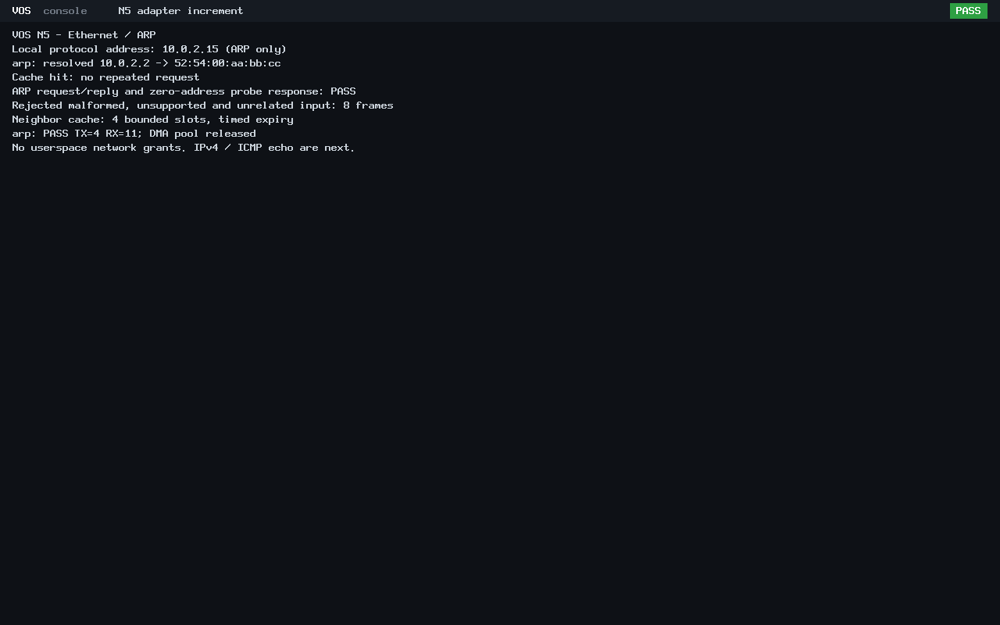

# N5 bounded Ethernet and ARP

The reviewed first 40-file adapter implementation is committed and pushed as
[`27fe770676b4ce138eb9596c881a556c820cbe74`](https://github.com/veasnawt/vos/commit/27fe770676b4ce138eb9596c881a556c820cbe74)
on `feat/n5-networking`. Main remains the accepted N4 merge `bbca69d`. This
ARP increment was subsequently published as
[`a6571c19b128f6ffb61e2b38635df55093b49f45`](https://github.com/veasnawt/vos/commit/a6571c19b128f6ffb61e2b38635df55093b49f45)
with the exact reviewed 37-file inventory. No merge was performed. Its raw
pre-publication JSON records remain unchanged historical snapshots.

The [networking guide](../networking.md) describes the new bounded Ethernet-II
dispatcher, ARP wire validation, request/reply handling and four-entry expiring
neighbor cache. It reuses the published virtio-net driver and packet interface.
There is one pending query and no dynamic allocation, second DMA pool, new
syscall or automatic userspace grant. vsh, Rixie and ABI v0–v3 sources are unchanged.

## Focused verification

| Check | Result |
| --- | --- |
| Host C checks with AddressSanitizer and UBSan | 4,598 checks PASS; no sanitizer errors |
| Ethernet and ARP bounds | Truncation, oversize, type/length gap, unsupported EtherTypes, hardware/protocol/address sizes, operations, source/target validation |
| State/output safety | Invalid/unsupported input and short output leave state/output unchanged; guarded output buffers and input/output aliasing pass |
| Cache/query bounds | Four-entry replacement/expiry, cache hits, one pending query, explicit retry after expiry, timestamp wrap and no zero-address neighbor |
| Mode selection | Existing raw-network boot and new ARP boot recognized; vsh/Rixie options do not select networking |
| BIOS and UEFI | PASS on each: 4 TX, 11 RX, 8 rejected inputs; real query/solicited reply, local request/reply and zero-address probe reply |
| Memory and legacy path | All 11 DMA frames released; PMM count/audit restored; ABI v0 hello runs/reclaims on both boots |

The wire exercise rejects truncated ARP, wrong hardware length/opcode, unsupported
IPv4 EtherType, unrelated target, unsolicited reply, Ethernet/ARP MAC mismatch and
reserved EtherType gap. It resolves the actual peer, confirms a cache hit generates
no repeat query, learns the second peer from its request and answers a probe
without caching address zero. Exact emitted frames are checked by an independent
Unix-socket peer; raw PCAP and packet hex are retained. There is no TAP, NAT, LAN,
cloud connection or Linux guest network stack.

The successful run is `build/n5-arp-20261024T162933Z/`. Its
[evidence index](n5-arp/evidence.json), [exact changed-file inventory](n5-arp/changed-files.txt)
and [final preservation/accounting review](n5-arp/final-review.json) identify source,
products, the complete local manifest, raw host/serial results and independent
PCAP verification. No N3 or N4 verification campaign was repeated.

## Storage and preservation

The inherited 3360 MiB ceiling was authorized for N3 D2/C20. It was not silently
relabelled as an N5 budget. The owner approved 272 MiB additional ARP continuation
capacity within that unchanged ceiling before ARP writes/execution. The pinned
ledger is `build/n5-session-20261024T162331Z/ARP-BUDGET.json`, SHA-256
`cd2214f6d8fa72a605dfd7acc202ba63033ea75a0bee3f28334b6fcb61184988`.
It preserves a 200.40 MiB existing N5 baseline and adds a separate positive-growth
meter with metadata reserve. Original host reserves, the aggregate limit and
128 MiB local attempt bound remain enforced; all old attempts remain charged.

The first publication attempt at `build/n5-session-20261024T161524Z/` stopped
before commit because raw QMP register transcripts have CRLF/whitespace. A fresh
guarded continuation at `build/n5-session-20261024T162109Z/` verified the unchanged
40 staged blobs, excluded only raw transcripts from style lint and published.
Those raw bytes and every prior failed/interrupted record remain intact.

ARP host and runtime checks passed on the first ARP test attempt, with clean
continuous isolation samples. No storage allowance or physical reserve increased.
No evidence, worktree or stash was removed. N3 protected binaries/archives and
N4 evidence remain unchanged; the original D1r3 root remains unfinished, unsealed
and unarchived. Final byte/MiB accounting is in the linked review record.

## Authentic screenshots

These are lossless conversions of unmodified QEMU PPM dumps from the passing run.
They show real ARP resolution and reply checks, rejected input counts and DMA
teardown. Identical display content gives identical hashes. They label IPv4 and
ICMP echo as next work; they do not depict IP connectivity or ping.

The subsequent [IPv4/ICMP increment](n5-ipv4.md) now passes focused checks.
ARP publication succeeded before a post-push adapter assertion compared main
against the wrong feature baseline. The failed publisher root
`build/n5-arp-20261024T171143Z/` remains unchanged. Independent guarded recovery at
`build/n5-ipv4-20261024T171849Z/` verified all 37 committed blobs, remote refs,
main, worktrees and stashes. The failure was not relabelled clean.
No browser or Rixie Connected work has begun.
