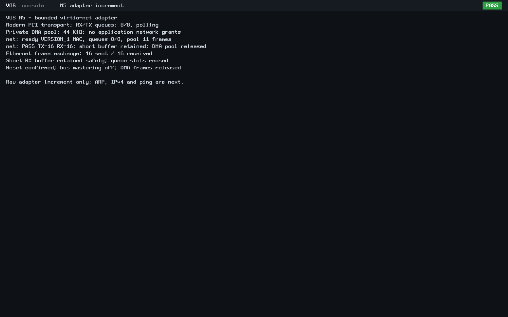

# N5 first working network adapter

The accepted N4 implementation is present in main at merge
`bbca69d850e8c168bfa824ace475a27226b2cdb7`; its tree is identical to N4 publication
`50cbc8bc49bd10d5272647b267ed23895d2f533d`. Local main fast-forwarded safely and
`feat/n5-networking` was created from it. No history rewrite, worktree removal or
stash change occurred. The reviewed 40-file increment is published as
[`27fe770676b4ce138eb9596c881a556c820cbe74`](https://github.com/veasnawt/vos/commit/27fe770676b4ce138eb9596c881a556c820cbe74)
on `feat/n5-networking`. Its raw final-review record retains the pre-publication
state. Subsequent [Ethernet/ARP work](n5-arp.md) is recorded separately.

The new opt-in modern virtio-net driver initializes the adapter and exchanges raw
Ethernet frames using fixed queues, copied buffers and a private 44 KiB DMA pool.
The [networking guide](../networking.md) records the infrastructure inspection,
transport choice, resource bounds, safety limits, reproduction and permission
direction. No application automatically obtains network access; no new syscall ABI
or Rixie Connected feature was introduced.

## Focused results

| Check | Result |
| --- | --- |
| Actual driver against host PCI/DMA model | 251 checks PASS: feature/queue bounds, buffer validation, TX padding, RX short-capacity retention, malformed/duplicate completions, timeout, reset and quarantine |
| BIOS and UEFI network exchange | PASS: 16 exact TX and 16 exact RX frames on each firmware; queue slots reused |
| DMA lifetime | PASS: confirmed reset, bus mastering disabled, all eleven frames returned and PMM free count/audit restored |
| Adapter absent | PASS: graceful no-device path, no DMA allocation |
| Native app compatibility with NIC present | PASS: BIOS vsh and UEFI Rixie keyboard/reply/exit checks, without network initialization or frame transmission |
| Accepted application identities | PASS: both apps rebuilt from unchanged sources and match accepted N4 ELF hashes |
| Legacy application path | ABI v0 hello succeeds/reclaims on all five boots; ABI v0–v3 sources unchanged |
| Build guard/layout | Empty NET_BUILD refused; existing kernel layout check passes for fresh images |

Each bounded q35/TCG guest has 128 MiB RAM. An inherited connected Unix socket
provides an isolated QEMU network peer. Frames are compared byte for byte in both
directions and retained as hex and PCAP. There is no host TAP/NAT/LAN or network
service. These are raw adapter checks; Ethernet protocol dispatch, ARP, IPv4 and
ICMP remain subsequent increments. N3 campaigns were not repeated.

The final reproducible run is `build/n5-session-20261024T154351Z/`. Its
[evidence index](n5-net/evidence.json), [exact changed-file inventory](n5-net/changed-files.txt)
and [final preservation/accounting review](n5-net/final-review.json) retain the
source/product identities, complete local manifest, raw output and guard outcome.

## Preserved development history

- `build/n5-session-20261024T153726Z/`: host checks passed and the first BIOS NIC
  initialized, but strict RX header validation rejected the first packet.
- `build/n5-session-20261024T153943Z/`: diagnostic run identified a zero
  num_buffers field; raw frame/PCAP and diagnostic header bytes are retained.
- `build/n5-session-20261024T154135Z/`: all five boots passed after making the
  nonmerged single-descriptor contract explicit. Its compatibility step used
  accepted local N4 ELF artifacts.
- `build/n5-session-20261024T154351Z/`: final passing run builds those apps from
  source and checks their identities, removing that local-artifact dependency.

The guide documents the QEMU/VIRTIO count-field discrepancy and why the driver
does not trust an unnegotiated merged-buffer count. Actual queue/length checks and
negative controls still reject unsafe entries. No prior attempt was overwritten
or described as clean; all attempt storage remains charged.

## Authentic captures

These are lossless conversions of unmodified QEMU PPM screendumps from the final
run. They show actual frame counts and successful DMA teardown, and explicitly
identify ARP, IPv4 and ping as future work. Identical content produces matching
PNG hashes. Original dumps and app-compatibility captures remain in local evidence.

All N3 protected evidence, seven reference binaries, earlier N4 records, worktrees
and stashes remain preserved. Existing reserves and the 3360 MiB cumulative ceiling
were retained; N4 and all N5 attempts are counted together. Publication preserved
raw QMP register transcripts byte for byte; their CRLF/whitespace was excluded
only from style lint after the first publication attempt stopped before commit.
No test or integrity criterion changed. The next increment adds Ethernet/ARP.
