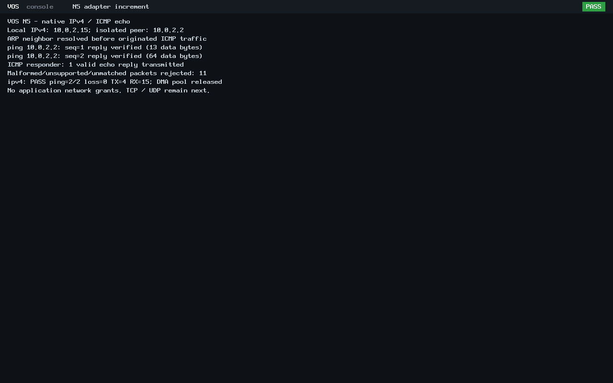

# N5 native IPv4 and ICMP echo

The exact reviewed 37-file ARP implementation is committed and pushed as
[`a6571c19b128f6ffb61e2b38635df55093b49f45`](https://github.com/veasnawt/vos/commit/a6571c19b128f6ffb61e2b38635df55093b49f45)
on `feat/n5-networking`. Main remains the accepted N4 merge `bbca69d`.
This subsequent IPv4/ICMP implementation is uncommitted for review.

The [networking guide](../networking.md#bounded-native-ipv4-and-icmp-echo) documents
the new kernel-only context, parsing bounds, checksums, echo correlation and
reproduction workflow. It reuses the unchanged virtio-net driver and existing ARP
cache. Normal boots and ABI v0-v3 have no new application network authority.

## Focused results

| Check | Result |
| --- | --- |
| IPv4/ICMP host with ASan/UBSan | 1,806 checks PASS |
| Existing ARP host regression | 4,598 checks PASS after shared Ethernet validation extraction |
| IPv4 validation | Truncation/MTU, version/IHL/total length, TTL, checksum, addresses; options/fragments/unsupported protocols rejected |
| ICMP validation | Checksum including odd/empty data; code/type, peer MAC/IP, identifier/sequence, exact length/data, timeout and unsolicited replies |
| Buffer safety | Short outputs, canaries, in-place response, aliased outgoing data; 1472-byte incoming echo response and 64-byte origination bound |
| BIOS and UEFI | Each PASS: 2/2 pings, zero loss, one incoming request answered, 11 malformed/unsupported/unmatched frames rejected |
| Wire evidence | Each 19 PCAP records: 4 TX / 15 RX; exact peer transcript and independent checksum/tuple/data checks |
| Memory and legacy path | All 11 DMA frames released, PMM restored/audited, ABI v0 hello exits/reclaims |

The native VOS stack resolves 10.0.2.2 with ARP before emitting ICMP. It originates
one 13-byte and one 64-byte echo payload, matches the actual returned packets,
and sends a valid reply to a peer's 17-byte request. The independent Unix-socket
peer is test equipment; the guest uses VOS Ethernet/ARP/IP/ICMP code. No Linux
guest networking, TAP, NAT, LAN or internet connectivity is involved. This is
a real packet-level ping demonstration, not an interactive shell `ping` command.

The successful root is `build/n5-ipv4-20261024T172906Z/`.
The [evidence index](n5-ipv4/evidence.json) pins sources, products, raw compact
artifacts and the complete local manifest. The [final review](n5-ipv4/final-review.json)
records protected identities, storage, refs/worktrees/stashes and the monitor.
The [exact changed-file inventory](n5-ipv4/changed-files.txt) separates this working
increment from the already published ARP inventory. No N3/N4 campaign was run.

## Preserved interruptions and storage

The original ARP publisher at `build/n5-arp-20261024T171143Z/` committed/pushed
successfully, then stopped at a post-push adapter assertion using the feature
parent instead of accepted main. Independent guarded recovery at
`build/n5-ipv4-20261024T171849Z/` checked all 37 published blobs, ancestry, remote
refs, main, 13 worktrees and two stashes. Its original failure remains unchanged.

The first IPv4 host attempt, `build/n5-ipv4-20261024T172838Z/`, stopped before QEMU:
ARP fixture setup had overwritten a sentinel later asserted as untouched.
Resetting that sentinel immediately before the tested call corrected the fixture.
No protocol acceptance criterion was weakened. The failed run/log/manifest stay
preserved; the subsequent fresh attempt passes.

The same approved 272 MiB positive-growth meter remains active inside the inherited
3360 MiB aggregate ceiling. Previous ARP usage, all failed/unfinished attempts,
source growth and metadata/Git provisions remain charged. Original C:, E: and
Linux reserves and isolation rules are unchanged. Final byte/MiB figures are in
the final review. Prior evidence, archives and seven protected binaries remain
unchanged; D1r3 remains unfinished, unsealed and unarchived.

## Authentic screenshots

These are lossless conversions of the passing guests' unmodified QEMU PPM dumps.
They show real ping/reply counts, rejection checks and DMA teardown. Identical
display content produces identical image hashes.

## Limits and next work

Only local unicast ICMP echo is supported. No routing, reassembly, options, DHCP,
IPv6, TCP, UDP or DNS is implemented. Applications still have no network syscalls.
Next is a bounded kernel UDP datagram increment, followed by a separately scoped
TCP design; explicit capability enforcement is required before application access.
No browser or Rixie Connected work has begun. N5 remains in progress.
