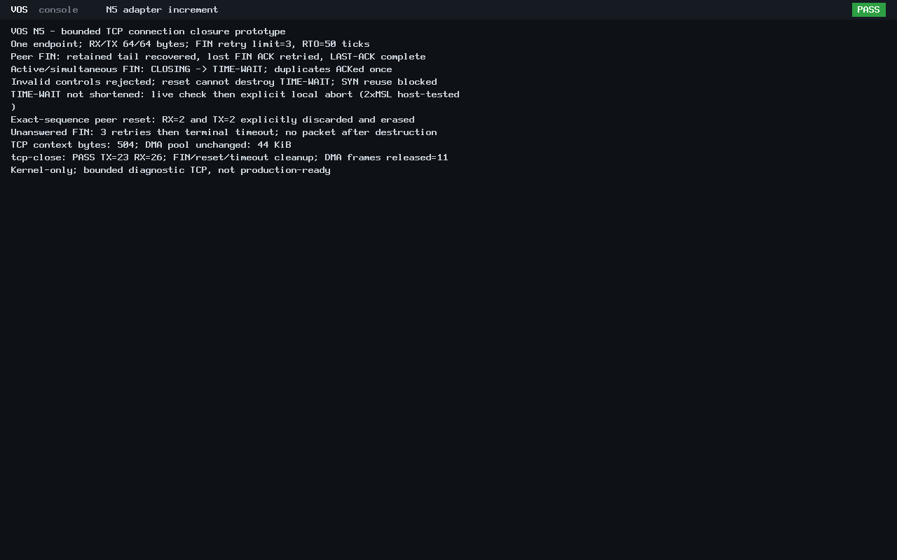

> Resume update: all focused tests, independent capture checks and the original
> final audit completed before the usage interruption. The owner subsequently
> merged [PR #6](https://github.com/veasnawt/vos/pull/6) at 369153d, with the same
> source tree as d512db7. No completed tests were rerun on resume. Current
> [resume review](n5-tcp-close/resume-review.json),
> [exact inventory](n5-tcp-close/resume-changed-files.txt) and
> [manual QEMU instructions](n5-tcp-close-manual.md) supplement the original
> checkpoint below, whose original documents and raw evidence are preserved.

# N5 bounded TCP connection closure

The reviewed 61-file retransmission increment is published as
[d512db7cdf40b5b3dbcaf9c18f21041943d1c22c](https://github.com/veasnawt/vos/commit/d512db7cdf40b5b3dbcaf9c18f21041943d1c22c)
on `feat/n5-networking`. Connection-closure work remains **uncommitted for review**.
N5 remains in progress; the owner's next major milestone is N6, the VOS graphical desktop.

## Behavior and memory

Closure is a separate LISTEN-only kernel opt-in, requiring the existing payload mode.
Existing establishment, payload and retry profiles retain their prior opt-in behavior.
No syscall, application capability, driver DMA allocation or ABI v0-v3 changes.

A single flag at offset 364 uses one former padding byte. Context size remains
**504 bytes against the unchanged 512-byte limit**; `tx_since` remains at offset 368.
RX and retained TX stay 64 bytes each; the driver still owns its 44 KiB private DMA pool.

Local `net_tcp_finish` emits FIN|ACK only after both buffers have drained.
It returns BUSY while data is retained or unread, WINDOW for a zero peer window,
and never queues a FIN behind data. The caller can continue reading and retry
finish after progress. FIN consumes exactly one sequence number but no buffer slot.
The supported states are ESTABLISHED, CLOSE-WAIT, FIN-WAIT-1, FIN-WAIT-2,
CLOSING, LAST-ACK and TIME-WAIT. Original state enum values remain unchanged.

Peer FIN can carry bounded in-order data; bytes remain readable before EOF.
A FIN just beyond a full advertised window is not consumed: accepted payload
fills the real buffer, the ACK advances only over those bytes, and FIN can be
retried after an explicit window update. CLOSE-WAIT still permits bounded data
send/retry and partial/cumulative ACK retirement. Sending FIN cannot retire
retained data or cause a data ACK to acknowledge an unsent byte.

Active close progresses through FIN-WAIT; simultaneous FIN uses CLOSING.
Passive close reaches LAST-ACK, then erases state on the valid final ACK.
Duplicate FIN is ACKed without consuming its sequence number twice.
TIME-WAIT refuses new SYN reuse and ignores reset assassination.
Unread RX delays successful linger cleanup; explicit timeout/reset/abort reports
a terminal discard rather than silently claiming delivery.

RST must match the bound peer IP, MAC and port. Only exact RCV.NXT resets the
connection. An inaccurate in-window RST receives a challenge ACK; an
out-of-window reset is dropped. This is not authentication: an on-path peer
knowing the exact tuple/sequence can reset the connection. Challenge ACK rate
limiting remains unsupported. Malformed headers, unsupported flags/options,
bad checksums, invalid FIN sequences and future/ambiguous ACKs fail closed.

## Timers and destruction

The caller supplies monotonic 100 Hz PIT ticks, with unsigned wrap-safe intervals:

| Timer | Bound |
| --- | --- |
| FIN/data retry spacing | 50 ticks, at most 3 retries |
| Outstanding FIN/data absolute horizon | 200 ticks |
| Incomplete close / CLOSE-WAIT | 400 ticks from first close event |
| MSL | 12,000 ticks (120 seconds) |
| TIME-WAIT | 24,000 ticks (2xMSL) |
| Absolute close user timeout | 48,000 ticks, including repeated-FIN linger extension |

FIN retries reuse the retained-data retry metadata and transmit sequence without
advancing SND.NXT. Zero-window retries emit nothing and consume no retry charge.
Valid FIN ACK clears its retry state. Duplicate ACK and FIN cannot extend the
original incomplete-close or hard user deadline. TIME-WAIT duplicate FIN restarts
only its linger anchor. No adaptive RTO/backoff or SYN/RST retransmission is added.

`net_tcp_expire` returns DONE for successful linger cleanup, 1 for timeout abort,
0 otherwise. LAST-ACK completion returns DONE from input; valid reset returns RESET.
All terminal paths erase connection sequences, peer binding and RX/TX buffers.
Local abort preserves endpoint configuration in LISTEN; endpoint close erases all
504 bytes. No later retransmit is permitted. Adapter reset confirmation remains
mandatory before DMA release.

The state accounting and reset rules follow the relevant portions of
[RFC 9293 sections 3.6 and 3.10.7.4](https://www.rfc-editor.org/rfc/rfc9293.html).
This scoped implementation is not a claim of full RFC conformance.

## Focused verification

| Check | Result |
| --- | --- |
| Closure ASan/UBSan | 8,505 checks PASS |
| Existing data retry ASan/UBSan | 1,711 checks PASS |
| Existing payload ASan/UBSan | 5,397 checks PASS |
| Existing establishment ASan/UBSan | 3,808 checks PASS |
| BIOS / UEFI | PASS / PASS |
| Independent PCAP review | 49 frames each: 23 TX / 26 RX; 47 valid IPv4/TCP checksum pairs |
| Legacy ring-3 hello | exits 0 and frames reclaimed on each boot |
| Adapter teardown | STOPPED/reset confirmed, 11 DMA frames freed, PMM restored/audited |

Host tests cover short output atomicity, normal active and passive close,
simultaneous FIN, FIN with 0..64 payload bytes, zero-window backpressure,
partial/cumulative/duplicate/invalid ACKs, bad FIN/RST, exact-sequence reset,
retry exhaustion, timer boundaries, sequence/tick wrap, unread data and destruction
from every closing state. Full 2xMSL expiry and the absolute hard timeout use
controlled host clock values; no live timer is shortened.

Each real firmware boot uses four connections over the unchanged isolated
QEMU stream peer, with no TAP, NAT, LAN or Internet. It demonstrates:

1. Peer FIN while a four-byte TX tail remains: retry the tail, then recover a
   deliberately dropped FIN ACK and finish LAST-ACK successfully.
2. Active/simultaneous close: reject invalid controls, enter TIME-WAIT, ACK
   duplicate FIN once, reject reset assassination and premature SYN reuse.
3. Exact-sequence peer reset with 2 unread RX and 2 retained TX bytes: explicitly
   discard and erase both, with wrong-MAC and old-sequence resets rejected.
4. Blackholed FIN: three retries, terminal timeout and no post-destruction packet.

The live TIME-WAIT connection is **explicitly locally aborted after its checks**;
the runtime does not claim successful 240-second linger expiry.
The full expiry is host-tested. Six unique bytes are delivered by the peer in
the retained-tail test. Prefix acceptance is a controlled peer decision, not
claimed partial Ethernet/IP delivery. Raw PCAPs and decisions are retained.

## Performance

Optimized hosted models use the unchanged canonical handshake/payload and retry
benchmarks against the accepted retransmission binaries, under adjacent recorded
host conditions. Sanitizer runs are separate. Paired median changes are
**+2.22% handshake, +4.05% payload transaction and +8.83% retry cost**.
No optimization or security-check bypass was introduced.

The new closure model measures FIN construction, peer FIN/ACK processing and
controlled-tick linger cleanup, including a 504-byte state restore; it establishes
an initial baseline rather than a speedup claim. Raw samples and medians are in
[performance-pair.json](n5-tcp-close/performance-pair.json).
Unsanitized QEMU CPU time, observed peak RSS and elapsed time are recorded per
firmware. Different loss/closure scenarios cannot establish guest throughput
regressions against the prior payload scenario.

## Reproduction and authentic captures

Use the documented toolchain and existing isolation/admission controller first.
The script is the workload, not a replacement for those guards:

```sh
PYTHONDONTWRITEBYTECODE=1 python3 -B scripts/test-tcp-close.py \
  --output "$PWD/build/n5-tcp-close-$(date -u +%Y%m%dT%H%M%SZ)"
```

`TCP_CLOSE_BUILD` must be nonempty for `tcp-close-iso` / `tcp-close-uefi-iso`.
These images require the controlled peer; an unconnected manual boot will time out.
The paired benchmark additionally needs the preserved accepted retry baseline
at `build/n5-tcp-retry-20261024T193224Z/results`, pinned by its recorded manifest.
The SDK/shell launch configurations and their verified application ELFs are unchanged.




Both are lossless PNG conversions of real QMP framebuffer captures; no UI content
was added or altered. Identical screen content across firmware is expected.
Serial logs, PCAPs, QMP registers, commands and capture hashes establish provenance.

## Evidence, history and storage

[Evidence index](n5-tcp-close/evidence.json), [exact changed files](n5-tcp-close/changed-files.txt)
and [final preservation/accounting review](n5-tcp-close/final-review.json) identify
sources, binaries, raw results and manifest hashes. Full accepted output is
`build/n5-tcp-close-20261024T201015Z/results`; its guard passed.
Independent capture review is `build/n5-tcp-close-20261024T201156Z`.

Preserved unsuccessful attempts are accurately distinguished:

- `195458Z` admission helper used `manifest` instead of the actual
  `local_manifest` field. No closure source was changed.
- `195546Z` nested controller loading lacked the launcher's argv context.
  Admission was moved to the existing outer controller, with unchanged checks.
- `200702Z` reached the expected BIOS protocol/cleanup states but failed
  the fixture's final RX count: expected 25 instead of 26. Its failed verdict,
  captures, manifest, logs and accounting remain unchanged. Independent review
  at `200924Z` proved all 49 records and control/data fields before correcting
  only the count assertions/marker. No TCP logic was changed for the repeat.

All these shorthand roots have prefix `build/n5-tcp-close-20261024T`.
No failed run was marked clean. No previous evidence was overwritten.

Initial admission reserved 64 MiB attempt plus 16 MiB finalization. After the
preserved failed attempt, the successful repeat was freshly admitted with a
stricter 40 MiB output bound plus 16 MiB finalization (56 MiB peak), within both
the existing 272 MiB continuation meter and inherited 3,360 MiB aggregate ceiling.
Small evidence-only operations use a tighter 1 MiB output bound; all original
physical reserves, isolation queries/stop rules and positive-growth accounting
remain enforced. Final exact accounting is in the linked review; the final
user report includes the last read-only measurement after the review itself.
No evidence deletion, shrink credit, allowance increase or reserve reduction.

The final review rechecks seven protected binaries, historical records/archives,
accepted N4/N5 manifests, ABI/application source and ELF identities, 13 worktrees,
two stashes and all unrelated Git references. D1r3 remains unfinished, unsealed
and unarchived. No historical N3/N4 runtime campaign was repeated.

GitHub main remains the owner's PR #5 merge `ffaf2fb`.
After publication the feature is two ahead/two behind, common ancestor
`4e799c2`; local main/origin-main remain `bbca69d`.
There was no fetch, rebase, reset, force-push or executor merge into main.

## Limitations and next action

This remains a passive, one-connection diagnostic prototype. Unsupported features
include out-of-order reassembly, TCP options, congestion control, adaptive recovery,
persist probes, production ISNs and application sockets. Cryptographically secure
randomness must precede production TCP/cryptographic service claims.
No new focused security failure was found; tuple/sequence checks are not peer
authentication, and challenge-ACK rate limiting is not implemented.

Recommended remaining N5 work is owner review/publication of this closure
increment and consolidation of the existing milestone results and limitations.
Do not turn production TCP improvements, DNS/DHCP/TLS or application networking
into unapproved N5 gates. N6 graphical desktop work needs separate authorization.
