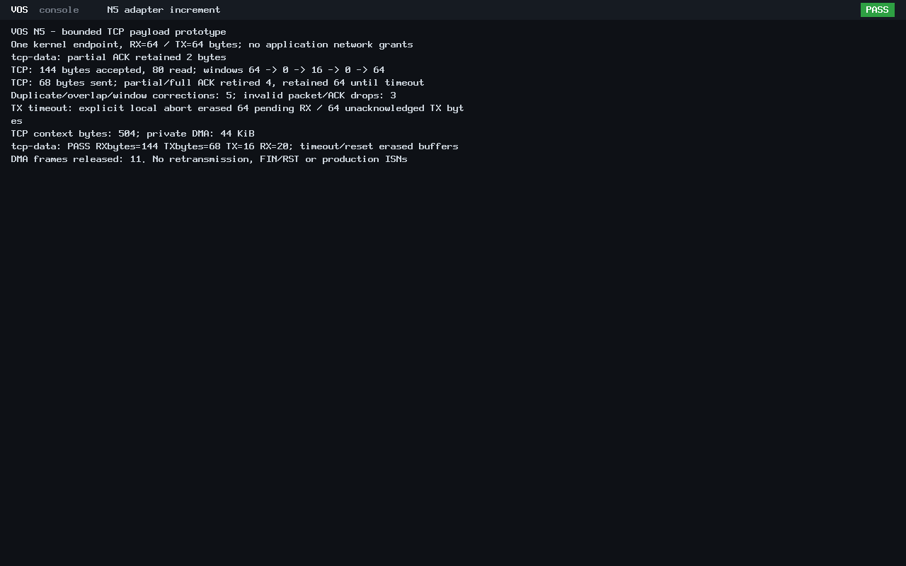

# N5 bounded TCP payload exchange

TCP establishment is published as
[`4e799c241b6f78ffe26e88274a132bf90772d628`](https://github.com/veasnawt/vos/commit/4e799c241b6f78ffe26e88274a132bf90772d628)
on `feat/n5-networking`, including the exact reviewed 49-file candidate. The
payload increment remains **uncommitted for review**. N5 is in progress.

## Git and publication

Before publication, feature-only commit `a5889f9` (UDP) and main-only merge
`d01b3f5` diverged from `33693b3` (IPv4/ICMP): one ahead and one behind. Main's
tree equals IPv4; there was no competing content change. Publication was a normal
fast-forward feature-branch push, with no merge, rebase or reset needed. The
feature is now two commits ahead/one behind GitHub main. Local main/origin-main
stay `bbca69d`; GitHub main stays `d01b3f5`. The executor did not merge into main.

The first controller, `build/n5-tcp-20261024T183512Z/`, stopped on the original
15-second storage-reserve query timeout during read-only preservation hashing.
It was terminated before staging/commit/push. Read-only checks confirmed the
candidate/index unchanged, isolation and reserves, using the same guard in 2.09 s.
A fresh guarded publisher at `build/n5-tcp-20261024T184326Z/` passed and published.
The timeout record remains unchanged and charged; it is not claimed clean or
uninterrupted. Neither guard source nor timeout was relaxed.

## Implementation and focused verification

The [guide](../networking.md#bounded-tcp-payload-exchange) describes opt-in payload
mode, fixed buffers and advertised-window backing, partial reads/ACKs, TX ownership,
modular sequence checks, explicit timeout/reset cleanup and kernel-only access.
The establishment-only profile retains its old zero-window behavior.

| Check | Result |
| --- | --- |
| New payload ASan/UBSan host checks | 5,397 PASS; sizes 1-64, exhaustion, canaries, short output, aliasing, stale/future ACKs, duplicates/overlap, wrap and cleanup |
| Existing networking host regressions | TCP 3,808; UDP 136,730; IPv4 1,806; ARP 4,598 PASS |
| Existing TCP criteria | Test source unchanged; extra 160 context-erasure byte checks explain the count increase from 3,648; original 512-byte bound retained |
| BIOS and UEFI, each | 144 bytes accepted, 80 read, 68 sent, 4 TX bytes validly acknowledged; five corrective ACKs and three invalid packet/ACK drops |
| Window accounting | Actual capacity 64 -> 0 -> 16 -> 0 -> 64, then 55/54/0; no new-byte ACK on duplicate/overlap/out-of-window data |
| TX ownership | Partial ACK retains `S!`; duplicate ACK retains it; full ACK retires it; window 0 blocks new sends; invalid-sequence data cannot retire the later 64-byte TX |
| Cleanup | Explicit TX timeout aborts 64 pending RX and 64 unacknowledged TX bytes, erases buffers/state; reset confirms STOPPED, releases 11 DMA frames, restores/audits PMM |
| Independent wire review | 36 PCAP records per firmware: 16 TX/20 RX; 33 valid TCP checksum checks plus retained bad-checksum control, exact sequence/ACK/window/payload model |
| Compatibility | ABI v0 hello exits/reclaims on both boots; ABI v0-v3, capability/launch/SDK and vsh/Rixie source and accepted ELF identities preserved |

The positive bidirectional exchange includes 80 read peer bytes and fully ACKed
`VOS!`. Additional traffic deliberately fills both buffers for timeout testing.
An ACK reports bytes copied into RX, not application consumption. On timeout the
remaining 64 accepted-but-unread RX bytes and 64 unacknowledged TX bytes are
explicitly aborted with the connection; they are not reported as delivered.
There is no silent overwrite or ACK of rejected `bad`, gap, overlap or full-window
bytes. The peer is isolated test equipment; actual VOS code handles guest TCP.
No Linux guest networking, TAP, NAT, LAN or internet connection is used.

## Evidence and reproduction

The passing root is `build/n5-tcp-data-20261024T185933Z/`. Sources were hashed before
execution and verified unchanged afterward. The [evidence index](n5-tcp-data/evidence.json)
pins source/product hashes, the complete local manifest, raw host/serial logs,
PCAP verification and metrics. The [final review](n5-tcp-data/final-review.json)
records exact accounting, protected identities and refs/worktrees/stashes. See
the [complete changed-file inventory](n5-tcp-data/changed-files.txt) and
[reproduction command](../networking.md#bounded-tcp-payload-exchange).
Only the affected host checks and two new payload firmware boots ran; no completed
historic QEMU campaign was repeated. Payload verification passed its first attempt.

## Relevant performance observations

Correctness runs use host ASan/UBSan at `-O1`. Performance evidence is separate:
an optimized unsanitized hosted protocol model and the actual `-O2` kernel under
q35/TCG, 128 MiB, modern virtio-net and the same bounded peer configuration.
The [paired host-model record](n5-tcp-data/performance-pair.json) identifies compiler
flags, host CPU/load, identical benchmark source and pinned old binary.
The [wire/scenario metrics](n5-tcp-data/wire-metrics.json) preserve raw timings.

| Measurement | Observation |
| --- | --- |
| Context | 344 -> 504 bytes: 128 buffer bytes plus 32 bookkeeping bytes; still below 512 |
| Paired optimized host legacy handshake median | 217.68 -> 229.39 ns, +5.38%; sample ranges overlap; no large regression detected in this scoped model |
| New hosted 2-byte bidirectional transaction median | 484.02 ns including handshake/setup/cleanup; not kernel or network throughput |
| QEMU CPU to PASS, BIOS/UEFI | 0.92 / 3.92 seconds including boot and timeout |
| Observed emulator VmHWM, BIOS/UEFI | 77,924 / 156,148 KiB; includes emulator/firmware/TCG overhead, not kernel allocation |
| Payload-to-ACK capture median, BIOS/UEFI | 7.250 / 3.703 ms with controlled peer pacing and 100 Hz polling sleeps |
| Fixed private DMA | 44 KiB, unchanged; freed after confirmed reset |

The scenario is not a throughput benchmark: it includes peer polling, window
coordination and a deliberate 2-second TX timeout. Raw accepted-byte rate excludes
the final wait but is still scenario-paced, and includes bytes later aborted.
Historical establishment-only SYN response observations are 3.052/12.390 ms,
versus 10.640/17.506 ms here. That different packet prelude/load is not a controlled
regression comparison; existing 100 Hz receive sleeps and peer/TCG scheduling
quantize timings. The paired optimized host model is the comparable workload.
No optimization or validation bypass was introduced, and no general latency,
throughput or production-responsiveness claim is made from these small samples.

## Security and limits

No new security failure was observed in focused checks. Input remains untrusted:
headers/checksums, tuple, sequence, ACK range, advertised window and buffer bounds
are validated before state/copy. Full, malformed and timed-out paths are exercised.
No application sockets or grants are added. The unsafe boundary remains the
existing C kernel copied-packet/DMA interface, with private descriptors and
supervisor memory; this work adds no Rust unsafe/FFI or assembly boundary.

This remains a prototype: one connection, whole in-order segments, one in-flight
TX segment, no retransmission, out-of-order reassembly, full stream reliability,
FIN/RST wire closure, active open, congestion control or production ISN generator.
Partial overlaps/window-exceeding segments are rejected as a whole, with the
current ACK; no partial trimming is claimed. Timeout/reset is a local abort, not
peer-notified graceful closure. Before production TCP/cryptographic services,
secure entropy, a seeded/reseeded CSPRNG and secret-based ISN generation must be
implemented and verified. Deterministic diagnostic ISNs are not a substitute.
DNS, DHCP, TLS, browser work and Rixie Connected remain outside this increment.

## Storage and preservation

Admission `build/n5-tcp-data-20261024T184917Z/` reserved 128 MiB for the attempt and
16 MiB evidence provision. Aggregate capacity was 3187.21/3360 MiB, leaving
172.79 MiB; 157.12 MiB remained in the unchanged 272 MiB continuation meter.
The baseline at `build/n5-tcp-data-20261024T185044Z/`, failed publisher, all older
attempts, source growth and metadata/Git provisions remain charged. No allowance,
reserve or guard changed; nothing was cleaned up. All protected evidence/binaries,
archives, worktrees and stashes remain preserved. D1r3 remains unfinished, unsealed
and unarchived. Final accounting is in the linked review.

## Authentic screenshots

These are lossless conversions of unchanged QEMU PPM captures from the passing
guests. They show byte/window/ACK counts and explicit timeout/reset cleanup.

Next: bounded retransmission of the retained TX segment, with retry limits and
packet/ACK-loss tests. Wire closure and reassembly remain unsupported.
