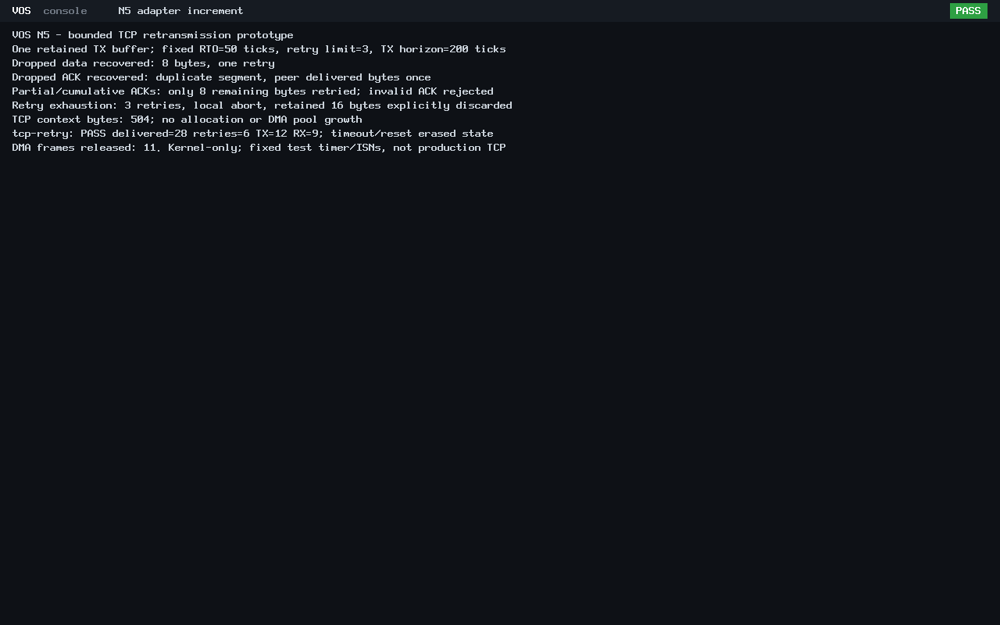

# N5 bounded TCP retransmission

The reviewed 55-file payload increment is published as
[`ff251a728529908776ec5557cbc359f2247bc369`](https://github.com/veasnawt/vos/commit/ff251a728529908776ec5557cbc359f2247bc369)
on `feat/n5-networking`. Retransmission changes remain **uncommitted for review**.
N5 remains in progress.

## Git and publication

Actual remote inspection found the owner had merged
[PR #5](https://github.com/veasnawt/vos/pull/5) at `ffaf2fb`, containing accepted
establishment `4e799c2`. Independent comparison confirms no tree differences;
the extra history consists of merge commits. The previously reported two-ahead,
one-behind state was an earlier checkpoint. Payload publication was a normal
feature-branch fast-forward without rebase/reset/merge. The feature is now one
ahead/two behind main, with common commit `4e799c2`. Local main/origin-main stay
`bbca69d`; GitHub main stays `ffaf2fb`. No main merge was performed by the executor.
The guarded publisher is `build/n5-tcp-data-20261024T191858Z/`.

## Implementation and verification

The [guide](../networking.md#bounded-tcp-retransmission) specifies opt-in data-only
retries, retained-prefix ownership, monotonic relative timer and finite retry/
absolute-time budget. Fixed RX/TX buffers and all existing ACK validation remain.

| Check | Result |
| --- | --- |
| New ASan/UBSan retry host checks | 1,711 PASS; sizes 1-64, short output, retained data, partial/cumulative/duplicate/future ACKs, timer edges, late polling, window shrink/zero, sequence/tick wrap and destruction |
| Unchanged host regressions | Payload 5,397; legacy TCP 3,808; UDP 136,730; IPv4 1,806; ARP 4,598 PASS |
| BIOS and UEFI, each | Data loss recovered, ACK loss recovered without duplicate delivery, eight-byte partial-ACK suffix recovered; six total retransmissions |
| Exhaustion, each | Three retries of the final 16-byte segment, then explicit local abort at the absolute 200-tick horizon |
| Independent capture, each | 21 records, 12 TX/9 RX; 19 TCP pseudoheader checksums and exact sequence/ACK/window/payload/ID verification |
| Memory | Context stays 504 bytes; six bytes of old padding hold retry metadata; original 512-byte bound, RX/TX=64 bytes each and DMA=44 KiB unchanged |
| Cleanup | No retry after full ACK, abort or close; endpoint erased; adapter STOPPED/no quarantine, all 11 DMA frames released, PMM restored/audited |
| Compatibility | ABI v0 hello exits/reclaims on both boots; ABI v0-v3, vsh/Rixie/SDK, capability and launch/protection sources and accepted app ELFs preserved |

The peer first drops `dataLOSS` before application delivery. The retry recovers
eight bytes. It then delivers `ack-LOSS` but drops its ACK; the repeated segment
generates a cumulative ACK without duplicate application delivery. For
`partial-data`, the controlled receiver accepts `part`, withholds the trailing
eight bytes, and sends duplicate/future ACK controls. Only `ial-data` is retried.
The peer finally blackholes all copies of `timeout-retained` until exhaustion.
The 28 delivered bytes are exactly `dataLOSSack-LOSSpartial-data`, once each.
Wire payload including duplicates totals 116 bytes; 16 retained bytes are explicitly
aborted, not claimed delivered. Partial acceptance is a deliberate peer fixture,
not a claim that only part of an Ethernet packet reached QEMU.

The peer's loss/dedup decisions and dropped-ACK bytes are preserved. PCAP records
actual wire traffic; the intentionally omitted ACK is absent until the duplicate
segment triggers its later copy. No Linux guest stack, TAP, NAT, LAN or internet
connection is used. There is no post-destruction retransmission or extra packet.

## Evidence and reproduction

The passing root is `build/n5-tcp-retry-20261024T193224Z/`; source hashes remained
unchanged throughout. The [evidence index](n5-tcp-retry/evidence.json) identifies
sources, products, full local manifest, raw logs, loss decisions, application
delivery, independent PCAP verification and metrics. See the
[exact changed files](n5-tcp-retry/changed-files.txt),
[final preservation/accounting review](n5-tcp-retry/final-review.json) and
[reproduction command](../networking.md#bounded-tcp-retransmission).
The new host/runtime checks passed on their first attempt. Only affected host
regressions and two retry-profile firmware boots ran; historical campaigns and
completed payload QEMU tests were not repeated.

## Relevant performance evidence

ASan/UBSan correctness runs are separate from optimized hosted benchmarks and
the actual unsanitized `-O2` kernel in q35/TCG with 128 MiB and the same NIC/peer
configuration. The [paired record](n5-tcp-retry/performance-pair.json) pins the
accepted payload binary, unchanged canonical benchmark source, flags and host
conditions. The [wire metrics](n5-tcp-retry/wire-metrics.json) retain capture gaps.

| Optimized host observation | Accepted payload -> current |
| --- | --- |
| Legacy handshake median | 232.49 -> 250.18 ns, +7.61% |
| Two-byte bidirectional transaction with setup | 487.94 -> 503.80 ns, +3.25% |
| Retry including restoration of 504-byte pending state | 92.46 ns median; first retry-path baseline, not kernel throughput |
| Context / private DMA | 504 bytes / 44 KiB, unchanged |

QEMU CPU to PASS was 0.97/3.75 seconds for BIOS/UEFI; observed emulator VmHWM
was 77,780/156,044 KiB. Total scenarios were 5.02/7.18 seconds, including firmware
and deliberate retry waits. These are compact scenario baselines, not throughput
or hard latency guarantees. Firmware, emulation, polling and different loss
scenarios prevent direct end-to-end timing comparisons with the payload run.
The modest hosted increases are reported; no broad performance improvement or
production responsiveness claim is made, and no security checks were bypassed.

## Limits and security

No new security failure was observed in the focused checks. Only currently
outstanding bytes can be retried; partial/cumulative ACKs cannot retire unsent
data, duplicate/invalid ACKs cannot postpone the absolute deadline, and destruction
erases every connection buffer/counter. Retry fields reuse padding rather than
expanding allocation or changing the 512-byte limit.

This is not production TCP. Fixed 50-tick RTO, three retries and 200-tick original
TX horizon replace neither RTT estimation/backoff nor congestion control. Late
polling or partial progress can leave fewer useful retries before the hard cap.
Fast retransmit, persist probes, SYN/FIN/RST retransmission, out-of-order reassembly,
wire closure, active open and production-quality ISNs remain unsupported. Secure
randomness remains required before production TCP or cryptographic services.
No application sockets, DNS, DHCP, HTTPS, browser or Rixie Connected work is added.

## Storage and preservation

Fresh admission and layout proof are at `build/n5-tcp-retry-20261024T192316Z/`.
Aggregate accounting was 3217.03/3360 MiB with 142.97 MiB remaining; 127.30 MiB
remained under the unchanged 272 MiB continuation meter. A stricter 64 MiB output
bound plus 16 MiB evidence provision admitted this increment without expanding
allowances or weakening reserves. Old roots, failures, source growth and metadata/
Git provisions remain charged. All seven protected binaries, historical evidence/
archives, 13 worktrees and two stashes remain preserved. D1r3 remains unfinished,
unsealed and unarchived. Final figures are in the linked review.

## Authentic screenshots

Lossless conversions of unchanged QEMU PPM captures show recovery, partial ACKs,
retry exhaustion, the 504-byte context and confirmed DMA teardown.

Next candidate: bounded FIN/RST connection closure and state/timeout cleanup,
subject to authorization. No closure code is included here.
