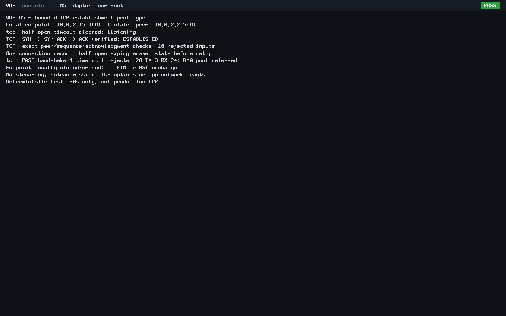

# N5 bounded passive TCP establishment

UDP is published as
[`a5889f908c06ab912321f6fcb8f930e9f12abdd0`](https://github.com/veasnawt/vos/commit/a5889f908c06ab912321f6fcb8f930e9f12abdd0)
on `feat/n5-networking`, with all 46 reviewed files. The TCP increment is
**uncommitted for review**. N5 remains in progress.

## Git ancestry and preservation

[PR #4](https://github.com/veasnawt/vos/pull/4) merged published IPv4/ICMP commit
`33693b3` into GitHub main at `d01b3f5`. Independent GitHub comparison confirms
that IPv4 is its merge base and main is one merge commit ahead with zero file
differences. Thus no ancestry rewrite, rebase or dirty-worktree manipulation was
needed: UDP is a normal descendant of IPv4 and a fast-forward update to the
existing feature branch. Local main/origin-main stay `bbca69d`; remote main
stays `d01b3f5`. No UDP or TCP merge into main was performed by the executor.

The guarded UDP publisher is `build/n5-udp-20261024T181255Z/`. It reviewed exact
source/evidence identities, all 46 staged blobs, PCAPs, protected records and
refs/worktrees/stashes before publishing. All previous evidence and failed or
unfinished attempts remain preserved; D1r3 is unfinished, unsealed and unarchived.

## Implementation and focused results

The [networking guide](../networking.md#bounded-passive-tcp-establishment) documents
the single passive endpoint and connection record, shared IPv4 transport checksum,
header/tuple/sequence checks, explicit half-open expiry and local erase/cleanup.
No payload queue, heap allocation, new DMA pool or application authority is added.

| Check | Result |
| --- | --- |
| TCP host ASan/UBSan | 3,648 checks PASS; bounded headers, pseudoheader/checksum, ports, flags, one record, short output/canaries and in-place SYN processing |
| Affected host regressions | UDP 136,730; IPv4/ICMP 1,806; Ethernet/ARP 4,598 checks PASS |
| Sequence/timer boundaries | Peer/local 32-bit wrap, 64-bit tick wrap, exact final ACK/sequence, late and stale ACKs rejected, timeout erases state before reuse |
| BIOS and UEFI, each | One completed SYN -> SYN-ACK -> ACK handshake, one expired half-open attempt and 20 rejected inputs |
| Wire evidence, each | 27 PCAP records: 3 TX / 24 RX including ARP; 22 independent valid TCP checksum checks and exact positive/negative fields verified |
| Resource bounds | One connection record at most 512 bytes; no data queues; a second connection rejected; endpoint/state erased after demonstration |
| Reset and compatibility | Reset confirmed, STOPPED/no quarantine, all 11 DMA frames released, PMM restored/audited, original ABI v0 hello exits/reclaims |

The guest listens at 10.0.2.15:4001, with the controlled peer at 10.0.2.2:5001.
The first SYN uses peer ISN `ffffffff`; the SYN-ACK correctly acknowledges zero.
Two incorrect ACKs cannot establish that connection. Real PIT expiry erases it.
The next SYN uses ISN `01020304`, and the guest responds with fresh diagnostic
ISN `11233344` and ACK `01020305`. Only a final peer ACK with sequence `01020305`
and acknowledgment `11233345` enters ESTABLISHED. The preserved raw wire records
and independent PCAP review identify every field, rather than inferring success
from serial output alone.

Controls include truncated/invalid-offset headers, TCP/IP checksum corruption,
zero source port, unsolicited ACK, fragmented IP, reserved bits, TCP options,
SYN payload, unbound destination, wrong peer IP/MAC, wrong ACK/sequence, RST and
a competing SYN. No rejected packet generates extra TCP output or another record.
The host peer is isolated test equipment. There is no TAP, NAT, LAN, internet
connection or Linux network stack inside the guest.

## Evidence and reproducibility

The successful root is `build/n5-tcp-20261024T182146Z/`. The source map was hashed
before execution and confirmed unchanged afterward. The [evidence index](n5-tcp/evidence.json)
pins sources, products, the complete local manifest, raw host/serial logs,
commands, independent PCAP results and screenshots. The [final review](n5-tcp/final-review.json)
records refs, protected identities, app compatibility and exact storage. The
[changed-file inventory](n5-tcp/changed-files.txt) lists the complete working set.
The [guide](../networking.md#bounded-passive-tcp-establishment) gives the fresh-build
test command; its bounded peer is required to complete the demonstration.

TCP host/runtime verification passed on its first attempt. Only the affected
network host regressions and two TCP firmware boots ran; no N3/N4 campaign or
completed network QEMU run was repeated. vsh/Rixie/SDK, syscall ABI v0-v3 and
application launch/protection sources remain unchanged. Accepted application
ELFs, protected binaries, prior manifests and archives are rehashed in final review.

## Storage

Admission at `build/n5-tcp-20261024T181615Z/` reserved a 128 MiB attempt plus
16 MiB evidence provision within the existing limits. Before TCP writes, aggregate
accounting was 3158.29/3360 MiB, with 201.71 MiB remaining; 186.05 MiB remained in
the unchanged 272 MiB continuation meter. All historical usage, metadata/Git
provisions and prior failures stay charged, without shrink/deletion credits.
Reserves and continuous isolation rules are unchanged. Final figures are in the
linked review; no allowance expansion or cleanup was performed.

## Authentic screenshots

These are lossless conversions of the passing guests' unchanged QEMU PPM dumps.
They show establishment, actual half-open expiry, rejection counts and teardown,
and explicitly label the test-only ISNs and incomplete TCP scope.

## Limitations and next task

This is a controlled passive-handshake prototype, not complete or production TCP.
Only header-only segments without options are supported. There is no payload
streaming, retransmission, active open, congestion control, persist/keepalive,
FIN/RST wire closure or TIME-WAIT behavior. SYN-ACK advertises a zero receive
window. Closing is a local erase; the peer receives no closure packet. ISNs are
caller-supplied deterministic test values, not a production unpredictable generator.
Options from ordinary full TCP peers may be rejected. There is no unrestricted
userspace networking, DNS, DHCP, TLS, browser or Rixie Connected.

Next: bounded in-order payload transfer on the established test connection, with
fixed send/receive buffers and explicit sequence/window accounting. Retransmission
and wire closure remain unsupported until separately implemented and verified.
