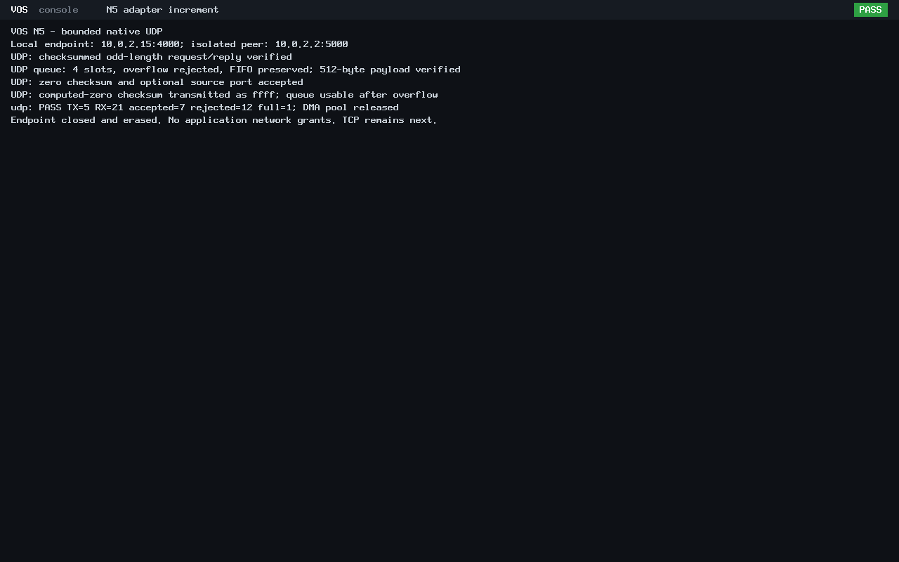

# N5 bounded kernel UDP

IPv4/ICMP is committed and pushed as
[`33693b32178c9096295f1d9186547dc9062fbb50`](https://github.com/veasnawt/vos/commit/33693b32178c9096295f1d9186547dc9062fbb50)
on `feat/n5-networking`, with the exact reviewed 43-file inventory.
Local main remains the accepted N4 merge `bbca69d`. This subsequent UDP increment is
**uncommitted for review**. N5 remains in progress.

The [networking guide](../networking.md#bounded-kernel-udp) documents one explicitly
configured kernel endpoint, four receive slots, a 512-byte payload bound and the
shared IPv4/ARP/ICMP context. UDP introduces no userspace network API or grants.

## Focused verification

| Check | Result |
| --- | --- |
| UDP host, ASan/UBSan | 136,730 checks PASS; payload sizes 0-512, independent pseudoheader checksums and zero-result vectors |
| Affected host regressions | IPv4/ICMP 1,806 PASS; Ethernet/ARP 4,598 PASS |
| Input validation | IP/UDP truncation, UDP lengths below 8 or unequal to IP payload, invalid checksum/pseudoheader, zero destination, unbound port, payload over 512, fragments and unsupported TCP |
| Checksum-zero semantics | IPv4 omitted checksum accepted/flagged; true computed zero emitted and received as `ffff`; empty/odd/max payloads verified |
| Queue/resource bounds | Four slots, FIFO, full-queue rejection, wrap/recovery, empty/null receive, independent copies, slot/endpoint erasure and output canaries |
| BIOS and UEFI, each | PASS: 4 UDP sent, 7 received, 12 invalid/unsupported/unbound rejected, 1 queue overflow rejected |
| Wire evidence, each | 26 raw PCAP records: 5 TX / 21 RX, including ARP; exact bytes/order and independent checksum/port/payload verification |
| Reset/teardown | Adapter reaches STOPPED, no held/quarantined frames, all 11 DMA frames released, PMM restored/audited, endpoint erased |
| Compatibility | ABI v0 hello exits/reclaims on both boots; vsh/Rixie source, ABI/launch infrastructure and preserved application ELF identities unchanged |

The native endpoint 10.0.2.15:4000 resolves the peer 10.0.2.2:5000 through the
existing ARP cache. It exchanges checksummed odd-length payloads, receives a
zero-checksum datagram, source-port-zero empty datagram and a 512-byte payload,
rejects a fifth queued datagram, then consumes valid traffic after draining.
The `c4a1` payload makes the independently calculated UDP checksum exactly zero;
both directions carry the required `ffff` wire representation. A final native
completion datagram confirms the sequence before reset/teardown.

The host Unix-socket peer is test equipment; packet handling inside the guest
is VOS code. There is no Linux guest network stack, TAP, NAT, LAN or internet
connection. This is not a shell UDP/socket interface.

The successful root is `build/n5-udp-20261024T175141Z/`; sources were hashed
before execution and confirmed unchanged afterward. The [evidence index](n5-udp/evidence.json)
pins the local manifest, products, sources, raw logs, captures and screenshots.
The [final review](n5-udp/final-review.json) records integrity, compatibility,
isolation and accounting. See the [exact changed-file inventory](n5-udp/changed-files.txt).
No completed QEMU campaign was repeated; only the affected host regressions ran.

## Preservation and accounting

IPv4 publication was reviewed under the existing guards at
`build/n5-ipv4-20261024T174316Z/`, including exact staged blobs, remote refs and
protected evidence. UDP admission at `build/n5-udp-20261024T174606Z/` reserved
128 MiB for one attempt plus 16 MiB for evidence within both existing counters:
3360 MiB aggregate and the unchanged 272 MiB positive-growth continuation ledger.
Previous usage, failed/interrupted attempts and metadata/Git provisions remain
charged. No evidence was deleted and no reserve or allowance changed.

UDP host/runtime verification passed on its first attempt. A subsequent PCAP
review adapter at `build/n5-udp-20261024T175331Z/` stopped on a Python variable
name collision; its original failure remains unchanged. A fresh guarded review
at `build/n5-udp-20261024T175403Z/` renamed that local variable and independently
verified the existing captures. No QEMU test was rerun and no packet acceptance
criterion changed. All earlier evidence, archives, worktrees and stashes remain
preserved. D1r3 remains unfinished, unsealed and unarchived.

The first final-preservation audit, `build/n5-udp-20261024T175733Z/`, stopped on
its exact remote-main pin after verifying 38,130 protected entries, the 101-entry
R4 manifest and archive identity. GitHub confirmed that the owner had merged
[PR #4](https://github.com/veasnawt/vos/pull/4) at `d01b3f519006c0831775b7db64e66c81ccdac914`
during UDP verification. The PR head is published `33693b3`, its base is `bbca69d`,
and GitHub comparison shows one merge commit ahead with zero changed files.
The stopped audit remains unchanged. A fresh continuation pins that exact remote
merge separately from unchanged local main/origin-main, preserves strict ref
detection and records the independent PR/comparison proof. No local branch was
fetched, merged or rewritten and no completed test was rerun.

## Authentic screenshots

These are lossless conversions of unchanged QEMU PPM dumps from the passing
guests. They show the real exchange, queue/zero-checksum checks and DMA teardown.
Matching display content produces identical image hashes.

## Limitations and next task

One kernel owner, one configured endpoint, four copied datagrams and 512 payload
bytes per datagram are supported. Delivery/order are not guaranteed by UDP.
There is no routing, retransmission, DHCP, DNS, TCP, IPv6, reassembly, UDP options,
userspace socket API, browser or Rixie Connected.

Next: a bounded kernel TCP handshake with one explicitly configured endpoint and
connection, strict checksum/sequence validation and timeout cleanup. Explicit
capability enforcement remains necessary before any application network API.
