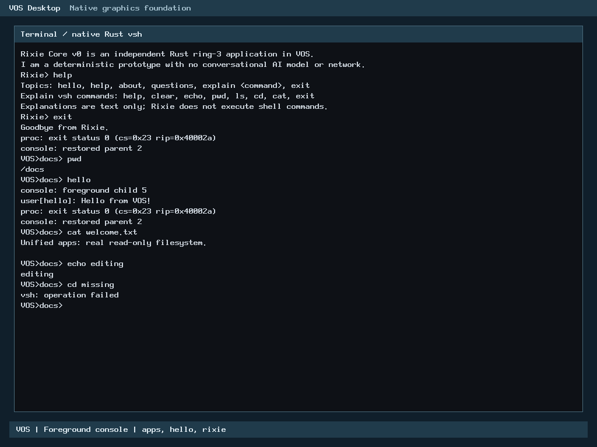

# N6 first graphical slice: refined layout and image recovery

Focused layout and native verification: PASS. Branch:
`feat/n6-graphical-desktop`, based on accepted main
`e211c738d9f0b98a0ddb717b4d17f0063dfe38f0`.
This completes this local slice/refinement only; N6 remains in progress.

## Result and architectural boundary

A real kernel-rendered desktop contains one system bar, background, a bordered
console panel and a footer. The panel hosts the existing Rust ring-3 vsh.
Its existing trusted catalog/broker launches hello and the independent offline
Rixie application, then restores the live shell and working directory.

No Terminal GUI application, window manager, mouse, GUI surface/event ABI,
application network grant, arbitrary executable loader or new scheduler behavior
was introduced. Rust applications, ELF loading, process lifecycle, exclusive
console ownership and ABI v0-v4 remain unchanged.

The existing GRUB Multiboot2 framebuffer path supplies BIOS VBE / UEFI GOP
information. The parser validates 32-bit BGRX layout, dimensions, stride,
byte limits and physical range overflow. Existing devmap keeps device pages
supervisor-only writable/NX with guard pages and WC/UC handling. No framebuffer
address or authority is exposed to ring 3.

Pure scene geometry/painting remains separate from the private display sink and
console viewport. The existing bounded PS/2 input path remains the sole input
consumer. Drawing uses the original write-only rectangle/glyph primitives and
font. There is no whole-framebuffer shadow, heap-backed desktop or refresh loop.

## Exact layout corrections

The separate 28-pixel strip containing the duplicated desktop title was removed.
The single top bar now shows VOS Desktop and its context on one row.
Normal desktop presentation omits the PASS badge and native-console diagnostic
caption. Status state and serial verification output remain intact; failure and
panic rendering retain their diagnostic paths. Other console modes are unchanged.

The terminal frame moved from y=68 to y=44: a 16-pixel gap below the 28-pixel
system bar. Its text viewport moved from y=108 to y=84. The bottom bounds remain
unchanged, recovering 24 pixels without moving the footer.

The old capacities 25/25/43 clipped labels of 26/26/45 characters. Capacity is
now `(element_right - text_x) / 8`, using the actual glyph width, framebuffer
width and each element's bounds. Header edges use 16-pixel padding and a
two-glyph gap; panel and footer captions use symmetric 12-pixel inner padding.
The three formerly truncated labels fit completely at all tested sizes:
640x480, 800x600 and 1024x768, including padded strides.

Clear, wrapping, Backspace and chronological scrolling remain inside the console
viewport. Desktop chrome stays outside it. Layout requires at least 640x480;
unsupported cases retain the existing console/serial behavior.

## Verification and reuse

| Check | Outcome |
|---|---|
| Strict C syntax, affected objects, link/layout and Multiboot validation | PASS during layout-refinement-1 |
| Refined renderer/console ASan/UBSan | 562,324 assertions PASS |
| Existing screen-input ASan/UBSan regression | PASS |
| Current BIOS native interaction | PASS |
| Current UEFI native interaction | PASS |
| Image boot files | SHA-256 matches for kernel, vsh, hello, rixie and GRUB configuration |
| Fresh UEFI partition/boot validation | Primary/backup GPT CRC, table equality, non-overlap, bounds, boot catalog, EFI PE32+ and FAT boot-file identity PASS |

The affected host tests use actual renderer/screen code against bounded RAM.
They check allocation canaries, row padding, clipping, complete caption pixels,
single-header gap, absence of a normal PASS badge, viewport scrolling/clear/
erase and malformed geometry rejection. They are hosted evidence, not a claim
of physical-device testing.

The 562,324-assertion result and console regression were reused during image
repair because all covered C/header/test bytes were independently verified
unchanged. Image repair compiled no C and reran no sanitizer campaign.
The original 576,831-assertion result remains historical evidence for the
pre-refinement layout. No N3/N4 or full execution-broker campaign was repeated.

Each current firmware session records 13 command checks plus the Backspace/
editing check: apps, hello, clear, echo, cwd/pwd, actual Rixie hello/about/help
and exit, restored pwd, repeated hello, real read-only cat and failed cd.
The shell stays suspended while Rixie receives input; final shell exit reclaims
the process and halts the kernel. Serial records show real child exit and
foreground console restoration.

The separate optimized hosted run retained a
32.264 ms median over five runs,
including startup, allocation and assertions. Its oracle/workload differs from
the original slice, so it supports no like-for-like speedup/regression claim or
native framebuffer latency claim.

## Genuine updated screenshots




These are unedited, direct QMP PNG captures of separate real 1024x768 guest
sessions after shell/Rixie interaction and restoration. Their identical pixels
produce identical hashes; per-firmware serial, commands and registers remain
separate. The guest draws directly into its firmware framebuffer. QMP only
provides development input/capture; it is not the rendering implementation.

The original two-header/truncated captures remain unchanged under
`/home/veasnawt/src/myos/build/n6-desktop-20261025T064844Z/attempt-1/{bios,uefi}/desktop.png`.

## Preserved failure and precise image-construction recovery

The initial N6 controller preflight referenced a nonexistent historical directory.
It failed before source/branch/attempt writes. PRE-ADMISSION-HISTORY.json retains
that diagnostic and its corrected binding; no guard was relaxed.

The first graphical attempt passed. The separate owner-authorized
layout-refinement-1 passed the refined host checks, rebuilt only desktop/screen
objects using accepted recipes, and linked the new kernel with verified unchanged
objects. Its BIOS replay image was produced, but its UEFI replay failed.
That continuation remains FAILED; its result and controller stop are not relabeled.

The failed command imported the old UEFI image and used
`-boot_image any replay` while mapping the refined kernel. It replayed
16 boot-related commands and imported GPT/APM/system-area constraints.
libisofs rejected the requested GPT layout:
`GPT partitions 1 and 2 overlap by 80 blocks`.
The partial UEFI ISO is failure evidence and was never booted or treated as valid.

The image-repair authorization introduced exactly layout-image-repair-1,
with fresh control/output directories, a 30-minute session, and bindings to
the N6 phase, accepted base, original manifest, failed manifest and owner request.
The original controllers and consumed identities remain unchanged.
The historical refinement admission has 13 rejection checks; the new repair
admission has 24, covering identity reuse, forged/missing authorization, wrong
baseline/manifest, expiry, unauthorized source writes, cumulative bounds,
isolation and the exact accepted physical-reserve function.

The repair used the previously successful producer:

```text
grub-mkrescue -d <accepted x86_64-efi module directory> -o <fresh UEFI ISO> <fresh stage>
```

The fresh stage contains the exact refined kernel, unchanged accepted application
ELFs and the established UEFI-head plus desktop GRUB configuration. GRUB creates
new boot/partition metadata. No imported system area, speculative GPT offset,
geometry adjustment or new partition flag is used. The working BIOS image and
producer are preserved and reused read-only.

Before either native boot, ISO file extents were bounded and hashed read-only.
The repaired UEFI image additionally passed protective-MBR, GPT header/table
CRC, backup-table equality, partition bounds/non-overlap and EFI boot-catalog
checks. The EFI loader is x86_64 PE32+, subsystem EFI application, and its bytes
inside the FAT ESP match the ISO boot file. These checks were first exercised
read-only against the known-good original UEFI image. Actual firmware boot is
separately recorded, not inferred from image validity.

Raw directories (all preserved):
- Original graphical slice: `/home/veasnawt/src/myos/build/n6-desktop-20261025T064844Z/attempt-1`.
- Failed layout image replay: `/home/veasnawt/src/myos/build/n6-desktop-20261025T064844Z/layout-refinement-1`.
- Successful image repair/native run: `/home/veasnawt/src/myos/build/n6-desktop-20261025T064844Z/layout-image-repair-1`.
- Additive repair control/finalization: `/home/veasnawt/src/myos/build/n6-desktop-20261025T064844Z/final/layout-image-repair-1`.

## Accounting and evidence

The unchanged N6 allocation is 96 MiB: cumulative execution 72 MiB,
finalization 16 MiB, metadata 8 MiB. Aggregate remains 3,360 MiB, with all
historical reservations and physical reserves retained.

Fresh repair admission allowed a conservative 30 MiB additional execution peak:
3 MiB stage, 14 MiB producer scratch, 12 MiB ISO and 1 MiB native artifacts.
The original 32.391 MiB and failed-refinement 9.324 MiB remain charged.
The admitted combined execution peak was 71.715/72 MiB. Actual sampled
allocated-byte high-water counters and the final controller receipt remain
distinct from this conservative provision; temporary production files receive
no shrink credits once observed.

At the post-native checkpoint:
- Original execution: 32.391 MiB.
- Failed refinement: 9.324 MiB.
- Repair execution: 14.730 MiB.
- Cumulative execution: 56.445/72 MiB.
- N6 cumulative: 61.094/96 MiB.
- Aggregate: 2762.742/3,360 MiB.

Documentation and finalization remain charged. Final records supersede this
checkpoint without removing any historical consumption. Original and failed
artifacts, seven protected binaries, 22 historical archives, 13 worktrees and
both stashes are preservation requirements.

[Current results](n6-desktop/result.json), [evidence index](n6-desktop/evidence.json),
[host evidence](n6-desktop/host.txt), [BIOS serial](n6-desktop/bios.serial.txt),
[UEFI serial](n6-desktop/uefi.serial.txt) and the
[exact file inventory](n6-desktop/changed-files.txt) are included.

The original phase manifest is a checkpoint inventory whose accounting entries
have corresponding retained guard snapshots; it is not described as a sealed
archive. Original/refinement/repair execution manifests describe their retained
artifacts separately. The failed manifest is preserved at SHA-256
`0b3801d70e1b60b9f21b04ee6d2c132dba08ac51f59e75bca6d01ad995851747`.
The passing repair manifest is
`ec09c874c6994ba8762cf4b69ed76a6836996a965e05ff90fa3a7f6cefe1507f`.

## Reproduction and manual testing

A future build needs its own fresh storage/isolation admission. The consumed
continuation identities must not be rerun or their outputs reused for writing.
Canonical fresh builds use the normal GRUB producer:

```sh
: "${admitted_output:?Set a fresh storage-admitted output directory}"
apps="$PWD/build/app-console-20261025T051241Z/attempt-1/image/user"
make desktop-uefi-iso DESKTOP_BUILD="$admitted_output/kernel" DESKTOP_APPS="$apps"
```

The input ELF identities must be verified first and reused read-only. This builds
a fresh kernel and fresh BIOS/UEFI images; it does not invoke the failed replay
recipe. Exact tested producer arguments and image-validation reports remain in
the repair evidence.

To boot the preserved refined BIOS image manually after admission:

```sh
phase="$PWD/build/n6-desktop-20261025T064844Z"
disk="$PWD/build/app-console-20261025T051241Z/attempt-1/disk.img"
qemu-system-x86_64 -machine q35 -accel tcg -m 128M \
  -cdrom "$phase/layout-refinement-1/kernel/vos.iso" -boot d -nic none \
  -vga none -device VGA,edid=on,xres=1024,yres=768 \
  -serial stdio -no-reboot -no-shutdown \
  -drive "file=$disk,if=none,id=vs0,format=raw,readonly=on" \
  -device virtio-blk-pci,drive=vs0,disable-legacy=on
```

For UEFI use `$phase/layout-image-repair-1/vos-uefi.iso`, never the partial
file under layout-refinement-1. Create a new admitted variable-store copy:

```sh
: "${manual_output:?Set a fresh admitted manual output directory}"
test ! -e "$manual_output/OVMF_VARS_4M.fd" &&
  cp /usr/share/OVMF/OVMF_VARS_4M.fd "$manual_output/OVMF_VARS_4M.fd"
```

Add these QEMU arguments:

```sh
-drive if=pflash,format=raw,unit=0,readonly=on,file=/usr/share/OVMF/OVMF_CODE_4M.fd \
-drive "if=pflash,format=raw,unit=1,file=$manual_output/OVMF_VARS_4M.fd"
```

Type apps, hello, clear, cd docs, rixie; use Rixie help/about/exit. Check the
restored VOS>docs> prompt, pwd and cat welcome.txt. Keyboard input targets
the QEMU display window. Existing test variable stores remain immutable evidence.

## Limits

This is a kernel-owned scene around a real text console, not a new Terminal
GUI application or finished desktop. There is no mouse, focus/event routing,
interactive taskbar, drag/resize, acceleration or application surface ABI.
Only supported BGRX32 framebuffers and >=640x480 desktop geometry are accepted;
unavailable-display fallback is host-tested, not a new native fallback campaign.

VOS targets independent physical x86_64 computers. Current verification is
QEMU SeaBIOS/OVMF only and does not prove physical firmware, input or GPU
compatibility. There is no physical-hardware, production-security or performance
claim. The official roadmap is unchanged. No GUI surface/event work began.
