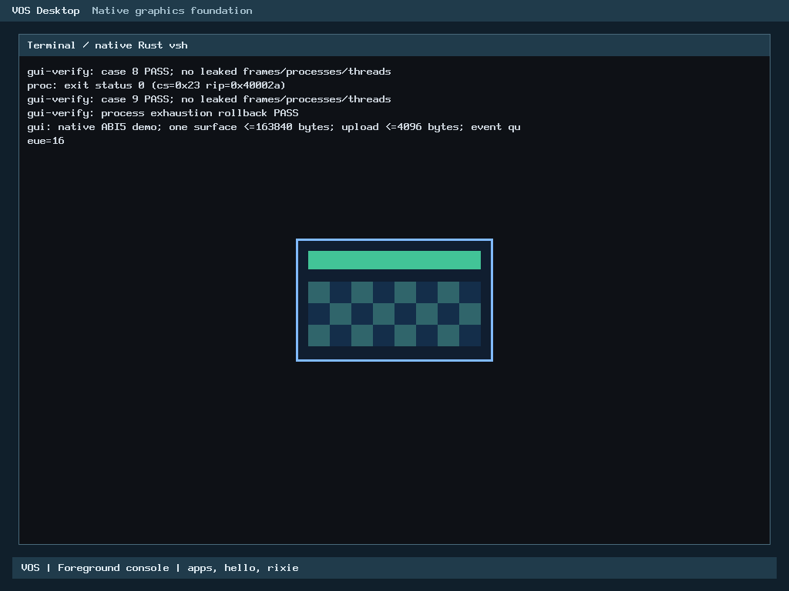

# N6.2 native GUI surface and event foundation

The bounded GUI runtime passed focused hosted checks and actual BIOS/UEFI
interaction. This is a local review candidate on `feat/n6-gui-surfaces`, based
on `3308cc86cf99d98da4cb353e6678d7782e623d47`. N6 remains in progress.
The startup-error cleanup limitation below is retained explicitly for review.

## Delivered contract

[ABI v5 / GUI structures v1](../abi/syscall-v5.md) defines private surface
creation, validated pixel upload, presentation, release and bounded text-key
events. The existing syscall entry, ELF loader, PMM, process teardown, scheduler,
keyboard instance and private framebuffer sink are reused. ABI v0-v4 applications
retain their behavior and authority boundaries.

A trusted boot-selected route runs a separate Rust gui-demo ELF with explicit
GUI rights. It draws a blue/green geometric panel; a/b changes its pixels and q
exits. Its renderer is userspace code. The kernel only validates, owns bounded
storage, routes authorized input and presents pixels. vsh is started afterward
with its unchanged hello/Rixie whitelist. This is not graphical Terminal or
shell-driven GUI launching.

## Memory and ownership

- One foreground GUI grant and one surface globally; maximum 256x160 BGRX32.
- Surface backing: 163,840 bytes / 40 zeroed PMM frames. Allocation failures
  at every partial-frame step roll back.
- Upload: at most 4 KiB copied to kernel stack before commit. Present uses one
  <=1 KiB row, with no whole-framebuffer shadow.
- Queue: 16 records of 16 bytes =256 bytes, with explicit drop-newest loss
  reporting. The native kernel ELF reports a 664-byte GUI service record.
- One existing 16 KiB guarded thread-pool stack is used by the input worker.
  The Rust demo uses a 1 KiB row on its existing 16 KiB userspace stack.
- Framebuffer mappings remain supervisor-only; no device or kernel pointer is
  shared with applications. Surface tokens and grants are process/PID-bound.

The prior 128 MiB guest reported 127,796 KiB usable; the current GUI verification
boot reported 127,700 KiB. The 160 KiB surface is a conservative bounded first
allocation, not a future desktop-resolution requirement.

## Verification

| Component | Evidence |
|---|---|
| GUI service, actual console/keyboard/editor | 978,126 ASan/UBSan assertions PASS |
| Actual renderer/private sink | 2,155,514 ASan/UBSan assertions PASS, including existing scene checks; 640x480, 800x600 and 1024x768, stride/canaries/chrome isolation |
| Existing console-handoff regression | 49,499 ASan/UBSan assertions PASS |
| Actual payload/catalog/ELF bootstrap | 3,033 new ASan/UBSan assertions PASS with exact 3/4/5-application inputs and strict negatives |
| Rust sizes/offsets/resource constants | 2 tests PASS |
| ELF profiles/negative controls | 294 tests PASS; kernel/shell validators agree on 68/72 files with four documented build-only differences |
| Existing file ABI constants | 20 independent comparisons PASS |
| Kernel image | Link layout and Multiboot validation PASS |
| BIOS | Native GUI and subsequent shell/Rixie interaction PASS |
| UEFI | GPT CRC/non-overlap/boot-file validation and native interaction PASS |

The three original C component results and Rust/ELF results were reused only
after covered source/input identities matched. The catalog caller correction
received its own actual-source/bootstrap regression. No historical N3/N4
campaign was repeated.

Each firmware exercised GUI probe cases 0-9: valid lifecycle/stale token;
invalid sizes/addresses; upload bounds/strides/lengths/addresses; denied
authority; partial allocation failure; actual user UD2 fault; cancellation while
blocked; focus revocation interrupting a blocked reader; actual injected queue
overflow; and an empty fresh-focus queue. Process-table exhaustion/loader rollback
was also exercised. PMM, process/thread counts and audits returned to baseline.

The independent native demo then created/presented its surface, received a/b/q
from the real QEMU input path, changed its pixels and exited. A separate PNG
decoder compared all 40,960 surface pixels against an independent RGB oracle,
before and after keyboard input. QMP captured the guest framebuffer; it did not
render the UI.

Subsequent actual vsh tests covered apps, hello, clear, echo, cwd/pwd, Rixie
hello/about/help/exit, prompt restoration, repeated hello, read-only cat, editing/
Backspace and failed cd. Final shell exit reclaimed its process and halted.

Cross-process active-surface denial was exercised in the hosted service test;
native cases exercised an ungranted ring-3 caller. Hosted hardware/scheduler
models do not establish physical-device support.

## Authentic captures

These are unedited direct QMP PNGs from separate 1024x768 firmware sessions,
after key a changed the application pixels. Their deterministic pixels have the
same hash; serial, commands and registers are separate. The small panel is the
Rust application's output. Surrounding Terminal/vsh chrome is the existing
kernel-owned console scene, not an implemented graphical Terminal application.

## Failure history and authorized recoveries

All earlier files remain unchanged:

1. Original controller stopped at preflight for a missing write-scope path.
   Its unsupported scope-stop request produced `unknown action` /
   `service failure 1`; it remains a failed record, not a clean completion.
2. `attempt-1` passed the three C sanitizer components, then Rust host tests
   failed E0152: std and the freestanding SDK both supplied panic_impl.
3. `verification-continuation-1` used the existing SDK cfg(test) path only for
   hosted compilation. Rust tests passed; Make dry-run then rejected unresolved
   isolated GUI ELF targets because USER_BUILD was not forwarded.
4. `image-recipe-recovery-1` forwarded USER_BUILD in the two kernel sub-makes.
   Both images and native ABI5 ELFs built, and static ELF tests passed. BIOS then
   failed common catalog admission before GUI execution; UEFI was not run there.
   The caller incorrectly passed all eight source-array slots, including unused
   zero entries, to the strict catalog validator.
5. `catalog-recovery-1` changes only that caller argument to validated count.
   The validator is unchanged. Actual 3/4/5-payload host tests and the successful
   BIOS/UEFI runs above are the acceptance evidence for that correction.

The legacy ELF-test invocation also rebuilt
`build/x86_64/tools/elfcheck` outside the admitted root. This was an output-path
coverage defect. The tool is preserved at SHA-256
`d35d34b33c1ec5978297e6c8f9c3e82e7cab0df06e4be32ed397753fd22a46ab`.
Its earlier identity was not recorded, so preservation of its previous contents
is not claimed. A conservative 32 KiB tool/directory provision is fully charged.
Future invocations explicitly set BUILD and ELFCHECK inside the admitted output.
The passing legacy tests were reused; the catalog recovery did not rerun them.

Catalog recovery reused 59 individually hashed kernel objects and the exact
native ELFs read-only. Only app_payload.o was recompiled and the kernel relinked.
The previously verified BIOS-only replay producer wrote a fresh BIOS ISO. UEFI
used fresh GRUB construction, with no imported GPT/system-area replay.
Both new images were independently validated before their respective boots.

The inline Windows launcher exceeded the OS command-line length before process
creation. The approved adapter was staged additively inside this phase's
finalization directory, fully charged, then admitted. It did not consume an
execution attempt or alter an existing record.

## Evidence and accounting

Raw phase: `/home/veasnawt/src/myos/build/n6-gui-20261025T083036Z`.
Passing execution: `/home/veasnawt/src/myos/build/n6-gui-20261025T083036Z/catalog-recovery-1`.
All failed roots and controller/owner recovery receipts remain there.

- Passing runtime manifest: `f0ebd048e9b416b000db4bb318f6d011f3ea6c268fd7f348f074d5ff48f6bd4a`.
- Full raw result: `d5472981a0baa1eb02e368b3f9d15810077f847e5687ce91615a69c0daf76785`.
- [Portable result summary](n6-gui/result.json) omits the duplicate full legacy
  build log while retaining its verdicts and the raw-result identity.
- [Evidence index](n6-gui/evidence.json), [host results](n6-gui/host.txt),
  [BIOS serial](n6-gui/bios.serial.txt), [UEFI serial](n6-gui/uefi.serial.txt) and
  [exact file inventory](n6-gui/changed-files.txt) are included.

At the post-native checkpoint, cumulative sampled execution was
84.152/104 MiB,
N6.2 was 92.113/128 MiB and
aggregate was 2855.027/3,360 MiB.
This includes the external-tool provision and all failed work. Final documentation,
controller and Git accounting supersede this checkpoint without shrink credits.

The approved catalog continuation had a 40 MiB conservative provision:
2 MiB compile/link/host regression, 8 MiB BIOS replay, 3 MiB UEFI stage,
14 MiB producer scratch, 12 MiB UEFI ISO and 1 MiB native artifacts.
No prior reservation, phase ceiling or physical reserve was reduced.

An optimized hosted service workload had a 64.464 ms median over three runs,
including process startup, assertions and allocation tests. This is a first
baseline for that workload, separate from sanitizer timings; it is not native
display latency or a demonstrated improvement over another component.

## Manual testing and reproduction

Existing evidence is read-only. A future execution requires fresh storage and
isolation admission; consumed roots/identities must not be reused for writing.

For an already-admitted manual session, boot the preserved BIOS ISO:

~~~sh
phase="$PWD/build/n6-gui-20261025T083036Z"
image="$phase/catalog-recovery-1/image/kernel/vos.iso"
disk="$PWD/build/app-console-20261025T051241Z/attempt-1/disk.img"
qemu-system-x86_64 -machine q35 -accel tcg -m 128M \
  -cdrom "$image" -boot d -nic none \
  -vga none -device VGA,edid=on,xres=1024,yres=768 \
  -serial stdio -no-reboot -no-shutdown \
  -drive "file=$disk,if=none,id=vs0,format=raw,readonly=on" \
  -device virtio-blk-pci,drive=vs0,disable-legacy=on
~~~

This is the verification image. When serial reports OVERFLOW INPUT WINDOW,
type a at least 20 times within its three-second probe window. After the GUI
demo appears, a/b changes its colors and q exits to the real shell.
Use apps, hello and rixie; Rixie's exit returns to the shell. These verification
fixtures are absent from a normal GUI_VERIFY=0 image.

For UEFI select `vos-uefi.iso` instead and add:

~~~sh
: "${manual_output:?Set a fresh admitted output directory}"
test ! -e "$manual_output/OVMF_VARS_4M.fd" &&
  cp /usr/share/OVMF/OVMF_VARS_4M.fd "$manual_output/OVMF_VARS_4M.fd"
# Add to the QEMU command:
# -drive if=pflash,format=raw,unit=0,readonly=on,file=/usr/share/OVMF/OVMF_CODE_4M.fd
# -drive "if=pflash,format=raw,unit=1,file=$manual_output/OVMF_VARS_4M.fd"
~~~

Never write to recorded firmware variable stores. For ordinary interactive
testing without the probe timing, build the normal four-application GUI image
using the fresh-output workflow in the ABI guide.

## Evidence-only finalization recovery

The first finalization stopped when the accepted Windows disk-capacity query
timed out after its unchanged 15-second limit. The controller terminated its
service; Git staging did not complete. HEAD and the index retained their accepted
baseline identities, and no index.lock remained. No local commit was created by
that interrupted attempt.

The last complete guard sample was 2026-10-25 20:06:08.512 Asia/Bangkok; the
recorded stop was 20:07:35.359. The approximately 86.848-second interval is
unconfirmed. Continuous isolation/capacity monitoring is not claimed during that
interval or the subsequent stopped period. A post-stop read-only audit completed
its preservation comparisons, then its final Windows isolation refresh also
timed out at the unchanged 90-second limit.

The failed controller, violation and its pre-commit manifest remain unchanged:
- Violation: `5680fd1bfa0ad885e9b9052e93cb7857f0845e5f835e2dfa2b847de250410174`.
- Failed guard result: `ce43a8b188543f5c7c2b1f45261434d34b84ca550619049a860915f665f4eaa0`.
- Failed finalization manifest: `b043e77ce425597135397f0033e0b3f331835b454d0503cf614ffbe0e7ea46dd`.

The owner explicitly authorized one evidence-only recovery
(call_8da1864d1539494abc933260a454f6ca). Fresh isolation and physical reserves then
passed using the same 90/15-second query limits. The new metadata namespace is
`/home/veasnawt/src/myos/build/n6-gui-20261025T083036Z/final/evidence-finalization-1`.
The existing policy permits this fresh, owner-bound finalization of independently
verified completed results; the failed controller is not resumed or relabeled.

This adapter has no test-run, implementation-write, cleanup, push or merge
operation. Only this report and its evidence index may change. Native sources,
ABI bindings, screenshots, runtime records, all failed roots and the external
validator artifact remain frozen. Cumulative execution stays at 88,240,128 bytes (84.152 MiB rounded);
all recovery metadata and Git costs remain charged to the original 128 MiB phase
and 3,360 MiB aggregate ceilings with historical reservations and reserves intact.

Successful completion and the local commit identity are recorded only after all
gates pass in that namespace's FINAL-RECEIPT.json and guard-result.json.
An absent receipt or failed guard result does not establish completed finalization.
No test rerun or implementation correction is part of this recovery.

## Design references, assets and remaining limits

The approved mockup is a future target: application name Terminal, dark-blue
minimalism, bottom-centered floating pill dock and compact 14px circular controls.
None of the dock, window manager, mouse support, graphical Terminal or final
mockup is implemented. There are no independent movable/resizable surfaces,
background GUI applications, GPU acceleration or runtime GUI service restart.

The GUI ABI is icon-library-agnostic. VICons is only a candidate; no npm/React,
icon package, SVG parser or temporary kernel icon artwork was added. Future
SVG-derived/raster assets can use the same bounded pixel upload interface.

Asset discovery was read-only. The current canonical font source is
`E:\VOS Assets\VOSDisplay-Regular-v1.100`, superseding v1.000 as the reference.
Its fonts/VOSDisplay-Regular.ttf, .otf and .woff2 are separate from historical/
rejected references. Metadata reports family VOS Display, Regular 1.100,
96 glyphs, 1000 units/em and printable Basic Latin coverage. All 352 manifest
entries matched. Distribution licensing remains reserved to the owner; technical
fsType=0 does not establish redistribution permission.

Logo sources include intended-logo.png and transparent vos-logo.png / vos.png;
transparent-edge artifacts require review before small-icon use. mini-brand-guide,
vector-identity and wordmark-review are PNG references, not standalone SVG logo
masters. The font package's SVGs are glyph exports. No asset was copied,
recreated, edited or integrated. After separate identity/license/use approval,
selected originals plus licenses/hashes and pinned offline rasterization/atlas
tools can live in the repository, with no /mnt/e dependency in ordinary builds.

One trusted-bootstrap limitation remains: failure of initial GUI ELF loading
after input-service creation can leave that one idle kernel worker until reboot.
The direct loader-exhaustion and per-application cleanup probes passed; they do
not claim complete rollback of this outer pre-grant startup branch. This is
retained for owner review, not represented as a passed failure-injection case.

VOS targets independent physical x86_64 computers. Current native evidence is
QEMU SeaBIOS/OVMF only. Physical firmware/GPU/USB input support and production
security/performance are not established. The official roadmap is unchanged.
