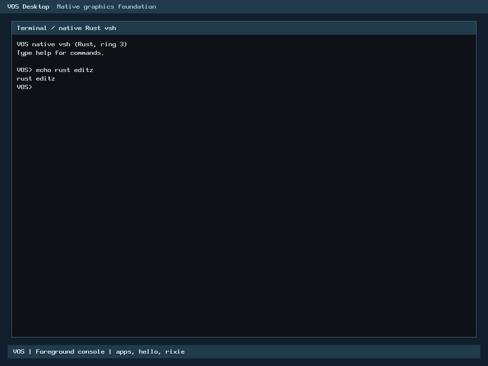

# R2: Rust console editor transitions

Local correctness/resource/runtime verdict: **PASS**. Performance acceptance: **explicitly approved by the owner on 2 November 2026 (Asia/Bangkok)** for the pinned source and documented measurements. Commit/PR/required CI: **pending gated publication**. This is the existing R2 selected-driver program, not a newly invented accepted milestone.

## Baseline and scope

Authoritative main `159528f27d785c9ed26ecfb1d82f7f6ed2e17018` merges H1-B PR #51 with parents `fbf11d98d66c6bca4cb457c12b7f952879ad7858` and `ae33130016e0f5a6cbf9a12ccaec9e90579e0da6`. Earlier pointer, keyboard and console extraction migrations remain accepted. H2-A remains inactive.

Only `input_console_accept()` transitions move from production C to Rust. Safe `no_std` generic core owns filtering, append, NUL termination, sticky overflow, Backspace and Enter sealing. The private raw adapter owns the existing C callback boundary. C retains reader/ownership/controller I/O, interrupt and screen/serial implementations. H1-B HID core and previously migrated input functions remain byte-identical to accepted main.

## ABI, memory and ownership

The public C header is unchanged: `void input_console_accept(struct input_console_line *, char)`. Editor stays 144 bytes, align4, offsets length0/bytes4/ready136/overflow140. There is one actual Rust symbol; the C object no longer defines it. Production code size for that symbol is 176 bytes versus accepted C180. No heap, DMA or new persistent state. Rust object frame is 8 bytes against the128-byte ceiling; GCC reference stack-usage reports32 bytes including its ABI return-address accounting (see raw measurement command), so the raw numbers use different metadata conventions. Loaded ELF segments are identical: growth0 against4096 ceiling. Full ELF file size changes by -720 bytes; this includes debug/symbol metadata, not loaded growth. Kernel and archive independently reproduce byte-for-byte.

Ready ignores all input. CRLF is emitted before setting ready. Erase callback runs before decrement/zero; length is reloaded after that callback as in C. Printable bytes are stored and terminated before echo. Overflow remains sticky after Backspace. No editor reference crosses any callback: raw-pointer access avoids aliasing an external observer with a Rust reference. The adapter's safety contract requires a mapped caller-owned editor, no concurrent writers and callbacks that do not unmap/free it; C already required valid storage. Null/wrapping pointers are ignored. Out-of-range lengths are bounded without using undefined C indexing as an oracle. Post-erase callback changes in the defined C domain are differentially tested.

The hot NUL/no-key polling byte returns before editor access. This is an unconditional no-op in accepted C; every editing path keeps its pointer/range checks. Trait dispatch is monomorphized, with no vtable, copying allocation or hidden runtime dependency. Target object imports only the three existing C echo callbacks.

## Verification

| Gate | Actual result |
| --- | --- |
| Accepted baseline buffered-input fixture | PASS against accepted production archive |
| Safe Rust core |12/12 tests |
| Transition-specific compiled mutants |10/10 detected by designated assertions |
| Actual ABI differential |825,728 cases per variant, three variants: release, C ASan/UBSan, separate Rust overflow-check build |
| Boundaries | All256 bytes, lengths0..128, noncanonical ready/overflow flags, sticky overflow, guarded pages, malformed lengths, null/wrap and callback order/reload |
| Random/edit streams | Deterministic seed `c1a55e7a20261102`;2,000x256 input steps |
| PS/2/input/foreground/GUI/renderer | Complete current production-archive regression PASS |
| Existing extractor |10 core tests,10 mutants and222,017 differential cases per variant PASS; existing implementation unchanged |
| H1-B | Complete default all-stage core/adapters/8mutants/resources PASS;15 core tests plus existing hostile descriptor/report coverage |
| BIOS/UEFI |8/8: SeaBIOS/OVMF x128MiB/2GiB xnormal/GUI verification |
| Native behavior | Real Rust edit entry traps, append/Backspace/seal and shell output, Caps/Shift/punctuation, GUI16cases,18 load-failure reclamations, overflow/handoff recovery |
| Security/resource | Fresh kernel verify, one symbol owner, no unexpected target dependencies, no SIMD/heap/DMA, source-scope and diff checks |

C sanitizers do not instrument Rust. Checked Rust and guard pages provide separate coverage. QEMU execution is not physical-hardware proof. The Rust entry trap may observe a NUL poll; it proves execution identity, not one exact key's latency. Functional edited command output and symbol ownership establish the end-to-end replacement separately.

## Performance policy and investigation

Hosted release microbenchmarks compare the actual production Rust archive with the frozen accepted C body, both at equivalent O2/integer-only x86_64 release settings. Exact commands/tool versions/CPU,9 alternating-order samples per workload,10 warm-up batches,5,000x256 measured calls, CPU affinity, monotonic aggregate clock, raw latency/throughput CSVs and both disassemblies are preserved. Identical state setup is outside timing; common call/timer/callback overhead is retained. These are function-call microbenchmarks, **not BIOS/UEFI runtime performance**. Guest IRQ/input latency and physical performance are **NOT TESTED**; breakpoints and functional runs are not timing evidence.

| Workload | C ns/call | Rust ns/call | Median change |
| --- | ---: | ---: | ---: |
| append | 3.1688 | 4.0237 | +26.98% |
| backspace | 4.6005 | 4.6022 | +0.04% |
| ignored | 2.3236 | 2.0506 | -11.75% |
| newline | 4.3123 | 4.5880 | +6.39% |
| overflow | 2.1856 | 3.1266 | +43.05% |
| ready | 2.0364 | 2.0634 | +1.33% |

The original no-input result was Rust3.8434 versus C2.4099ns; the safe no-key shortcut now gives Rust2.0506 versus C2.3236ns. Initial samples and the original implementation result remain preserved. Other hot paths retain costs: append+0.8549ns, overflow+0.9410ns, newline+0.2757ns. Ready and Backspace median differences are small and may be measurement noise; no statistical parity claim is made.

Machine-code review shows direct branches/callback calls, no bounds-panic helper, dynamic dispatch, vector copy or allocator. Extra pointer-interval admission, bounded append and post-callback length checks remain. LLVM also uses an early signed-byte conversion and branch layout different from GCC. Removing the checks to win a benchmark would weaken the new safe boundary and is not proposed. The no-key optimization targets the common poll path without changing valid editor behavior. Remaining >5% regressions are investigated but **not accepted automatically**. The owner explicitly approved these exact remaining regressions and gated publication; the [source-bound decision](r2-console-accept-rust/performance-owner-approval.json) is preserved. Older PR52/53 exceptions do not cover this function and this decision does not extend to future migrations. Further optimization remains possible but is not claimed or hidden by methodology changes.

## Genuine runtime evidence




Actual QMP screenshots show `echo rust editz` after deleting the final `x`, then the genuine vsh result. The native result and per-case proof records preserve kernel/image/source provenance. These are PS/2-to-console executions; no native USB input or Dell compatibility is claimed.

## Failures retained

The initial native harness sent `!` as a QMP qcode unsupported by the helper. That first run failed after the Rust entry trap; its result/logs/media remain under `build/native`. Only the harness's post-Backspace test byte changed to supported `z`; existing Shift/punctuation regression is unchanged. All8 fresh cases passed in `build/native-final`. A monitor setup failure (missing controller steps directory) occurred before any command/worktree execution and is retained; the directory setup was corrected. The first publication checks also stopped before commit on untouched disassembly/frozen-reference whitespace and an allowlist omission of the reviewed H1 adapter. Controller-only corrections retain those failures and keep strict whitespace checks on source. No guard stop was bypassed, old outputs deleted or failed receipt relabeled.

## Reproduction and evidence

Select the pinned compiler and a fresh admitted `build/` output. For ordinary contribution use public interfaces; maintainer private manifests/budgets are not contributor requirements. See [contribution policy](../../CONTRIBUTING.md), [security](../../SECURITY.md) and [publication checklist](../milestone-publication-checklist.md).

```sh
make -j1 ARCH=x86_64 BUILD=build/candidate USER_BUILD=build/user RUSTC="$RUSTC" verify
python3 -I -B scripts/test-console-accept-rust.py --archive build/candidate/rust/libvos_kernel.a --rustc "$RUSTC" --out build/console-accept-check
python3 -I -B scripts/test-boot-hid.py --rustc "$RUSTC" --out build/hid-check
# Native helper's --help documents manifest, EFI tools and read-only disk inputs:
python3 -I -B scripts/test-ps2-pointer-native.py --help
# Add --console-accept-proof --keyboard-proof --console-line-proof to the normal/GUI matrix.
```

[Hashed evidence](r2-console-accept-rust/SHA256SUMS) includes raw samples, resources, exact baseline/toolchains, both disassemblies, native results/proofs and current regressions. All generated binaries/full local logs and failure outputs are retained in the admitted worktree/controller, not committed as build trees. The new static CI gate runs the focused verifier; existing Build smoke runtime and secret-history workflows stay enabled. Final new-head CI is pending publication.

## Storage and next gate

Owner-approved source-only worktree; forecast226,000,000B; unchanged STOP240,000,000/hard cap260,000,000B, C floor22,548,578,304B, E reserve1,610,612,736B plus forecast,1.25x per-step rule, exclusive lock and cumulative6,000,000B shared ceiling from the original accounting origins. All prior charges and outputs remain. No H2-A storage mechanism is enabled.

**Next gate: final source/security/evidence admission, signed-off commit, PR publication and final required CI inspection. The source-bound performance decision is approved. No merge is authorized.**
