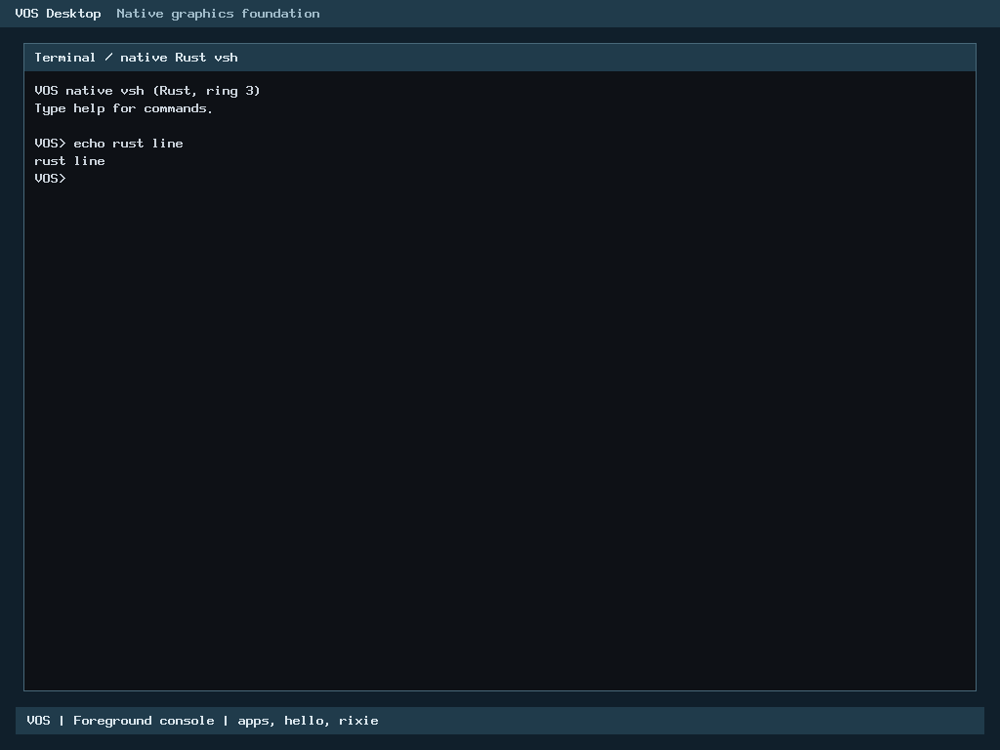

# R2: Rust console line extraction

**Local correctness/resource/native gates PASS. The owner explicitly approved the documented remaining hosted fallback regressions and gated publication on 2 November 2026 (Asia/Bangkok). Awaiting published-head CI and human review; not merged.** This is a bounded selected-input increment, not completion of R2. Baseline is authoritative main `9ab5e9f58e85dfe57f039a6a7072496f21cc9779` (PR52 merge, tree identical to verified `a7e8193`). Both baseline merge workflows passed. PR51 remains unmerged and independent; H2-A is inactive.

## Ownership and contracts

Only `input_console_take_line()` moves from `arch/x86_64/input_console.c` into Rust. `kernel/rust/input/console_line.rs` forbids unsafe code and owns precedence, capacity/bounds admission, forward copy order and reset transitions. A monomorphized private adapter in `arch/x86_64/rust/console_line.rs` performs narrowly audited raw memory operations behind the unchanged C ABI. No virtual dispatch, heap, device operations or callback occurs. Controller I/O, keyboard decoding, foreground/epochs, serial echo, scheduling and cancellation remain unchanged. The frozen C function is test-only, pinned to the accepted baseline.

The existing editor remains 144 bytes, align4, offsets length0/bytes4/ready136/overflow140, with a 129-byte line buffer. PENDING=-1 leaves state/output unchanged; overflow clears the editor and returns TOOLONG=-3 without writing output; insufficient capacity or null output returns NOSPACE=-2 without changes; success copies length+1 including NUL, resets and returns length (including zero).

C has no restrict qualifier, so defined forward-copy overlap is preserved byte-for-byte. No overlapping Rust references are formed. Raw reads immediately precede corresponding writes and final editor reset may also affect overlapping output, exactly as C. Caller still supplies exclusive mapped editor storage and admitted writable output; pointer arithmetic checks cannot prove mapping validity. Newly refused null/wrapping editor/output and oversized lengths on the previously undefined C copy path return NOSPACE; tests never invoke the C oracle with undefined pointers or out-of-object reads. Existing PENDING/overflow precedence remains intact.

## Performance policy and optimization record

This increment applies the owner's standing Rust Performance Policy: equivalent release workload/architecture, immutable raw samples, investigation above5%, practical optimization, no weakened checks and explicit approval of any remaining regression. The full standing policy and owner receipt are pinned in the persistent master ledger; the program is not restarted. PR52's 1.529x keyboard hosted result stays a separate optimization candidate and its accepted source/evidence is untouched.

The initial Rust clear became a call to the kernel byte-loop `memset`, versus the accepted C's `rep stosq`; clear-heavy hosted paths were about3x slower. Typed wide-store and field-store probes also lowered to `memset`. The private x86-64 adapter now uses one bounded `rep stosq` memory primitive for exactly18 qwords (144bytes), matching the existing C architecture assumption. Invariants: complete mapped exclusive editor, x86-64 unaligned stores permitted, SysV DF=0 already required by the accepted C, no stack/flags changes, default compiler memory clobber preserved. All decisions/copy sequencing remain safe Rust. This is justified architecture-specific memory glue, not controller I/O or a new Assembly subsystem.

Null/range validation was combined into equivalent interval predicates; reduced-width exhaustive models and 64-bit boundary checks verify the algebra. Capacity and maximum length are combined with `min(capacity,129)` and an explicit one-byte empty path avoids general-loop setup. No check was removed. Four retained stages (initial, clear, range and branch/final) document investigation and improvement.

Final production-archive hosted medians:

| Workload | C ns/call | Rust ns/call | Rust/C | Decision |
| --- | ---: | ---: | ---: | --- |
| Pending | 1.9151 | 2.1840 | 1.1404 | +0.2689ns, review required |
| Overflow/reset | 12.3988 | 11.9762 | 0.9659 | No measured regression |
| Insufficient capacity | 2.0634 | 3.5352 | 1.7133 | +1.4718ns, review required |
| Empty success | 13.2786 | 12.9109 | 0.9723 | No measured regression |
| 16-byte success | 18.1627 | 17.3656 | 0.9561 | No measured regression |
| 128-byte success | 67.1644 | 54.1706 | 0.8065 | No measured regression |

Raw throughput and all seven samples are in `console-host-final/performance.csv`. CPU-pinned, alternating C/Rust sample order, 5,000 timed batches x256 calls after10 warm-up batches; identical preparation occurs outside each timed batch and common timer overhead remains included. The C oracle and production Rust both use O2, x86-64, integer-only/no-red-zone code. GCC defaults x86-64/generic were verified; the host harness's floating formatting uses its normal ABI outside the timed functions. C baseline is the actual accepted function, not a newly guarded surrogate.

Disassembly attributes the remaining fallback cost to additional bounded/refusal checks and LLVM branch/boolean selection; there are no hidden allocations, helper calls, dynamic dispatch or new copies on those paths. Further simple range/branch optimizations were tested; necessary checks remain. The production reader calls extraction only after `line.ready` and validates full destination capacity, so these slower API refusals are defensive paths, not its normal hot path. That observation does **not** waive the owner's explicit acceptance requirement. The owner explicitly approved these exact remaining regressions and gated publication; the [source-bound decision](r2-console-line-rust/review/performance-owner-approval.json) is preserved. No performance approval is inferred from the master program or functional PASS, and the exception does not apply to future migrations. Guest BIOS/UEFI latency/throughput and physical hardware performance are **NOT TESTED**; hosted numbers and functional native boots are distinct.

## Verification and resources

- 222,017 C/Rust cases per variant: production archive with C ASan/UBSan, release, and separately overflow-checked Rust FFI. Exhaustive lengths0..128/capacities0..130, noncanonical flags, null output, every relevant forward-overlap destination, random cases, reset/precedence and protected-page edges. Seed `a76c209ecf315b84`.
- Final10 core tests PASS. Ten compiled semantic mutants detected: readiness, overflow clear, capacity equality, missing output check, terminator, forward order, length bound, success clear, return length and empty clear. Nine final-core controls are retained in `console-host-final`; the later test-only empty reset assertion and tenth control are retained in `empty-reset-control`. Compiler failures do not count as mutation detection. Default public driver runs all ten.
- Existing input/console/handoff/GUI/pointer/renderer regressions PASS against the new production archive. Keyboard differential rerun: 3,703,936 comparisons in each C-sanitized/release variant; unchanged core/mutation evidence reused by exact source identity. Pointer gate retains its 52,394,348 comparisons per variant.
- Eight QEMU q35/TCG cases PASS: BIOS/UEFI x128MiB/2GiB xnormal/GUI verification. Every case traps the actual Rust extraction address, submits `echo rust line`, validates output, restores input and completes the existing keyboard, pointer, foreground, cleanup and application checks. GUI verification includes the existing16 cases,18 bootstrap failures and overflow recovery.
- Independent kernel and Rust archive are byte-identical; GUI Rust archive matches. Final kernel SHA256 `c36de4ba5922ee4689411269fc85888e4923868a3e87557105cec664aba16ab4`; archive `d5645ff8e105eb1ad8a71704e6b27884dc84075e20dbc148ec67271dc5c9dd3f`.
- Leaf stack frame0bytes; loaded allocated-section growth0; existing editor144bytes/output maximum129bytes; no new permanent state, heap allocation, DMA page, SIMD or helper dependency. C object imports the one Rust-owned symbol. Stable header/build object list unchanged; still59 production C translation units and4 Assembly units, not a whole-driver retirement.

C sanitizers do not instrument the prebuilt Rust archive. Separate Rust overflow/debug checks and protected-memory tests supplement that limitation. Initial host release formatting failure is retained under `console-host`; a supplementary unit check attempted during the native run was refused by exclusive lock before execution, then scheduled after the native operation ended. No lock bypass, evidence deletion or automatic failed-test replay occurred. All optimization outputs and raw failures remain preserved.

## Actual runtime screenshots

BIOS,128MiB, actual shell and Rust entry trap:



UEFI,128MiB, separate execution:


Images are unmodified QMP PNG captures. [Commands, serial logs and instruction traps](r2-console-line-rust/native/result.json) establish provenance; screenshots alone do not prove ownership or speed. [Evidence manifest](r2-console-line-rust/SHA256SUMS).

## Reproduction and publication gates

Follow [CONTRIBUTING](../../CONTRIBUTING.md), [SECURITY](../../SECURITY.md) and the [publication checklist](../milestone-publication-checklist.md). Use the repository-pinned Rust toolchain and fresh output paths:

```sh
make -j1 ARCH=x86_64 BUILD=build/r2-line-check verify
python3 -I -B scripts/test-console-line-rust.py \
  --archive build/r2-line-check/rust/libvos_kernel.a \
  --rustc "$RUSTC" --out build/r2-line-host
```

The existing native producer's optional `--console-line-proof --keyboard-proof --memory 128M --memory 2G` requires actual extraction/keyboard entry traps and genuine shell output. GUI testing uses a separate `TEST_DEFS=-DVOS_GUI_VERIFY` build. Exact local invocations and readonly app/disk inputs are in the captured storage/native receipts. Maintainer-local Windows identity, private preservation assets and controller directory are not contributor prerequisites.

Storage guards remain unchanged at their original roots; this new separately approved root has STOP240MB/cap260MB, C floor22,548,578,304bytes, physical E reserve1,610,612,736bytes, 1.25x projection and cumulative3MB shared Git/controller allowance. Reconciled forecast counts all failed/optimization outputs and avoids double-counting native evidence already inside its directory; no verification cases were removed and no cleanup occurred.

Complete diff/security/evidence review passed and the owner explicitly approved the two documented hosted fallback regressions. Commit/push/PR remain gated on final admission and exact source identity. The focused Build smoke addition does not turn correctness PASS into performance acceptance. Final new-head CI is NOT RUN until publication is authorized. No merge, PR51 change, H2-A activation, physical Dell test or next R milestone implementation is included.
