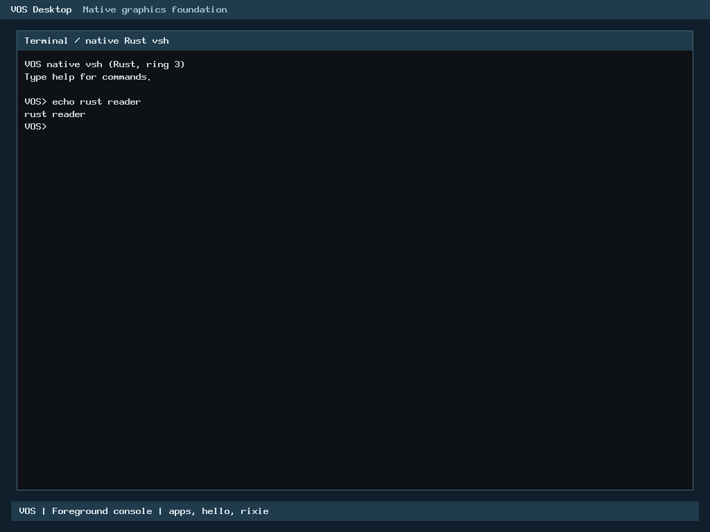

# R2: Rust blocking console reader coordination

**Local correctness, resources and eight native cases PASS. The owner explicitly approved the pinned source and documented remaining hosted regressions on 2 November 2026 (Asia/Bangkok). Gated publication and final required CI remain pending; no merge.** This is the ongoing selected-input R2 program, not a newly named official milestone. Baseline is accepted main `9134d1cbce7eb38ed4d87b53fc478620631f3077` (owner-merged PR54). H2-A remains inactive.

## Production scope and ABI

Only `input_console_read_line_for()` moves from C to Rust. The safe `no_std` core owns validation/error precedence and the prompt/cancel/poll/edit/extract/retry/sleep flow. A private adapter retains opaque raw C pointers and existing callbacks. The public header, C wrapper `input_console_read_line`, boot option parsing, keyboard setup/polling, IRQ rules, scheduler, process/foreground/epoch/lease authority and previously accepted editor/extractor/HID source are unchanged.

The six-argument C ABI and errors are preserved: keyboard unavailable precedes output/capacity failure; no prompt on refusal; complete144-byte editor initialization before prompt; prompt before first cancellation; cancellation before poll; edit then readiness/extraction; TOOLONG message/re-prompt before one-tick wait; successful/failed extraction and interruption return without another sleep. The intentionally blocking API retains bounded per-iteration resources rather than adding a new total timeout/retry limit.

No editor, keyboard, output or process reference spans a C callback or scheduler wait. Caller mapping/lifetime requirements remain the existing C contract; the cancel function/context stay opaque and are not promoted to Rust process references. Full144-byte private editor, including padding, is initialized before use. Kernel keyboard layout is verified (88bytes, ready offset16); editor remains144bytes/align4. No heap, DMA, new persistent state, threads or async framework.

## Optimization and resource evidence

The initial Rust initializer called the existing byte-loop memset while C used inline rep stosq. The private x86 adapter now uses the same bounded memory primitive as accepted extraction:18qwords, complete mapped144-byte editor, x86 unaligned stores, SysV DF=0, default compiler memory clobber, no stack/flags changes or device operation. Initialization order and every admission check remain intact. Admission is separated from the private frame-owning path; its same six scalar arguments permit a conditional tail branch, avoiding frame allocation on refusals.

Actual linked production private reader frame: **216bytes** (six8-byte pushes +168-byte subtraction); public entry frame0 with a tail branch. This meets the adopted216-byte normalized ceiling. Accepted C .su is224bytes including8-byte ABI return-address accounting. Existing helper frames are compared consistently as callees, not silently charged to this reader-only ceiling. Standalone reader object metadata reports200bytes; whole-crate inlining changes allocation, so the default verifier ALSO checks the actual production archive's prologue and rejects >216 or a framed call entry. The earlier composite checker FAIL included an unchanged8-byte editor helper; it remains preserved.

Independent optimized/repro kernel and archive match byte-for-byte; GUI archive matches. Loaded-segment growth **0bytes** against4096 limit; ELF file delta-1144bytes is metadata/file size, not loaded growth. Kernel SHA256 `e33cc0605d6adc8bbaddb539c117b86b6bce41d6969809194f09c19a6be24bf8`; archive `b2387394ec2b4819894b22a7504b9ad1c4f4e59b312b219de313fd006ba5202d`. Compiler/runtime dependencies, ABI ownership and layout remain bounded.

## Verification matrix

| Gate | Actual evidence |
| --- | --- |
| Accepted baseline | Buffered-input fixture PASS against accepted archive before changes |
| Final safe-core tests |12/12 |
| Final compiled semantic mutants |12/12 caught by designated assertions, not compiler errors |
| Reader differential |422,096 cases in each of three variants: production archive release, C ASan/UBSan, separate checked Rust composite ABI |
| Coverage | Lengths0..129, capacities0..131, null/unavailable/noncanonical readiness, all256 input bytes, initial/mid-wait cancellation, overflow/re-prompt, exact output and callback/poll/sleep traces; seed `c0a2d5e720261102` |
| Boundaries | Null/wrapping keyboard refusal, exact129-byte output guard-page edge, no invalid C oracle calls |
| Actual archive input/console/GUI | Complete current PS/2/foreground/handoff/GUI/renderer suite PASS, including52,394,348 pointer comparisons per variant |
| Existing extractor |222,017 actual-archive comparisons each in release and C sanitizer variants PASS |
| H1 adapters | Actual console49,500, GUI978,127 and PS/2 service987,802 assertions PASS; three binaries re-executed after metadata-only proof correction |
| BIOS/UEFI |8/8 SeaBIOS/OVMF x128MiB/2GiB xnormal/GUI; actual Rust reader entry, edited commands, Caps/Shift, overflow/cleanup/foreground restoration |
| Runtime extraction proof | Breakpoint at ELF/GOT-resolved copy instruction inside private Rust reader; verifies15 actual `echo rust line`+NUL bytes/length and resulting shell output |

C sanitizers do not instrument the Rust archive. Separate checked Rust, guard pages and exact ABI comparisons supplement that limitation. Hosted finite scripts detect test hangs without imposing new limits on production blocking. Unchanged HID/keyboard/extractor core mutation evidence is reused by source identity; full unrelated acceptance campaigns are not repeated.

## Genuine execution images




These are separate, unmodified QMP captures of genuine running VOS. Entry/RIP and copy-memory records plus serial logs corroborate ownership and results. They do not measure guest latency or demonstrate USB input/physical Dell compatibility.

## Standing performance policy

Actual production archive vs exact frozen accepted C reader, sharing accepted editor/extractor helpers; O2 integer-only x86_64 release architecture/flags. Nine alternating-order samples/workload,10 warm-up batches,2,000x64 timed calls, CPU affinity, monotonic aggregate clock. Common script-counter resets are timed equally; each implementation includes its own fresh editor initialization. Model polling/sleep/echo callbacks are identical, not real scheduling/I/O latency. Raw samples, flags, tools/CPU context, initial and final disassemblies and source hashes are retained. C sanitizers/debug timing are separate.

| Workload | C ns/call | Rust ns/call | Median change |
| --- | ---: | ---: | ---: |
| empty | 33.4844 | 32.0250 | -4.36% |
| idle16 | 131.3001 | 120.3727 | -8.32% |
| initial-cancel | 17.1508 | 18.5610 | +8.22% |
| maximum | 1011.5984 | 972.7015 | -3.85% |
| mid-cancel | 23.5953 | 23.6719 | +0.32% |
| nospace | 2.7945 | 3.0367 | +8.67% |
| overflow-retry | 1022.3560 | 1016.8075 | -0.54% |
| short16 | 155.4367 | 177.0984 | +13.94% |
| unavailable | 2.5992 | 2.7836 | +7.09% |

The initial empty path was62.9672 vs C34.1406ns; initial cancellation46.4312 vs17.0023ns. Bounded initialization/frame placement removed that large cost. Final empty, idle16, maximum and overflow-retry medians are faster; no statistical general-performance claim is made. Remaining initial-cancel/nospace/unavailable/short16 regressions exceed5% and were investigated. Mid-cancel+0.0766ns may be noise but is not silently waived.

Machine-code review shows direct control/callback calls, retained keyboard interval/capacity checks and Boolean/branch layout differences. LLVM inlines the accepted extraction into the reader and uses a compiler-generated memcpy on nonempty copies; the hosted executable resolves a weak archive helper. This code-generation difference is consistent with short16 overhead, but each instruction/helper's contribution is not isolated. No hidden heap or dynamic trait dispatch exists. Necessary checks were not removed to improve numbers. Further source optimization would require its own bounded requalification; the owner explicitly approved the current exact-source remaining measurements for gated publication; the [source-bound decision](r2-console-reader-rust/performance-owner-approval.json) is preserved. Earlier PR52/53/54 exceptions do not extend to this reader.

**Guest BIOS/UEFI latency/throughput and physical hardware performance: NOT TESTED.** Functional boots, breakpoints and screenshots are not timing measurements.

## Preserved failures and focused corrections

- Initial stack-probe harness omitted __file__; corrected probe used a fresh output; actual compile output retained.
- A quoting failure prevented optimization-script creation; an unchanged duplicate build followed. Both failed setup/duplicate build receipts and outputs remain. Revised remaining forecasts stayed below unchanged240MB STOP; actual worktree remains bounded.
- Composite resource check counted unchanged helper frames. Corrected reader-only metadata and actual production-archive/linked-frame checks enforce the adopted budget; original FAIL is retained. Final full corrected driver passed. Its later actual-archive metadata helper was tested independently with unchanged functional inputs.
- First native attempt reached Rust reader/editor but timed out at the no-longer-called out-of-line extraction symbol. New proof identifies the real inlined copy through ELF/GOT, not hard-coded addresses, then checks actual bytes/length/output. Eight fresh cases passed; original failure/media/logs remain.
- A scheduling attempt was refused by exclusive lock before command/output creation while the preceding monitor completed. No lock bypass occurred.
- H1 binaries all passed but its old extractor-symbol assertion failed after compiler inlining. Archive owner stays unique; corrected proof requires actual Rust reader/private body and no C extractor fallback. Missing-reader, missing-owner and C-fallback negative controls reject; the same three source-hash-matching binaries were re-executed. Original FAIL remains.
- Resource-controller tail-branch spelling check expected jmp; actual zero-frame conditional je is valid. Correction recognizes the real branch and retains the failed check; no budget changed.

## Reproduction, evidence and publication

Follow [CONTRIBUTING](../../CONTRIBUTING.md), [SECURITY](../../SECURITY.md) and [publication checklist](../milestone-publication-checklist.md). Use fresh admitted build paths with the pinned Rust compiler. Ordinary contributors need public interfaces, not private maintainer budgets/manifests.

```sh
make -j1 ARCH=x86_64 BUILD=build/candidate USER_BUILD=build/user RUSTC="$RUSTC" verify
python3 -I -B scripts/test-console-reader-rust.py --archive build/candidate/rust/libvos_kernel.a --rustc "$RUSTC" --out build/reader-check
# Native helper --help documents the existing app/EFI/read-only-disk inputs.
# Use --console-reader-proof --console-line-proof --console-accept-proof --keyboard-proof
# with BIOS/UEFI,128MiB/2GiB and normal/GUI kernels.
```

[SHA256 manifest](r2-console-reader-rust/SHA256SUMS) pins original/final results, raw samples, corrections, resources, genuine images and native records. Full local generated outputs/logs remain in the admitted worktree/controller. No cleanup or evidence retirement occurred. Existing240/260MB root limits,21GiB C floor, physical E reserve,1.25x rule and exclusive fail-closed monitoring remain. New8MB cumulative shared ceiling uses the same origins and retains all prior charges; sealed older guards are unchanged. H2-A accounting remains inactive.

The owner approved the source-bound performance decision. Next gate: final security/evidence admission, signed-off commit, ordinary push/PR and required final CI. No merge is authorized.
