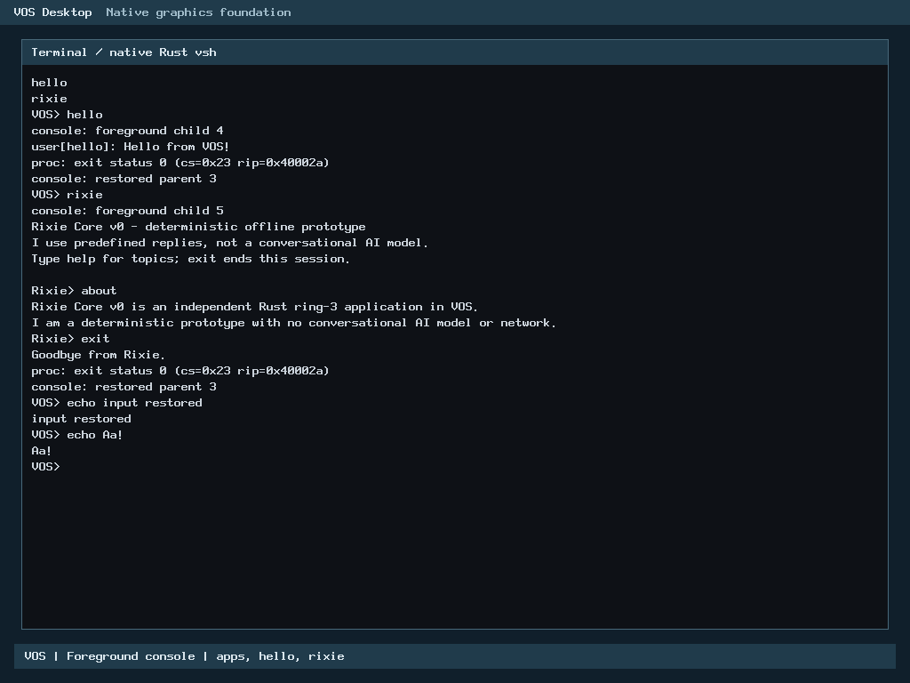

# R2: Rust PS/2 keyboard decoder

Local verification PASS; candidate awaiting PR CI and human review/merge. This is one bounded R2 selected-driver increment, not completion of R2 or the R Series. Baseline: accepted `main` `77045d829f60475b7110e05816a82e75eea62da2` (B1 merge, PR #50). H1-B PR #51 is unmerged and is not a dependency. H2-A remains disabled.

## Ownership and compatibility

Production `keyboard_decode()` and both 128-byte US translated Set-1 lookup tables now belong to Rust. `kernel/rust/input/ps2_keyboard.rs` forbids unsafe code and performs one bounded transition per byte. `arch/x86_64/rust/ps2_keyboard.rs` exports the unchanged C symbol and snapshots/writes the caller-owned seven-byte state. Layout assertions in both languages cover size 7, alignment 1 and all seven offsets. Null or wrapping pointers return no character. Other pointers must identify exclusive mapped writable state: arbitrary address validity remains the caller's responsibility. No borrowed pointer escapes, callback, yield, allocation or device access occurs.

The accepted C branch order and all byte-valued state semantics remain intact, including noncanonical modifier/Caps/Pause values. Controller I/O, IRQ/polling, owner epochs, foreground routing, console/GUI and PS/2 mouse delivery remain C and unchanged. Only the decoder/tables leave `keyboard.c`; the public header and build object list are unchanged. There are still 59 production C translation units and four Assembly units; no whole-driver or kernel-wide Rust percentage is claimed. The accepted C decoder survives only as a frozen differential reference with baseline/hash provenance.

## Verification

| Gate | Actual result |
| --- | --- |
| Baseline, candidate, independent repeat, GUI verification builds | PASS; `make verify`, ELF/layout/Multiboot2 checks |
| Reproducibility | Repeat kernel and archive byte-identical; GUI Rust archive also matches |
| Core semantics | 11 Rust tests PASS |
| Differential and ABI | 3,703,936 comparisons per variant, three variants; full 1,792 reachable states, bounded encodings, hostile field bytes and million-step streams |
| Boundary checks | Null/wrap, unaligned byte state and both protected-page edges PASS |
| Negative controls | Nine compiled mutants detected by their intended semantic assertions; failure logs preserved |
| Overflow checks | Same FFI/core source compiled with Rust overflow/debug assertions; differential PASS |
| Existing input regressions | Production archive pointer differential: 52,394,348 comparisons per C-sanitized/release variant, 16,777,216 packet triples; pointer Rust, xHCI, console, GUI/service/renderer gates PASS |
| Native QEMU | BIOS and UEFI × 128 MiB and 2 GiB × normal and GUI-verification kernels: 8/8 PASS |
| Native ownership | Four normal boots trap actual Rust `keyboard_decode`, `pointer_decode` and `pointer_idle` instruction addresses |
| Native behavior | All eight type `echo Aa!` using Caps/Shift/release sequences and require shell output; pointer pixels/corners/clicks, foreground handoff, held-input cleanup, shell/hello/Rixie pass |
| GUI verification | Each of four verification boots passes the existing 16 native cases, 18 bootstrap failures and overflow recovery |

The C harness/reference are ASan/UBSan-instrumented; the prebuilt Rust archive is **not** sanitizer-instrumented. Separate overflow-checked Rust and protected-page tests supplement that limitation. Seed: `72b15e7deca0de01`. Nine mutants target shift masks, Caps repeat/XOR, fake E0 shift, Pause length, Ctrl, Alt, release and punctuation. Compilation failure does not count as mutation detection.

## Measured resources and performance

Existing state remains 7 bytes; new mutable global state, heap allocations and DMA pages: zero. Compiler stack metadata reports a 10-byte leaf frame, below the 128-byte test ceiling. Disassembly uses general registers and no helper calls. The independent target object is 431 bytes of text, 240 bytes of switch rodata and two 128-byte tables; the final loaded section sizes are identical to the accepted baseline (including existing GOT sections). No loaded-image or reserved-page growth occurred. Complete measurements and symbol ownership are in [resources](r2-keyboard-decode-rust/resources/OWNERSHIP_RESOURCES.json).

Seven hosted, CPU-pinned release-loop samples measured median **C 3.9064 ns/call, Rust 5.9738 ns/call**: +2.0674 ns, 1.529×. This is a measurable microbenchmark regression, disclosed for review; it is not guest IRQ latency or a physical-device performance measurement. No numeric acceptance threshold was relaxed. The ABI retains explicit snapshot/write and pointer-range checks. Sanitizer results are not used as performance evidence.

The separate maintainer worktree uses owner-approved 240,000,000-byte STOP and 260,000,000-byte hard cap; C reserve 22,548,578,304 bytes and 1.25× step rule remain enforced. The independent monitor also accounts for shared Git/controller growth, confined temporary outputs and physical E capacity. Native campaign ended at 144,146,434 worktree bytes; minimum C free 57,622,384,640 and E free 124,597,628,928 bytes. Publication documentation adds bounded evidence. No historical artifact cleanup was performed. Old B1 guard, 336 controller seal entries, 58 published seal entries, original R2-B manifest and ten protected negative-test refs were revalidated. These local maintenance controls are not prerequisites for external contributors.

## Authentic runtime evidence

BIOS, normal kernel, 128 MiB, QEMU q35/TCG:


UEFI/OVMF, normal kernel, 128 MiB, separate execution:



Images are unmodified QMP PNG captures. Serial output and native instruction traps establish the technical claims; screenshots alone do not prove ownership. [Native results](r2-keyboard-decode-rust/native/result.json), per-case commands/serial traces and [hashed evidence](r2-keyboard-decode-rust/SHA256SUMS) are retained. Original raw media/build outputs stay local. Three controller-script quoting/preparation errors occurred before their guarded operations; their records remain under `preparation/`. The initial publication checker compared `ref SHA` with `SHA ref` and stopped before writing documentation; after correcting field order, all protected refs matched. Its failed receipt is retained. No component gate failure was suppressed or relabeled.

## Reproduction and publication

Follow [CONTRIBUTING](../../CONTRIBUTING.md), [security policy](../../SECURITY.md) and the [publication checklist](../milestone-publication-checklist.md). With the repository-pinned Rust toolchain and normal prerequisites, use a fresh output directory:

```sh
make -j1 ARCH=x86_64 BUILD=build/r2-check verify
python3 -I -B scripts/test-ps2-keyboard-rust.py \
  --archive build/r2-check/rust/libvos_kernel.a \
  --rustc "$RUSTC" --out build/r2-keyboard-check
python3 -I -B scripts/test-ps2-pointer-rust.py \
  --archive build/r2-check/rust/libvos_kernel.a \
  --rustc "$RUSTC" --out build/r2-pointer-check
```

The existing native producer accepts explicit application/disk/GRUB inputs; captured exact invocation is in `storage/native-eight-cases/start.json`. `--keyboard-proof --memory 128M --memory 2G` adds decoder-entry traps and both memory configurations. GUI verification uses a separate `TEST_DEFS=-DVOS_GUI_VERIFY` build; read-only guest disk and copied per-case OVMF variables keep host recovery assets untouched. Default native harness behavior remains compatible. Build smoke adds this focused hosted gate without changing permissions or other gates. Final CI must be inspected on the published head; local PASS is not CI PASS.

## Limits and next work

No native USB, arbitrary HID, controller activation or physical Dell testing is included. The default US layout and existing Set-1 behavior are preserved. This does not certify physical hardware or production security. H1-B's independent hosted adapters that compile `keyboard.c` will need to link the Rust decoder when rebased; that unmerged PR is unchanged here. The microbenchmark slowdown is a human review item. R3 still requires accepted/merged R2 dependencies. Next: review this increment and authorize its merge separately; then select the next bounded remaining R2 driver ownership change under the master ledger, with fresh scope/resource admission.
