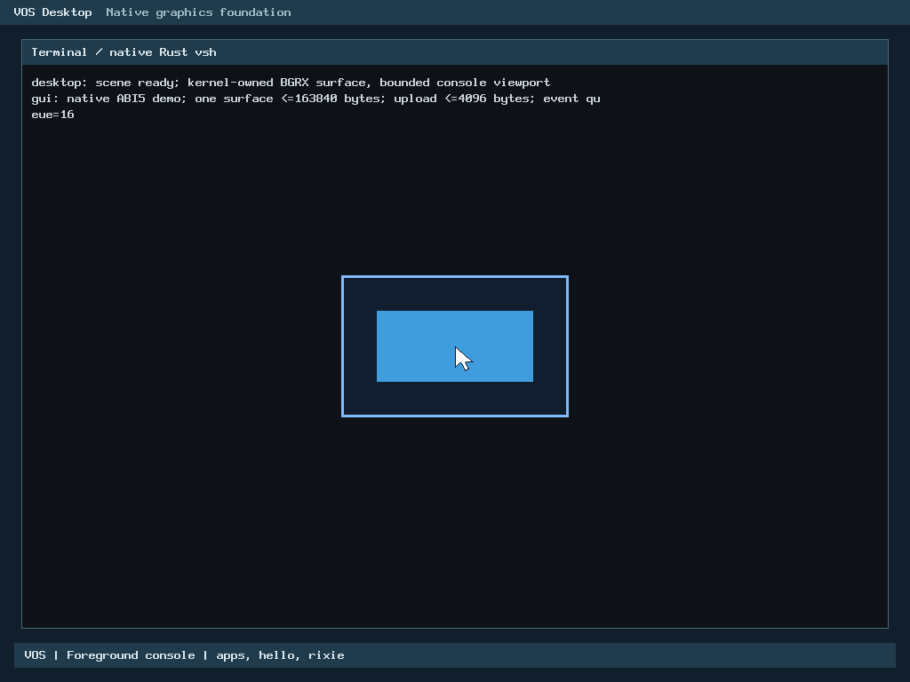
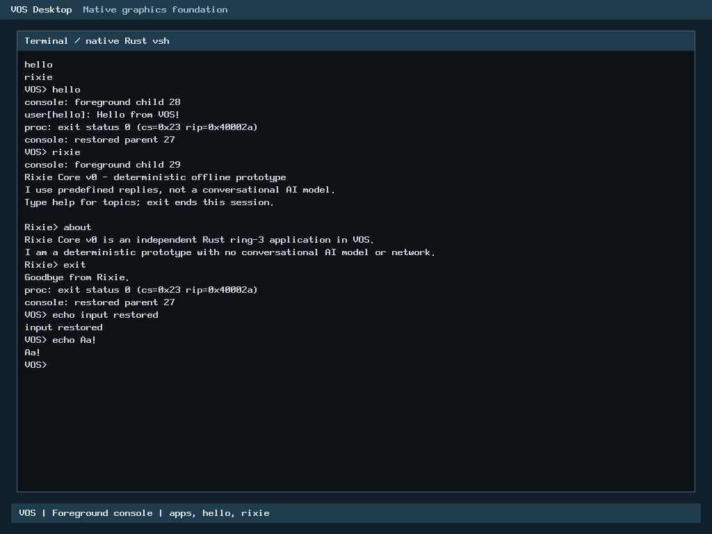

# R2 Rust keyboard queue extraction — local verification checkpoint

Verdict: local correctness, resource, reproducibility and eight QEMU configurations PASS. **The owner explicitly approved the four source-bound hosted regressions; gated publication and required published-head CI remain pending.** No merge is authorized.

Baseline: accepted main `7151c51126c4303f066c998ba905cfd4b1181f2b` (owner-merged PR #57), tree `3f2725575ebc14a1fb47365f9a6e20ad6df040fb`. Branch `codex/r2-keyboard-queue`. This is the next selected-input R2 increment, not a new milestone or R2 exit declaration. H2-A remains inactive.

## Ownership, ABI and safety

Only the private `routed_poll()` FIFO policy moves from C to allocation-free safe Rust. The C public dispatcher, ordinary polling, controller backend/writes, initialization, suspend/resume, existing decoders, pointer polling/loss accounting, ownership and thread/IF=0 rules remain. One now-unused C forwarding helper is removed; accepted Rust drain is retained.

The private C ABI `vos_rust_keyboard_routed_poll` validates null/alignment/address extent, then calls the safe policy. The 88-byte caller-owned context and 32-byte FIFO are unchanged; public headers are byte-identical. Raw pointer lifetime and mapped/initialized storage remain caller preconditions; numeric range checks do not establish mapping. No reference spans a foreign input callback. Queue fields reload after drain. All 256 byte patterns, including consumed NUL and signed C-char returns, retain defined C behavior. Invalid out-of-range dequeue heads fail closed instead of invoking the C oracle's undefined indexing. Noncanonical but defined unsigned counts are not silently clamped.

Ready is checked before exactly one drain, even when the FIFO is already populated/full; callback ordering and state changes are preserved. Count/head/slot updates are safe and bounded. The new safety predicate is exhaustively compared at address boundaries and over 100,000 deterministic addresses against the original explicit predicate. Its optimization combines checks without removing them.

## Verification

| Gate | Actual outcome |
| --- | --- |
| Frozen C / production Rust | 782,855 comparisons in each release and C ASan/UBSan variant |
| Checked Rust archive | 782,855 comparisons, overflow checks enabled; C sanitizer harness |
| Pure Rust | 32 positive tests |
| Mutation controls | 31/31 intended assertions detected: 19 accepted routing controls plus 12 queue/range controls |
| Affected input regressions | Actual archive pointer/keyboard/foreground/GUI and HID adapters PASS; six release/sanitized console variants PASS |
| Production and independent rebuild | Kernel and archive byte-identical; GUI profile uses same Rust archive |
| Runtime | BIOS/OVMF ×128 MiB/2 GiB ×normal/GUI verification: 8/8 PASS |
| Published-head CI | NOT RUN: publication remains blocked |

Seed `7232647261696e31`; exhaustive queue heads/counts/bytes, 64 synchronous callback profiles, complete 88-byte state and port-read traces, guarded boundary objects, no controller writes. C sanitizers do not instrument production Rust. The checked archive is separate evidence, not a claim of Rust ASan coverage. Each mutant is a distinct module/type with its own preserved source, and the intended assertion runs in a separate process. One shared test runtime (1,687,384 bytes) replaces repeated runtimes; coverage and failure outputs are retained.

Each QEMU case proves actual Rust entries, real PS/2 `z` scan 0x2c, ELF-resolved post-drain FIFO byte 0x7a, returned byte, consumed head/count and cleared slot. Exact pointer packets/pixels, text modifiers, console reader/editor/extraction, foreground cleanup and restored shell also pass. GUI verification retains all sixteen cases, overflow recovery and repeated worker reclamation. These are emulated PS/2 observations, **not native USB input**. Physical hardware and guest latency remain NOT TESTED.

Failed compile/harness attempts remain in the maintained worktree with original receipts; [attempt notes](r2-keyboard-queue-rust/preserved-attempts.json) explain bounded corrections. No failed attempt is relabeled PASS. Exact raw-output whitespace exceptions are [hash-bound](r2-keyboard-queue-rust/raw-evidence-whitespace.json); source/prose whitespace checks stay strict. One already-passing BIOS case is reused with identical kernel/archive and all mandatory assertions.

CI initially rejected the obsolete direct C-to-drain ownership assertion. The [correction](r2-keyboard-queue-rust/ci-ownership-correction.json) requires a unique C-to-Rust-queue-to-Rust-drain relocation chain, verified on the actual archive and five rejected broken topologies. Production code, all functional/resource/mutation checks and performance approval bindings are unchanged; full CI must rerun. The failed job log remains retained.

## Resources and reproducibility

New Rust queue own frame **8 B** excluding return address, below the 24 B ceiling. The C routed branch tail-jumps before its ordinary-path frame; existing drain frame 40 B and pointer-poll frame 24 B remain unchanged. No heap, DMA or new persistent state. Loaded-image growth **0 B** against a 4,096 B ceiling; `.data` and `.bss` unchanged. ELF file 1,227,056 → 1,226,912 B. No unresolved ELF symbols or new panic/allocation/SIMD dependency in the selected path. Accepted routing machine code is identical except direct relocation displacements. See [resources](r2-keyboard-queue-rust/resources.json), [assembly](r2-keyboard-queue-rust/production-routing.asm) and [reproduction](r2-keyboard-queue-rust/reproduction.json).

## Standing Rust Performance Policy

Both accepted C reference and candidate C glue use equivalent release `-O2`, scalar x86-64 kernel flags and no LTO; production Rust uses accepted `opt-level=2`, x86-64 bare-metal, panic-abort, no-red-zone, no LTO settings. Full public `keyboard_poll()` paths are measured against the frozen accepted C version, sharing unchanged Rust drain/decoder code and identical workload/reset/counter overhead. Nine process blocks ×nine paired samples ×20,000 iterations; CPU affinity fixed, order alternates, all raw CSVs retained. These are hosted loop timings, not isolated guest instruction latency or hardware throughput. WSL scheduling/frequency are not controlled. Whole-process CPU measurement is separately scoped in [CPU evidence](r2-keyboard-queue-rust/cpu-measurement.json); it is not attributed separately to C and Rust. Reciprocal operation rates are derivable from these loop times, not a separately measured throughput campaign.

| Workload | C ns/call | Rust ns/call | Change |
| --- | ---: | ---: | ---: |
| unready | 4.7200 | 4.1300 | -12.50% |
| empty | 12.8250 | 12.5800 | -1.91% |
| queued | 8.6000 | 7.8300 | -8.95% |
| full | 8.6600 | 8.1750 | -5.60% |
| pointer_pending | 7.6600 | 7.0800 | -7.57% |
| refill | 27.1500 | 27.5400 | +1.44% |
| mixed | 64.7400 | 65.3050 | +0.87% |
| burst32 | 1487.9248 | 1512.5698 | +1.66% |
| ordinary_control | 17.1200 | 18.5750 | +8.50% |

Disassembly review identified the C dispatcher's compiler shrink-wrapping/branch-layout change on the source-unchanged ordinary path. Its input loop and accepted Rust callees remain intact; this is a plausible contributor, not a fully isolated causal claim. Necessary private pointer/range and queue-head checks are retained. A check-equivalent range optimization was tested; originals and initial measurements remain preserved. Refill/mixed/burst differences include shared callbacks and loop overhead. The ordinary control regression exceeds 5% and was investigated; **all four remaining positive medians received explicit source/binary-specific owner approval** under the standing policy; see the [separate approval](r2-keyboard-queue-rust/performance-owner-approval.json). No prior keyboard, console, drain or pointer exception transfers. [Exact decision binding](r2-keyboard-queue-rust/performance-decision-required.json).

Candidate archive SHA-256: `73eb6101ac15fb08a571ae41a2599498b8287111f9daec5dcf74d0cb26e8b696`. Kernel SHA-256: `68f6a7ceac4d836f6c9d987d8b5c2bb946752f7a702e94fb56cefea2f1eaed72`. Raw samples, tool versions, source hashes and assembly are included. No parity, physical-performance or blanket approval claim is made.

## Storage and history

The redesigned admitted forecast is 221,125,000 B including 25% output margin, versus the inadmissibly close 238,625,000 B proposal. The reduction shares test-runtime machinery; it deletes no output and reduces no controls. STOP/cap remain 240,000,000/260,000,000 B. C floor 22,548,578,304 B, E reserve 1,610,612,736 B plus projections, same cumulative shared Git/controller origins and 12,000,000 B ceiling, locking and fail-closed monitoring remain. No STOP marker was removed and no cleanup or external unmonitored output was used.

All 1,563 sealed historical controller entries, prior checkpoint, protected refs and original guards passed again. The exit-98 incident, unauthorized deletion history, recovery ratification and source-bound approvals remain. Sixty missing historical logs remain a disclosed limitation; nothing was reconstructed. See [historical integrity](r2-keyboard-queue-rust/historical-integrity.json). R2 is partial; R3–R5 exit/integration gates and separate human merges remain required.

## Reproduction and remaining gates

Build production and independent profiles with `make -j1 ARCH=x86_64 BUILD=build/production USER_BUILD=build/user verify` and distinct fresh `build/repro`; build GUI verification with `TEST_DEFS=-DVOS_GUI_VERIFY`. Then run `python3 -I -B scripts/test-keyboard-queue-rust.py --archive build/production/rust/libvos_kernel.a --rustc "$RUSTC" --out build/queue-new`. The result records exact commands. Use the explicit native runner with checked kernel/application/disk paths, BIOS/OVMF, both RAM sizes and `--keyboard-queue-proof` plus accepted reader/editor/extraction/decoder/routing/pointer proofs. Maintainer historical inputs are recorded by hash; external contributors need not possess private controller receipts.

Next: gated final security/evidence review, focused commit/PR and required published-head CI. The original pending-decision receipt is retained as history and superseded only by the separate approval. Never merge automatically. Do not begin a dependent increment against unaccepted queue code or activate H2-A. [Policy links](../../CONTRIBUTING.md): [security](../../SECURITY.md), [publication checklist](../milestone-publication-checklist.md).

## Genuine captures

Actual VOS pointer surface after the real queue check; Rust execution is established by accompanying logs, not the screenshot alone.

Actual edited shell/modifier output after native input and ownership checks. No generated or fixture-replay image is used.
