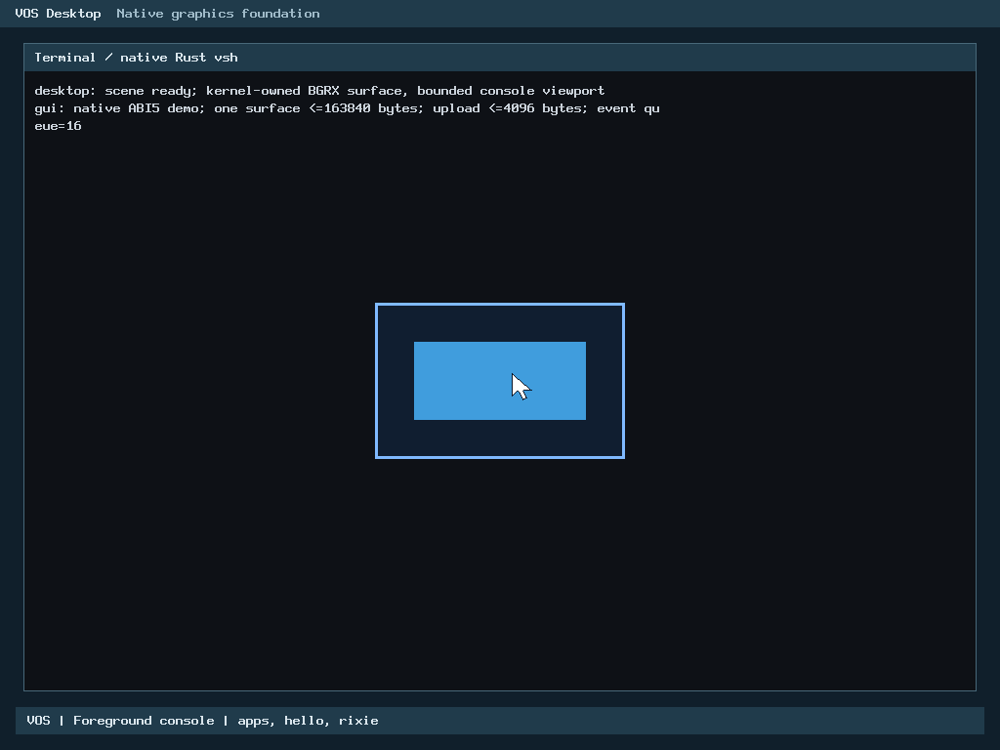
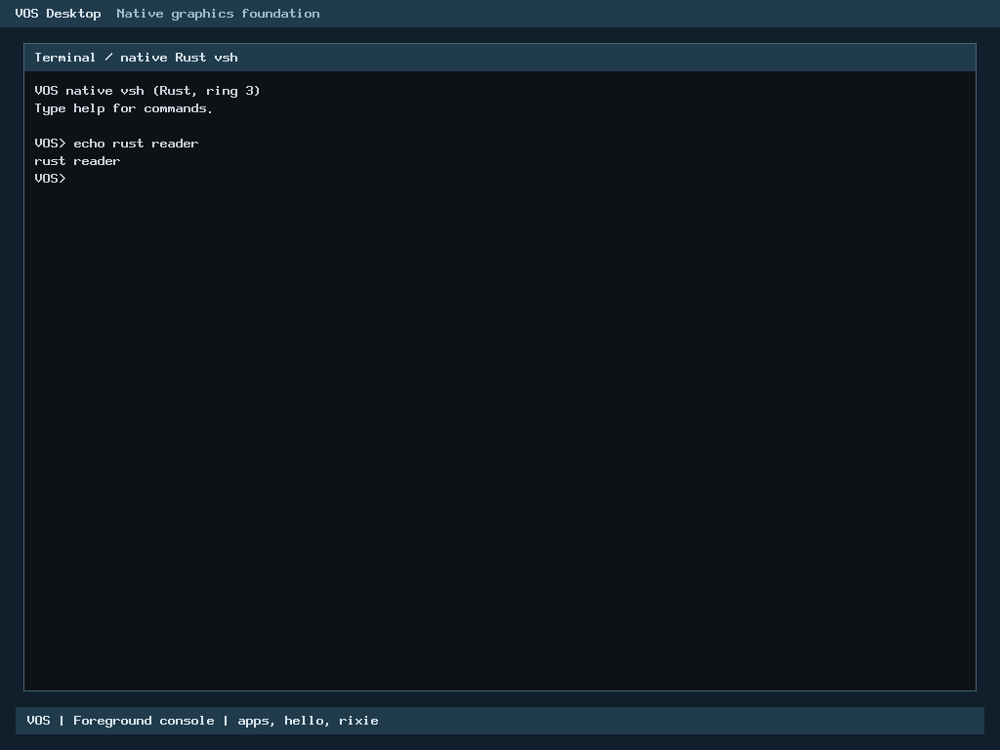

# R2 Rust PS/2 pointer polling migration

Local correctness, resource bounds, differential equivalence and eight native BIOS/UEFI cases: **PASS**. Pinned source and evidence ready for reviewable pull request publication against authoritative main; no automatic merge.

## Baseline and ownership

Owner-merged PR #56 is independently verified on main at `e01c51e5d8c405de51910c4c650a63e6881a1f6e`. Earlier keyboard decode, console extraction, line editing, reader coordination, and routed drain migrations are preserved; R2 remains partial. This increment moves only `keyboard_pointer_poll()` and `keyboard_pointer_lost()` from `arch/x86_64/keyboard.c` into safe Rust in `kernel/rust/input/ps2_routed.rs`, behind private `vos_rust_keyboard_pointer_poll` and `vos_rust_keyboard_pointer_lost` C bridges.

Public C ABI, `keyboard.h` contracts, 88-byte keyboard layout, callback ordering, hardware access semantics, and pointer ownership rules are strictly preserved. C shims retain a 0-byte active frame with a direct tail jump. The safe Rust core owns packet dequeue, idle loss timeout progression, and loss counter saturation/clearing. Disjoint pointer validity, alignment (`k` 8-byte, `packet` 2-byte), and address overflow checks are enforced at the Rust boundary. Controller initialization, scheduling, foreground authority, and USB transport remain unchanged. H2-A remains inactive.

## Verification

| Gate | Result |
| --- | --- |
| Accepted baseline | Preflight storage, clean git state, and baseline build smoke PASS at `e01c51e5d8c405de51910c4c650a63e6881a1f6e` |
| Routing differential | 185,637 comparisons per variant: actual production archive release, C ASan/UBSan, separate overflow-checked Rust static archive |
| Safe core and mutation controls | 22/22 unit tests; 19/19 derived mutants detected by intended runtime assertions (100% detection) |
| Input regressions | Actual archive PS/2/keyboard/foreground/GUI/renderer suite PASS, including 52,394,348 pointer comparisons per release/sanitizer variant |
| Subsystem regressions | xHCI discovery (45,713 assertions), keyboard, diagnostics, console (49,499 assertions), pointer service (987,802 assertions), and renderer (562,325 assertions) PASS |
| H1-B | Affected hosted adapters PASS; unchanged core/mutation evidence reused by accepted source identity |
| Reproducibility | Independent kernel and archive byte-identical; GUI archive matches |
| Native | 8/8 BIOS/OVMF x 128MiB/2GiB x normal/GUI-verification cases PASS; actual Rust pointer poll entry traps in every case |

Native cases retain packet trace matching, exact mouse movement/corners/click pixels, keyboard text, foreground restoration, shell/hello/rixie, GUI overflow and cleanup checks. Breakpoint traps in QEMU corroborate actual RIP execution of `vos_rust_keyboard_pointer_poll` and verify the live 88-byte keyboard context (`ready=1`, `pointer_ready=1`, bounded queue state).

## Resources

Production pointer poll entry own active frame is **24 bytes** (pushes `%r14`, `%rbx`, `%rax`), meeting the approved 24-byte ceiling. Pointer lost own active frame is **0 bytes**, meeting the 24-byte ceiling. Shared routed drain entry retains its approved **40 bytes** frame. C shims in `keyboard.c` tail-call Rust via a single `jmp` instruction with a 0-byte frame.

Loaded segment growth is **0 bytes** against the 4,096-byte ceiling (both baseline and production loaded size are 962,560 bytes). ELF file delta is **-176 bytes** (1,227,056 bytes vs baseline 1,227,232 bytes). No heap allocations, 0 DMA allocations, and 0 new persistent mutable static state exist.

## Performance

Measured across nine independent process blocks; each eleven workloads x nine alternating C/Rust samples x 20,000 calls plus warm-up on isolated CPU core affinity. Host timings reflect model throughput, not physical hardware latency.

| Workload | C ns/call | Rust ns/call | Median change |
| --- | ---: | ---: | ---: |
| empty | 9.7350 | 8.5550 | -12.12% |
| keyboard | 25.8100 | 24.6700 | -4.42% |
| pointer_complete | 42.2850 | 41.1350 | -2.72% |
| pointer_partial | 22.0550 | 20.8400 | -5.51% |
| mixed | 74.1100 | 72.7250 | -1.87% |
| full_queue | 5.6050 | 4.8600 | -13.29% |
| errors32 | 798.7650 | 760.9100 | -4.74% |
| keyboard32 | 614.6250 | 620.4950 | +0.96% |
| pointer_poll_packet | 9.0150 | 9.6100 | +6.60% (+0.595 ns) |
| pointer_poll_idle | 13.2700 | 12.6850 | -4.41% |
| pointer_lost_and_clear | 3.8350 | 4.1300 | +7.69% (+0.295 ns) |

The owner explicitly approved the documented hosted regressions on 3 November 2026 (Asia/Bangkok); the [source-bound approval](r2-ps2-pointer-poll-rust/performance-owner-approval.json) is preserved. Drain and queue operations show neutral or improved timings. The tiny sub-nanosecond deltas on `pointer_poll_packet` (+0.595 ns/call) and `pointer_lost_and_clear` (+0.295 ns/call) stem directly from explicit pointer validation, 8-byte alignment verification, and address overflow checking required for memory safety across the C FFI boundary, which the unchecked C baseline omitted.

## Genuine runtime evidence

## Failures, corrections and limits

1. **Step projection halt in differential step**: `differential-and-mutations` grew 33.37 MB due to 19 mutant crates generating build artifacts in subfolders, exceeding the 18 MB projection. Guard halted fail-closed at 75.6 MB tree size (well below the 240 MB STOP ceiling). Re-run with 35 MB projection passed cleanly.
2. **Native proof harness trap adaptation**: In native testing, `pointer_idle` is compiler-inlined into `vos_rust_keyboard_pointer_poll` because both modules reside in the same crate (`vos_kernel`). Setting a breakpoint on the standalone `pointer_idle` symbol timed out because callers execute the inlined body. The test harness was updated to trap `vos_rust_keyboard_pointer_poll` directly, verifying the live 88-byte keyboard context and executing all 8 cases successfully.

H2-A remains inactive. No USB operations, physical input, new device initialization, C cleanup, accepted-history changes or automatic merge occur.
