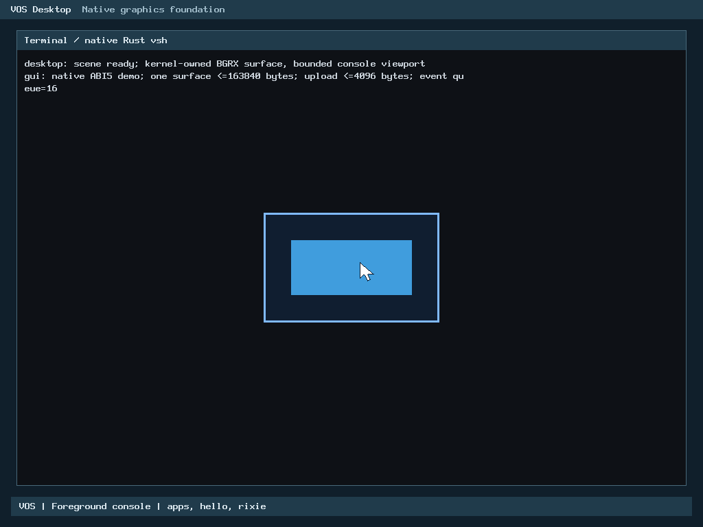
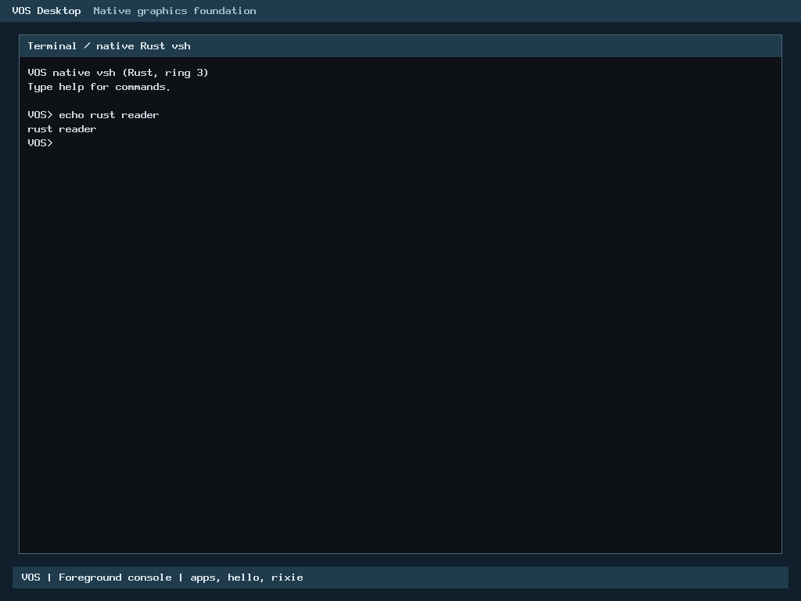

# R2 Rust shared PS/2 routed-drain migration

Local correctness/resource/runtime verdict: **PASS**. Publication: The owner explicitly approved the pinned source and documented remaining hosted regressions on 2 November 2026 (Asia/Bangkok). Gated publication and final required CI remain pending; no merge.

## Baseline and ownership

Owner-merged PR55 is independently verified on main at `f6e9603865a935e6624d45910fae4582f7b4acbf`. Earlier pointer/keyboard/console migrations and H1-B are preserved; R2 is still partial. This increment moves only `routed_drain()` from `arch/x86_64/keyboard.c` into `kernel/rust/input/ps2_routed.rs`, behind the private `vos_rust_keyboard_routed_drain` C bridge. Public ABI, keyboard88-byte layout, existing Rust decoders, public poll/dequeue/packet delivery, initialization, controller writes, foreground authority and scheduler remain unchanged.

The safe Rust core owns the32-iteration/status/data routing, backpressure, error resets, lost-counter saturation and bounded queue transitions. The raw adapter retains no pointee reference across the existing C `io->in` callback, reloads its pointer for each read, and forms only short borrows for initialized fields between callbacks. Fixed repr/layout assertions and exact C differential traces validate the boundary. Pointer mapping/lifetime, callback validity, exclusive thread context and IF=0 remain explicit caller responsibilities. No new IRQ, DMA, allocator, persistent state or controller write exists. Device reads remain0x64 then0x60, at most64 reads/call.

Queue arithmetic preserves defined C unsigned wrapping, while indexing is modulo32. Saturating lost increment is equivalently `x.wrapping_add(u32::from(x != u32::MAX))`; this avoids a long-lived maximum-value register. An out-of-line pointer helper takes the raw address by value and contains the compiler-inlined accepted decoder. The accepted decoder source was not copied or changed. The public Rust decoder remains available. Language ownership is proved by archive/ELF symbols and actual RIP traps; a screenshot alone cannot prove it.

## Verification

| Gate | Result |
| --- | --- |
| Accepted baseline | Existing xHCI discovery, keyboard, diagnostics and foreground console fixtures PASS before edits |
| Routing differential |185,637 comparisons per variant: actual production archive release, C ASan/UBSan, separate overflow-checked Rust static archive |
| Safe core and mutation controls |16/16 tests;14/14 derived routing mutants detected by intended runtime assertions |
| Input regressions |Actual archive PS/2/keyboard/foreground/GUI/renderer suite PASS, including52,394,348 pointer comparisons per release/sanitizer variant |
| Console ABI regressions |Reader, editor and extraction differential fixtures pass in release and C sanitizer modes against actual archive |
| H1-B |Affected hosted adapters PASS; unchanged core/mutation evidence reused by accepted source identity, not claimed rerun |
| Reproducibility |Independent kernel and archive byte-identical; GUI archive matches |
| Native |8/8 BIOS/OVMF x128MiB/2GiB xnormal/GUI-verification cases PASS; actual Rust routing and pointer-helper RIP traps in every case |
| Default runner compatibility |One additional BIOS128MiB normal case PASS without the new optional driver-proof flag |

Native cases retain packet trace matching, exact mouse movement/corners/click pixels, keyboard text, foreground restoration, shell/hello/rixie, GUI overflow and cleanup checks. The new proof reads the stopped guest's live88-byte keyboard context and verifies ready/pointer-ready and bounded queue fields. The default pointer proof also follows the inlined Rust helper when present; it still falls back to the public decoder for older kernels. Earlier native evidence and all failure receipts remain unchanged.

C ASan/UBSan does **not** instrument production Rust. Separate checked Rust, guarded boundary objects, exact state/read-trace comparison and safe-core tests supplement it. Finite fixtures do not prove every device timing or concurrency state. This is PS/2 QEMU verification, not native USB or physical Dell qualification.

## Resources

Production routing entry **40B**, pointer helper **0B**: sum40B, meeting the approved40B own-frame ceiling excluding ABI return addresses and unchanged decoder/I/O callees. Accepted C `.su`48B includes an8B return address; normalize to40B. The corresponding call path substitutes a zero-frame Rust helper for the accepted pure decoder call; no frame allowance was increased.

Loaded segment growth **4096B** against4096B ceiling; ELF file delta **3504B**. `.data` and `.bss` sizes unchanged. No new heap, DMA or persistent state. Context88B and queue/drain bounds32 remain unchanged. Actual production ELF has no undefined symbols; routing code is scalar and has no panic/allocator call. [Resource evidence](r2-ps2-routed-drain-rust/resources.json).

Kernel SHA256 `af66c9af59565b3d9d03ba5cd046f445c0e11dfd3a4537dc5db70a60cfb6b9c8`; Rust archive `e8db6afa0b3e3246156620b75c6fea9b40e1f53a59f4ee11357e71cdab49573c`.

## Release performance and remaining decision

Accepted **C routing plus accepted Rust decoders** versus Rust routing with the same accepted decoders; this is not a comparison against the pre-R2 all-C kernel. Equivalent O2 scalar x86-64, freestanding/no-redzone/no-stack-protector/kernel-model flags. The newly explicit C kernel flags produce byte-identical frozen-C drain machine code; a fresh185,637-case release comparison passes. Previous unchanged sanitizer/checked/core/mutation results are retained with their exact inputs rather than rerun for that flag spelling.

Nine independent process blocks, each nine alternating C/Rust samples/workload x20,000 calls plus warmup: **81 pairs/workload**, all retained, aggregate medians rather than best-run selection. Common state reset, fixture callback and clock overhead are included. Linux CPU affinity is not physical-core isolation; host frequency and competing scheduling remain uncontrolled. Earlier trials are preserved, including their differing medians. Small differences and broad per-pair ranges may be noise; no statistical parity/improvement claim is made.

| Workload | C ns/call | Rust ns/call | Median difference | Rust model Mcalls/s |
| --- | ---: | ---: | ---: | ---: |
| empty | 8.6350 | 8.3050 | -3.82% | 120.409 |
| keyboard | 22.1600 | 22.0500 | -0.50% | 45.351 |
| pointer_complete | 41.2400 | 40.2300 | -2.45% | 24.857 |
| pointer_partial | 20.3600 | 19.5201 | -4.13% | 51.229 |
| mixed | 70.6750 | 68.1000 | -3.64% | 14.684 |
| full_queue | 4.4600 | 4.5700 | +2.47% | 218.818 |
| errors32 | 306.6000 | 302.6000 | -1.30% | 3.305 |
| keyboard32 | 438.0400 | 432.6300 | -1.24% | 2.311 |

Throughput is the reciprocal of hosted model timing, **not measured device throughput**. No final median regression exceeds5%. The full-queue path remains **+2.47%, +0.11ns/call**; the owner explicitly approved the current exact-source remaining measurements for gated publication; the [source-bound decision](r2-ps2-routed-drain-rust/performance-owner-approval.json) is preserved. Disassembly review retained null/alignment/range guards at the private Rust entry; the accepted C internal helper assumes a valid pointer. These extra guards are consistent with fast-return overhead but their individual cost is not isolated. Inlining/register-pressure corrections reduced the initial56B frame to40B without removing checks. No practical further optimization is justified by the current tiny/noisy difference; do not remove guards to obtain numbers. Guest BIOS/UEFI or physical input latency is **NOT TESTED**; functional boot is not timing evidence. [All samples and methodology](r2-ps2-routed-drain-rust/performance-final.json).

## Genuine runtime evidence





Frames are unedited QEMU screendumps, with serial logs, source/binary identities, GDB context/RIP observations and packet/pixel oracles. [Eight-case outcome](r2-ps2-routed-drain-rust/native-results.json), [default compatibility](r2-ps2-routed-drain-rust/native-default-compatibility.json). Full local serial/QMP/trace/image evidence and failed attempts are retained in admitted build/controller directories.

## Failures, corrections and limits

Initial accepted-baseline selection pointed at an older retained pre-optimization archive; the hash assertion rejected it before tests. The sealed accepted optimized/repro pair was then selected. Bootstrap receipt-directory and temporary-directory setup errors are retained separately. Initial56B routing-frame builds failed the resource check; the pointer-by-value helper and equivalent bounded counter form meet40B. A count-removal mutant initially failed compilation under unchanged warnings; removing the assignment outright produced the required runtime detection. The checked object initially lacked Rust panic-runtime linkage; a complete checked no_std static archive with an aborting hosted panic handler fixes linkage without disabling overflow checks. All original FAIL logs/results/binaries remain preserved.

H2-A remains inactive. No USB operations, physical input, new device initialization, C cleanup, accepted-history changes or merge occur here. Original guards and recovery/evidence assets are preserved. Local storage uses its explicitly approved root/cumulative accounting; this report does not establish new contributor storage policy.

## Reproduction and publication

Follow [CONTRIBUTING](../../CONTRIBUTING.md), [security policy](../../SECURITY.md) and [publication checklist](../milestone-publication-checklist.md). Use fresh outputs and applicable local admission; never clean historical build trees.

```sh
make -j1 ARCH=x86_64 BUILD=build/routed-production USER_BUILD=build/user verify
python3 -I -B scripts/test-ps2-routed-rust.py --archive build/routed-production/rust/libvos_kernel.a --rustc "$RUSTC" --out build/routed-check
python3 -I -B scripts/test-ps2-pointer-rust.py --archive build/routed-production/rust/libvos_kernel.a --rustc "$RUSTC" --out build/routed-input
python3 -I -B scripts/test-boot-hid.py --stage adapters --rustc "$RUSTC" --out build/routed-hid
```

The ordinary native runner accepts explicit normal/GUI-verify kernels, an application hash manifest, EFI modules and a read-only ext2 fixture (same public workflow as the accepted pointer/reader reports); add `--memory 128M --memory 2G`, `--routed-drain-proof` and the existing keyboard/console proof flags to reproduce the eight-case matrix. Maintainer-retained ELFs/disks are verified inputs, not required private possessions for contributors; build equivalent inputs with documented application tools. Machine identities and private storage-controller directories are not public API.

The owner approved the source-bound performance decision. Next gate: final security/evidence admission, signed-off commit, ordinary push/PR and required final CI. **Do not merge automatically.** Wider R2 migrations and future hardware transport remain independently scoped.
