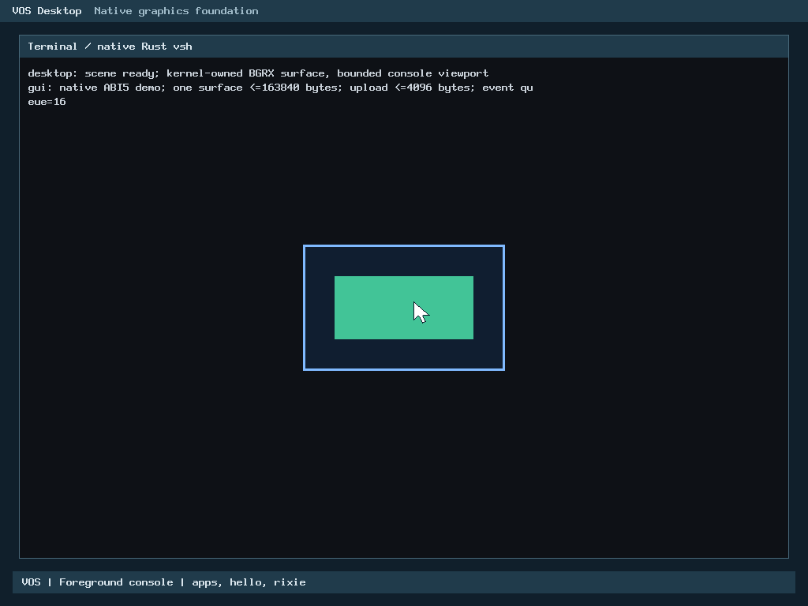
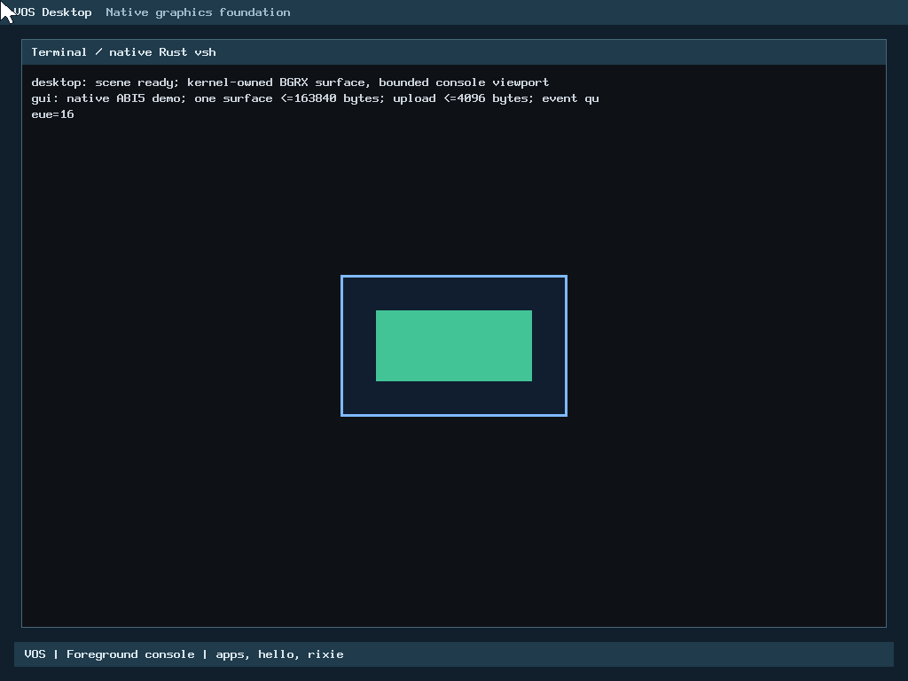

# R2-B: Rust PS/2 pointer decoder

**Verified for PR review, not accepted or merged.** The production kernel's
`pointer_decode()` and `pointer_idle()` are now freestanding `no_std` Rust
inside the existing kernel archive. The PS/2 controller, keyboard routing,
pointer session ownership and GUI delivery remain the unchanged C code.
Verification is QEMU-only; physical hardware is NOT TESTED.

**This is not a physical USB-input fix.** The owner's Legacy BIOS PC uses a USB
keyboard and mouse. VOS has no operational USB HID support, so the reported
`native GUI surface/event application` and `native vsh` failures on that machine
are outside this change. USB.2-C and USB.3-USB.5 remain separately authorized
future milestones.

Baseline: accepted `main` at PR #25,
`d2c0ac2d92bb917531a372d21d6b432425c4645f`. Checkout
`/home/veasnawt/src/vos-r2b`, branch `feat/r2b-ps2-pointer-rust`. Codex
implemented the change and began verification. Claude Code recovered,
audited and completed the work after Codex hit its usage limit. See
[progress](r2b-ps2-pointer-rust/progress.md),
[preservation](r2b-ps2-pointer-rust/preservation.json),
[exact inventory](r2b-ps2-pointer-rust/changed-files.txt) and
[hash manifest](r2b-ps2-pointer-rust/manifest.json). No R2-A assessment
exists in any local VOS tree. R2 scope comes from the
[Master Plan R-series](../plans/MASTER-PLAN.md#6-r-series-rust-first-kernel-migration).

## Implementation

| Part | Owner | Notes |
| --- | --- | --- |
| `kernel/rust/input/ps2_pointer.rs` | Safe Rust, `#![forbid(unsafe_code)]` | Packet/idle state machine. Every reachable C state behaves identically. Unreachable states (`used >= 3`, or a partial packet with `idle >= 16`) are discarded and rejected instead of indexing. |
| `arch/x86_64/rust/ps2_pointer.rs` | Unsafe FFI only | Exports the unchanged `pointer.h` symbols. Const-asserts the 5-byte/align-1 decoder and 6-byte/align-2 packet layouts. Rejects null, misaligned, overlapping and wrapping pointers. Writes output fields individually and never reads or borrows the output. |
| `arch/x86_64/arch.mk` | Build | Removes `pointer.o` from the production object list. Rust dep-info already tracks the `#[path]` modules. |
| `arch/x86_64/pointer.c`, `pointer.h` | Unchanged | Kept only as the differential reference. No production link uses them. |

`keyboard.c` still owns the decoder storage inside `struct keyboard`. It resets
that storage on controller errors and lease changes, and it calls the decoder
synchronously from its polling drain. PIO, IRQ, capability, scheduler and
userspace ABI code are unchanged.

## Acceptance matrix

| Gate | Result | Evidence |
| --- | --- | --- |
| A. Behavioral equivalence | **PASS.** Covers all 16,777,216 three-byte sequences from a fresh decoder, a 1,000,000-step random byte/idle stream (fragmented packets and expiry), every partial/idle state through 17 polls, and the exact 16th-poll expiry. Records 52,394,348 byte/idle comparisons of return value, full 5-byte state and 6-byte output against the C reference under ASan/UBSan and release. Invalid-state, null, alignment, overlap and address-overflow rejection pass. Five mutated C references (idle 15, overflow mask, sync bit, X sign, button mask) are all detected. Keyboard/aux interleaving, error resets and demux are covered by the host keyboard, console and pointer-service suites. | [host](r2b-ps2-pointer-rust/host/result.json), [negative controls](r2b-ps2-pointer-rust/negative-controls/summary.txt) |
| B. Production Rust execution | **PASS.** `vos.bin` defines `pointer_decode` (217 B) and `pointer_idle` (51 B) from `libvos_kernel.a(...cgu.0.rcgu.o)`. The map has zero `pointer.o` references (baseline: 14). Both functions are leaf code with no calls, panic paths or SSE. On BIOS and UEFI, one-shot GDB breakpoints trapped in the running guest with RIP equal to each Rust entry. | [linkage](r2b-ps2-pointer-rust/linkage/linkage.json), [disassembly](r2b-ps2-pointer-rust/linkage/disassembly.txt), [rust-execution](r2b-ps2-pointer-rust/native/bios-normal/rust-execution.json) |
| C. BIOS/UEFI regression | **PASS 4/4** (normal and GUI-verify on each firmware) plus **4/4** USB regression cases. Covers real PS/2 movement, press/click palette pixels, exact clipped corners (0,0)/(1023,0)/(1023,767)/(0,767), recentering, four click cycles, keyboard/mouse interleaving, held-button exit and revocation, GUI reclamation, console restoration, no key leak, `apps`, `hello`, Rixie, `pwd`, and vsh exit. GUI-verify adds 16 native GUI cases, 18 bootstrap load failures, pointer overflow-snapshot recovery and checkerboard pixels. The USB.2-B runner on this kernel passes default and opt-in resource/USB.1 probe modes with PCI metadata unchanged. | [native](r2b-ps2-pointer-rust/native/result.json), [USB](r2b-ps2-pointer-rust/usb-regression/result.json) |
| D. ABI and compatibility | **PASS.** `pointer.h` and every userspace, syscall, scheduler, process, capability and ELF file are byte-identical to the baseline. Applications built at earlier milestones (vsh, hello, rixie, gui-demo, gui-probe, pointer-demo, pointer-probe) run unmodified and are hash-checked. The five-segment kernel layout check passes. The host keyboard, console-handoff, xHCI and diagnostics suites link the actual Rust symbols. | [measurements](r2b-ps2-pointer-rust/measurements.json) |
| E. Resources | **PASS.** Decoder state stays 5 B. Stack frame is 0 B (leaf code; target ≤128 B). Loaded-kernel growth is 0 B: all PT_LOAD sizes and `.text/.rodata/.data/.bss` are unchanged (target ≤4 KiB). New permanent allocations: 0. Decoder code grows from 170 B to 268 B inside existing page padding. The archive grows by 540 B. `vos.bin` shrinks by 1,224 B because the C object's debug info is gone. | [measurements](r2b-ps2-pointer-rust/measurements.json) |
| F. Authentic evidence | **PASS.** Screenshots are unaltered QEMU `screendump` output from these runs. Serial logs, commands, events, ISO/trace hashes and source identities are retained. | below, [media](r2b-ps2-pointer-rust/media.json) |
| G. Preservation | **PASS.** Refs, worktrees, stashes and the index are unchanged before commit. All 446 Codex `build/r2b-1` evidence files are unchanged, and tracked historical results are unmodified. Codex's failures and Claude's failed attempt are retained. | [preservation](r2b-ps2-pointer-rust/preservation.json) |

### Performance

These are hosted single-CPU release microbenchmarks of the same archive, medians
of 7 runs × 6,000,000 calls. They are not kernel latency.

| Workload | C | Rust | Ratio |
| --- | --- | --- | --- |
| Valid packet stream | 3.43 ns | 5.17 ns | 1.51 |
| Rejected unsynchronized bytes | 2.33 ns | 3.52 ns | 1.51 |
| Decode plus idle poll | 4.82 ns | 6.79 ns | 1.41 |

The 1.2-2.0 ns per-call increase comes from the FFI pointer checks and
state-validity checks that the C version does not perform. The investigation was
by disassembly: the extra branches appear before the shared state machine. At
PS/2's default 100 samples/s (≤300 bytes/s), this adds well under 1 µs of CPU
per second of input. The checks are kept, because removing them would trade
memory safety for an immaterial gain.

## Screenshots

These are original QEMU `screendump` frames from the
[native matrix](r2b-ps2-pointer-rust/native/result.json). They are not
physical-hardware photos.

| BIOS: click turns the Rust panel green | UEFI: same flow under OVMF |
| --- | --- |
|  |  |
| BIOS: cursor clipped at (1023,767) | UEFI: cursor clipped at (0,0) |
|  |  |

All nine per-firmware normal-mode frames are retained under
[`native/`](r2b-ps2-pointer-rust/native), along with the GUI-verify
checkerboard frames. Each frame is checked by exact pixel oracles.

## Recovery history and corrections

Codex's run ([raw records](r2b-ps2-pointer-rust/codex-interrupted)) included:

1. A first link failure from accidentally dropping `net_ipv4.o`, which Codex
   corrected.
2. A release harness that failed to build under `-mgeneral-regs-only`, which
   Codex corrected.
3. Host gates that passed.
4. One BIOS normal case that failed at `shell response pwd`.

Claude's audit found no defect in the Rust, FFI, build or CI changes, and left
them untouched. Fresh builds reproduce Codex's kernel and archive byte for byte.
Two defects were confined to the native runner:

- It omitted the accepted N6.3 read-only virtio-blk disk, so vsh correctly
  answered `filesystem unavailable (no grant)` and the test expected `/`. The
  disk is now required and hash-pinned (`5ef98c6e...`).
- Codex's "verify" kernel was built without `-DVOS_GUI_VERIFY` and was
  identical to the normal kernel. The runner now refuses a mode/kernel mismatch
  using a verify-only symbol.

The runner also restores N6.3 checks that Codex's port had dropped: checkerboard
pixel oracles, recentering confirmation, four click cycles and the
`pointer-demo` key-leak check.

Claude's first matrix attempt passed BIOS normal, then failed producing UEFI
media because this host has no system x86_64-efi GRUB modules. It is retained
in [native-attempt-1](r2b-ps2-pointer-rust/native-attempt-1). The rerun used the
retained module tree that USB.1 recorded, after all 305 hashes matched.

## Reproduction

```sh
RUSTC=$HOME/.rustup/toolchains/nightly-2026-09-03-x86_64-unknown-linux-gnu/bin/rustc
O=build/r2b-claude-1
make ARCH=x86_64 BUILD=$O/kernel-normal RUSTC=$RUSTC verify
make ARCH=x86_64 BUILD=$O/kernel-verify RUSTC=$RUSTC TEST_DEFS=-DVOS_GUI_VERIFY verify
python3 -I -B scripts/test-ps2-pointer-rust.py --archive $O/kernel-normal/rust/libvos_kernel.a \
  --rustc $RUSTC --out $O/host
python3 -I -B scripts/test-ps2-pointer-native.py --normal-kernel $O/kernel-normal/vos.bin \
  --verify-kernel $O/kernel-verify/vos.bin --apps-manifest build/r2b-1/apps.json \
  --efi <retained x86_64-efi GRUB modules> --disk <accepted N6.3 disk.img> --out $O/native-2
python3 -I -B scripts/test-usb-resources-native.py --kernel $O/kernel-normal/vos.bin \
  --apps $O/usb-apps --efi <retained x86_64-efi GRUB modules> --out $O/usb-regression
```

CI's Build smoke job runs `test-ps2-pointer-rust.py` against the archive it
builds. The native matrix needs QEMU, OVMF and the retained inputs, so it is a
local maintainer check.

## Storage, limitations and next boundary

Windows C: had 22,930,595,840 bytes free before and 22,927,331,328 after, with
1.35 GiB of headroom above the 20 GiB reserve. The logical WSL build tree
exceeded the 128 MiB provision by 212,992 bytes, as
[disclosed](r2b-ps2-pointer-rust/storage.json). No cleanup was performed.

Limitations:

- Rust is not sanitizer-instrumented. The C reference and harness are.
- Performance numbers come from hosted microbenchmarks.
- Only QEMU's PS/2 model is exercised.
- Physical PS/2, USB HID and the owner's USB-input PC are NOT TESTED and not
  addressed.

Next work (another R2 driver, R3, USB.2-C) requires separate owner
authorization.
