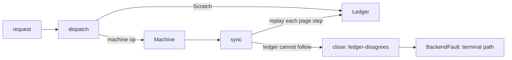

# USB input bring-up, Increment 1: hosted safety fixes and a read-only survey

Scope: the owner's goal is a real USB keyboard and mouse on a physical x86-64 computer booted from a USB drive. This increment
is the first step on the shortest dependency-correct path and nothing more: it removes four known blockers in the hosted
model and adds a way to find out, read-only, what the target computer's USB controllers are. **No controller reset, no PCI
configuration write, no DMA activation, no physical hardware test and no host-disk operation was performed or is implemented.**
Baseline: `c909a7f334809080fae47377ff8c3b1e3f3b51e3` (merge of PR #35). Branch `feat/usb-inc1-discovery-gates`. The owner
approved this work for publication review on 2026-10-30; it is not merged and merging needs the owner.

## 1. Result

| Gate | Result |
| --- | --- |
| C4.1 machine gate (`scripts/test-usb2c41.py`) | pass: 49 Rust tests, oracle 600 traces / 156,000 steps / 0 mismatches, 102/102 mutants killed (102 by tests, 47 by the oracle), 4 compile-fail controls, 5 oracle corruption controls |
| C4.2a session gate (`scripts/test-usb2c42a.py`) | pass: 58 Rust tests, oracle 200 traces / 44,000 requests / 0 mismatches, 163/163 mutants killed (156 by tests, 69 by the oracle), 7 compile-fail controls, 6 oracle corruption controls |
| Survey gate (`scripts/test-usb-survey.py`) | pass: 24 Rust tests (incl. 20,000 hostile register files and 300 hostile PCI trees), 55/55 mutants killed, 3 compile-fail controls, source scans for any write path |
| Native BIOS and UEFI matrix (`scripts/test-usb-survey-native.py`, QEMU 10.2.1 q35) | pass: 8/8 (survey with one xHCI, with two xHCI + EHCI behind a bridge, with no USB; default boot with an xHCI, each under SeaBIOS and OVMF) |
| Hand-run regressions | `vos.usb2-qualify=1` on BIOS: still `QUALIFIED`, lease acquired and released; survey plus `vos.usb_probe=1`: survey refused, probe runs, boot completes |
| Production image | no Rust panic or formatting machinery (`core::panicking`, `core::fmt`: 0 symbols, as in the baseline); +18,464 B code, +16 B RW data |

Verdict: **CONDITIONAL GO** for requesting Increment 2 (section 10). The survey has never run on a physical computer; QEMU
shows the code works, not that any real controller behaves the same.

## 2. What changed

| Area | Change |
| --- | --- |
| Scratchpad policy | resolved against the primary specification (section 3): 31 is not a hardware limit; spec bound 1,023, VOS budget 64 |
| Ledger wiring | the session owns the DMA ledger and replays every machine page step onto it; scratchpad pages go through a typed request; DCBAA entry 0 must be the prepared array |
| Backend faults | `Operation::BackendFault` / `Reason::BackendFault`: a failed backend ends the machine under its own reason, no longer disguised as a controller status error |
| Stack frames | `Session::write` frame 632 B -> 296 B; largest frame in the model 376 B; worst static chain from the session entry 888 B |
| Survey | `vos.usb-survey=1` / `=hold`: PCI tree walk, per-xHCI register report, PS/2 status, IOMMU limitation, on-screen summary |
| Screen | `screen_restart_log()` so a long report is not split across the circular log's wrap |
| devmap | one more scope-lease kind: a 64 KiB read-only window at a page-aligned BAR (the QEMU 16 KiB profile is unchanged) |
| Build and CI | `make usb-survey-iso` / `usb-survey-uefi-iso`; a survey gate step and a production panic-free check in CI |
| Docs | the stale C4.2a statement in `docs/STATUS.md`, `docs/ROADMAP.md` and `README.md` is corrected |

All new production kernel logic is Rust (`kernel/rust/usb/xhci/survey.rs`, `arch/x86_64/rust/xhci_survey.rs`). The C seams are
`arch/x86_64/xhci_survey.c` (116 lines: bounded config reads, the lease adapter, text output, the option check),
two small additions to existing C (`devmap.c` lease kind, `screen.c` restart) and one call in `kernel.c`. The kernel remains
mostly C; migrating it is a separate proposal.

## 3. The scratchpad discrepancy, resolved

Source: xHCI Requirements Specification Rev 1.2 (May 2019, 645 pages), the publisher-hosted copy recorded in the C3b.2 Gate 0
report (sha256 `9257ca24f34bff08e6020623f707c788ca0f0df657aa713309ff489a68b1731e`), text extracted read-only.

| Where | What it says |
| --- | --- |
| 4.20 (PDF p.334) | the xHC "may request multiple Scratchpad Buffers"; their number is in "the Max Scratchpad Buffers Hi and Lo fields in the HCSPARAMS2 register (section 5.3.4)"; "An xHC implementation may declare zero"; software shall allocate them before R/S = 1; entry 0 of the DCBAA points at the array |
| 5.3.4, Table 5-12 (PDF p.384) | Max Scratchpad Bufs Hi = bits 25:21, Lo = bits 31:27; "Valid values for Max Scratchpad Buffers (Hi and Lo) are **0-1023**" |
| 6.6 (PDF p.516) | "The size of the Scratchpad Buffer Array is defined by the Max Scratchpad Buffers field in the HCSPARAMS2 Register (5.3.4)"; one eight-byte element per buffer |
| 6.1, Table 6-1 (PDF p.440) | row "Scratchpad Buffer Array: max size 248, boundary PAGESIZE, alignment 64" |

248 bytes is 31 eight-byte entries, which is exactly what the original five-bit field could count. That Table 6-1 row therefore
reads as the pre-Hi-field limit left unchanged when the field grew to ten bits. This is an inference from the arithmetic and
the two normative field definitions (5.3.4 and 6.6 are specific, Table 6-1 is a summary); I did not consult an xHCI 1.0 copy.
The decision does not depend on it: a controller that encodes 32 or more buffers is valid, and VOS must not call it broken.

Policy now in `dma_model.rs`: `SPEC_MAX_SCRATCHPADS = 1023` (a larger count cannot be encoded: `scratchpads-invalid`) and
`SCRATCHPAD_BUDGET = 64` (a resource decision: more is refused as `scratchpads-exceed-budget`, not as a broken controller).
64 entries are 512 bytes, so the array stays inside one 4 KiB page, which also satisfies the boundary in Table 6-1 for every
count VOS accepts. The machine no longer refuses controllers that need scratchpads at qualification; it requires DCBAA entry 0
to be non-zero, page-aligned, inside device memory and distinct from its own pages, and the session requires it to be the
address of an array whose buffers are all prepared. The survey prints each controller's real request, so the budget can be
checked against hardware before anything depends on it.

## 4. Hosted safety fixes



- **Ledger wiring.** After every request `sync()` compares the machine's four pages with what the ledger last saw and replays
  each legal step (allocate, zero, prepare, publish, release); `SetDcbaap` publishes the array and every buffer atomically as
  device-owned, and reaching `Quiesced` quiesces the ledger. Any other step, or a ledger that refuses one, closes the session
  (`ledger-disagrees`): a model inconsistency must fail closed, not drift. A correct session never produces it; a
  walk assertion checks that on every step and the mutation controls make it appear. A core page may not be allocated on top of
  a scratchpad page (the machine cannot see them), `abandon()` quarantines everything after a close, and a fault inside the
  quarantine tail quarantines it automatically.
- **Backend faults** reach the machine as `BackendFault` (rule `fault.backend`); exposure decides Failed versus Quarantined as
  before.
- **Frames.** Measured over the compiled objects with a stub backend (`scripts/measure-usb2c42a.py`, now with a static call
  graph): before 632 B for `Session::write`; now 296 B, largest frame 376 B (`dispatch`), worst chain from the session entry
  888 B. `Session` is 1,032 B (640 B of it the ledger), `Machine` 200 B. A real backend's own frames are not included.
- **Equivalent mutants.** Two defensive branches in the mirror (an illegal page step; a quiesce error other than "nothing
  to quiesce") are unreachable by construction; the first run kept them and their mutants survived, so the branches were
  simplified instead of the mutants being waved through. `ac64` in the ledger cannot matter while the machine's DMA limit is at
  most 1 GiB.

## 5. The read-only survey

Opt-in on the kernel command line; the default boot is unchanged (checked, section 6). `vos.usb-survey=hold` halts when done so
a physical screen stays readable; `=1` continues to boot. It refuses to run together with the other USB boot options (`vos.usb_probe`, `vos.usb2-qualify`, `vos.usb2-residue`, `vos.usb2-contain`, `vos.usb2c2-dma`) and says so. It runs
early, before the scheduler and every storage driver, with interrupts off.

What it does, all by reading: walks PCI bus 0 and every bus a bridge reports behind it (bounded: 4,096 functions, 32 buses),
lists every USB host controller (xHCI, EHCI, OHCI, UHCI) with identity, BAR and decoding state, and for each xHCI (at most four)
walks its PCI capabilities (power state, MSI/MSI-X enables, No Snoop) and leases a 64 KiB read-only window at its BAR to read
the capability, operational and port registers and the extended-capability chain: version, slots, interrupters, ports,
**scratchpad request**, AC64, CSZ, port-power control, USBCMD/USBSTS (twice, to show a controller that changes by itself),
connected ports, USB Legacy Support (BIOS/OS semaphores and the SMI register), Supported Protocol ranges and the Debug
Capability. It also prints the legacy keyboard controller's status register (a side-effect-free port read; the data port is never
touched) and ends with a short 80-column summary. PCI command and BAR are re-read afterwards and compared; the window is
released and the release checked; either failure is reported as an integrity failure.

```
usb: xhci 00:02.0 0x1b36:0x000d cls 0x0c0330 rev 0x01 sub 0x11001af4 cmd 0x0107
usb: 00:02.0 hci 0x0100 caplen 0x40 slots 64 intr 16 ports 8 scratchpads 0 ac64 1 csz 0 ppc 0
usb:   ports read 8 connected 2 p5=0x00000e03 p6=0x00000e03
usb: SUMMARY xhci 00:02.0 1b36:000d v0100 ports 8 connected 2 slots 64 spad 0
```

Screenshots in `docs/results/usb-inc1-hosted-safety-and-survey/native/final/*/screen.png` show the text on the display. The
first native matrix showed the circular log wrapping so that the report's end sat above its start; that is why
`screen_restart_log()` exists (`history/native-1-*` keeps the evidence).

**Limits, stated in the report text where they matter.** (1) The BAR size cannot be learned without writing the BAR, so the
window is 64 KiB and reads are confined to structures the controller itself declares; a BAR smaller than the window means
a malformed controller could make a declared offset land on its neighbour. (2) Bridges are followed through the bus numbers the
firmware assigned; a second root bus is not found. (3) **ACPI DMAR and IVRS are not read** (tables above 1 GiB need a
firmware-table window that does not exist yet), so an Intel IOMMU is UNKNOWN; only an AMD IOMMU PCI function is counted.
(4) A read that never completes would hang the machine; the recovery is power off. The survey writes nothing to any disk and
halts before any storage driver is initialized.

Production footprint (`measurements/kernel-footprint.json`, base = the C4.2a-built kernel, identical to the C3b.2 image):
`.text` 225,280 -> 245,760 B and `.rodata` 49,152 -> 53,248 B as page-granular section sizes; symbol-level +18,464 B of code,
+16 B RW, 246 B growth in existing symbols; largest survey stack frame 2,168 B (`vos_xhci_survey_v1`); `core::panicking` and
`core::fmt` symbols 0 before and after. The first version of the survey pulled in 208 KB of Rust panic and float-formatting
code, which the footprint comparison caught and which would also have broken the existing panic-free-link check; it was
rewritten without indexing, unwrapping or `core::fmt`, and CI now checks the production image directly.

## 6. Verification detail

| Check | Evidence |
| --- | --- |
| Hosted tests, oracles, mutants, compile-fail | `gates/c41-machine-passed`, `gates/c42a-session-passed`, `gates/survey-passed` |
| Native survey and default boot, BIOS and UEFI | `native/final` (serial logs, commands, three screenshots) |
| Qualification and conflict regressions (BIOS) | `regression/` (configs, build logs, serial logs; commands in section 8) |
| Frames and footprint | `measurements/` |
| Secret audit (reproduced generic-key rule) | `secret-audit.json`: 0 findings |
| CI | not run: nothing is published. The existing C1-C3b.2 hosted and native-image checks (sanitizers, ASan harnesses, 700 MB of historic output) were **not** re-run locally; CI runs them on the PR |

Failed and superseded runs are kept in `history/`, not relabelled:

| Run | What happened | Fix |
| --- | --- | --- |
| C4.2a session gate 1 | 3 surviving mutants (an unreachable mirror branch, an unreachable quiesce error, a ledger release policy no test used) | removed the dead branches; added `the_never_release_policy_applies_to_scratchpad_pages_too` |
| Survey gate 1 | 4 survivors (vendor-zero check duplicated in two places; type-1 bridge header; upward-only bus rule; window end bound) | one `present()` helper; tests for each remaining decision |
| Survey gate 2 | passed on sources later rewritten panic-free | superseded by gate 3 |
| Native matrix 1 | passed, but the screenshot showed the log wrapping | `screen_restart_log()` and the last-lines summary |
| Native matrix 2 | 2 cases failed: my check counted the new summary lines twice | test-script defect, fixed; matrix 3 and 4 pass |
| First kernel link | production-image check rejected the test-only option string in my conflict list | removed it |
| Kernel footprint | 208 KB of panic and formatting code in the image | panic-free rewrite (section 5) |
| C4.1 gate evidence | the C4.1 gate ran before the last `session.rs` edit; `session.rs` is the only input that changed since (hashes compared) and the C4.1 tests and oracle never execute it | CI re-runs the gate on the PR |

## 7. Resource measurements and storage compliance

Admission (owner-relayed Antigravity acceptance): forecast 180 MB, stop line 243 MB, hard cap 270 MB, projection before and
measurement after every step, STOP at 1.25x. `storage/storage-log.txt` has every step.

| Step | Projected | Actual growth | Note |
| --- | --- | --- | --- |
| checkout | 21.0 MB | 20.5 MB | |
| C4.1 gate | 38.0 MB | 58.0 MB (1.53x) | STOP: my projection counted only the 4 workers (38.4 MB); the table's full-gate cost is 56.4 MB. Investigation accepted by the owner |
| C4.2a gates | 18.0 / 14.5 MB | 16.3 / 13.9 MB | workers reused |
| production kernel and four ISOs | 20-28 MB | 14.2 + 22.1 + 29.0 MB (one failed link, then builds) | three extra directory copies |
| survey gate 1 | 16.0 MB | 26.4 MB (1.65x) | STOP: ignored the 7.5 MB test binary. Owner approved raising the stop line to 262 MB |
| later steps | | -10.1 .. +8.7 MB | stripped binaries overwrote larger ones in place |
| hand-run regression ISOs | | 13.5 MB | not under the guard (disclosed) |

Peak tree 252.7 MB, final about 250 MB: above the original 243 MB stop line **with approval**, below the approved 262 MB and the
270 MB cap. 1.25x STOP fired twice, both from my projection errors against numbers already in the unit-cost table, and each
was investigated and approved before work resumed. Nothing was deleted, moved or pruned; `C:` stayed above the 20 GiB
reserve. The forecast of 180 MB was exceeded because of two extra ISO sets, two failed gate runs and the survivor fixes.

Revised budget and how future estimates change (`storage/storage-estimation-rules.md`): stop line 262 MB, cap 270 MB, forecast
180 MB exceeded. Every projection is now the sum of the full unit costs (a test binary is 7.5 MB, or about 1.5 MB stripped,
which the gates now use; each mutation worker is a test binary plus an rlib; a first full gate is 56 MB), covers the whole
remaining plan with 25 percent contingency, counts failed reruns, and includes hand-run steps under the guard.

**Scratchpad fail-safe evidence.** Controllers asking for more than the 64-buffer budget are refused before anything is planned:
`scratchpad_counts_are_decoded_from_hcsparams2_and_judged_by_policy_not_by_a_31_limit` (counts 65, 512 and 1,023: the machine
refuses with `scratchpads-exceed-budget`, no ledger exists, no write reaches the controller; 1-64 qualify),
`the_scratchpad_policy_separates_the_specification_limit_from_the_resource_budget` (ledger: 65 and 1,023 exceed the budget,
1,024 is invalid, the budget keeps the array inside one page and the spec citation is asserted to sit next to the policy),
the C4.1 case table (65, 1,023, 1,024 and 65,535) and the mutants `scratch-budget-off-by-one`, `scratch-invalid-unchecked`,
`scratch-limit-31`, `scratchpad-budget-ignored`, `scratchpad-invalid-ignored` and `scratchpad-limit-31`.

## 8. Reproduction

```bash
python3 -I -B scripts/test-usb2c41.py --rustc "$RUSTC" --out build/x41
python3 -I -B scripts/test-usb2c42a.py --rustc "$RUSTC" --out build/x42a
python3 -I -B scripts/test-usb-survey.py --rustc "$RUSTC" --out build/xsurvey
make ARCH=x86_64 RUSTC="$RUSTC" GRUB_EFI_DIR=<x86_64-efi dir> uefi-iso usb-survey-iso usb-survey-uefi-iso
python3 -I -B scripts/test-usb-survey-native.py --kernel-dir build/x86_64 --out build/xnative
```

Regressions run by hand: `grub-mkrescue -d /usr/lib/grub/i386-pc -o reg-q.iso -graft-points /boot/vos.bin=<vos.bin>
/boot/hello.elf=<hello.elf> /boot/grub/grub.cfg=q.cfg` (and `c.cfg`), then QEMU q35 with `-device qemu-xhci -device
usb-kbd,bus=xhci.0`, waiting for `boot: checks passed`.

To survey the physical computer (needs the owner's authorization for a physical boot, read-only): write the
`vos-usb-survey.iso` / `vos-uefi-usb-survey.iso` image to a **USB drive** only (the survey never touches any other disk), boot it, choose
the first entry, photograph the screen, then power off. Recovery from anything unexpected: power off and remove the drive.

## 9. Remaining trust limitations and unresolved hardware risks

- QEMU only. No physical computer has run any of this; real controllers, firmware and chipsets are the unknown.
- IOMMU state is unknown on Intel (ACPI DMAR not read) and software DMA ownership is bookkeeping, not isolation (no IOMMU).
- The scratchpad budget (64) is a guess until a real controller's request is seen; the survey prints it.
- The model qualifies only controllers with no connected device at boot (C4.1 rule `device-attached`); a keyboard already
  plugged in at boot would be refused. That rule needs its own design before physical bring-up.
- Taking the controller from firmware may end USB-to-PS/2 emulation, so a failed takeover could leave no keyboard. Activation
  must stay opt-in with the default entry unchanged.
- Sequence numbers still do not prove freshness against asynchronous hardware or firmware; a consistently lying device is not
  detected.
- The survey's 64 KiB window and firmware-assigned bus numbers (section 5); UEFI `vos.usb2-qualify=1` was not re-run natively.

## 10. What I need and what comes next

From the owner (no assumptions about the hardware are made): make and model; UEFI or legacy boot; the xHCI PCI IDs (a Linux
live USB's `lspci -nnvv`, or Windows Device Manager hardware IDs); whether the keyboard and mouse sit in ports directly on the
board or behind a hub; the firmware settings Legacy USB support, XHCI hand-off and VT-d/IOMMU; whether PS/2 hardware exists and
what the VOS screen shows today; the display (there is no serial port, so photographs); and whether a spare machine or an add-in
xHCI card exists. From a Linux live session, `dmesg | grep -i -e DMAR -e IOMMU` would answer the IOMMU question the survey cannot.

Recommended next, only after authorization: run the survey on the target once (physical, read-only) and read its numbers; then
Increment 2: a read-only firmware-table window for DMAR/IVRS and a native read-only backend for the session over the survey's
lease, with the same hosted verification. Controller writes, DMA activation and USB HID each need their own authorization and a
documented recovery procedure.
