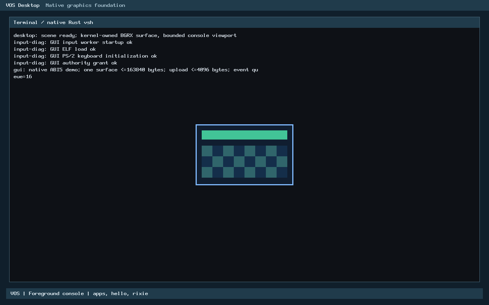

# USB.1 discovery: production Rust migration

Status: local verification completed for owner review. This branch is not
published or accepted. USB.1 remains opt-in, read-only, PCI bus 0, at most four
controllers; it does not operate an xHC or implement USB input.

Base: reviewed USB.2-A `8a7df0e1f2d1534df0fc5ef64ef8088e81a3c9a0`, above design
`2cd3bf3e7b7132fdfe6f5b643919916f39b465b3` and accepted main
`95eb0e0c944277a4ed9f3ad0e8671e25d2d9f6cd` (USB.1 PR #22).
Independent checkout: `/home/veasnawt/src/vos-usb1-rust`, branch
`feat/usb1-rust-migration`. Original USB, D1 and publication checkouts are preserved.

## USB.2-A publication review

[PR #23](https://github.com/veasnawt/vos/pull/23) publishes the unchanged USB.2-A
commit and its original design parent: 40 files against main, including the
39-file implementation inventory. Build smoke and Secret history audit passed.
It was merged externally during this task at
`86493ff2b2a8f2d84c4ce3ed4d0ccf132d97a072`; this agent did not merge it or
rewrite the migration's reviewed source parent.
[Publication review](usb1-rust-migration/usb2a-publication.json).

The 46 Rust tests import the real portable crate. Fresh checks passed all 46,
two Send/Sync compile-negative controls, the stale-handle mutation control,
freestanding/concrete code generation and kernel layout checks. Additional
`x86_64-unknown-none` compile-time assertions confirm Controller=424 bytes and
PermanentSnapshot=144 bytes, not just hosted layout measurements. These exclude
the modeled 16 KiB DMA, 4 KiB control and up to 8 KiB page-table resources, future
worker slot/stack, caller storage and compiler spills. The host fake is not
production memory. No live backend, MMIO, DMA allocation or activation is enabled.
Ownership, bounded cleanup and ring checks remain software contracts; neither
snapshots nor software request IDs authenticate hostile hardware or prove quiescence.

## Exact migration inventory and shared code

| Original C function/decision | Production replacement | Remaining C |
| --- | --- | --- |
| `outcome` | `discovery::Report::outcome`, typed Status/Reason | None |
| `xhci_class_matches` | `discovery::class_matches`; Rust defines original C symbol | None |
| `overlap` | `header::overlaps` | Test reference only |
| `xhci_decode_caps` | `Header::from_words`, `valid_structure`, `layout_end`, `discovery::decode_caps`; private Rust ABI wrapper | None |
| `xhci_probe`: qualification/BAR/extent/status/error decisions | `discovery::probe` with safe `ProbeIo` and private Rust callback adapter | No production decision implementation |
| Seven volatile capability reads and mapping-view validation | `vos_xhci_copy_caps` | 28-byte synchronous copy through the existing map callback |
| PCI scan/config reads, devmap check/map | Existing platform services, called through bounded callbacks | Existing PCI/devmap implementations |
| Boot option, scan limit, serial formatting and PCI readback | Existing `xhci_boot.c`, unchanged | Platform/diagnostic adapter, not a second validator |

[Original C](../../tests/reference/xhci-usb1.c) is byte-identical to accepted
main's `arch/x86_64/xhci.c`, SHA-256
`db5c0d6c01df786fc0588bcdb5a032dc57cd22731e447d3bfc2927e223b60866`.
It is compiled only under `reference_*` names in tests; never linked to VOS.
All five superseded production C functions above were removed from `xhci.c`.

The shared [header/layout module](../../kernel/rust/usb/xhci/header.rs) is used
by both [USB.1 discovery](../../kernel/rust/usb/xhci/discovery.rs) and
[USB.2-A capabilities](../../kernel/rust/usb/xhci/capabilities.rs). There is one
header field decoder and register-layout algorithm. USB.1 retains xHCI
1.0/1.1/1.2 and DWORD-aligned CAPLENGTH; USB.2-A still requires its stricter
activation profile, eight-byte alignment, supported protocol capabilities,
qualified aperture and platform facts. No operational policy is relaxed or
incorrectly imposed on read-only discovery. USB.1 has no ring logic to migrate.

The small [production subset entry](../../kernel/rust/usb/xhci/discovery_core.rs)
includes those exact shared source files. It excludes Controller, rings and
resource models from production. This uses the existing Rust kernel archive,
panic handler and higher-half compilation settings, not a second runtime.

## Production execution and FFI/security review

Actual call path:

`kernel.c -> xhci_boot_probe -> pci_scan_bus0/visit -> xhci_probe [Rust export]
-> discovery::probe -> shared Header validation -> copied snapshot adapter`.

[C boot call relocations](usb1-rust-migration/C-boot-call.txt),
[Rust object symbols](usb1-rust-migration/rust-symbols.txt) and
[C adapter disassembly](usb1-rust-migration/C-adapter.txt) establish linkage.
C no longer defines `xhci_probe`, `xhci_decode_caps` or `xhci_class_matches`.
Bounded QEMU execution traces contain an actual entry at the linked Rust probe
on [BIOS](usb1-rust-migration/bios-rust-probe-execution.txt) and
[UEFI](usb1-rust-migration/uefi-rust-probe-execution.txt), paired with successful
discovery and unchanged PCI command/BAR output. This is executed production code.

Portable modules forbid unsafe code. All seven new unsafe blocks are confined
to [the private ABI adapter](../../arch/x86_64/rust/xhci_discovery.rs): two trusted
callback calls, one copied-snapshot call, output borrowing, aligned copied-input
read, ops borrowing and output write. Three `no_mangle` attributes and the C
extern declaration are also explicit unsafe boundaries. The core contains no
raw device pointer. C retains seven volatile DWORD reads and map-view validation.

C/Rust compile-time checks agree on Info=104 bytes, alignment 8, Ops=40 bytes,
PCI address=3 bytes and key offsets; scalar status values remain 0/1/2/3.
Every defined output field, reason string and platform callback sequence is
differentially checked. Reason strings are static NUL-terminated read-only data.
Probe accepts an uninitialized writable output without reading it. Decode's
kernel-private contract requires initialized output and aligned copied RAM.
Valid pointer extent/lifetime and nonaliasing remain trusted C caller obligations:
null/alignment checks do not validate arbitrary pointers. Callbacks must not
mutate borrowed ops/output. No application ABI or authority is added.

No reset, ownership transfer, PCI configuration-data writes, BME changes, DMA,
interrupt registration, commands or USB transfers are introduced. Firmware's
existing command/BAR state is preserved, including pre-enabled BME. PCI mechanism
1 address selection remains the original platform operation. Mapping count,
cache policy and boot-lifetime retention remain unchanged: only the seven-word
header is read, never operational registers. Real MMIO may still stall or fault
on unsupported hardware; Rust metadata checks do not establish hardware safety.

## Focused verification and the preserved native failure

| Check | Observed result |
| --- | --- |
| Original USB.1 cases via production Rust | 45,713 assertions PASS; malformed input, BAR/map failures, scan bound and opt-in behavior |
| Independent original-C/actual-Rust differential | 40,110 probe/decode cases PASS in ASan/UBSan C harness and optimized builds; fields, reasons, operation sequences, unchanged input |
| USB.2-A regression | 46 tests PASS; 2 ownership compile-negative controls; stale-handle mutation detected as expected |
| R0 | 4,132 pairs plus 2 fixed ABI vectors PASS |
| R1 | 497,127 bounds cases, 283 ELF field/status/output comparisons, 2 deny-all controls PASS |
| Application ELF/static profiles | `make user-test` PASS through real Rust-backed checker |
| Existing keyboard/editor/diagnostics | PASS |
| Existing console handoff | 49,499 assertions PASS |
| Existing GUI bootstrap | 523 assertions PASS; C sanitizer harness models lifecycle, not native scheduler proof |
| Kernel | Strict five-load/W^X/page-tiled/below-4-MiB and Multiboot2 checks PASS |
| Rust object | No SIMD/FP, allocator, OS, GOT/TLS or unwind findings; only `panic` and `vos_xhci_copy_caps` unresolved before final link, none after |
| Module dependencies | Unchanged fixture does not rebuild; copied shared-module change rebuilds archive |

C sanitizers do not instrument Rust instructions. Rust checks compile with
warnings denied, overflow/debug checks in hosted tests and the existing
bare-metal code-generation contract. R0/R1 scalar function bytes are identical
to accepted main. The panic bridge's source and target contract are unchanged;
deliberate R0 panic/incorrect-result native campaigns were not repeated.
The reused portable harness's `production_kernel_inputs_changed=false` field
means that harness writes no production source; the migration itself deliberately
changes the production inputs described above.

The first [native run](usb1-rust-migration/native-original-failed.json) is **FAIL**:
five BIOS cases and two UEFI cases passed, then UEFI/no-controller timed out
at 35 seconds before any VOS kernel output. Its [serial log](usb1-rust-migration/failed-boot-serial.txt)
ends at OVMF's boot handoff. It is not relabeled as passing. An isolated
[diagnostic](usb1-rust-migration/boot-diagnostic.json) using identical media and
configuration reached the GUI in 13.853 seconds. That does not prove a timing
root cause; the incident remains unexplained.

An explicit [continuation](usb1-rust-migration/native-continuation.json) ran only
the three unfinished UEFI cases, with the same 35-second limit and assertions:
all passed. [Coverage reconciliation](usb1-rust-migration/native-coverage.json)
distinguishes seven reused passes, three continuation passes, the failed run and
the diagnostic. No arbitrary timeout increase or hidden automatic retry was used.
This transient pre-kernel incident is a remaining review concern.

The ten tested profiles cover ordinary option-off boot, xHCI discovery with an
attached but unsupported USB keyboard, no-controller behavior, and fail-closed
console/GUI authority with i8042 disabled. Normal profiles verify a/b/q, `apps`,
`hello`, Rixie greeting/exit, restored shell and GUI resource cleanup.
Two [capture sessions](usb1-rust-migration/captures.json) additionally verified
shell exit/reclamation, Rixie help and unchanged QMP PCI metadata with real Rust
execution traces. USB input remains unsupported; those sessions use PS/2.

## Memory and performance

[Measured layout/linkage](usb1-rust-migration/memory-and-linkage.json):

| Measurement | Accepted C discovery | Rust discovery |
| --- | ---: | ---: |
| Page-rounded physical kernel reservation | 843,776 bytes (824 KiB) | 847,872 bytes (828 KiB) |
| `.text`, page padded | 172,032 | 176,128 |
| `.rodata`, page padded | 45,056 | 45,056 |
| Writable initialized data, including boot data | 220 | 220 |
| BSS, including boot BSS | 618,304 | 618,304 |
| Existing C-facing Info / Ops | 104 / 40 | 104 / 40 |
| Additional persistent mappings, allocations or workers | 0 | 0 |

New safe Report=88 bytes and shared Header=40 bytes are temporary values, not
permanent allocations. Bare-metal size assertions pass. Compiler stack/spill
cost also exists; no full dynamic stack high-water claim is made. The final
Rust object is 3,889 text-class bytes including R0/R1 and reason strings, zero
data/BSS. USB.2's 424-byte Controller is not linked or allocated by USB.1.

Initial draft `unwrap()` calls unnecessarily pulled core panic formatting into
the non-GC kernel link, producing a 1,028,096-byte reservation and unwanted GOT
and formatting code. The initial build/log remains under `build/usb1-rust-1`;
it was never booted. Validating and retaining concrete callbacks removes that
dependency. A production subset excludes operational models; an in-place bounded
report and deliberate non-inlining avoid code expansion from output conversion.
No check was bypassed. The resulting increase is one 4 KiB page, not zero.

[Release samples](usb1-rust-migration/release-benchmark.json) use seven
alternating C/Rust pairs of 200,000 complete mocked probes, same input/callbacks,
optimized bare-metal Rust and original C with matching scalar/kernel flags.
ASan/UBSan timing is excluded. Host frequency/scheduling variation remains large.
The recorded medians are 96.174 ns C and 164.1595 ns Rust CPU time per mock call;
median **paired** CPU ratio is 1.406 (range 1.033-4.049). Thus this run measures
higher Rust-side cost, not a performance improvement. Those medians and paired
ratios differ because host conditions vary; no production latency percentage is
inferred. The [review](usb1-rust-migration/performance-review.json) attributes
additional software work to typed report/snapshot conversion and the C copy
boundary; disassembly guided the in-place correction. Earlier measurements are
retained, including the initial SIMD-capable C comparison that was unsuitable
for the final comparison. No faster sample was selected to conceal regression.
This is boot-only bounded discovery (at most four probes), not USB throughput or
actual MMIO latency; the measured cost and extra kernel page need owner review.

## Authentic visual evidence



[UEFI screenshot](../images/usb/vos-usb1-rust-uefi.png). These are actual running
QEMU captures after discovery and `a` input, not new GUI/USB capabilities.
Both firmware paths produce identical panel pixels; separate serial records,
launch commands, execution traces and PCI snapshots establish their provenance.

## Reproduction and ordinary preview

Use an installed Rust compiler with `x86_64-unknown-none` and the existing GCC,
binutils, GRUB, xorriso, QEMU/OVMF prerequisites. No installation/download or
legacy admission controller is required. Choose fresh output roots; no cleanup.

```sh
cd /home/veasnawt/src/vos-usb1-rust
export RUSTC="$HOME/.rustup/toolchains/nightly-2026-09-03-x86_64-unknown-linux-gnu/bin/rustc"
python3 -I -B scripts/test-xhci-core.py --rustc "$RUSTC" --out build/usb2a-recheck
python3 -I -B scripts/test-xhci-migration.py --rustc "$RUSTC" --out build/usb1-differential
make ARCH=x86_64 BUILD=build/usb1-check/kernel USER_BUILD=build/usb1-check/user \
  ELFCHECK=build/usb1-check/elfcheck RUSTC="$RUSTC" verify user-test
python3 -I -B scripts/test-usb-probe.py --output build/usb1-native \
  --rustc "$RUSTC" --grub-efi-dir "$GRUB_EFI_DIR"
```

Set `GRUB_EFI_DIR` to installed/unpacked x86_64-efi GRUB modules; the local
retained producer path is recorded in native evidence. Host ELF tools now discard
unreferenced USB sections so the shared archive does not require a device adapter
in an ELF checker. No application ABI/build output contract changed. R0's isolated
dependency fixture preserves relative module paths rather than copying one file.

Normal preview uses the retained migrated media, with no timed stress input:

```sh
qemu-system-x86_64 -machine q35 -accel tcg -m 128M -nic none -device qemu-xhci \
  -cdrom build/usb1-rust-1/native/probe-bios.iso -boot d -serial stdio -monitor none -no-reboot
```

For UEFI use `probe-uefi.iso` and add read-only OVMF_CODE plus a fresh private
copy of OVMF_VARS, as in the [existing preview procedure](usb1-rust-integration.md#reproduction-and-ordinary-preview).
Press a/b normally, q returns to vsh, then try apps/hello/rixie; exit returns
from Rixie. Do not disable i8042 or attach usb-kbd for normal usability testing.

## Preservation, review boundary and remaining work

[Exact changed files](usb1-rust-migration/changed-files.txt),
[manifest](usb1-rust-migration/manifest.json),
[preservation](usb1-rust-migration/preservation-final.json),
[protected audit](usb1-rust-migration/protected-audit.json) and
[resources](usb1-rust-migration/resources.json) record finalization.
All 49 protected entries (45 unique paths), historical phase records, 13 original
worktrees, two stashes, original five-file D1 draft and retained symlink are
preserved. No historical controller was executed, funding applied, reservation
retired, evidence overwritten or old checkout modified. Disk capacity was checked
for this separate checkout under the owner's ordinary development policy.

README/STATUS/ROADMAP were reviewed. Their dated USB.1 integration-candidate
wording predates accepted PR #22; this report records current ancestry without
rewriting historical results or claiming new milestone acceptance. Synchronizing
that public status belongs in the subsequent authorized migration publication
review. N6 remains incomplete and physical hardware remains unverified.

Remaining review concerns are the measured software-cost increase, one additional
kernel page and the preserved unexplained pre-kernel timeout. No functional
C/Rust discrepancy was found in the tested corpus. Passing tests are not proof
of zero bugs. USB.2-B/C have not begun: scoped MMIO leases, real PMM/worker
lifetimes, platform/address/cache qualification, rollback, CR3-safe reclamation
and a real quarantine owner remain prerequisites. No reset, DMA operation,
enumeration or HID work is authorized by this report. The migration branch must
not be pushed until its USB.2-A dependency is accepted and publication reviewed.
