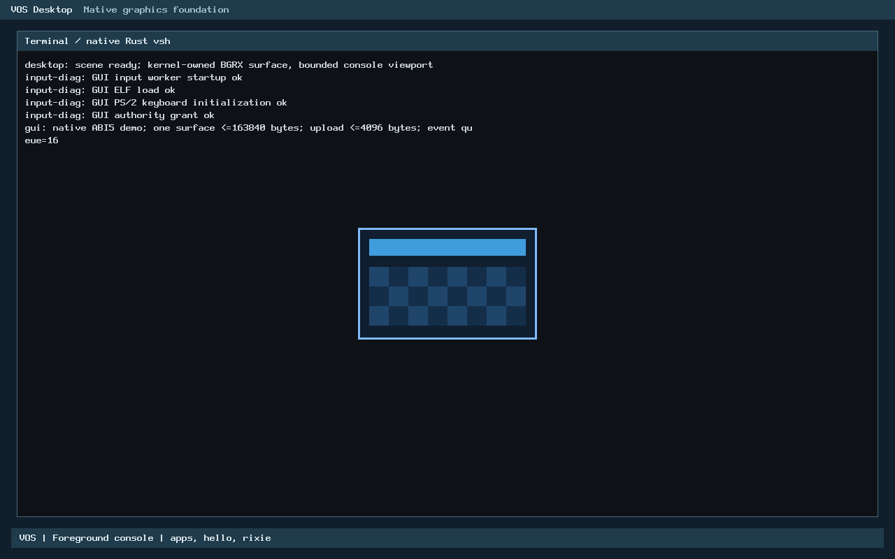

# USB.1 Rust migration: publication review

**READY FOR PR WITH DOCUMENTED LIMITATIONS.** No production correction or
optimization is justified by this review. The original migration remains intact.
Its extra page and higher synthetic software cost are explicit tradeoffs; no
material hardware/boot regression is established. The old timeout remains failed
evidence with unproven cause, not a retrospectively successful run.

## Source baseline and publication scope

- Accepted main: `86493ff2b2a8f2d84c4ce3ed4d0ccf132d97a072`, owner-merged USB.2-A
  [PR #23](https://github.com/veasnawt/vos/pull/23).
- Original migration: `4abe69f4ffb12997f3c9ede9ecb20f20f39a610b`, parent
  `8a7df0e1f2d1534df0fc5ef64ef8088e81a3c9a0`.
- Final reviewed source/tool head: `e7e657495c3773d6f6150bad9639e6913fd48eb4`.
  Subsequent publication documentation is a descendant, not a rewritten source
  commit. The final PR head is recorded by GitHub and the publication receipt.
- Branch/checkout: `feat/usb1-rust-migration`,
  `/home/veasnawt/src/vos-usb1-rust`. No migration PR existed at recovery.

Main's additional commit is a merge with a tree identical to `8a7df0e`. The
feature's merge base is that source parent; no rebase, cherry-pick or integration
merge is necessary. Its reviewed source is compatible with current main.
Publication includes [the exact branch inventory](usb1-rust-publication-review/changed-files.txt),
[follow-up inventory](usb1-rust-publication-review/review-changed-files.txt),
[hash manifest](usb1-rust-publication-review/manifest.json) and unchanged
[original migration report](usb1-rust-migration.md). The original 97-file commit,
its 96 non-self manifest entries, failure records and screenshots are preserved.

## Correctness, safety and ownership

Source review compared the [original C reference](../../tests/reference/xhci-usb1.c),
[safe discovery](../../kernel/rust/usb/xhci/discovery.rs),
[shared header/layout](../../kernel/rust/usb/xhci/header.rs),
[USB.2-A qualification](../../kernel/rust/usb/xhci/capabilities.rs) and
[private C ABI adapter](../../arch/x86_64/rust/xhci_discovery.rs).
No behavioral discrepancy was found in the reviewed contract or tested corpus.

USB.1 still matches class/subclass/prog-if `0c:03:30`, scans only bus 0, inspects
at most four matching endpoints, accepts assigned page-aligned 32/64-bit memory
BARs within physical width, requires existing memory decoding, maps/checks only
28 bytes and reads seven capability DWORDs. It preserves status 0/1/2/3,
reason text, mapping errors, early-return order and callback order. Offset
validation checks reserved bits, alignment, nonoverlap and extent below 64 MiB.
The decoder accepts interface versions 1.0/1.1/1.2 and DWORD CAPLENGTH alignment.
There is no vendor restriction on this read-only path.

USB.2-A retains its independent, narrower activation model: qualified QEMU
resource/platform facts, xHCI 1.0, eight-byte CAPLENGTH, <=16 ports, a 16 KiB
aperture and supported protocol metadata. Four new
[policy regressions](../../tests/rust/xhci-discovery-review.rs) pass: broader
USB.1 versions, alignment/ports and layout remain accepted while USB.2-A rejects
them; both reject a malformed overlapping layout. They execute the real shared
Rust modules, not a duplicate implementation. [Output](usb1-rust-publication-review/policy-tests.txt).

Production call path remains `kernel.c -> xhci_boot_probe -> visit -> xhci_probe`
(Rust export) `-> discovery::probe -> Header`. C owns platform PCI/devmap services,
serial formatting and the bounded volatile snapshot copy. Original relocation,
linked-object and actual BIOS/UEFI execution traces remain valid by unchanged
source/image identities. New native runs also observe correct discovery and
unchanged PCI command/BAR readback. A linked-but-unused Rust routine is not the
basis of this verdict.

FFI review confirms System V C signatures, nullable callback representation,
integer widths, enum values and checked layouts: Info=104 bytes/alignment 8,
Ops=40 bytes, PCI address=3 bytes. The Rust probe initializes output without
reading it. The compatibility decode entry requires initialized exclusive output
and nonaliasing copied input RAM. Pointer length/lifetime, callback/context
validity and nonaliasing remain trusted kernel-caller obligations; null/alignment
checks cannot validate arbitrary addresses. Current callers satisfy those
contracts. Static NUL-terminated reasons outlive their outputs. No application
pointer API or grant is added.

The seven new unsafe blocks remain confined to the already-reviewed FFI adapter;
portable modules forbid unsafe code. There are no new unsafe blocks in this
review. Neither C nor Rust performs controller writes, reset, ownership transfer,
DMA, commands, interrupts, rings, transfers or enumeration. PCI mechanism-1
address selection and pre-existing firmware BME state remain unchanged platform
behavior. Physical MMIO faults/stalls and hostile hardware are not contained by
safe Rust parsing; physical hardware is NOT TESTED.

## Performance investigation and decision

The original **1.406** is the median of seven paired CPU ratios for a single
positive mocked probe. It is not a production USB or language speed ratio. Its
baseline uses scalar kernel flags, but the host callbacks also perform trace
array writes, repeated checks and bookkeeping. It has no deliberate warm-up,
only one process, no affinity control and substantial host variability: paired
ratios 1.033-4.049. The separately calculated 96.174/164.1595 ns medians are not
the same statistic as the median paired ratio. Original samples remain unchanged.

[New measurement source](../../tests/bench/xhci-discovery.c) measures class
matching, standalone decoding and the complete exported probe with equivalent
RAM snapshot callbacks. It is an **isolated-operation/complete-mocked-probe
benchmark**, not a full discovery scan, real MMIO or representative boot-latency
measurement. Unlike the old callbacks, it contains no per-operation tracing.
Both implementations use the same eight-input corpus, function-call boundary,
output/checksum consumption and callback bodies. Equivalence is checked before
measurement; the differential suite checks all defined fields separately.

Method: three independent processes, child-only fixed CPU affinity, three 50,000
call warm-ups per implementation/operation/corpus, nine alternating-order pairs
per process, 300,000 calls per sample (27 pairs per table row). No LTO; cross-unit
calls and consumed checksums prevent elision. Both C and Rust are optimized at
level 2, x86-64 scalar/kernel/no-red-zone; the C baseline is the immutable accepted
source. C sanitizers are excluded from timings. `CLOCK_THREAD_CPUTIME_ID` and
`CLOCK_MONOTONIC_RAW` are both recorded. Timer overhead is amortized over batches,
not subtracted to manufacture an adjusted result. The host is WSL2/Hyper-V on
an i5-4570; Windows scheduling, frequency and VM behavior remain uncontrolled.
The existing archive uses rustc `1.100.0-nightly (2e2b193f8 2026-09-02)`, LLVM
23.1.1 and `x86_64-unknown-none`, as pinned in the original verification record.

| Operation/corpus | C median CPU ns/call | Rust median CPU ns/call | Median paired ratio |
| --- | ---: | ---: | ---: |
| Class / positive | 1.704 | 1.745 | 1.019 |
| Class / mixed | 1.832 | 1.785 | 1.008 |
| Decode / positive | 7.822 | 21.438 | 2.736 |
| Decode / mixed | 8.413 | 21.515 | 2.472 |
| Complete mock probe / positive | 38.277 | 57.842 | 1.499 |
| Complete mock probe / mixed | 31.895 | 51.243 | 1.609 |

All raw samples, minima/maxima, compiler identity and commands are in
[performance.json](usb1-rust-publication-review/performance.json) and the three
`performance-trial-*.jsonl` files. Distributions remain variable; e.g. positive
probe paired ratios 0.909-2.140. This result confirms extra software cost, not
equality or an intrinsic language comparison.

Disassembly explains relevant additional work: the private decoder wrapper
copies between the 104-byte C Info and 88-byte safe Report, then calls the shared
decoder. The C decoder updates its output directly. The complete Rust probe has
an additional typed copied-snapshot boundary and converts status/reason/output
representations. Symbol sizes are 370 bytes for the compatibility decoder wrapper,
381 for its Rust core, 1,085 for the probe wrapper, 757 for its core and 161 for
the snapshot adapter. Matching class code is essentially the same operation.
These observations identify concrete overhead, without assigning every measured
nanosecond to a single instruction or claiming isolated costs add exactly.

**Decision: retain the implementation.** The approximately 20 ns additional
mock CPU cost is reproducible, but this cold path runs at most four probes per
boot and includes no repeated controller service loop. Multiplying a mock cost
is not a hardware latency estimate. Production serial observations place USB
begin/end in the same 20 ms observation bin in most runs and cannot resolve a
nanosecond difference. Total boot variation is dominated by unisolated stages;
no material boot regression is demonstrated. Removing validation, broadening
unsafe aliasing or complicating the FFI merely to improve these numbers is not
justified. No optimization was applied and no before/after improvement is claimed.

## Exact footprint accounting

[ELF/map accounting](usb1-rust-publication-review/footprint.json) reuses verified
equivalent C and Rust kernel builds with unchanged linker/target contracts. The
test images' five loaded segments match these accounting images byte-for-byte.
The paired media also have byte-identical applications and GRUB configuration.

| Quantity | C | Rust | Delta |
| --- | ---: | ---: | ---: |
| ELF file bytes, including nonloaded metadata | 1,045,864 | 1,047,320 | +1,456 |
| Sum of PT_LOAD file bytes | 221,404 | 225,500 | +4,096 |
| PT_LOAD memory / physical reservation | 843,776 | 847,872 | +4,096 |
| Allocated `.text` input bytes | 170,611 | 172,051 | +1,440 |
| Text used extent including internal alignment | 171,482 | 172,973 | +1,491 |
| Page-padded `.text` | 172,032 | 176,128 | +4,096 |
| Page-padded `.rodata` | 45,056 | 45,056 | 0 |
| Writable initialized data including boot data | 220 | 220 | 0 |
| BSS including boot BSS | 618,304 | 618,304 | 0 |

The text increase is **1,440 bytes of input +51 bytes of changed internal
alignment +2,605 bytes of additional tail padding =4,096**. The last useful text
byte moves from `0xffffffff80130dd9` to `0xffffffff801313ac`, crossing the
original `0xffffffff80131000` boundary. Tail padding grows from 550 to 3,155
bytes. This preserves page-level executable separation; it is not disguised
logical accounting. Rounding a larger executable range requires one real page.

At object level, the old C `.text` is 1,488 bytes, the C adapter is 156 (-1,332),
and new Rust function inputs add 2,772 bytes over R0/R1, giving +1,440. Raw used
rodata grows 368 bytes, consuming existing padding without another page. Two
184-byte generated tables have different contents and roles: one targets code,
the other read-only strings. They are not interchangeable duplicate objects.
Removing either alone would save no physical page. No fragile table, wrapper,
linker-padding or whole-kernel-GC optimization was introduced.

File-size growth differs because C debug information shrinks while symbol/string
metadata changes. All section and segment deltas, symbols and raw map excerpts
are committed. Five PT_LOADs, W^X, page-tiled reservation and the 4 MiB physical
end limit pass the unchanged checker. Reserved range moves from
`0x100000..0x1ce000` to `0x100000..0x1cf000`; no extra writable static storage,
runtime allocations, mappings or workers are introduced. Temporary Report/Header
values are 88/40 bytes plus compiler spills; no full dynamic stack proof is claimed.

## UEFI timeout classification

The [original failed run](usb1-rust-migration/native-original-failed.json) and
[serial output](usb1-rust-migration/failed-boot-serial.txt) are unchanged. Its
35-second GUI deadline expired after OVMF logged `BdsDxe: starting`, before the
first VOS kernel output. QEMU was then terminated by its supervisor; that is not
a guest panic/exit or proof of a bootloader deadlock. The old logs cannot separate
firmware-to-loader handoff, GRUB loading, pre-first-message kernel entry or host
waiting/scheduling. They contain no evidence of reaching Rust discovery. The
original CODE/VARS seed hashes and continuous phase timestamps were not captured;
current hashes cannot retroactively establish those missing identities.

The new [fixed comparison](usb1-rust-publication-review/boot-comparison.json)
used unchanged 35-second gates, q35/TCG/128 MiB, the same OVMF CODE and fresh
private VARS seeds, no network/host disks, and paired accepted-C/migration media.
Actual extracted kernel/application/config identities were verified. The plan
specified four AB/BA no-controller UEFI pairs, then one BIOS and one UEFI
present-controller start per implementation: 12 starts, 12 PASS, no retries.

One migration/present run had ~2.026 seconds between observed USB completion and
GUI presentation. Four additional **predeclared** C/Rust/Rust/C present-controller
starts added phase markers: 4/4 PASS. Their USB-completion-to-GUI intervals were
approximately 40.6-61.0 ms. The earlier GUI delay was not reproduced and was after
the USB path had reported completion; its cause is not established either.
This bounded follow-up did not rerun failed cases until they passed.

Totals: eight starts per implementation; **seven UEFI +one BIOS each**, all pass.
UEFI GUI observations range 3.572-14.698 seconds for C and 4.024-12.289 seconds
for Rust. These sparse, noisy measurements establish successful observed boot
phases, not a population failure rate, precise USB timing or a reliability proof.
Raw serial, commands, exits and timestamps accompany the results. QEMU was alive
at acceptance and intentionally stopped afterward; supervisor exit codes are
reported separately from guest success. No timeouts or assertions were weakened.

**Classification: not reproduced under documented conditions; original causal
attribution remains INCONCLUSIVE.** No repeatable migration-specific failure or
kernel fault was found. Preserve the incident as a residual environment/early-boot
risk. It is not a publication blocker for this bounded QEMU prototype, but a
passing reproduction does not establish harmlessness or physical reliability.

## Changes, verification and acceptance gates

Follow-up `e7e657495c3773d6f6150bad9639e6913fd48eb4` adds only three focused
measurement scripts, one C benchmark and four Rust policy regressions. The
publication documentation commit adds this report/evidence and synchronizes
README/STATUS/ROADMAP with accepted PRs #22/#23 and this unaccepted migration.
No corrective production commit or new controller feature exists.

[Fresh/reused regression binding](usb1-rust-publication-review/regressions.json)
records source/archive/executable hashes and commands. Fresh execution of existing
verified binaries passes 45,713 USB.1 sanitizer assertions, 40,110 differential
cases, 46 portable tests, 4,134 R0 ABI vectors and 497,127 R1 bounds cases. The
stale-handle mutation exits 101 as expected, never counted as an implementation
failure. Two ownership compile-negative controls, 283 ELF/tool comparisons,
freestanding/object audit, ten reconciled original firmware cases and interactive
shell/hello/Rixie/cleanup captures are reused by exact unchanged source/input
identity. C sanitizers do not instrument Rust instructions. No unrelated stress
or historical campaign was repeated.

| Gate | Verdict | Evidence / scope |
| --- | --- | --- |
| A: USB.1 function/security | PASS | Original-C differential, original USB.1 sanitizer cases, source/FFI review and native readback; read-only/bounded contracts preserved |
| B: USB.2-A compatibility | PASS | 46 actual core tests, 4 new policy tests, unchanged-input ownership/mutation controls; no qualification-policy conflation |
| C: kernel/ABI/layout | PASS | R0/R1, unchanged application/ABI sources and loaded scalar functions, exact ELF/maps and unchanged five-load validator |
| D: firmware | PASS | 16 fixed new starts, original valid negative/default/interactive evidence; timeout cause separately INCONCLUSIVE |
| E: cost/footprint investigation | PASS | Equivalent-work distributions, explicit production relevance limits, exact extra-page reconciliation; tradeoffs retained and disclosed |
| F: repository preservation | PASS | [Final preservation audit](usb1-rust-publication-review/preservation.json), [manifest](usb1-rust-publication-review/manifest.json), exact inventories and original commit reachability |

No gate claims an unexecuted check passed. PASS on E means the cost is understood
within these measurement limits, not that Rust is faster or that boot impact has
been precisely quantified. GitHub CI is separate publication evidence, not a
replacement for the controller-specific tests.

## CI publication correction

Initial PR head `73fafe1dcff15e03944af6ef0e41d1934c99ad55` triggered a failed
[Secret history audit](https://github.com/veasnawt/vos/actions/runs/40502867276):
seven generic-api-key findings in the immutable original migration's failed-run
JSON. Independent inspection identifies the same public GRUB EFI module SHA-256
values already reviewed in the accepted USB.1 integration. Each was freshly
compared to the retained module bytes and prior review; none is a credential.

The [CI correction receipt](usb1-rust-publication-review/ci-secret-review.json)
preserves the failure and classification. Following the existing repository
convention, `.gitleaksignore` adds only seven exact original-commit/file/rule/line
fingerprints. There is no path, rule, global or future-commit exemption, no
historical edit, and no change to the pinned scanner/workflow or `--all` scan.
The retained checksum-verified Gitleaks 8.30.1 reports zero remaining findings.
A new independent synthetic commit with the same harmless digest at the same
path/rule/line still produces one finding (exit 1), verifying that the exception
does not cover future commits. No kernel/native test rerun is warranted by this
scanner-metadata correction. Required CI outcomes for the corrected head remain
separate publication evidence.

## Authentic visual evidence



[UEFI capture](../images/usb/review/vos-usb1-review-uefi.png) is paired with its
actual command, image digest and serial output in
[boot commands](usb1-rust-publication-review/boot-commands.json). These captures
show the unchanged native application after opt-in discovery, not USB HID or a
new graphical feature. The identical expected panel pixels are not evidence of
identical firmware; separate launch/serial provenance identifies each run.
No benchmark or ELF-summary mock screenshot was fabricated. Raw data and tables
are more useful for those investigations. Original interactive screenshots and
actual Rust execution traces remain in the migration report.

## Reproduction, preservation and limitations

Use the existing compiler and retained verified inputs, with fresh output roots:

```sh
cd /home/veasnawt/src/vos-usb1-rust
python3 -I -B scripts/review-usb1-performance.py \
  --archive build/usb1-rust-1/reviewed-kernel/rust/libvos_kernel.a \
  --out build/review-performance-reproduction
python3 -I -B scripts/review-usb1-footprint.py \
  --baseline /home/veasnawt/src/vos-usb2a/build/usb2a-1/kernel/vos.bin \
  --migration build/usb1-rust-1/reviewed-kernel/vos.bin \
  --out build/review-footprint-reproduction
python3 -I -B scripts/review-usb1-boot.py \
  --baseline /home/veasnawt/src/vos-usb1-integration/build/usb1-integration-1/usb \
  --migration build/usb1-rust-1/native --out build/review-boot-reproduction
```

Those maintainer-local paths are retained inputs, not artifacts shipped in Git.
For a fresh checkout, the [migration reproduction](usb1-rust-migration.md#reproduction-and-ordinary-preview)
and [original integration procedure](usb1-rust-integration.md#reproduction-and-ordinary-preview)
build equivalent inputs. No downloading, cleanup or physical-device operation is
part of these review scripts. Ordinary interactive preview commands remain in
the migration report; manual users need no timed stress inputs.

[Resource record](usb1-rust-publication-review/resources.json) distinguishes
ordinary physical disk capacity from untouched historical accounting. The review
planned at most 80 MiB of new output and reused kernels, archives and images;
no full rebuild or image duplication was needed. All protected entries, prior
failures, 13 original worktrees, two stashes, interrupted D1 draft and retained
symlink remain unchanged. No discontinued D1 admission/attestation, funding,
reservation retirement or storage-management operation ran. Recovery checkpoints
are in [progress.json](usb1-rust-publication-review/progress.json); live final
publication state is retained in `build/usb1-publication-review-1/progress.json`
and the PR, avoiding a self-referential commit hash inside its own tree.

Known defects: none established in this review. Tradeoffs: one extra physical
page and higher isolated mocked CPU cost. Unconfirmed hypotheses: historical
early-boot timeout and one late GUI observation may involve firmware, loader,
guest startup or host timing; no cause is claimed. Deferred work: real xHCI
operation, device enumeration and HID. Environmental limits: QEMU/OVMF/WSL,
small boot sample, coarse serial timestamps, no physical tests, no complete
dynamic stack high-water proof and no sanitizer instrumentation of Rust code.

**Publication recommendation: READY FOR PR WITH DOCUMENTED LIMITATIONS.**
No unresolved correctness/security or demonstrated material production regression
blocks review. Keep the original history and disclose the limitations. Required
GitHub checks must still finish successfully; do not enable auto-merge or merge.

For separately authorized USB.2-B, prioritize scoped MMIO leases and exact
resource ownership/lifetime/rollback contracts, using existing PCI/devmap/PMM
services. Avoid repeated C crossings or report conversions on future hot ring
paths; do not infer their performance from this cold probe benchmark. Preserve
platform qualification, kernel-CR3-safe reclamation and real quiescence/quarantine
requirements. This review implements none of USB.2-B/C, reset, DMA, enumeration,
HID or unrelated kernel work.
