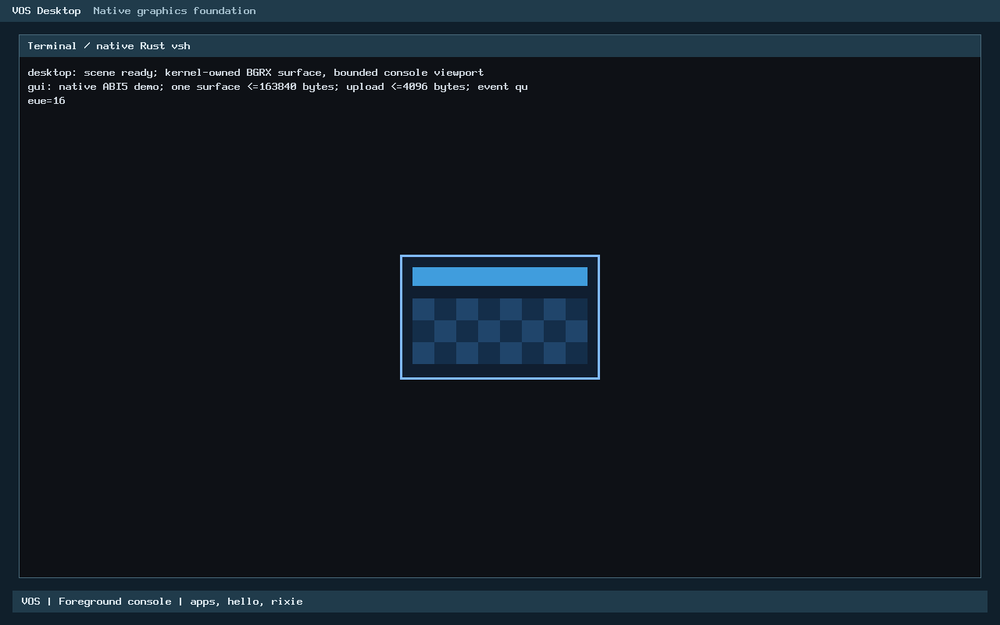

# USB.2-C3a.2: early UEFI firmware memory exclusion

**Verified for PR review, not accepted or merged.** On every UEFI boot, VOS now
removes EFI BootServicesCode/BootServicesData and every other non-RAM or
unclassified memory from the physical allocator **before `pmm_init`, so before
the first allocation**.

- **Why.** GRUB's Multiboot2 memory map (tag 6) reports boot-services memory as
  available. Firmware drivers nevertheless leave DMA engines pointing into it
  after ExitBootServices: OVMF's xHCI rings, and AHCI command-list and FIS areas
  with FIS receive still running. C3a.1 established this.
- **How the decision is made.** The decision is Rust: it parses, validates and
  classifies the EFI memory map (tag 17) against tag 6. C enters the resulting
  ranges into the existing reservation table, which `pmm_init` applies with its
  clear-only protect pass, so the EFI map can remove frames but never add any.
- **What is not changed.** There is no production opt-out and no release path.
  A UEFI boot without a valid EFI map is refused, and BIOS boots are unchanged.

**No device write.** No PCI configuration or controller register is written and
nothing is reset or published. Verification is QEMU-only; physical hardware is
NOT TESTED. C3b remains unauthorized.

- **Baseline:** accepted `main` at PR #29, `9c93d549678e37b4857e3a927971972583486983`.
- **Worktree:** `/home/veasnawt/src/vos-usb2c3a2`, branch `feat/usb2c3a2-efi-exclusion`.
- **Records:** [inventory](usb2c3a2-efi-exclusion/changed-files.txt),
  [hash manifest](usb2c3a2-efi-exclusion/manifest.json),
  [measurements](usb2c3a2-efi-exclusion/measurements.json),
  [budget](usb2c3a2-efi-exclusion/budget.json),
  [storage](usb2c3a2-efi-exclusion/storage.json),
  [preservation](usb2c3a2-efi-exclusion/preservation.json),
  [retained failures](usb2c3a2-efi-exclusion/history/failures.json).

## Gate 0: design validation (before implementation)

Recorded in [gate0.json](usb2c3a2-efi-exclusion/gate0/gate0.json):

1. **Baseline, Git and storage.**
   - `origin/main` equals the baseline.
   - All four existing worktrees are clean, with 0 stashes.
   - C: has 23.22 GB free, which is 1.75 GB above the 20 GiB reserve.
2. **C3a.1 conclusions reproduced** on the baseline kernel, observed through
   QEMU's gdbstub at the first `pmm_alloc_frame` call:
   - **UEFI:** all 9,765 BootServices frames in [1 MiB, 1 GiB) were allocatable.
     This includes the xHCI pages 0x674a000–0x674d000 and the armed AHCI pages
     0x6744000/0x6745000.
   - **BIOS:** the firmware pages are e820-reserved.
   - In both cases the PMM avail bitmap equalled an independent oracle, frame
     for frame.
3. **Tag format.** Tag 17 is laid out as type, size, `descriptor_size`, `descriptor_version`, then
   `(size − 16) / descriptor_size` EFI_MEMORY_DESCRIPTORs. Observed: 5,824 B,
   descriptor size 48, version 1, 121 descriptors, no remainder; sorted,
   non-overlapping, page-aligned, no zero-length entries. VOS's Multiboot2
   header requests only module alignment and a framebuffer, never EFI boot
   services, so GRUB calls ExitBootServices and passes the final map; no tag 18
   appears. After ExitBootServices, UEFI hands BootServicesCode/Data to the OS,
   which is exactly where the firmware DMA buffers live.
4. **Intersection.** Every tag-6 available byte in the window is covered by EFI
   Loader, Conventional or BootServices descriptors, and every BootServices
   descriptor lies inside tag-6 type 1. The root cause is that tag 6 merges
   BootServices memory into "available".
5. **Before the first allocation.** The first PMM allocation is `devmap_init`'s
   page directory, after `pmm_init`. Exclusions computed before `pmm_init` and
   applied by its protect pass are therefore active first, by construction.
   Calling the freestanding Rust archive that early needs no heap, PMM or new
   mapping, so **no boot-architecture change** is required.
6. **Other memory types.** Allowed are only LoaderCode, LoaderData and
   Conventional with EFI_MEMORY_WB and without RUNTIME/SP. Everything else that
   overlaps tag-6 RAM is excluded:
   - BootServices*, Reserved, RuntimeServices*, Unusable, ACPI*, MMIO*, PalCode,
     Persistent and Unaccepted (15);
   - any unknown or OEM type;
   - any tag-6 RAM that no allowed descriptor covers.

**Decision: GO.** Protection is enforceable before the first allocation.

## Architecture

| Layer | Responsibility |
| --- | --- |
| `kernel/rust/boot/efi_memory.rs` (portable, `forbid(unsafe_code)`, no allocation, panic-free) | `plan()` is the fail-closed policy. `EfiMap::parse` validates the tag type and size, descriptor size (40–1024, multiple of 8), version 1, count (1–512, no partial descriptor), page alignment and overflow (pages × 4 KiB and base + length). `MemoryMap::parse` validates tag 6. `exclusions()` sweeps the window [1 MiB, 1 GiB) boundary by boundary and emits, in ascending order, every part of tag-6 available RAM that is uncovered by an allowed descriptor or covered by any other descriptor. Overlaps and contradictions therefore resolve toward exclusion. With a bounded output capacity, the last range is widened (more excluded, never less). |
| `arch/x86_64/rust/efi_exclusion.rs` | The only `unsafe` code: two loader slices whose bounds C guarantees, one exclusive output report, and a synchronous C callback. Layouts of the 56-byte input and 32-byte report are asserted on both sides. |
| `arch/x86_64/efi_memory.{c,h}` | Builds the input from `boot_info` and adds each range with `resv_add` ("firmware memory (EFI)", page-rounded outward). Capacity is the free reservation-table entries. Also holds the error strings and the validated floor. |
| `bootinfo.{c,h}`, `multiboot2.h` | Records the first tag 17, the number of tag-17s, and tag 18. It does not interpret them. |
| `kernel.c` | Between `boot_reserve` and `pmm_init`: applied, BIOS, or refused (panic with the reason). After `pmm_init`, it panics if fewer than 2,048 usable frames remain on an applied boot. |

**`pmm.c` is unchanged.** Exclusions use the existing reservation path, whose
protect pass only clears availability bits; this is the "cannot expand"
guarantee at the allocator level. The PMM's own self-test oracle
(`selftest_pmm_kernel`) reads the same table.

### Fail-closed policy

| Loader evidence | Outcome |
| --- | --- |
| No EFI system-table tag, no tag 17 (legacy BIOS) | Not applicable: e820 protection only (unchanged) |
| Exactly one valid tag 17 (with or without a system-table tag) | Applied |
| EFI system table but no tag 17 | **Boot refused** ("UEFI without an EFI memory map") |
| More than one tag 17, tag 18 present, or any malformed tag 17/tag 6 | **Boot refused** with the specific reason |
| Reservation table has no free entry and exclusions exist | **Boot refused** |
| Fewer than 2,048 usable frames after exclusion | **Boot refused** ("usable memory below floor") |

## Memory availability and the floor

Exclusions are computed from each boot's own validated map; nothing is
hardcoded. Two OVMF layouts appeared in the matrix: 9,765 frames in 10 ranges
for normal boots, and 9,777 frames in 7 ranges with a virtio-blk disk attached.

The **floor was validated, not assumed**. A gdbstub write watchpoint on
`kernel_pmm.free` recorded every allocation and free across each boot, giving the
exact low-water mark:

| Workload | Peak frames in use |
| --- | ---: |
| Desktop, GUI demo, vsh, apps, hello, Rixie | **57** (BIOS and UEFI, baseline and C3a.2 alike) |
| Same with C2 DMA exercise (mode d) | 58 |
| Same plus virtio-blk storage (ls, cd, pwd, cat through ext2) | **95** |
| Refused conflict boot | 17 |

**Outcome:**
- The 2,048-frame (8 MiB) floor is **21×** the heaviest measured workload.
- It exceeds the fixed pools: GUI 40 frames, block cache 32, virtio-blk 6.
- After exclusion, UEFI keeps **20,713** usable frames (≈81 MiB of 119 MiB).
- The floor is adopted as boot policy on applied boots only, so BIOS behaviour
  is unchanged.

## Verification

| Gate | Result | Evidence |
| --- | --- | --- |
| 1–3. Pure Rust tests | **PASS: 9 tests.** Covered: the real OVMF/SeaBIOS fixtures; policy matrix; every malformed class (truncated, wrong type, size beyond bytes, descriptor size, version, empty, partial, >512, unaligned, overflowing add and multiply, tag-6 errors); overlap/contradiction/attribute cases (no WB, RUNTIME, SP, Unaccepted, OEM, Reserved, BS code, uncovered RAM); partial frames; capacity coalescing and its failure; window and sink errors. **300 randomized maps** are checked against an independent frame model: the result is always a subset of tag-6 RAM, never contains a frame that must be excluded, and keeps every other whole frame unless coalesced. | [c3a2-host](usb2c3a2-efi-exclusion/hosted/c3a2-host/result.json) |
| 7. Allocator-model negative control | **PASS.** Without exclusion, first-fit exhaustion reaches every xHCI/AHCI firmware page; with it, none. No live firmware buffer is touched. | `allocator_model_never_hands_out_excluded_frames` |
| 8. ASan/UBSan, mutation and compile-fail controls | **PASS.** 262,450 sanitized checks, using real `mb2_parse`/`boot_reserve`/`resv`/`pmm`/`efi_memory` C with the bare-metal Rust archive on Multiboot2 blocks built from the captured tags: exact exclusion against the model; allocate-until-exhausted never yields an excluded frame and `pmm_reserve_in` refuses them (the reference PMM hands all 9,765 out); SeaBIOS identical to e820-only; every refusal enters nothing; one free slot gives a widened superset and a full table refuses; conventional claims over reserved memory add nothing; direct ABI misuse. **3 compile-fail controls:** `EfiMap` and `MemoryMap` only from `parse` (E0451); no `Plan::Release` (E0599). **5 mutations, each detected:** BootServices allowed, uncovered RAM allowed, unchecked end, coalescing drops a range, missing map accepted. The link guard confirms no Rust `core`/`compiler_builtins` member. | [sanitizer](usb2c3a2-efi-exclusion/hosted/c3a2-host/sanitizer.txt) |
| 4. PMM bitmap before the first allocation and after the GUI | **PASS in all 17 boots.** At the gdbstub breakpoint on the first `pmm_alloc_frame`: PMM ready, free = usable, alloc bitmap all zero, and **the whole 262,144-frame avail bitmap equals the independent oracle**, which parses tags 6/17 from the dumped Multiboot2 block. After the shell exits: avail bitmap unchanged, no unavailable or excluded frame ever allocated. | per-case `result.json` |
| 5. UEFI firmware DMA memory | **PASS.** All BootServices frames are unallocatable from the first allocation. The xHCI DCBAA/command/event/ERST pages and the armed AHCI command-list/FIS pages, read through HMP, all have `avail=0`. Kernel exclusion ranges equal the oracle. | UEFI cases |
| 6. BIOS | **PASS.** No EFI map, no exclusion, avail bitmap equals the e820 oracle. The xHCI rings and the running AHCI port stay e820-reserved. Usable frames 31,929 (baseline 31,930: the kernel image grew one page). | BIOS cases |
| 9. Regressions | **PASS.** USB.2-C3a: 12 tests, 4 mutations, sanitizer. USB.2-C2: 9 tests, 6 compile-fail, 3 mutations, sanitizer. USB.2-C1: 17 tests, 2 mutations, 76 assertions. USB.2-B: 1,016 assertions. USB.1: 45,713 assertions. R1: 497,127 bounds cases and 283 validator files. R2-B: hosted differential plus native pointer matrix 4/4. USB.2-A 46/46 reused by source identity. Natively, the matrix covers C1 (q), C2 (d), USB.1 probe (p), the conflict refusal (c), unsupported/absent controllers, **storage** (virtio-blk + ext2 on both firmwares), GUI, vsh, apps, hello and Rixie. | [hosted](usb2c3a2-efi-exclusion/hosted), [regressions](usb2c3a2-efi-exclusion/regressions) |
| 10. Zero device writes | **PASS.** Traced after VOS's first serial byte: 0 xHCI MMIO writes, 0 xHCI configuration writes and 0 state events in every boot. 0 configuration writes of any kind except, in the two storage boots, the accepted N3 virtio-blk driver's writes to its own function (00:03.0 command register and virtio PCI-cfg window). Register snapshots equal the last firmware write. | `trace-analysis.json`, `reanalysis.json` |

### Native matrix (kernel-4, `--expect exclusion`)

Mode key:
- **n:** normal boot.
- **r:** guard.
- **q:** guard + C1.
- **d:** guard + C2.
- **p:** USB.1 probe.
- **c:** probe + guard; refused at boot.
- **+disk:** read-only accepted ext2 disk on virtio-blk.

| Case | Usable | Excluded (ranges) | BS allocatable | Peak | xHCI reads | Result |
| --- | ---: | --- | ---: | ---: | ---: | --- |
| bios-n / r / q / d / p / c | 31,929 | 0 | — | 57/57/57/58/57/17 | 0/127/145/127/7/0 | PASS |
| bios-r none / NEC / two xHCIs | 31,929 / 31,929 / 31,928 | 0 | — | 57 | 0 | PASS (refused) |
| bios-n +disk | 31,926 | 0 | — | 95 | 0 | PASS (run 2, re-analysed) |
| uefi-n / r / q / d / p / c | 20,713 | 9,765 (10) | **0** | 57/57/57/58/57/17 | 0/127/145/127/7/0 | PASS |
| uefi-n +disk | 20,701 | 9,777 (7) | **0** | 95 | 0 | PASS (run 2, re-analysed) |

### C3a residue guard compatibility

The guard is unchanged and remains safe. On UEFI it now **refuses**
("residue incomplete or controller unqualified; protected pages kept") instead
of reserving pages. The reason is that the firmware xHCI pages are already
unallocatable and outside usable RAM, so it classifies them as protected and
uninspected, exactly as on BIOS:
- `hazards=0` and nothing is reserved;
- integrity checks pass;
- mode reads are unchanged at 127 (and 145 with C1);
- its plan is no longer produced on UEFI.

Memory protection is now unconditional and prevention-based. **Restoring
contents inspection** for excluded pages, using C3a.1's separate "reuse-safe"
and "contents known" predicates, is **required before any C3b plan** and is not
part of this milestone.

### Screenshots

These are genuine running-VOS captures from the C3a.2 kernel, UEFI and BIOS
normal boots, with exclusion active on UEFI.

| | Desktop | Shell |
| --- | --- | --- |
| UEFI |  |  |
| BIOS |  |  |

## Resources

Measured against a kernel built from `9c93d54` with the same toolchain.

| Measure | Result | Ceiling |
| --- | ---: | ---: |
| Code + read-only data (input sections) | **3,944 B** (text 3,216, rodata 728) | 4,096 B |
| Permanent RW (`.data` + `.bss`) | **0 B** | 64 B |
| Loaded PT_LOAD growth, page-rounded | 4,096 B (code segment) | — |
| Largest new stack frame | 232 B (`vos_efi_exclusions_v1`); `boot_info` +16 B, report +32 B on `kernel_main` | — |
| Threads, heap, page tables, device writes | 0, 0, 0, 0 | 0 |
| Storage (build tree) | 544,526,336 B | 629,145,600 B (stop at 566,231,040) |

**By contributor:**
- **Rust:** 2,511 B text, no rodata.
- **`efi_memory.o`:** 231 B text and 112 B rodata.
- **`kernel.o`:** 394 B text and 568 B strings.
- **`bootinfo.o`:** 80 B text and 48 B rodata.

Three earlier candidates exceeded the ceiling (5,385, 4,785 and 4,219 B). They
were reduced without removing any validation; the ceiling was not raised.

## Retained failures

See [failures.json](usb2c3a2-efi-exclusion/history/failures.json). The runner
and test defects were each fixed, and only the affected cases were rerun:
- **Gate 0 baseline expectation:** the runner required OVMF pages to be
  unallocatable on the baseline kernel, where they are allocatable.
- **Kernel size:** kernel-1 to kernel-3 exceeded the ceiling.
- **Test compile error:** a borrow error in a test helper.
- **Storage key mapping:** QMP has no `.` qcode, so typing `cat welcome.txt`
  failed.
- **Storage trace predicate:** it was too strict for the accepted virtio-blk
  configuration writes. It was re-checked offline from the retained raw traces.

## Limitations and residual risks

1. **QEMU only** (q35, 128 MiB, OVMF 4M, SeaBIOS). Physical firmware is NOT
   TESTED. On physical systems, BootServices memory under 1 GiB may be much
   larger; the floor would then refuse rather than run unprotected.
2. **GRUB dependence.** A UEFI loader that omits tag 17, or that exits boot
   services differently, is refused (fail closed); no other loader is
   supported.
3. **Loader memory.** LoaderCode/LoaderData stay allocatable. This assumes GRUB
   uses no native DMA drivers; VOS images load only `efi_gop` and serial.
4. **Engines still armed.** Exclusion protects memory but does not stop the
   firmware's still-armed engines (OVMF AHCI FIS receive, bus mastering on all
   functions). VOS never programs those devices.
5. **No release path.** BootServices memory is never returned to the
   allocator. Releasing it would need a separately authorized all-bus-master
   quiescence proof.
6. **Guard on UEFI.** The C3a guard no longer produces a UEFI plan (above).
7. **No IOMMU/DMAR qualification.**
8. **Self-test builds not run.** The `VOS_TEST` self-test images were not
   booted. Their PMM oracle reads the same reservation table, so it would include
   the exclusions, but this is NOT TESTED here.

## Final safety decision

| Question | Answer |
| --- | --- |
| Is firmware DMA memory protected before PMM allocations? | **Yes (UEFI, QEMU-verified).** The exclusions enter the reservation table before `pmm_init`. A gdbstub snapshot at the first allocation shows every BootServices frame, including the xHCI and AHCI firmware DMA pages, unallocatable, with the whole bitmap equal to an independent oracle. |
| Do default UEFI boots enforce the exclusion? | **Yes.** It is unconditional, with no option, opt-out or release. A UEFI boot without a valid map is refused. |
| Does BIOS behaviour remain correct? | **Yes.** No exclusion; e820 protection only; bitmap equals the e820 oracle; firmware rings and the live AHCI port stay reserved. |
| Does the C3a residue guard remain compatible? | **Safe and compatible, with reduced capability.** It never reserves or reads excluded memory and reports no hazard, but on UEFI it now refuses instead of producing a plan. |
| Does uncertainty still block C3b? | **Yes.** C3b stays blocked until three things are in place: (a) the guard can inspect excluded firmware memory under split reuse-safe/contents-known predicates; (b) C3b's own halted-controller preconditions and refusal matrix are authorized and verified; (c) physical behaviour remains explicitly out of scope. This milestone does not authorize or begin C3b. |

## Reproduction

```sh
rustc="$HOME/.rustup/toolchains/nightly-2026-09-03-x86_64-unknown-linux-gnu/bin/rustc"
out=build/usb2c3a2-review
make ARCH=x86_64 BUILD=$out/kernel RUSTC="$rustc" verify
python3 -I -B scripts/test-usb2c3a2.py --archive $out/kernel/rust/libvos_kernel.a --rustc "$rustc" \
  --kernel-map $out/kernel/kernel.map --out $out/host
python3 -I -B scripts/test-usb2c3a2-native.py --kernel $out/kernel/vos.bin --expect exclusion \
  --apps <dir with verified vsh/hello/rixie/gui-demo ELFs> --efi <x86_64-efi GRUB modules> \
  --disk <read-only accepted ext2 disk> --out $out/native
```

- **Baseline mode.** `--expect baseline` with a pre-C3a.2 kernel reproduces the
  Gate 0 hazard evidence. The Gate 0 runs predate the runner's `--disk`
  storage cases and its refined trace predicate.
- **CI.** Build smoke runs `test-usb2c3a2.py`, with the link guard, after the
  C3a suite.
