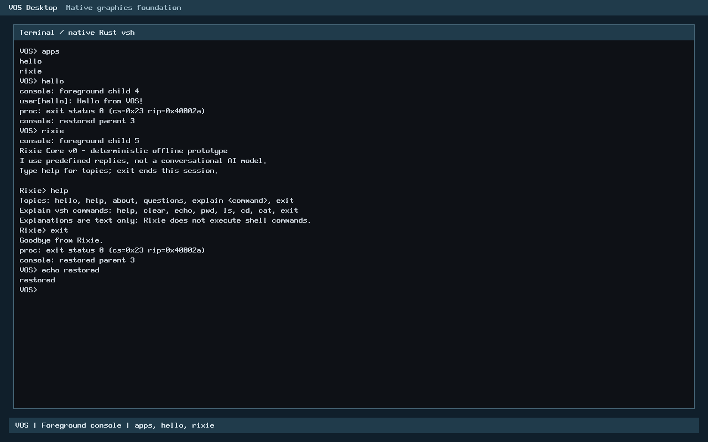

# USB.2-C3a.3: protected firmware DMA inspection

**Verified for PR review, not accepted or merged.** C3a.2 correctly removed
firmware-owned memory (EFI BootServices code and data) from the physical
allocator. That made the C3a residue guard refuse on UEFI, because it could no
longer tell excluded firmware RAM from any other unreadable memory. C3a.3
restores **bounded, read-only inspection** of that memory, in place, and keeps
two safety properties apart:

- **Reuse protection.** Every firmware page the guard discovers is unallocatable
  for the whole boot (reserved by the guard, excluded at boot, map-protected or
  untracked). The C3a.2 exclusion is unchanged and still unconditional.
- **Inspection completeness.** Every firmware ring and descriptor structure was
  bounded, read and validated.

**A successful inspection never implies that firmware memory is safe to
release.** There is no release path and no new allocation, reservation, mapping
or page table.

**No device write.** No PCI configuration or controller register is written;
nothing is reset, halted, started, masked or published. Verification is
QEMU-only (OVMF and SeaBIOS); physical hardware is NOT TESTED. C3b remains
unauthorized.

- **Baseline:** merged C3a.2, PR #30, `662a3ccb6d1111393c30c486ca4af657fac5808e`.
- **Worktree:** `/home/veasnawt/src/vos-usb2c3a3`, branch `feat/usb2c3a3-protected-inspection`.
- **Records:** [inventory](usb2c3a3-protected-inspection/changed-files.txt),
  [hash manifest](usb2c3a3-protected-inspection/manifest.json),
  [measurements](usb2c3a3-protected-inspection/measurements.json),
  [budget](usb2c3a3-protected-inspection/budget.json),
  [storage](usb2c3a3-protected-inspection/storage.json),
  [preservation](usb2c3a3-protected-inspection/preservation.json),
  [Gate 0](usb2c3a3-protected-inspection/gate0/gate0.json),
  [retained failures](usb2c3a3-protected-inspection/history/failures.json).

## Gate 0: baseline and safety review

1. **Baseline.** `origin/main` is `662a3cc` (this clone has no local `main`
   branch; the work starts from the fetched commit in a dedicated worktree).
   All five existing worktrees are clean at their recorded commits, with 0
   stashes. C: has 23.22 GB free, 1.75 GB above the 20 GiB reserve.
2. **Evidence integrity.** The C3a.2 manifest matches 263/263 files. The older C3a
   and C2 manifests differ only in shared source files later edited by merged
   milestones (workflow, README, STATUS, ROADMAP, `kernel.c`, `kernel_probe.rs`,
   `arch.mk`, `xhci/mod.rs`); no evidence file differs.
3. **Why the guard refuses excluded pages.** `xhci_residue_page()` classified
   every frame the PMM reports unavailable (`avail=0`) as "protected". The Rust
   walk maps `Protected` to `UNINSPECTED`, and `xhci_residue_read64()` allowed
   reads only inside frames in the guard's own reservation registry. After
   C3a.2 the OVMF ring pages are `avail=0`, so they looked identical to
   e820-reserved or non-RAM memory. That refusal was correct (fail closed), not a
   bug.
4. **Can a safe temporary read-only mapping inspect them?** It is not needed,
   and a new one would be worse.
   - **Existing mapping.** Every frame below 1 GiB is permanently mapped at
     `KERNEL_VMA + phys` by the kernel. `kmap_init` rebuilds that alias with W^X:
     2 MiB pages, present, writable, non-executable, PAT index 0 (write-back),
     except over the kernel image. Every excluded firmware page therefore
     already has exactly one mapping, and it is the one the guard, `pmm_alloc_frame`
     and the rest of the kernel use.
   - **A separate read-only mapping** needs a page table, which is a PMM
     allocation (forbidden here), or a RAM mapping through `devmap`. `devmap`
     refuses any range that touches RAM (`DEVMAP_ERAM`) and maps device memory
     uncached or write-combining only. A second alias of write-back RAM with
     another cache type is a coherency hazard, and it would add an alias instead
     of removing one.
   - **Decision:** reuse the existing alias through the guard's existing 8-byte
     volatile load, gated by a new frame class (below). The alias is writable by
     design and unchanged; "read-only" is enforced by the code path (no store
     exists in the guard or in the Rust `Memory` trait) and verified
     independently (page bytes and mappings are compared from outside).
5. **Mapping audit.**
   - **Lifetime:** permanent from boot; nothing is mapped or unmapped for
     inspection.
   - **Address validation:** the frame must pass the checks below before any
     load.
   - **Cache:** write-back. Firmware wrote the structures through the CPU and a
     coherent QEMU DMA path. Whether platform DMA is cache-coherent on real
     hardware is not established (see limitations).
   - **Failure cleanup:** there is none to do, because nothing is acquired. The
     only lease is C1's existing BAR lease, which is released as before.

**Decision: GO.** A safe design exists with no new mapping.

## Architecture

| Layer | Responsibility |
| --- | --- |
| `kernel/rust/usb/xhci/residue.rs` (canonical, safe, portable) | New `Page::Excluded` class: safe from reuse and readable, never reserved. The walk claims such a page by counting it (`excluded`), not by reserving it. `Outcome` gains two predicates. `reuse_protected()` holds when no frame was hazardous or exhausted; `inspection_complete()` holds when every structure was read and validated (it ignores the controller's run state, which `halted()` reports). `complete()` is unchanged. `Memory` still has no write and no release method. |
| `kernel/rust/boot/efi_memory.rs` (portable) | `firmware_frame(efi, ram, frame, lo, hi)`: true only for a page-aligned frame inside the window that touches no non-available tag-6 entry and is excluded, with no range boundary inside it, by the **same sweep** that computes the exclusions. |
| `arch/x86_64/rust/efi_exclusion.rs` | One new narrow export, `vos_efi_firmware_frame_v1`, over the existing validated input. The `unsafe` surface is not expanded: a shared `tags()` helper now holds the one slice construction, replacing a duplicate. |
| `arch/x86_64/efi_memory.{c,h}` | Reservation entries made by the exclusion carry one shared `efi_memory_what` object. `efi_memory_firmware_frame()` accepts a frame only if it lies wholly inside such an entry (compared by identity) **and** the Rust re-derivation from the EFI map agrees. Nothing else is trusted. |
| `arch/x86_64/xhci_qualify.{c,h}` | `xhci_residue_page()` returns the new class 5 for such frames. `xhci_residue_read64()` allows aligned 8-byte loads inside owned or class-5 frames. `kernel.c` passes the boot information and reservation table for the one guard session; they are dropped when it ends. The report gains `excluded` and `inspection` (bit 0 reuse protected, bit 1 inspection complete) and the guard prints both predicates. |

**Four independent conditions must hold before a page is read in place:**
1. It is a page-aligned frame inside [1 MiB, 1 GiB) with the PMM reporting `avail=0`.
2. It lies wholly inside a boot reservation entry created by the C3a.2 exclusion.
3. The Rust re-derivation from the validated EFI map confirms it is excluded tag-6 RAM.
4. No non-available tag-6 entry touches it.

Anything else stays "protected" and uninspected. This includes BIOS e820
reservations, pages that are partly reserved, a corrupted EFI map at guard time,
contradictory loader evidence, and the guard running without its boot inputs.

### Outcomes by situation

| Situation | `reuse_protected` | `inspection_complete` | Verdict |
| --- | --- | --- | --- |
| UEFI, residue in excluded RAM, walk clean | yes | yes | plan valid (dry run) |
| UEFI, some residue frames still free RAM | yes, after reserving them | yes | plan valid |
| UEFI, malformed ring or ERST inside excluded RAM | yes | **no** | refused |
| BIOS, residue in e820-reserved memory | yes (map-protected) | **no** | refused |
| A residue frame already allocated | **no** | no | refused (hazard) |
| Reservation registry exhausted | **no** | no | refused |
| Running controller, clean excluded residue | yes | yes | refused (not halted); `halted()` stays separate |
| No controller / unsupported controller | not run | not run | refused, no MMIO |

## Verification

| Gate | Result | Evidence |
| --- | --- | --- |
| 1–2. Pure Rust: range validation, pointer arithmetic, descriptor parsing, refusals, negative controls | **PASS.** Residue suite 17 tests (12 existing, 5 new): in-place inspection without reserving, excluded/free mixtures, malformed ERST/Link/ERDP content inside excluded RAM, six malformed or out-of-range pointer classes (width, above 1 GiB, wrapping address, map-protected neighbour, allocated neighbour, beyond RAM) that never read outside owned or excluded frames, and the separation of the two predicates. EFI suite 11 tests (9 existing, 2 new) on the captured OVMF map: `firmware_frame` equals an independent frame model on a deterministic sample across the window, and rejects partial RAM, unavailable overlaps, coalescing gaps, conventional RAM and bad windows. | [c3a-host](usb2c3a3-protected-inspection/hosted/c3a-host/result.json), [c3a2-host](usb2c3a3-protected-inspection/hosted/c3a2-host/result.json) |
| 8. ASan/UBSan, mutation and compile-fail controls | **PASS.** 7 hosted scenarios added to the real PMM/devmap/qualification/residue C: in-place inspection leaves PMM, registry and every firmware byte unchanged; no boot inputs; map-reserved but not EFI-excluded; excluded page touching reserved bytes; EFI map corrupted at guard time; excluded and free mixture; direct classification, read gating, BIOS view, contradictory loader evidence. The 262,450 EFI-exclusion checks are unchanged. **Mutations, all detected:** 7 in the guard suite (3 new: reserving excluded frames, reuse ignoring hazards, inspection ignoring uninspected pages) and 7 in the EFI suite (2 new: partial-RAM frames and ignored unavailable overlaps). **Compile-fail:** `Memory` has no `release` (E0599), alongside the existing write, `Run` and `Plan` controls. The link guard confirms no Rust `core` or `compiler_builtins` member. | [sanitizer](usb2c3a3-protected-inspection/hosted/c3a-host/sanitizer.txt) |
| 3. Protected pages stay excluded before and after | **PASS in every boot with a controller.** The runner stops the guest at the guard's entry and at `screen_init`, then reads the PMM bitmaps from outside. The avail and alloc bitmaps are identical across the guard, no frame is allocated, reserved or freed (free count 20,712 at entry and exit), and the avail bitmap is unchanged after the GUI and apps run. Excluded frames are never allocated. | `guard_window` in each `result.json` |
| 3b. No new or writable alias | **PASS.** The runner walks the live kernel page tables (read-only, through the gdbstub) and finds, for every firmware page, **exactly one mapping**: the existing kernel alias, writable, non-executable, write-back. This holds at guard entry, at guard exit and after the GUI run. The alias is writable by design; it is unchanged. | `guard_window.*.mappings` |
| 3c. Firmware bytes untouched | **PASS.** SHA-256 of every ring and descriptor page is identical at guard entry, at guard exit and after the GUI run. | `guard_window.*.sha256` |
| 4. BIOS and UEFI regression boots | **PASS 17/17, first attempt** (table below). | [native](usb2c3a3-protected-inspection/native/result.json) |
| 5. C3a guard compatibility and refusal paths | **PASS.** The C3a hosted suite (all 11 original scenarios plus the 7 new) and the native refusals: BIOS residue, no controller, NEC controller, two controllers, and the probe + guard conflict. | native and hosted results |
| 6. No xHCI or PCI configuration writes | **PASS.** After VOS's first serial byte: 0 xHCI MMIO writes, 0 xHCI configuration writes, 0 state events in all 17 boots. 0 configuration writes of any kind except the accepted N3 virtio-blk driver's writes to its own function in the two storage boots. Guard reads (127, or 145 with C1) are unchanged from C3a. | `trace-analysis.json` |
| 7. Memory and size | **PASS** (Resources). | [measurements](usb2c3a3-protected-inspection/measurements.json) |
| 8b. Existing regressions | **PASS.** USB.2-C3a, C2 (9 tests, 6 compile-fail, 3 mutations, sanitizer), C1 (17 tests, 2 mutations, 76 assertions), USB.2-B (1,016 assertions), USB.1 (45,713 assertions), R1 (497,127 bounds cases, 283 validator files), R2-B hosted differential plus the native pointer matrix 4/4. Natively: C1 (q), C2 (d), USB.1 probe (p), storage (virtio-blk + ext2 on both firmwares), GUI, vsh, apps, hello and Rixie. **USB.2-A: only its 46 host tests were run** (PASS); see failures. | [hosted](usb2c3a3-protected-inspection/hosted), [regressions](usb2c3a3-protected-inspection/regressions) |
| 9. Screenshots and evidence | **PASS.** | below |

### Native matrix (kernel-2, `--expect inspection`)

Mode key:
- **n:** normal boot.
- **r:** guard.
- **q:** guard + C1.
- **d:** guard + C2.
- **p:** USB.1 probe.
- **c:** probe + guard; refused at boot.
- **+disk:** read-only accepted ext2 disk on virtio-blk.

`excluded` is how many frames the guard read in place; `inspection` is bit 0 reuse
protected, bit 1 inspection complete. Peak is the most frames in use at any
moment, from a write watchpoint on the PMM free counter.

| Case | Usable | Verdict | excluded / inspection | Reserved | Peak | xHCI reads |
| --- | ---: | --- | --- | ---: | ---: | ---: |
| uefi-r | 20,713 | **PLAN VALID** (dry run) | 7 / `0x3` | **0** | 57 | 127 |
| uefi-q (guard + C1) | 20,713 | PLAN VALID | 7 / `0x3` | 0 | 57 | 145 |
| uefi-d (guard + C2) | 20,713 | PLAN VALID | 7 / `0x3` | 0 | 58 | 127 |
| uefi-n, p, c, n+disk | 20,713 / 20,713 / 20,713 / 20,701 | (no guard / probe / conflict refused) | — | 0 | 57 / 57 / 17 / 95 | 0 / 7 / 0 / 0 |
| bios-r, q, d | 31,929 | REFUSED (residue map-protected, uninspected) | 0 / `0x1` | 0 | 57 / 57 / 58 | 127 / 145 / 127 |
| bios-n, p, c, n+disk | 31,929 / 31,929 / 31,929 / 31,926 | (no guard / probe / conflict refused) | — | 0 | 57 / 57 / 17 / 95 | 0 / 7 / 0 / 0 |
| bios-r: no xHCI, NEC, two xHCIs | 31,929 / 31,929 / 31,928 | REFUSED (no MMIO) | 0 / `0x0` (not run) | 0 | 57 | 0 |

In every UEFI guard boot, the guard prints `reuse_protected=1
inspection_complete=1; firmware memory is never released`; on BIOS, `reuse_protected=1
inspection_complete=0`. The oracle checks from C3a.2 still hold in all boots: the
avail bitmap equals the independent prediction at the first allocation, 9,765
BootServices frames are unallocatable on UEFI (9,777 with a disk), and the
firmware xHCI and armed AHCI pages are unallocatable.

### Screenshots

Genuine running-VOS captures from this kernel's **normal boots** (the runner
captures at mode n). They show the same desktop and shell that the guard boots
reach; the guard itself is serial output, not a screen.

| | Desktop | Shell |
| --- | --- | --- |
| UEFI |  |  |
| BIOS |  |  |

## Resources

Measured against C3a.2's kernel with the same toolchain. The ceilings are the
existing guardrails; the work fit inside them, so no additional budget was
proposed.

| Measure | Result | Ceiling |
| --- | ---: | ---: |
| Code + read-only data (input sections) | **1,631 B** (text 1,469, rodata 162) | 4,096 B |
| Permanent RW | **16 B** (`.bss`: two registry pointers) | 64 B |
| Largest stack frame | 440 B Rust, 448 B C (`xhci_residue_boot`, +16 B) | 512 B |
| Loaded PT_LOAD growth, page-rounded | 4,096 B (code segment) | — |
| Threads, heap, page tables, DMA allocations, device writes | 0, 0, 0, 0, 0 | 0 |
| Storage (build tree) | 546,701,312 B | 629,145,600 B (stop at 566,231,040) |
| Windows C: headroom above the 20 GiB reserve | 1.75 GB | ≥ 0 |

By contributor: Rust 949 B text, `efi_memory.o` 336 B, `xhci_qualify.o` 168 B,
`kernel.o` 16 B text and 68 B strings.

## Retained failures

See [failures.json](usb2c3a3-protected-inspection/history/failures.json).
- **One mutation control was not detected on the first candidate.** It targeted
  a check that was redundant with the probe-boundary logic. The redundant
  production check was removed, which shrank the kernel from 1,806 B to 1,631 B,
  and the mutation was re-targeted at the surviving condition.
- **One test expectation of mine was wrong,** in a scratch pre-run.
- **USB.2-A's full script was not rerun,** because its roughly 23 MB output would
  have crossed the 90% storage stop. Its 46 host tests ran against the changed
  tree and pass; its mutation controls, freestanding builds and benchmark are
  NOT rerun.

## Limitations and residual risks

1. **QEMU only** (q35, 128 MiB, OVMF 4M, SeaBIOS). Physical firmware and
   hardware are NOT TESTED.
2. **The inspection reads through a writable alias.** The kernel's permanent
   alias of low memory is writable, non-executable and write-back, and C3a.3
   neither creates nor changes it. The guard has no store path, and bytes were
   verified unchanged from outside, but the property "read-only" is enforced by
   code, not by the page tables. Making the page tables read-only would need a
   new mapping, which was ruled out.
3. **Cache coherency.** The alias is write-back. QEMU's DMA is coherent;
   no-snoop DMA or non-coherent platforms are not covered.
4. **A point-in-time read.** The structures are read once while the controller
   is observed halted. A firmware or DMA engine could change them afterwards;
   inspection says nothing about later state.
5. **BIOS residue is still not inspectable.** SeaBIOS's rings are in
   e820-reserved memory. The guard cannot prove such memory is plain RAM, so it
   stays protected and uninspected, and the plan is refused. This is
   deliberately fail closed.
6. **Armed engines.** Neither C3a.2 nor C3a.3 stops anything. OVMF leaves bus
   mastering on for all functions and AHCI FIS receive running on five ports; their
   memory is excluded, but the engines run.
7. **Device contexts and scratchpads** still leave the assessment incomplete,
   because their transfer rings and buffers are not bounded.
8. **No IOMMU/DMAR qualification**, and no release path for any excluded page.
9. **`VOS_TEST` self-test images were not booted.**
10. **Opt-in.** The guard still runs only with `vos.usb2-residue=1`.

## C3b GO/NO-GO assessment

**Decision: CONDITIONAL GO**, for a QEMU-only, UEFI-only C3b, if it is separately
authorized. C3b stays unauthorized regardless of this result, and nothing here
begins it.

| Question | Assessment |
| --- | --- |
| **Firmware-memory ownership** | **Sound on UEFI/QEMU.** Boot-services memory is excluded before the first allocation, with no release path. Observed bitmaps and independent oracles agree in 17 boots. On BIOS, the firmware pages are e820-reserved, so they are unallocatable but their ownership is by map, not by inspection. |
| **Inspection completeness** | **Complete on UEFI/QEMU** (7 page claims, 0 findings). **Not available on BIOS** (map-protected, uninspected). Under the "inspection must not rest on the controller looking halted" rule, a C3b write gate should require `inspection_complete`, which makes BIOS refuse by construction. |
| **Controller state** | The guard reads `USBCMD`/`USBSTS` once in the C1 lease, and C1 double-observes them. C3b must re-observe `HCH=1`, `R/S=0` and `CNR=0` immediately before each write, in the same lease as a fresh inspection, because C3a.3's read is point-in-time. A running controller is out of scope and must be refused. |
| **Bus mastering** | Firmware leaves it on for every function. Clearing the xHCI's bit is a PCI configuration write, the first write in this line of work. It is the intended C3b action, but it is a new class of effect. It needs exact trace attribution (the only write is the xHCI's command register) and a read-back. A failure must leave bus mastering off and never re-enable it. |
| **AHCI residual DMA** | Unaffected by an xHCI-only C3b. AHCI FIS receive stays armed on OVMF. Its command-list and FIS memory is excluded and never freed, so a device-to-host FIS lands in memory VOS never uses. The risk is to the memory-ownership invariant, not to VOS data, **provided the exclusion stays in place**. C3b must not release excluded memory or program AHCI. Quiescing AHCI is a separate decision. |
| **Limits of QEMU-only evidence** | QEMU's xHCI is a software model: no legacy SMI ownership, no real HCRST timing, coherent DMA, no IOMMU. A UEFI/QEMU pass says nothing about physical controllers, and physical takeover remains unauthorized. |

**Conditions I recommend attaching to any C3b authorization:**
1. It consumes the guard's two predicates; writes are allowed only when `reuse_protected` and `inspection_complete` hold, the controller was just seen halted, and C1 qualified a single qemu-xhci.
2. The permitted writes are listed up front (xHCI PCI command bus-master clear, then the dry-run plan's mask, reset and verify steps). The trace analyzer checks that exactly those, and no others, occur after the VOS boundary.
3. Fail-closed rollback: the failure state is bus mastering off, and nothing is re-enabled, re-armed or released.
4. Negative controls: a running-controller fixture, malformed rings in excluded memory, BIOS, no and unsupported controllers, and a forced timeout in the reset wait.
5. The exclusion must stay unconditional and the page-table mappings of excluded pages must be re-verified unchanged after the writes.
6. Budgets are proposed with measurements before implementation.

**NO-GO conditions** (any one blocks C3b): a hazard or exhausted registry; a
non-halted or unqualified controller; incomplete inspection; any need for a
physical-hardware assumption; or evidence that excluded pages were reused or
gained a new alias.

## Reproduction

```sh
rustc="$HOME/.rustup/toolchains/nightly-2026-09-03-x86_64-unknown-linux-gnu/bin/rustc"
out=build/usb2c3a3-review
make ARCH=x86_64 BUILD=$out/kernel RUSTC="$rustc" verify
for t in test-usb2c3a test-usb2c3a2; do
  python3 -I -B scripts/$t.py --archive $out/kernel/rust/libvos_kernel.a --rustc "$rustc" \
    --kernel-map $out/kernel/kernel.map --out $out/$t
done
python3 -I -B scripts/test-usb2c3a2-native.py --kernel $out/kernel/vos.bin --expect inspection \
  --apps <dir with verified vsh/hello/rixie/gui-demo ELFs> --efi <x86_64-efi GRUB modules> \
  --disk <read-only accepted ext2 disk> --out $out/native
```

`--expect inspection` adds the guard-window observations (PMM bitmaps, firmware
page hashes and a page-table walk at the guard's entry and exit). The
`baseline` and `exclusion` modes of the same runner reproduce the C3a.1 hazard
and the C3a.2 results. Build smoke CI runs both hosted suites, with the link
guard.
