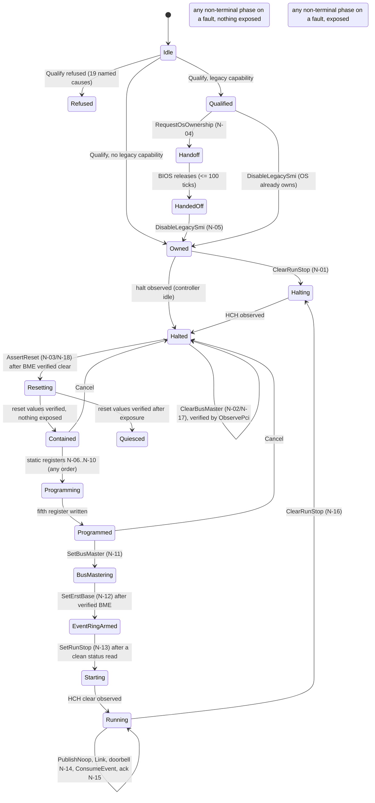

# USB.2-C4.1: hosted Rust xHCI initialization protocol model

Status: verified on the host for PR review; not merged. **Hosted only**: the model is a pure Rust state machine
under `kernel/rust/usb/xhci_init/` that no kernel source, Makefile, linker input or ISO references. It reads no PCI
configuration space, touches no MMIO, dereferences no physical address, enables no bus mastering, creates no DMA
ring and enumerates no device. Register writes exist only as `ModelEvent` values returned to a test. Nothing here
is evidence about physical xHCI hardware. Base: `03e7532aba739c636438c887e8aa9d6169f4cfcb` (C3b.2, PR #33).
Evidence: [`usb2c41-hosted-init-model/`](usb2c41-hosted-init-model/).

## 1. Result

| Gate | Result |
| --- | --- |
| Rust tests (`tests/rust/xhci_init_model.rs`) | 48 passed; every one of 64 rules and 106 reasons exercised |
| Independent Python oracle (`scripts/xhci_init_oracle.py`) | 600 traces, 156,000 steps (19,757 accepted, 136,243 refused), 0 disagreements |
| Oracle corruption controls | 5 of 5 corrupted traces detected (reason, rule, write value, terminal cause, transition target) |
| Mutation controls | 94 of 94 mutants killed by the Rust tests; 47 of them independently by the oracle; 0 survivors, 0 invalid |
| Compile-fail controls | 4 of 4 (old `Program` action gone, state unforgeable, no raw register write, `unsafe` rejected) |
| Production isolation | no kernel, build or ISO input mentions the model; production kernel built from this tree has the same loaded image as C3b.2 |
| Wall time of the full gate | 104.9 s (CI uses the same script) |

**Verdict: CONDITIONAL GO for merging C4.1**, conditions in section 13. It is a model: it grants no authority to
write a register, enable bus mastering or run on any controller.

## 2. Baseline and preservation

PR #33 merged as `03e7532` (`origin/main`); its tree equals the verified PR head `59fb080`. `git fsck` clean, no
stashes, 8 worktrees all clean. The C4 Gate 0 report and `SHA256SUMS` verified before starting and not modified. All 733
C3b.2 evidence hashes re-verified. Development used a separate worktree (`vos-usb2c41`, branch
`feat/usb2c41-hosted-init-model`). No historical build tree, evidence file or other worktree was modified, deleted,
pruned or moved. The diff against `origin/main` touches nothing under `arch/`, the `Makefile`, `kernel/rust/usb/xhci/`,
`kernel/rust/boot/` or any build input; it adds the model, its tests, scripts, evidence, a CI step and documentation.

## 3. Architecture

The model is a state machine over typed operations. `Machine::apply(Operation)` either **accepts** (returns the
transition, exactly one named `Rule` that justifies it and, for a register write, the `ModelEvent`) or **refuses**
with a named `Reason`, leaving every field unchanged (asserted on every refusal in every test). Faults and expired
deadlines are accepted transitions into a terminal phase: `Failed` if nothing was ever exposed to the device,
`Quarantined` otherwise (exposed = a published DMA page, or a bus master this protocol enabled).



Ordering that the machine enforces (xHCI 1.2 §4.2, §4.9.3, §4.9.4, §4.21.2, §4.22.1): ownership, halt, BME clear
(read back), HCRST (wait CNR clear, verify reset values), static registers, BME set (read back), **ERSTBA**, a clean
status read, R/S, then No-Op commands with one outstanding command, Link TRB and cycle toggling, bounded polling, ERDP
acknowledgments with EHB. ERSTBA follows BME because QEMU 10.2.1 reads the ERST inside that write (section 7).

### Typed operation inventory (34 operations)

`Action::Program` is gone (compile-fail control `old-broad-program-action-is-gone`); there is no raw register-write
operation (control `registers-have-no-raw-write`).

| Class | Operations |
| --- | --- |
| Observation and time | `Qualify(Facts)`, `Tick`, `ObserveHandoff`, `ObserveStatus`, `ObserveReset`, `ObservePci`, `ObservePorts`, `ConsumeEvent(Option<EventTrb>)` |
| Host DMA pages | `DmaAllocate`, `DmaZero`, `PrepareCommandRing`, `PrepareEventRing`, `PrepareDcbaa{entry0}`, `PrepareErst{segment,size}`, `DmaRelease` |
| Device writes, each a model event with a Gate 0 inventory id | `RequestOsOwnership` N-04, `DisableLegacySmi` N-05, `ClearRunStop` N-01/N-16, `ClearBusMaster` N-02/N-17, `AssertReset` N-03/N-18, `SetMaxSlots` N-06, `SetDcbaap` N-07, `SetCommandRing` N-08, `SetErstSize` N-09, `SetEventDequeue` N-10 (init) / N-15 (acknowledge, sets EHB), `SetBusMaster` N-11, `SetErstBase` N-12, `SetRunStop` N-13, `RingCommandDoorbell` N-14 |
| Ring staging and control | `PublishNoop`, `PublishLink`, `BeginPollStep`, `Cancel` |
| Always refused by name | `Forbidden(InterruptEnable | PortWrite | SlotDoorbell | Command)` |

The test `the_write_inventory_is_exactly_n01_to_n18_and_in_order` proves a complete session emits exactly N-01..N-18
in the Gate 0 order with the Gate 0 widths and values.

### DMA ownership

```mermaid
stateDiagram-v2
    [*] --> Free
    Free --> Allocated: DmaAllocate (4 KiB aligned, >= 1 MiB, < limit, no overlap)
    Allocated --> Zeroed: DmaZero
    Zeroed --> Prepared: Prepare* (entry 0 = 0, ERST names the event ring, 256 TRBs)
    Prepared --> Published: the pointer register write that discloses its address
    Allocated --> Free: DmaRelease (unpublished only)
    Zeroed --> Free: DmaRelease
    Prepared --> Free: DmaRelease
    Published --> Free: DmaRelease only in Quiesced and only if the release policy allows
    Published --> Published: Failed/Quarantined never release; physical policy "never" retains forever
```

Any published page, or any bus master this protocol enabled, makes the device *exposed*; allocation then closes.
`ReleasePolicy::Never` models the Gate 0 physical rule (bounded retention even after a valid quiescence).

### Quarantine

A quarantined controller gets one fixed containment tail and nothing else: if the protocol set R/S, clear R/S; observe
halt; clear BME; observe BME. R/S written by the protocol outranks any earlier "halted" read, because the controller
may still be about to start (a defect found during development, section 8).

## 4. Interpretation limits (read before trusting the guarantees)

The machine acts on what it is told. **A protocol cannot be safe against false observations**: if `ObserveStatus`
claims `HCH=1` while the controller runs, the machine will clear BME early. The device-safety property is therefore
proved only for truthful observations (the walker has a truthful mode and a lying mode; lying mode checks state
invariants only). A future backend's reads are the trust boundary.

## 5. Specification and QEMU distinctions

Primary reference: xHCI 1.2 (May 2019, 645 pp.), the same text used by the C3b.2 Gate 0 (hash unchanged). Section
numbers cited in the source are from that document.

| Topic | xHCI 1.2 | QEMU 10.2.1 (`hcd-xhci.c`) | Model |
| --- | --- | --- | --- |
| ERST fetch | not stated; the xHC "may prefetch" later entries | inside the ERSTBA-**high** write (`xhci_er_reset`); BME clear gives HCE; ERSTSZ must be 1; segment size 16..4096 | protocol requires verified BME before ERSTBA under *both* fetch timings; the hosted device implements QEMU's timing and an alternate "fetch at Run" timing, and the property tests run both |
| Reset | asynchronous; CNR must clear before register writes | synchronous, CNR never set | device supports delay; `ObserveReset(cnr)` keeps the machine in `Resetting` |
| Doorbell while halted | undefined | silently ignored | device counts a violation; the machine never rings while not running |
| Scratchpads | HCSPARAMS2 declares them; required before R/S | always 0 | `ScratchpadsRequired` refusal; DCBAA entry 0 must be 0 |
| USBLEGSUP / DbC | present on many controllers; DbC may survive reset | absent | handoff modelled and tested in the hosted device only; `Dbc::Enabled/Unknown` refuse |
| ERDP | write next TRB address, EHB=1 clears Event Handler Busy; never the same value twice | ERDP outside the ring raises HCE | enforced and violation-checked |
| MFINDEX wrap events | only with USBCMD.EWE | same | EWE is never written; type-39 events would be a named fault |

Unresolved states stay unresolved: `Tri::Unknown` (IOMMU, identity DMA, Enable No Snoop) and `Dbc::Unknown` each have a
distinct named refusal, and there is no profile for which unknown means yes. Only the QEMU 10.2.1 profile qualifies.

**Missing normative specifications** (unchanged from Gate 0): PCIe Base (Transactions Pending, Enable No Snoop, FLR),
PCI Local Bus is a third-party mirror, Intel VT-d / AMD IOMMU (DMAR / IVRS), ACPI, UEFI/PI, vendor datasheets and
errata, USB 2.0/3.2 and HID. Nothing in this model depends on a hardware guarantee those documents would supply.

## 6. Verification

* **Deterministic tests (48)**: happy path with 260 No-Ops (command ring wraps once at the Link TRB, event ring wraps,
  cycles toggle), both ERST fetch timings, the exact write inventory, qualification matrix (26 cases plus priority),
  idle/ownership/ordering/halt/BME/reset/static-register/scratchpad/ERST/command-ring/ERDP/EHB/poll-budget/forbidden/MSI
  cases, firmware handoff (success, timeout, regain, loss), device attachment before and after Run, DMA address
  alignment/range/overlap/lifetime/use-after-release, publication and release policy, deadlines exactly at their tick
  count, reset and timeout failures, the quarantine tail, cancel from every phase, terminal-phase immutability.
* **Randomized transitions**: 1,500 truthful and 1,500 lying seeds x 260 steps. Per step: refusals leave state
  unchanged, accepted `from/to` match, every accepted transition is an edge of an independently declared phase graph,
  event iff register write, terminal phases never change, published pages leave `Published` only through an accepted
  release in `Quiesced`, an exposed device never ends as a clean `Failed`. Truthful walks additionally assert **zero
  device violations** (DMA without BME, writes during CNR, ERDP repeats/out of ring, doorbell while halted, ...) and an
  independent write-order checker over the forwarded event log (itself tested against misordered logs).
* **Independent oracle**: a second implementation in Python from the rule table (declarative phase groups, ordered
  checks, own state); it replays exported traces and compares outcome, rule, write event, transition target and terminal
  cause on every step. Limit of the independence claim: same author, same session; the difference is structural.
* **Mutation controls (94)**: ordering (BME/ERSTBA/run/reset), ERDP/EHB, Link/cycle, completion validation, poll
  budget, every qualification refusal, every deadline, exposure, the quarantine tail, DMA address/lifetime/policy,
  event ids and values, and state-preservation on refusal. All killed by the Rust tests; 47 also by the oracle.

## 7. Refusal and failure matrix

Generated from the exported trace ([`matrix/refusal-and-rule-matrix.md`](usb2c41-hosted-init-model/matrix/refusal-and-rule-matrix.md))
and the Rust coverage test, which requires all 64 rules and 106 reasons. By category:

| Category | Named reasons (all terminal causes or refusals) |
| --- | --- |
| Qualification (19) | unqualified-platform, unsupported-version, page-size-unsupported, bad-capabilities, bad-dma-limit, controller-fault, inconsistent-run-state, iommu-present/-unresolved, identity-dma-denied/-unresolved, no-snoop-enabled/-unresolved, msi-enabled, dbc-enabled/-unresolved, scratchpads-required, ownership-conflict, device-attached |
| Sequencing | not-qualified, already-qualified, after-terminal, wrong-phase, observation-not-expected, use-cancel, use-clear-run-stop, already-halted, halt-not-requested, ownership-unresolved, smi-before-ownership, no-legacy-capability, already-os-owned |
| Bus master and reset | bme-clear-before-halt, bus-master-already-clear/-set/-before-programming/-unverified/-mismatch, reset-before-halt, reset-with-bus-master, erstba-before-static, erstba-without-bus-master, run-before-event-ring, status-not-checked |
| Static registers | program-before-containment, programming-closed, register-repeated, slots-invalid, erst-size-invalid, cycle-state-invalid, ehb-not-expected, pointer-mismatch, crcr-while-running |
| Command ring | command-index-mismatch, command-cycle-mismatch, command-outstanding, nothing-staged, link-not-expected/-missing/-toggle-missing/-target-mismatch |
| Event ring | event-index-mismatch, event-cycle-mismatch, poll-budget-exceeded, ack-missing, erdp-mismatch, ehb-not-set, erdp-repeat, completion faults, port-out-of-range, unexpected-event-type |
| DMA pages | page-already-owned/-not-owned, page-state, page-not-prepared, page-still-published, page-overlap, misaligned, address-range, allocation-closed, dependency-not-ready, erst-segment-*, scratchpad-pointer-unsupported, release-forbidden-by-policy |
| Forbidden writes | interrupt-enable, port-write, slot-doorbell, non-No-Op command |
| Timeouts and faults | handoff/halt/reset/start/command-timeout, clock-backwards, unexpected-halt, ownership loss/conflict, reset-unverified, cancelled |

## 8. What the verification found

Development-time defects the checks caught (all fixed; none were in a kernel):
1. The quarantine tail trusted a stale "halted" read after R/S had been written, and would have cleared BME on a running
   controller (found by the write-order checker and the device-violation property).
2. A "halted" read taken in `Starting` is only the pre-start transient, so the tail must prefer clearing R/S.
3. A refused `ObserveStatus` still overwrote the halted belief (found by the refusals-preserve-state assertion).
4. After `RequestOsOwnership` the machine did not record that it owns the semaphore.

Gate run 1 **failed** (kept in `history/gates-1-failed`): 91 of 94 mutants killed, 3 survived. Two exposed real test gaps
(no test for `ClearRunStop` on an idle controller; none advanced time past a completed command's deadline) and one was
masked by a second check (defense in depth); directed tests were added rather than any check weakened. Run 2 passed
(`history/gates-2-superseded`) but two mutants were killed only by the oracle; directed tests closed that and the
final run (`gates-3`) is the evidence of record.

## 9. Resource measurements

**Hosted code (model compiled alone with the kernel's flags, never linked)**: `x86_64-unknown-none`, `panic=abort`,
`opt-level=2`, kernel code model, static relocation. Read the per-member records in `measurements/measurements.json`:
the model object has `.text` **9,158 B** and `.rodata` **9,616 B** (about 1.7 KB of named read-only symbols plus roughly
7.9 KB of name and `Debug` string tables that only diagnostics need); `.data`/`.bss` 0 B. (The file's top-level
"all members" totals also include a few KB of `compiler_builtins` helpers the kernel already links; a filter in the
script missed them. It does not affect the per-member figures.) Largest stack frame 296 B; `Machine` 200 B, `Operation`
40 B, `Accepted` 40 B; no heap. Largest function `Machine::apply` 2,027 B. 1,629 model source lines: about 6.9 B of
code plus named rodata per line (C3b.2 measured 12.6 B per kernel source line).

**Source and test size**: model 1,629 lines, tests 2,314 lines, oracle 733, gate script 390, measurement script 134.

**Evidence in the repository**: 188 KB (31 files; no binaries, no raw trace).

**Storage (new C4.1 limits; the C3b.2 cap was not reused)**: forecast before work 97.5 MB, stop line 160 MiB. Measured
growth was higher: checkout 19.5 MB, development scratch 33.6 MB, each full gate run 56 MB (mutation workers, test
binary, trace), the identity build 14.9 MB. The guard stopped gate run 2 at the first line; the owner raised the line to
224 MiB. A later measurement step wrote 17 MB against a 3 MB projection (the bundled Rust `core` archive) and took the tree to
244.7 MB, **9.9 MB over the line**; the owner approved finishing with small writes only, cap 256 MiB not exceeded. Both
projection errors were mine and are recorded in `storage/storage-log.txt`. Nothing was deleted, pruned, moved or
compacted by this work; any cleanup is Antigravity's.

**Proposed future kernel budget, from these data (not authorized; to be re-measured on a real link in C4.2)**:

| Item | Proposal | Basis |
| --- | --- | --- |
| Model code (`.text`) in a test image | <= 10,240 B | 9,158 B measured |
| Named read-only data | <= 2,048 B | 1,704 B measured |
| Name and `Debug` tables | <= 8,192 B, test images only | about 7.9 KB, can be compiled out |
| Permanent `.data`/`.bss` | 0 B | `Machine` (200 B) lives in the dynamic control page |
| Largest frame | <= 512 B | 296 B measured |
| Production growth | inert refusing anchor only; the model (about 11 KB without name tables) does not fit the 4,096 B Gate 0 planning figure | measured |

The Gate 0 planning figures (24,576 B test image, 4,096 B production) were not consumed. They show that the model
alone uses about 11 KB of a 24 KB test-image envelope, leaving about 13 KB for the x86 backend and adapters, which is
**unmeasured** and must be justified at C4.2.

## 10. Production isolation

* The model directory is not referenced by `kernel_probe.rs`, any `mod.rs`, `Makefile`, `arch.mk`, linker script or CI
  build step; the gate script fails if any tracked file outside docs, the model, its tests and scripts mentions it.
* `#![no_std]`, `#![forbid(unsafe_code)]`; no `unsafe`, `extern`, `asm!`, `std::`, `alloc::`, `static mut` (checked).
* Source-to-binary identity: the production kernel image built from this tree (`vos.bin` 1,175,352 B) has the same flat
  loaded image (`f96f4ddb…`), the same debug-stripped ELF (`d09e73e8…`) and the same `PT_LOAD` table as the C3b.2
  production kernel. The unstripped files differ (`9b814a11…` vs `e34453f5…`) only because the `-g` C objects record the
  build directory. It contains no `xhci_init` and no test-image marker string. See `isolation/identity.json`.
* The C3b.2 containment contract and its two writes are unchanged; no new write path exists.

## 11. Source identities

Base `03e7532aba739c636438c887e8aa9d6169f4cfcb`, tree `69bc787a91150a8b73ba3dba1153217c19ac840a`. SHA-256 prefixes of
the verified files (full hashes in the manifest and `gates-3/result.json`):

| File | sha256 |
| --- | --- |
| `kernel/rust/usb/xhci_init/lib.rs` | `e8e9a3f9edd56c78…` |
| `kernel/rust/usb/xhci_init/machine.rs` | `9e12dd1f940f1e4e…` |
| `kernel/rust/usb/xhci_init/types.rs` | `32ba0c00550b4e5d…` |
| `tests/rust/xhci_init_support.rs` | `be7bdd5bde329fb8…` |
| `tests/rust/xhci_init_model.rs` | `fc9c91a0249fdad4…` |
| `scripts/xhci_init_oracle.py` | `fa7da1b2dd4da3ca…` |
| `scripts/test-usb2c41.py` | `4ee570c6a1d0d191…` |
| exported oracle trace (kept in `build/`) | `d61a72830eead5e2…` |

## 12. Not tested and not claimed

Physical hardware; QEMU or any kernel execution of this protocol (none exists); KVM; real xHCI timing, CNR, Transactions
Pending, DMA drain, USBLEGSUP, Debug Capability, scratchpads, IOMMU behavior; interrupts (polling only); anything
requiring PCIe, ACPI, UEFI, IOMMU or vendor specifications. The device used by the tests is a model written for these
tests; agreement with it shows protocol consistency with the encoded behaviours, not conformance of any controller.

## 13. Recommendation and prerequisites for C4.2

**CONDITIONAL GO to merge C4.1**: CI green on the PR head, the secret audit clean, owner acceptance that this is a
hosted model with the limits in sections 4 and 12, and the storage state in section 9 recorded. Merging authorizes no
write, no DMA and no native execution.

Prerequisites before C4.2 (separate authorization each):
1. Backend contract: a `Backend` trait whose reads feed `Observe*` truthfully, with read-after-write for BME, status and
   reset values; a decision on how observations are authenticated against a faulty bus (they cannot be, only cross-checked).
2. Read-only DMAR/IVRS and Debug Capability detection to make `Iommu::No` and `Dbc::Absent/Disabled` *established*
   facts; until then every real controller is refused by `IommuUnresolved`/`DbcUnresolved` by design.
3. Parameterized DMA pool and `Usage` budget (scratchpad capacity) and the scratchpad gate; BAR extent from capability
   registers instead of the fixed 16 KiB profile.
4. A real link measurement of the model plus backend against the proposed budget, and a decision whether the name tables
   ship.
5. The disjoint run-test image flavour and checker generalization from the Gate 0 report, and a new storage plan with
   Antigravity that fixes projection accounting (including toolchain archives) before any further build.
6. Owner decision on the physical-input risk (loss of firmware USB-to-PS/2 emulation at handoff) before any physical stage.
