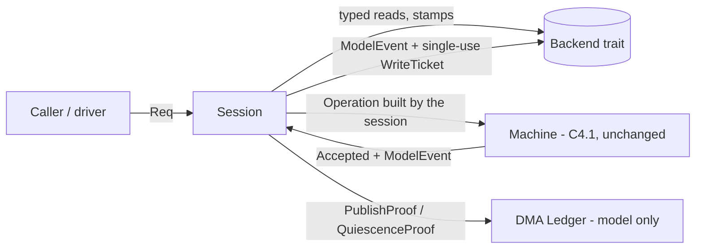

# USB.2-C4.2a: hosted backend contract

Status: verified on the host for PR review; not merged. **Hosted only.** The code lives in `kernel/rust/usb/xhci_init/`
beside the merged C4.1 model and is referenced by no kernel source, Makefile, linker input or ISO. It reads no PCI
configuration space, touches no MMIO, dereferences no physical address, enables no bus mastering, creates no DMA ring,
enumerates no device and starts no native execution. Writes exist only as `ModelEvent` values handed to a test backend.
Nothing here is evidence about real xHCI hardware. Base: `dbb7d1d06452414c9674d9f9bb4b6e08d859da59` (C4.1, PR #34).
Evidence: [`usb2c42a-hosted-backend-contract/`](usb2c42a-hosted-backend-contract/).

## 1. Result

| Gate | Result |
| --- | --- |
| Rust tests (`tests/rust/xhci_init_backend.rs`) | 51 passed; every one of 30 session closure causes, 6 session refusals and 18 ledger reasons produced |
| Independent Python session oracle (`scripts/xhci_init_oracle_session.py`) | 200 traces, 44,000 requests (18,998 accepted, 24,873 refused, 129 closures), 0 disagreements; also checks every backend call the session makes |
| Oracle corruption controls | 6 of 6 corrupted traces detected (refusal, rule, closure cause, write event, missing call, extra call) |
| Mutation controls | 138 of 138 killed: 131 by the Rust tests, 49 by the oracle, 7 by the oracle only; 0 survivors, 0 invalid |
| Compile-fail controls | 7 of 7 (proofs and tickets cannot be forged, session and machine state are private, `unsafe` rejected) |
| C4.1 regression (unchanged C4.1 gate) | 48 tests, 156,000 oracle steps with 0 disagreements, 94 of 94 mutants killed |
| Production isolation | no kernel, build or ISO input mentions the code; the production kernel and BIOS ISO built from this tree have the same stripped kernel, `grub.cfg` and file list as C3b.2 |
| Storage | tree 158.4 MB at the end (forecast 124 MB, stop line 168 MB, cap 200 MB); no step exceeded 1.25x its projection |

**Verdict: CONDITIONAL GO for merging C4.2a**, conditions in section 11. The merged C4.1 `machine.rs` and `types.rs` are
byte-for-byte unchanged (same hashes as at `dbb7d1d`); C4.2a is purely additive.

## 2. What was built

* **`backend.rs`**: the contract. `Reg` names every register with its architectural `Width`; a read returns
  `RegRead { reg, index, width, value, stamp, session }`. Every backend call (read, write or failed attempt) returns a
  `Stamp { seq, tick }` where `seq` rises by exactly one. Identity, topology and platform facts are separate typed reads.
  Writes need a `WriteTicket` that only the session can mint and that is single-use. `ReadFault` and `WriteFault` have
  named kinds; "not present" is distinct from failure.
* **`session.rs`**: the only way an observation reaches the machine. A caller cannot supply one (such a request is
  refused `use-backend-observation`). The session reads, validates and builds the machine operation itself.
* **`dma_model.rs`**: a parameterized, model-only ownership ledger. It uses no memory and no address.
* The C4.1 machine is untouched. The session reaches its terminal path with a forced controller-fault observation,
  because the machine has no backend-fault reason; adding one is a C4.2b decision, listed below.

### Session rules

| Rule | Behaviour |
| --- | --- |
| Typed reads | register identity, port index and width must match the request; all-ones reads, reserved USBSTS bits, wrong width, torn/partial/budget/lease faults close the session with a named cause; an absent optional capability does not |
| Sequence numbers | strictly consecutive, one session id, non-decreasing tick; duplicate, reordered, skipped and foreign-session responses close the session |
| Last write / last observation | `last_write_seq` follows every write attempt; per-kind validity flags (status, PCI, handoff, ports, events) |
| Invalidation | a write invalidates the observations it can change (R/S: status; BME: PCI; reset: status, ports, events; doorbell: status, events; acknowledgment: events; ownership writes: handoff; ERSTBA: status) |
| Staleness | a write whose required observations are invalid is refused `stale-observation` before the machine is consulted; the quarantine tail needs only a status read for the bus-master clear |
| Contradictions | halted cannot become running while R/S is believed clear; CNR cannot appear without a reset; bus-master state cannot change behind our back; a halted report is corroborated by USBCMD and a second USBSTS read |
| Identity and topology | bound at `bind` (exactly one complete xHCI topology); re-read before every live write; a change closes the session |
| Write path | machine decides first (a refusal costs the backend nothing), then identity/topology and the write's preconditions are re-read, then one ticket is spent and the write performed, then its read-back is checked |
| Uncertain writes | assumed to have happened in the **more exposed** direction: enabling writes are committed to the machine, disabling writes (R/S clear, BME clear, reset) are not; the register facts become `Unknown` |
| Unknown state | `Fact<T>::{Unknown, Known}` for BME, R/S and halted; an uncertain write or a failed read makes the fact `Unknown`; `Unknown` is never favourable |
| Terminal behaviour | on closure the backend is latched; afterwards only the quarantine tail (halt, observe halt, clear BME, verify) is possible, each step once; a fault inside the tail ends the tail; the first closure cause is kept |

### DMA ledger (model only)

`PoolSpec { device_limit, ac64, scratchpads, quarantine_cap, release }`; items are the four core pages, the scratchpad
array and up to 31 scratchpad buffers. States `Free, Allocated, Zeroed, Prepared, Published, DeviceOwned, Quiesced,
Quarantined, Retained`. Named refusals cover address alignment, range, overlap, 32-bit limits, double allocation, use
after release, dependency order (buffers before the array, array before the DCBAA, event ring before the ERST),
publication of an incomplete scratchpad set, **CPU access to a device-owned page**, release before quiescence, the
never-release policy, and bounded quarantine whose exhaustion closes the pool. Publication and quiescence need a proof
that only a session whose machine holds the matching state can mint.

**Scratchpad policy is provisional.** xHCI 1.2 Table 6-1 gives the Scratchpad Buffer Array a maximum of 248 bytes
(31 entries) while HCSPARAMS2 can encode up to 1,023 buffers. The ledger admits at most 31 and the discrepancy is recorded
beside the constant (`dma_model.rs`) and here; it must be resolved against the primary specification before the cap changes.
The C4.1 machine still refuses any scratchpad requirement at qualification; the ledger is not yet wired to it.

## 3. Verification

* **Deterministic tests (51)**: happy paths (260 No-Ops with consecutive sequence numbers and one ticket per write; the
  exact write sequence; a slow legacy firmware-running controller), no caller-supplied observations, bind topology,
  qualification decoding (including Debug Capability, semaphores, MSI, Enable No Snoop, attached devices, more than 16
  ports), scratchpad decode and refusal, invalidation and staleness, sequence defects (duplicate, reordered, gap, foreign
  session, clock), wrong register/width/all-ones, every read fault, contradictions, halt corroboration, identity and
  topology changes, preconditions that drift between validation and the write, firmware ownership (never released,
  regained, conflict), every uncertain-write kind for R/S clear, bus-master enable, run, reset, the tail, a fault in the tail,
  the backend's own refusals (replayed or mismatched tickets, writes after the latch), and the ledger.
* **Randomized runs**: 700 truthful and 700 fault-injected seeds x 220 steps. Per step: a refusal that is not a machine
  refusal of a completed read consumes nothing and changes nothing; freshness requirements and invalidations are checked
  against a separately declared table; nothing changes the machine after a terminal phase; after the session ends the
  backend sees only the two tail writes. Truthful runs also assert zero device violations and no closure.
* **Independent oracle**: Python, written from the rule tables with its own state, on top of the already independent C4.1
  Python machine oracle. For each request it predicts which backend calls are made, in order, and the outcome (machine
  transition or named refusal, and whether and why the session closed). Same author, same session: the independence is
  structural.
* **Mutation controls (138)**: stamps and typed reads, dispatch and terminal gating, bind/qualify/time, every observation
  decoder, the requirement, invalidation, precondition and read-back tables, ticket handling, commit direction for uncertain
  writes, proofs, and the whole ledger. All killed; 7 are visible only to the oracle (they change the sequence of reads,
  not an outcome the Rust tests assert).

### Recorded negative cases (software cannot detect these; the tests assert the limitation)

1. **A change after the last check is not prevented.** The device starts running after the precondition re-read and
   before the store; the write succeeds and the device model records a bus-master clear while running. Sequence numbers and
   re-reads narrow the window; they do not close it.
2. **A consistent liar is not detected.** A controller that never halts but reports `HCH=1` on every read while USBCMD
   truthfully shows R/S clear passes the corroboration; the session proceeds on a false halt.

## 4. Failed attempts (preserved)

| Attempt | Outcome |
| --- | --- |
| Mutation gate run 1 | **failed**: 128 of 138 killed, 10 survivors, each a real test gap (halt belief on fault, Debug Capability and BIOS-owned decoding, MSI after qualification, device attached during reset, port bit, CNR recheck, read-back of the wrong register, DCBAA-array dependency). Directed tests added; nothing weakened |
| Mutation gate run 2 | **failed**: 137 of 138, one survivor (`pci-belief-not-recorded`), masked by the verified-write path; a directed test added |
| Oracle first run | 2 mismatches, both a defect in the oracle (Python short-circuit stopped reading ports); the Rust session was right and unchanged |
| Development | the first test run found a real session bug: "halted to running is impossible" must only hold while R/S is believed clear; fixed in the session |

Run 3 passed (kept as `gates-3`) but was superseded: the secret audit flagged an identifier containing the word
"access" before a `=>` and a long string (the pattern behind the C3b.2 CI failure), so the variant was renamed to
`CpuTouchOfDeviceOwned` instead of adding an ignore entry, and the whole gate was repeated. **Run 4 (`gates-4`) is the evidence
of record** and is identical in every count.

## 5. Resource measurements (hosted objects, never linked)

Compiled with the kernel's flags (`x86_64-unknown-none`, `panic=abort`, `opt-level=2`, kernel code model), objects only
(no staticlib, no bundled `core` archive), `Session` instantiated over a stub backend:

| Quantity | Measured |
| --- | --- |
| Model object (machine, types, backend, ledger) | `.text` 10,895 B, `.rodata` 11,829 B (includes name tables) |
| `Session<Stub>` instantiation | `.text` 16,394 B, `.rodata` 1,478 B |
| Total new C4.2a code over C4.1 | about 27.3 KB text; named read-only data 2,568 B plus name tables |
| Largest function | `Session::write` 4,090 B; `Machine::apply` 2,027 B |
| Largest model stack frame | `Session::write` **632 B** (above the 512 B ceiling used by earlier stages; a finding) |
| Type sizes | `Session<Stub>` 328 B, `Machine` 200 B, `Ledger` 600 B, `Done` 48 B, `RegRead` 32 B, `WriteTicket` 24 B |
| Source added | 1,420 lines (`backend.rs` 240, `session.rs` 886, `dma_model.rs` 294) |

The backend itself (PCI, MMIO, DMA services) is not included; a real link measurement is C4.2c's job. The Gate 0
planning figures (24,576 B / 4,096 B) were not consumed. The new code is about 27 KB of text, so it does not fit a
4 KiB production budget; it belongs in test images only until promoted. `Session::write` would need a frame ceiling of
at least 640 B or a restructuring (it holds a trial `Machine` copy) before it can run on a 16 KiB thread stack alongside
the rest of a call chain.

## 6. Storage compliance

Admission: the owner confirmed Antigravity's acceptance (forecast 124 MB, stop line 168 MB, cap 200 MB); no separate
Antigravity record exists in the repository and the confirmation is recorded in `storage/storage-forecast.md`. Every step ran
through `guard.sh` with a projection from the unit-cost table and a post-step measurement; the 1.25x trigger never fired
(worst step 0.98x). Final tree 158.4 MB (94 % of the stop line, 79 % of the cap), 28 % above the 124 MB forecast: the forecast
counted three gate runs and no C4.1 regression run; the work needed four C4.2a gate runs (two failed and kept, one
superseded), a C4.1 regression run (19.6 MB) and the first worker build (20 MB). The stop line was not crossed; the
remaining margin is 9.6 MB, so no further heavy step is possible without a new storage decision. Compiler archives were avoided: measurement wrote 1.3 MB
(C4.1: 17-28 MB). Worker caches were reused in place. Nothing was deleted, pruned, moved or compacted.

## 7. Isolation

* The static scan fails the gate if any tracked file outside the model, its tests, scripts and docs names the model; the
  new files were staged before the scan was run (the C4.1 CI lesson).
* `#![no_std]`, `#![forbid(unsafe_code)]`; no `unsafe`, `extern`, `asm!`, `std::`, `alloc::`, `static mut` (checked).
* The production kernel and BIOS ISO built from this tree: flat loaded image `f96f4ddb…`, stripped ELF `d09e73e8…`
  and `PT_LOAD` table equal to C3b.2 and to the C4.1 record; ISO size, 313 file names, `grub.cfg` and the kernel payload
  (after debug stripping) equal to C3b.2's ISO; no model symbol or test-image marker in the kernel. The raw ISO differs in
  5,370 bytes (debug-path strings and ISO timestamps). See `isolation/identity.json`.
* No new write path, no controller initialization, no bus-master enablement, no DMA activation, no native execution, no HID.

## 8. Source identities

Base `dbb7d1d06452414c9674d9f9bb4b6e08d859da59`. SHA-256 prefixes (full values in the manifest and `gates-4/result.json`):
`backend.rs` `24d3e06c…`, `session.rs` `7547a81c…`, `dma_model.rs` `486caca7…`, `lib.rs` `82a94872…`, `machine.rs`
`9e12dd1f…` (unchanged), `types.rs` `32ba0c00…` (unchanged), `xhci_init_backend.rs` `f0a058d3…`,
`xhci_init_backend_support.rs` `32027f96…`, `xhci_init_oracle_session.py` `188596e7…`, `test-usb2c42a.py` `423ef4c9…`.
Toolchain: rustc `nightly-2026-09-03`, the kernel's own.

## 9. Remaining trust limitations

1. Sequence numbers order what the backend did. They are **not** proof of freshness against asynchronous hardware or
   firmware (SMM, autonomous device state changes, attachment); see the recorded negative cases.
2. A controller that reports false values consistently cannot be detected by software; only a second, independent
   evidence path helps.
3. Software ownership (the ledger) is bookkeeping. With bus mastering on and no IOMMU a device can reach any physical
   address regardless of it.
4. Observations of IOMMU, Debug Capability and Enable No Snoop are only as good as the backend that supplies them; no
   such detection exists in the kernel yet (C4.2b).
5. The tested backend is a model written for these tests. Agreement shows consistency with the encoded behaviours, not
   conformance of any controller.
6. Not tested: physical hardware, KVM, any kernel execution of this code, real timing, scratchpads, USBLEGSUP, Debug
   Capability, IOMMU; the missing PCIe, ACPI, IOMMU, UEFI and vendor specifications are unchanged from earlier reviews.

## 10. Prerequisites for C4.2b (separate authorization each)

1. A native read-only backend over the existing BAR lease that satisfies this contract: stamped reads, one aligned access
   per register, 64-bit reads as hi-lo-hi, no cached value, no retry, and the write surface compiled out.
2. Read-only IOMMU (DMAR/IVRS), Debug Capability and extended-capability detection; ACPI tables above 1 GiB need a new
   read-only firmware-table window, until then those facts stay `Unknown`.
3. A machine reason for backend faults (today the session forces a controller-fault observation), and wiring of the
   ledger and scratchpad plan to the machine; resolve or keep the 31-scratchpad cap against the primary specification.
4. A frame-size decision for `Session::write` (632 B) and a link measurement (C4.2c) before any budget is proposed.
5. The experimental-image flavour and checker generalization from the C4.2 Gate 0, and a storage plan that carries the
   unit-cost table forward.
6. The physical-input risk (loss of firmware USB-to-PS/2 emulation at handoff) stays open for any physical stage.

## 11. Recommendation

**CONDITIONAL GO to merge C4.2a**: CI green on the PR head (both workflows), the secret audit clean, owner acceptance that
this is a hosted contract with the limits in section 9, and the storage state in section 6 recorded. Merging authorizes
no write, no DMA, no native execution and no later stage.
